Tout fan de trains 9V LEGO est déjà un jour ou l’autre confronté au problème de rareté et de disponibilité des rails compatibles avec ce système. [FxBricks](https://shop.fxbricks.com/pages/fx-track), un nouveau fabricant, vient à point nommé pour palier à ce problème.

Les rails FxBricks sont _compatibles_ LEGO évidemment, le fabricant promet monts et merveilles :

-   plastique ABS **résistant aux UV**, couleur Dark Bluish Gray moderne
-   rails en Nickel, plaqué avec un alliage Copper-Beryllium, **résistant à la corrosion**
-   rails **compatibles avec le système L-Gauge** (_personnellement, n’étant pas un pro des trains LEGO, je ne connaissais pas_)

Dans ce petit test, nous allons voir en détail un de leur produit, les rails droits S32 référence 8832, et vérifier comment ils se comportent avec les anciens rails LEGO.

## #La Boite

Tout d’abord, commençons par l’emballage. Les rails sont livrés dans une boite rectangulaire de bonne facture. On voit le modèle de rail, sa référence, la quantité dans la boite.

[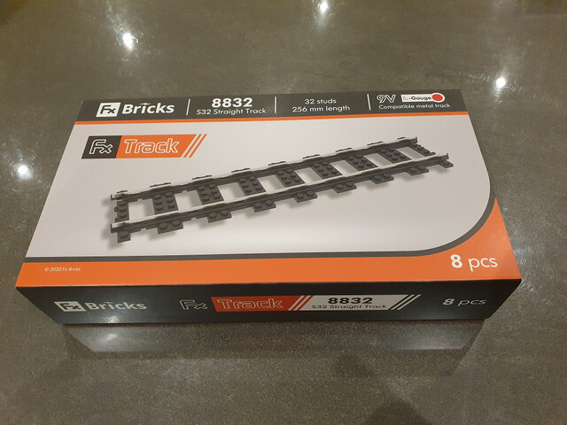](https://www.freelug.org/IMG/jpg/boite_recto.jpg)

**Boite Recto**

DOAN Duy Hai

Côté verso, on voit quelques descriptions du produit mais surtout l’explication du système de notation **Rxx**.

[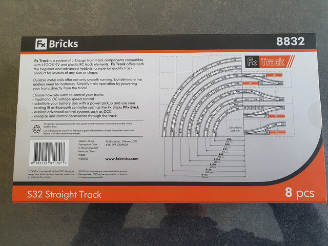](https://www.freelug.org/IMG/jpg/boite_verso.jpg)

**Boite Verso**

DOAN Duy Hai

Un petit zoom sur l’explication du système de courbure **Rxx**

[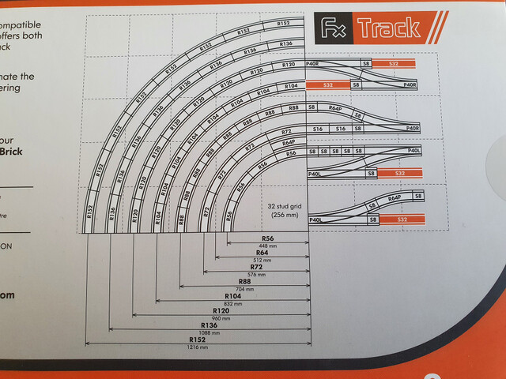](https://www.freelug.org/IMG/jpg/boite_verso_zoom.jpg)

**Système de courbure Rxx**

DOAN Duy Hai

Essentiellement, la valeur R**xx** détermine le rayon de courbure. Lorsqu’on met ensemble les rails courbes jusqu’à ce qu’ils forment un quart de cercle (90°), la valeur **xx** représente _la distance en tenons entre le centre du cercle et le **milieu** du rail_.

Les rails courbes LEGO standard sont du R56 (ref. 2867) mais FxBricks proposent plusieurs modèles de courbure pour faire des circuits plus complexes.

## #Le prix

Pour info, j’ai payé 59,99€ ces rails, plus 12,99€ de frais de port, ce qui donne un total de 72,98€.

Il y a 8 rails de longueur double par rapport au modèle LEGO, donc équivalent 16 rails droits LEGO.

Sans compter les frais de port, cela revient à un équivalent de **3,75€ le rail NEUF**.

Avec les frais de port, ça revient à **4,56€ le rail NEUF**.

Par comparaison, à la date à laquelle j’écris cet article (12/11/2021), pour une quantité minimale de 16 rails droits, **état NEUF**, le prix le moins cher sur Bricklink est de **6,55€**

On voit donc que pour les gros amateurs de trains 9V, avec une commande groupée de plusieurs packs de rails, économiquement c’est un bon plan.

## #Déballage

[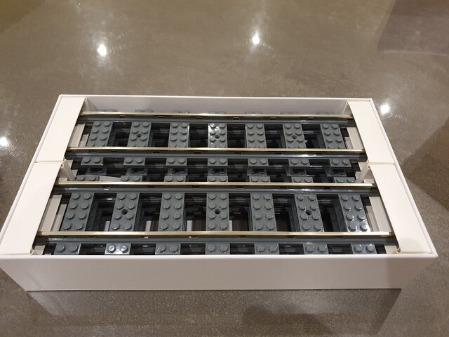](https://www.freelug.org/IMG/jpg/boite_ouverte.jpg)

**Boite Ouverte**

DOAN Duy Hai

Une fois déballé, nous voyons 2 lignes de rails tenus par des cartons à chaque bout. Ce sont des rails droits de **32 tenons** de longueur, soit la longueur **double** des rails droits standards LEGO (ref. 2865).

[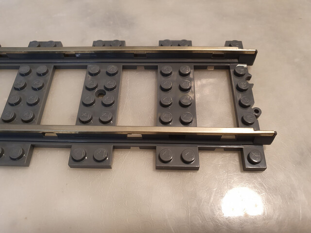](https://www.freelug.org/IMG/jpg/rail_zoom.jpg)

**Zoom sur Rail**

DOAN Duy Hai

En regardant de près, on voit que la forme générale est identique aux rails LEGO originaux, y compris le système pour emboîter les rails les uns aux autres.

[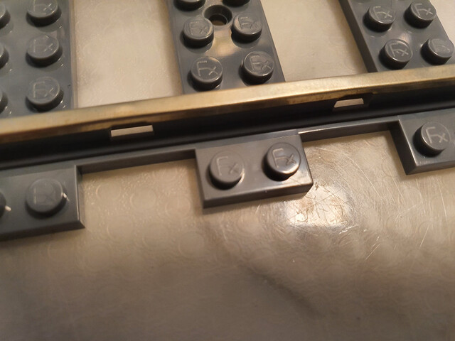](https://www.freelug.org/IMG/jpg/rail_tenon.jpg)

**Logo sur Tenons**

DOAN Duy Hai

Petit détail marrant, le fabricant se paye le luxe d’imprimer son propre logo Fx sur les tenons, de la même manière que LEGO.

## #Test

Nous passons dans le vif du sujet, le test de ces rails.

## ##Clutch Power

Premier point, le **clutch power**. Je ne mets pas de photo car non pertinent pour ce test. Mais après plusieurs essais sur plusieurs rails différents (_pour écarter la malchance de tomber sur un exemplaire défectueux_), je peux vous dire que le clutch power est beaucoup plus faible par rapport aux rails originaux.

Ceci peut être un souci ou pas, en fonction de vos montages de circuits. Si vous comptez mettre beaucoup d’éléments de décors sur les rails eux-même (typiquement les ballast), ça devrait aller.

Par contre, si vous comptez mettre des éléments de structure sur ces nouveaux rails, genre poteaux ou autre, il faut absolument prévoir un renforcement supplémentaire (_avec une prise au sol plus importante par exemple_).

Concernant l’emboitement entre 2 rails, que ce soit les nouveaux rails FxBricks ou avec les anciens rails LEGO, le **clutch power** est identique (car le système d’attache est différent des tenons). De ce côté là pas de souci.

## ##Colorimétrie

[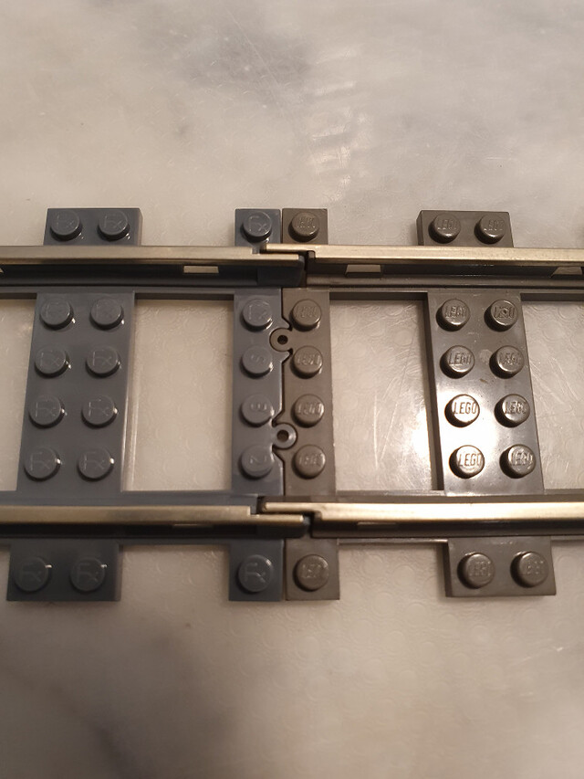](https://www.freelug.org/IMG/jpg/rail_clipse_.jpg)

**Rails clipsés**

DOAN Duy Hai

Quant à la couleur, évidemment on voit une différence lorsque c’est mélangé avec les anciens rails officiels car ces derniers sont dans l’ancienne teinte Dark Gray.

[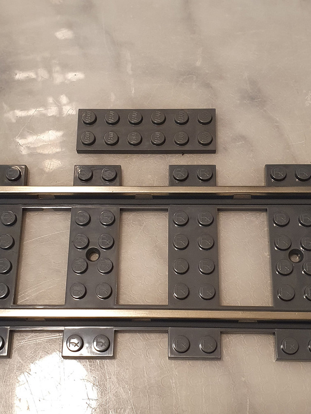](https://www.freelug.org/IMG/jpg/rail_dark_bluish_gray.jpg)

**Comparaison de teinte**

DOAN Duy Hai

Mis côte à côte avec un plate en nouveau Dark Bluish Gray, on ne distingue aucune différence de teinte à l’oeil nu. C’est un bon point !

## ##Effet de torsion

[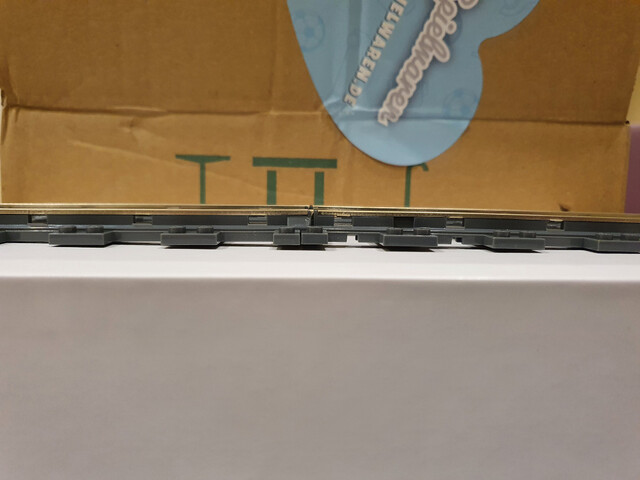](https://www.freelug.org/IMG/jpg/rail_sure_leve_1.jpg)

**Effet de torsion 1**

DOAN Duy Hai

[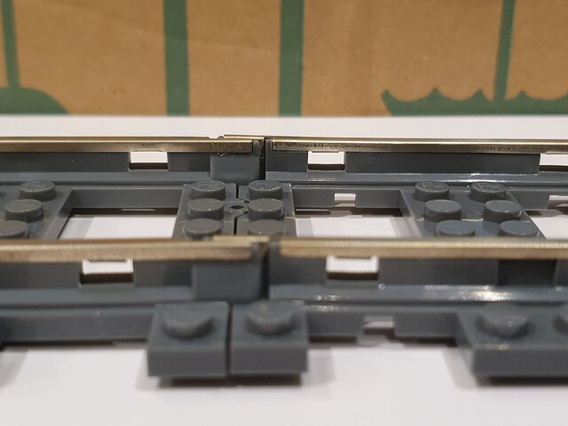](https://www.freelug.org/IMG/jpg/rail_sure_leve_2.jpg)

**Effet de torsion 2**

DOAN Duy Hai

Lorsqu’on clipse ensemble 2 rails FxBricks, on se rend compte d’un léger effet de **torsion**, qui sur-élève un peu les rails au niveau de l’interconnexion.

Avec les anciens rails, je ne constate pas ce défaut. Est-ce parce qu’ils sont plus tolérants et ont un jeu plus important au niveau de la connexion entre les tiges métalliques ? Difficile à dire.

A l’usage, comme je mélange ces nouveaux rails FxBricks avec mes anciens rails originaux, l’ensemble du circuit, sous l’effet du poids, reste bien collé au sol. Mais j’imagine que si l’on a un circuit exclusivement avec les rails FxBricks, cet effet de torsion se verrait beaucoup plus.

Je dirais que c’est un point à surveiller effectivement. Je mettrai à jour cet article lorsque j’aurai les rails courbes FxBricks R56.

## ##En selle Marcel !

[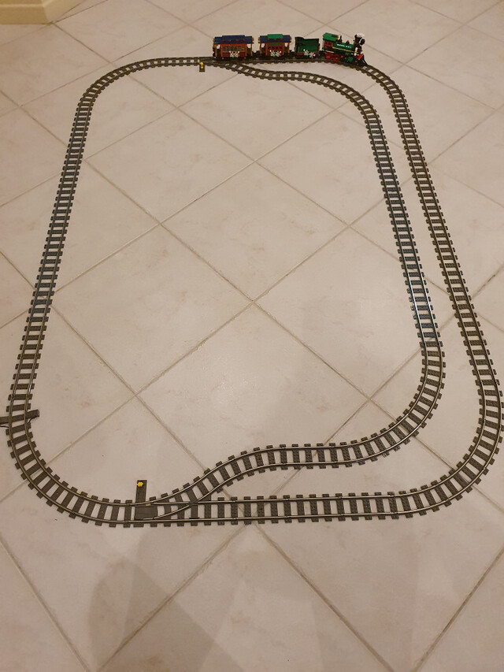](https://www.freelug.org/IMG/jpg/rails_en_action.jpg)

**En Action !**

DOAN Duy Hai

[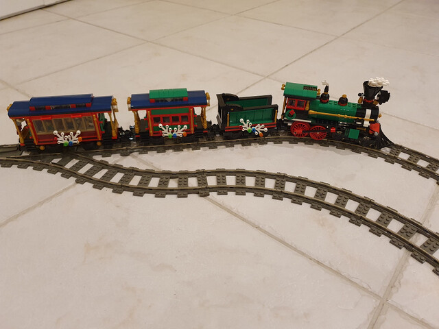](https://www.freelug.org/IMG/jpg/zoom_sur_le_train.jpg)

**Petit train de Noël**

DOAN Duy Hai

Voici le circuit complet avec les rails FxBricks (ils sont utilisés sur la ligne droite de gauche et du milieu).

A l’usage, aucun souci, le train roule parfaitement dessus. N’ayant pas de matériel électronique de précision, je n’ai pas pu tester la conductivité électrique (résistance donc) de ces nouveaux rails. Si quelqu’un de la communauté a cette information, qu’il ou qu’elle se manifeste.

## #Conclusion

Ma première impression, après l’usage, c’est que ces rails complémentent bien mon circuit existant. La qualité est au rendez-vous, modulo le petit souci de torsion sus-mentionné.

Sur le marché secondaire, les rails courbes R56 originaux, état NEUF, sont disponibles à partir de 0,75€ donc l’offre de FxBricks ne sera pas du tout pertinente. Pour un amateur de trains 9v comme moi, le combo idéal serait d’acheter les rails droits chez FxBricks et de continuer les rails courbes originaux LEGO.

Le seul intérêt des rails courbes FxBricks c’est pour les rayons de courbure non standards pour les pros de trains 9v. Les courbures R72 et R88 sont d’ores et déjà disponibles à l’achat sur le site de [Jb Spielwaren](https://www.jb-spielwaren.de/fx-bricks/) et les autres courbures seront prochainement disponibles.

Sur leur site/blog, ils annoncent également une future disponibilité :

-   des rails échangeurs gauche/droite
-   des nouveaux moteurs compatibles 9v

Personnellement, c’est ces 2 derniers éléments qui m’intéressent le plus. Je ferai un autre article de test dès qu’ils seront disponibles en commande.
