Vidiyo la gamme de LEGO qui nous fait devenir un créateur de clip musicaux... ou pas

Tout commence par un beau matin, où je vois deux sets de la gamme Vidiyo à 50%, je me dis tiens si on testait cette gamme qui ne m’attirait pas plus que ça.  
Chose faite, je prends donc les deux boites la numéro 43111 et la 43112. Je ne vais m’étendre sur l’application et la création de clip musicaux, qui n’a que peu d’intérêt.

Le packaging est quand même très sympa, et bien coloré. Sur ce point-là, le constructeur Danois sait y faire.

[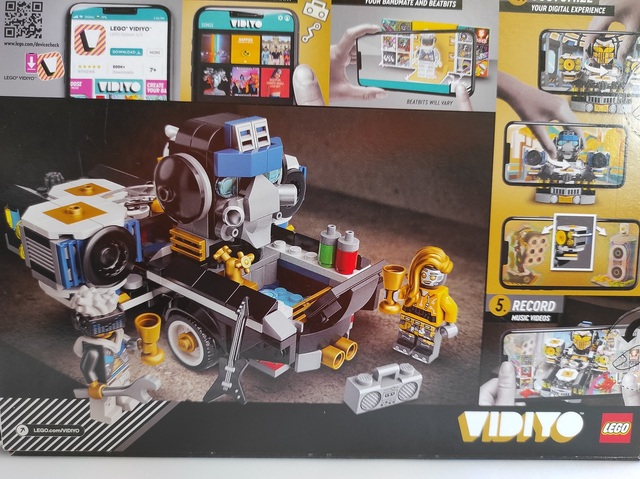](https://www.freelug.org/IMG/jpg/2-12.jpg)

[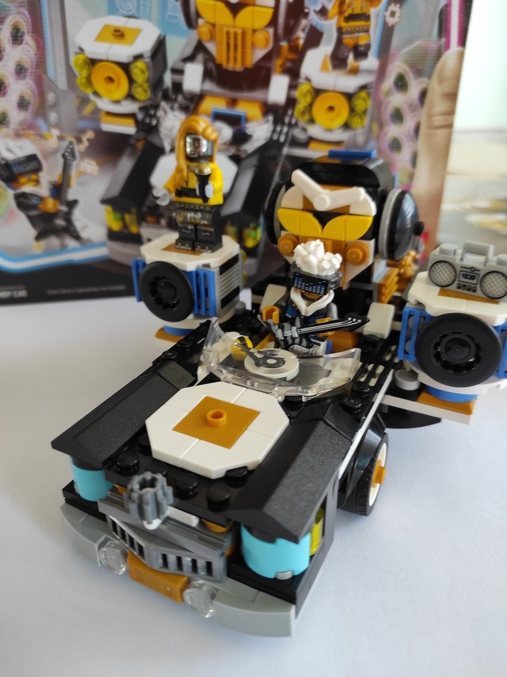](https://www.freelug.org/IMG/jpg/3-12.jpg)

Chaque set est composé de 3 sachets bien garnis, le set 43111 contient 344 pièces et le set 43112 contient 387 pièces (mea culpa j’ai perdu les photos du montage du set 43111).

[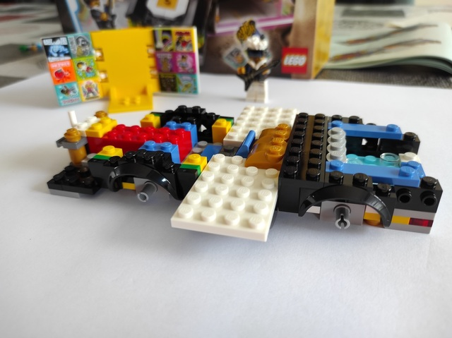](https://www.freelug.org/IMG/jpg/10-6.jpg)

[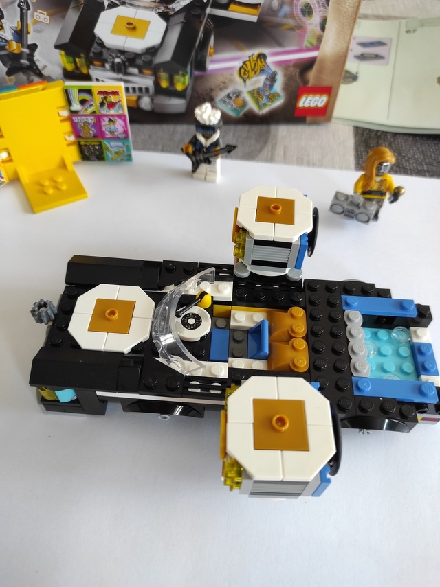](https://www.freelug.org/IMG/jpg/11-4.jpg)

Au niveau montage, l’expérience reste sympathique, même pour les habitués. Les finitions des sets sont correctes, il suffit de voir la baignoire dans la voiture. C’est tellement délire, comme toute la gamme d’ailleurs. Les techniques utilisées sont très sympas et intelligentes sans être les meilleures du monde (je ne spoile pas bien sûr).

[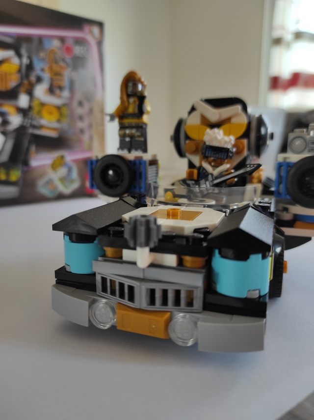](https://www.freelug.org/IMG/jpg/4-11.jpg)

[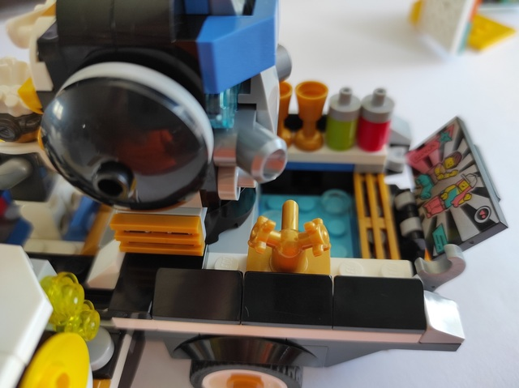](https://www.freelug.org/IMG/jpg/5-7.jpg)

[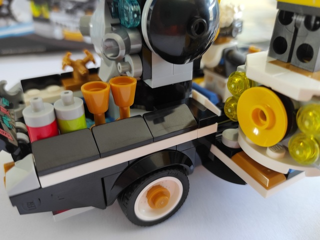](https://www.freelug.org/IMG/jpg/6-5.jpg)

[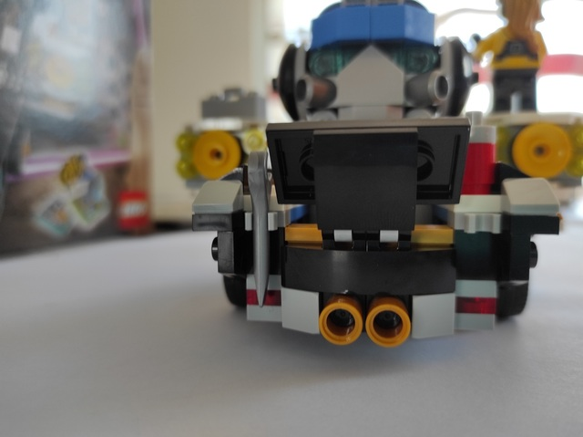](https://www.freelug.org/IMG/jpg/7-5.jpg)

[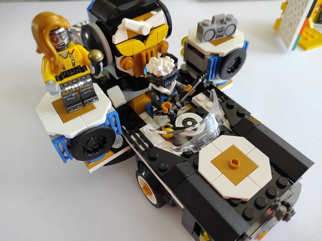](https://www.freelug.org/IMG/jpg/8-6.jpg)

[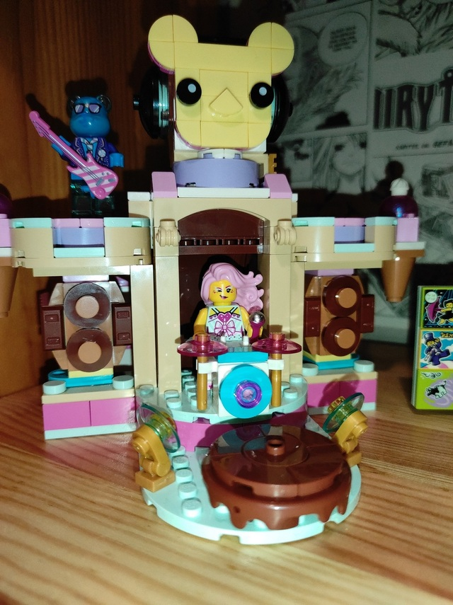](https://www.freelug.org/IMG/jpg/3b.jpg)

[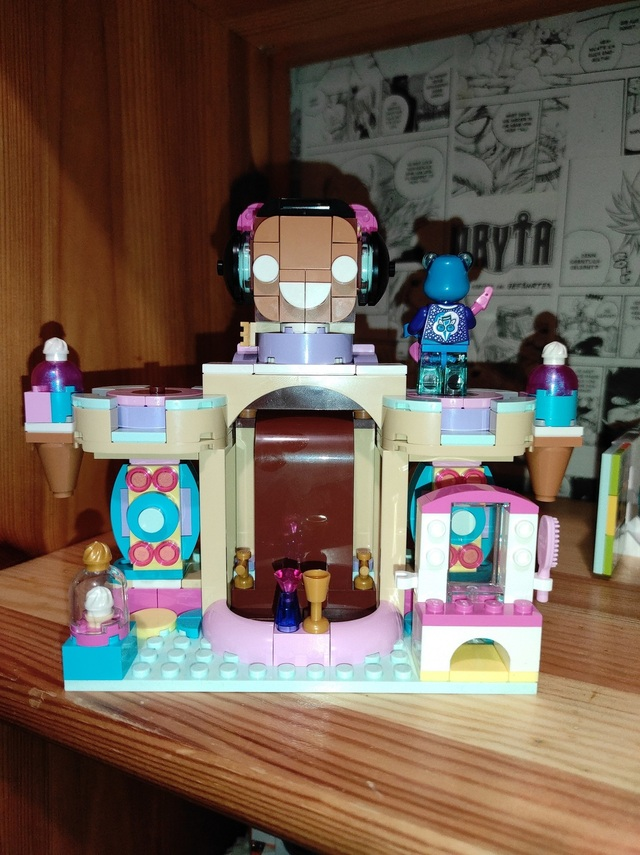](https://www.freelug.org/IMG/jpg/5b.jpg)

[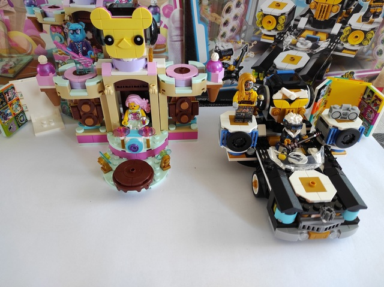](https://www.freelug.org/IMG/jpg/16.jpg)

L’énorme point positif de cette gamme ce sont les minifigs, elles sont carrément magnifiques, leur qualité est au top, les tampographies sont de très bonne qualité et la variété de personnages est là (bon la gamme est en fin de vie donc...).

[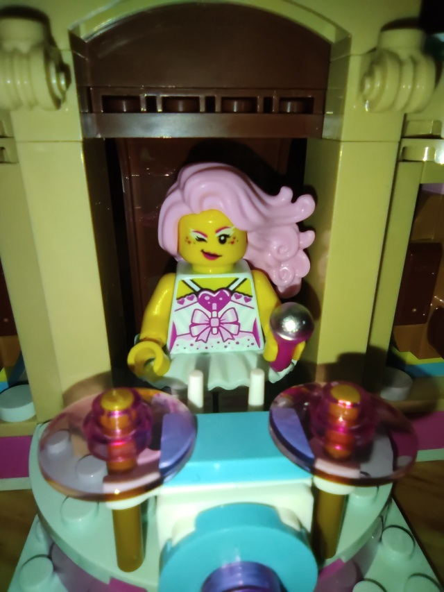](https://www.freelug.org/IMG/jpg/14-4.jpg)

Le gros point négatif c’est le fait d’utiliser une application. Qui serait prêt à mettre un téléphone en plus des briques chez nos têtes blondes ? Pas moi en tout cas, c’est ce qui fait que la gamme ne se vend pas bien. Et le deuxième point négatif, le prix, bien trop cher, le rapport prix / kilos n’est pas bon du tout pour un produit sans licence, autre que la licence LEGO.

Pour conclure sur ces 2 petits sets, ils sont sympathiques, détaillés (dans la mesure de leurs prix bien sûr), les minifigs sont magnifiques. Mais par contre, ne pas l’acheter plein pot. On les trouve a 50% régulièrement.

Merci de m’avoir lu.

André RIBEIRO
