Une petite semaine à fuir la grisaille du quotidien sur un paquebot MSC, et en vadrouillant parmi les différentes boutiques à bord, une stratégiquement bien placée en face de la piscine couverte a attiré mon attention. Quelques boites LEGO dont, une boite exclusive 40318 MSC Cruise sortie cette année, et vendue uniquement à bord !

**La boite**

De façon classique, on peut y voir le set monté sur la face avant. Sur la face arrière, deux photos du modèle original (le MSC Meraviglia), deux photos du set en situation de croisière, et les dimensions réelles en comparées à un Boeing et la Statue de la Liberté.

[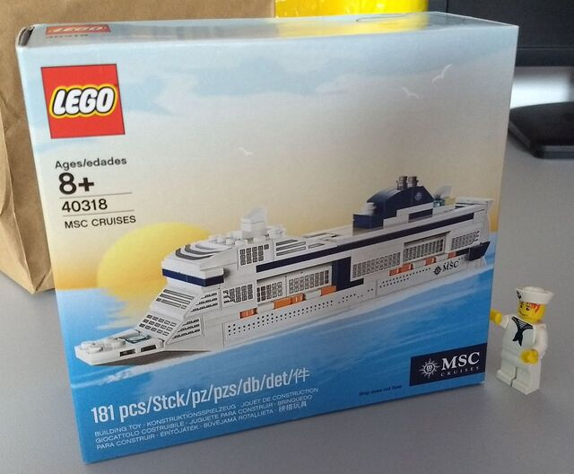](https://www.freelug.org/IMG/jpg/img_20191014_111426824.jpg)

[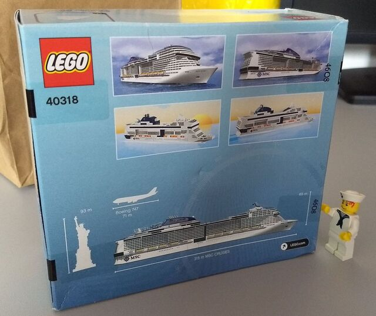](https://www.freelug.org/IMG/jpg/img_20191014_111438781.jpg)

**Le contenu**

Une fois ouverte, vous y trouverez la notice, 3 sachets de pièces non numérotées, et la planche de 30 autocollants/stickers ! Ce qui fait un ratio d’un sticker pour 6 briques, on sait par avance que l’on va en coller ! Pas de minifig fournie avec le set (bien que le petit marin qui accompagne mes photos aurait pu être sympa).

[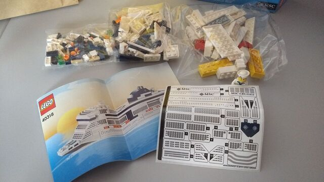](https://www.freelug.org/IMG/jpg/img_20191014_141927194.jpg)

[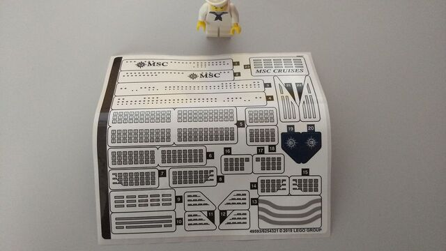](https://www.freelug.org/IMG/jpg/img_20191014_142059022.jpg)

**La construction**

Pas besoin de trier les pièces, on vide les 3 sachets directement dans un petit couvercle, et c’est partie pour une construction classique. On suit pas à pas les étapes et rapidement, la forme globale du navire se profile. On remarque vite la tendance de LEGO du remplissage avec des couleurs vives qui ne se verront rapidement plus du tout.

[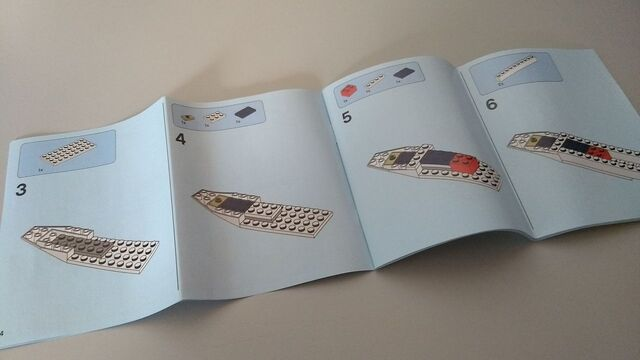](https://www.freelug.org/IMG/jpg/img_20191014_142352066.jpg)

[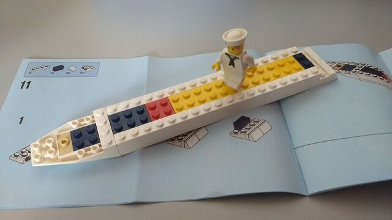](https://www.freelug.org/IMG/jpg/img_20191014_151549084.jpg)

Au fur et à mesure de l’avancement, on reconnaît le pont avec ses canots de sauvetage orange.

[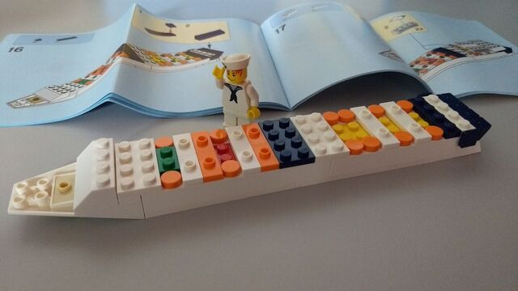](https://www.freelug.org/IMG/jpg/img_20191014_152432466.jpg)

Puis l’ensemble des ponts où se situent les cabines passagers. Et le pont des activités, restaurants et autres moments à occuper sur un tel navire !

[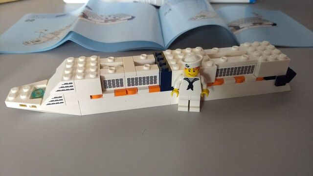](https://www.freelug.org/IMG/jpg/img_20191014_154142039.jpg)

[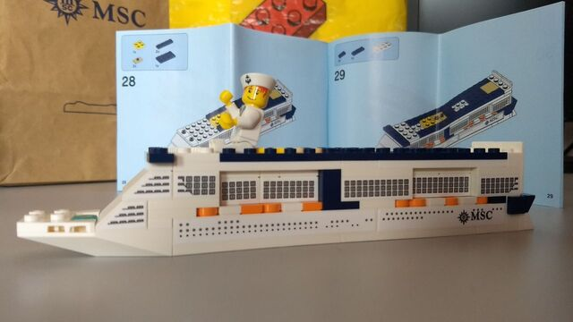](https://www.freelug.org/IMG/jpg/img_20191014_160116714.jpg)

Puis vient l’assemblage des éléments de support de la cheminée, là encore deux petites pièces colorées qui disparaîtront dans la structure. La passerelle proéminente avec ses cabines "Yatch Club", et enfin tout le pont arrière avec sa forme bien particulière.

[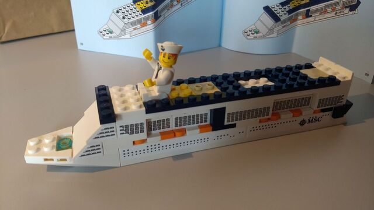](https://www.freelug.org/IMG/jpg/img_20191014_160157753.jpg)

[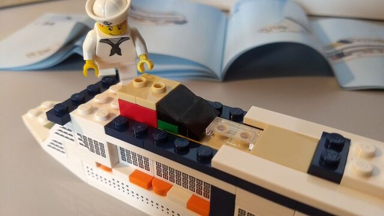](https://www.freelug.org/IMG/jpg/img_20191014_160501679.jpg)

[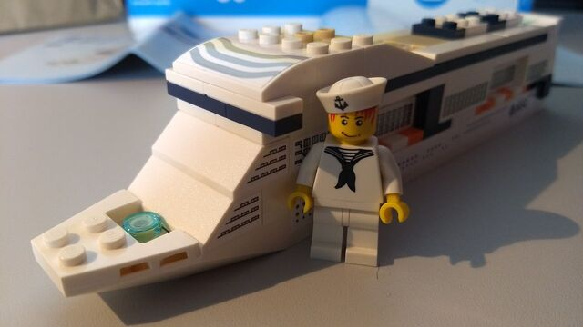](https://www.freelug.org/IMG/jpg/img_20191014_160847745.jpg)

[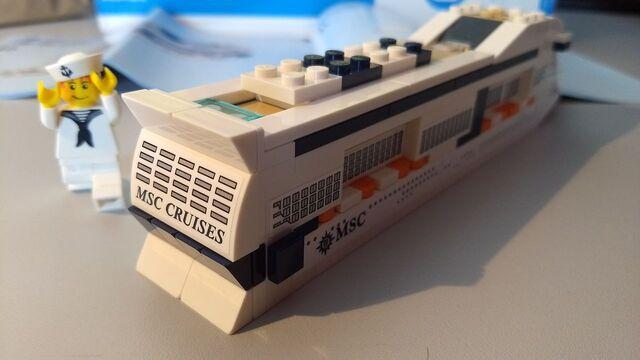](https://www.freelug.org/IMG/jpg/img_20191014_160927530.jpg)

Ce navire ne flotte pas ! C’est d’ailleurs précisé sur la boite, mais c’est un modèle d’exposition/jeu et le dessous de la coque est terminé par des "rounds plates lisses".

[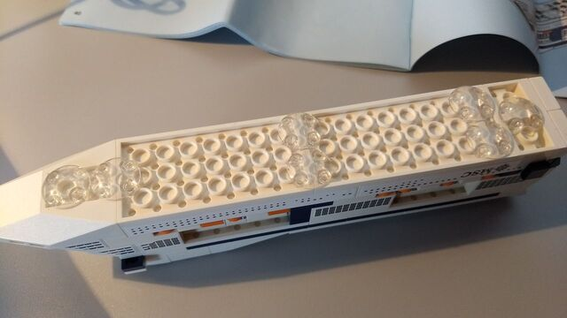](https://www.freelug.org/IMG/jpg/img_20191014_161843941.jpg)

**Conclusion**

On termine par quelques finitions, comme l’ajout des imposantes cheminées, des dômes de radar et les portes antennes.  
Le navire a une belle allure dans son ensemble, et on peut s’amuser à le comparer à son homologue réel. Quelques concessions ont été nécessaires (comme la position de la passerelle, ou l’absence de la 3e cheminée) et un choix étrange de la piscine centrale en "trans-clear" au lieu de bleu. La multitude de stickers contribuent à donner un rendu réaliste malgré l’échelle, mais nécessite une bonne dose de patience.

[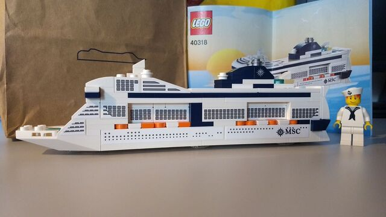](https://www.freelug.org/IMG/jpg/img_20191014_162706309.jpg)

Quelques "extra-parts", et à bord du MSC (pas celui-ci) où j’ai pu avoir cette boite, une petite promotion permettait d’avoir le sachet 30364.

[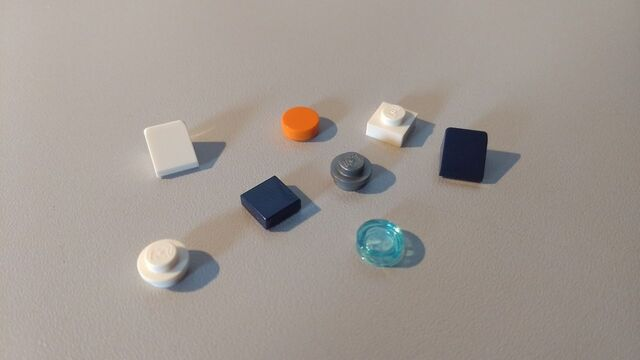](https://www.freelug.org/IMG/jpg/img_20191014_162752690.jpg)

[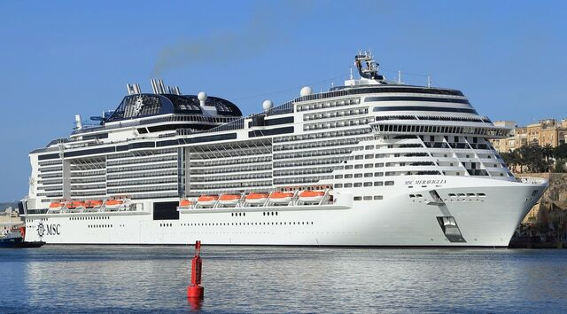](https://www.freelug.org/IMG/jpg/msc_meraviglia_grand_harbour_malta_20180307_03__cropped_.jpg)

* * *

Voir aussi la revue du [40227 - MSC Meraviglia](/articles/le-meraviglia-un-paquebot-pas-si-grand/)
