Aujourd’hui je vous propose la review du set 60134 dans la gamme City : le parc de loisir. Ce set sorti en 2016 est composé de 157 pièces, dont un chien, un bébé et 14 personnages.  
Le prix est de 40€ soit un ratio de 0,25€ la pièce.

Donc ce set vaut-il son prix ? Est-ce un set à minifig ? Le chien va-t-il manger le hot-dog ? La réponse à la fin de cette revue.

**Commençons donc par la boite :**

[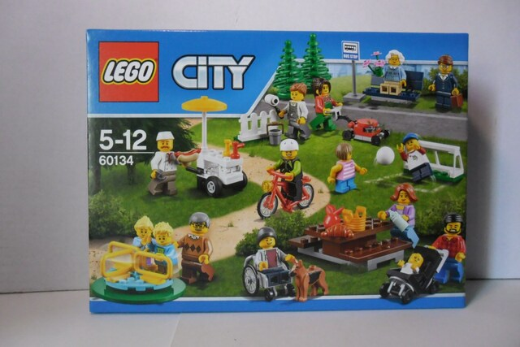](https://www.freelug.org/IMG/jpg/lego-60134-v01.jpg)

[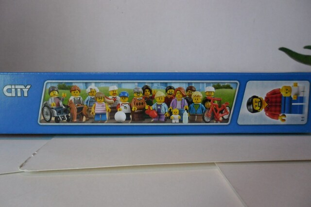](https://www.freelug.org/IMG/jpg/lego-60134-v02.jpg)

[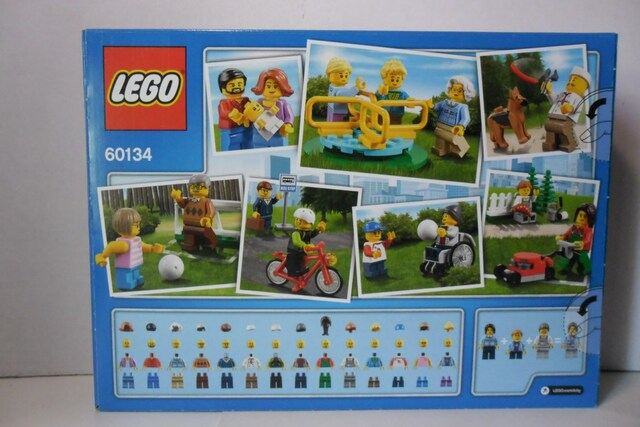](https://www.freelug.org/IMG/jpg/lego-60134-v03.jpg)

donc un aperçu de toute les minifigs, de son contenu et des possibilités de mixs.

Contenu de la boite ?

[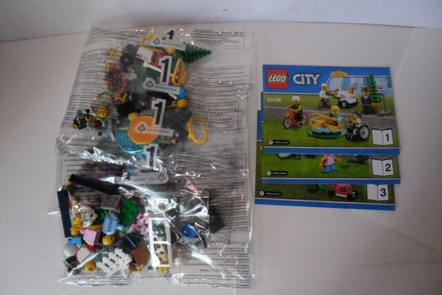](https://www.freelug.org/IMG/jpg/lego-60134-v04.jpg)

Soit trois sachets et trois notices, rien que ça...  
Par contre : pas de stickers ! C’est super je trouve...

Voici le contenu du premier sachet :

[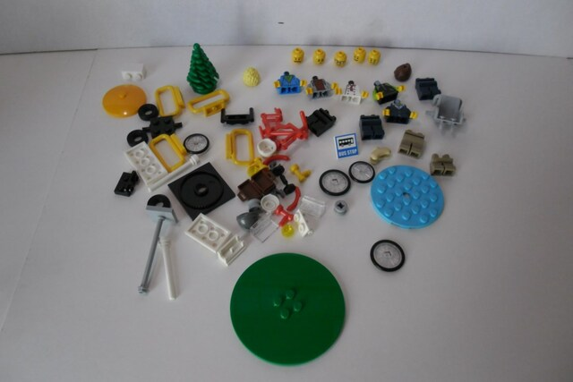](https://www.freelug.org/IMG/jpg/lego-60134-v05.jpg)

et le montage de différentes scénettes :

[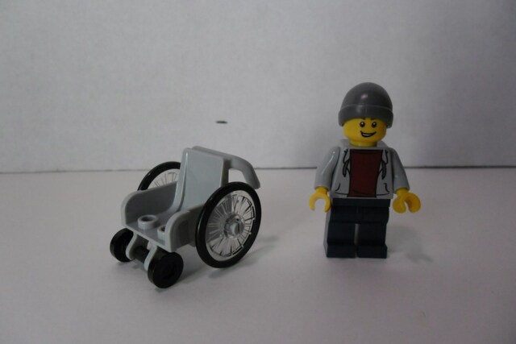](https://www.freelug.org/IMG/jpg/lego-60134-v06.jpg)

[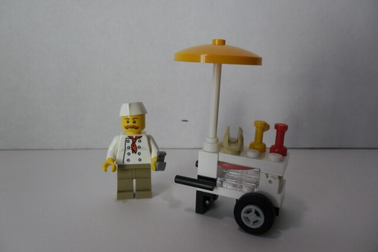](https://www.freelug.org/IMG/jpg/lego-60134-v07.jpg)

[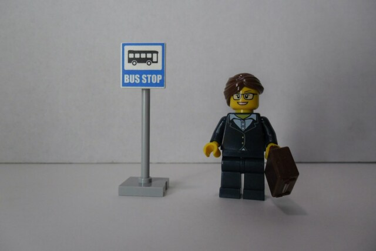](https://www.freelug.org/IMG/jpg/lego-60134-v08.jpg)

[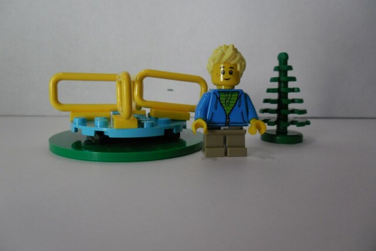](https://www.freelug.org/IMG/jpg/lego-60134-v09.jpg)

[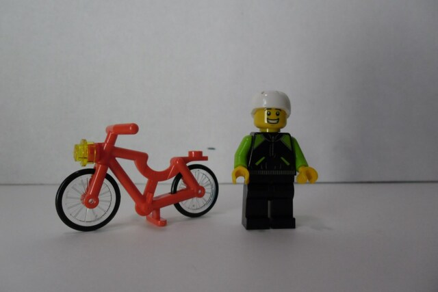](https://www.freelug.org/IMG/jpg/lego-60134-v10.jpg)

Passons au sachet 2 :

[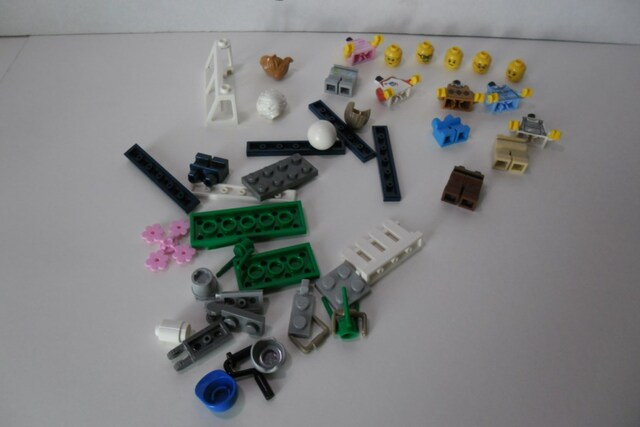](https://www.freelug.org/IMG/jpg/lego-60134-v11.jpg)

avec ses mini scénettes :

[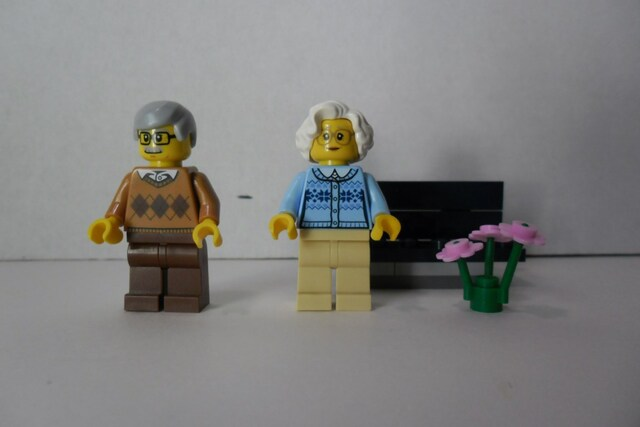](https://www.freelug.org/IMG/jpg/lego-60134-v12.jpg)

[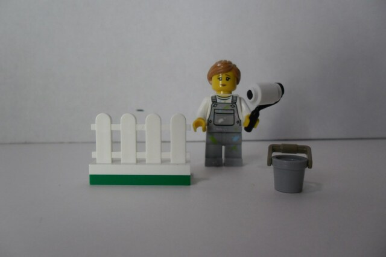](https://www.freelug.org/IMG/jpg/lego-60134-v13.jpg)

[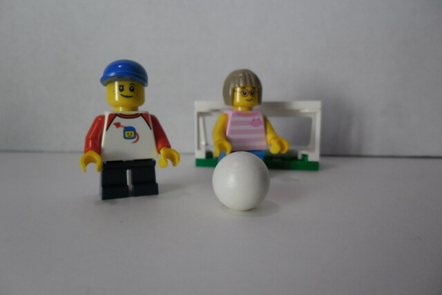](https://www.freelug.org/IMG/jpg/lego-60134-v14.jpg)

Hop le dernier sachet :

[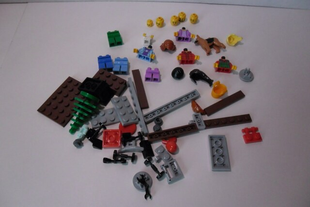](https://www.freelug.org/IMG/jpg/lego-60134-v15.jpg)

avec ses mises en scènes :

[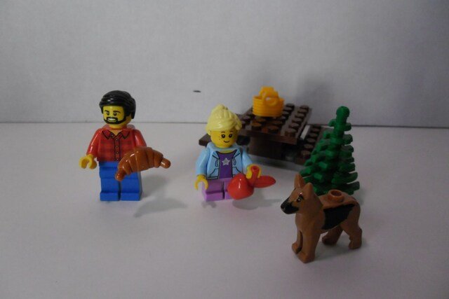](https://www.freelug.org/IMG/jpg/lego-60134-v16.jpg)

[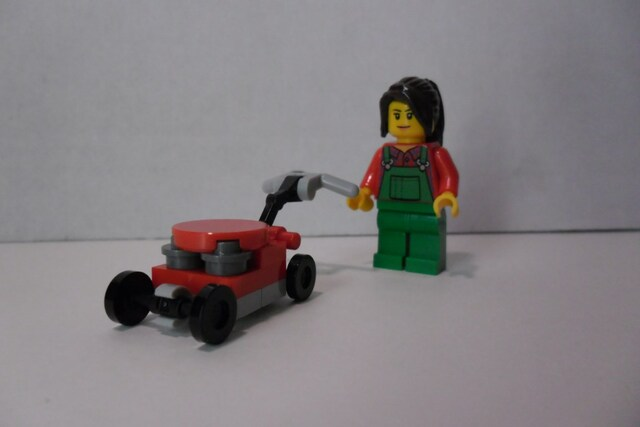](https://www.freelug.org/IMG/jpg/lego-60134-v17.jpg)

[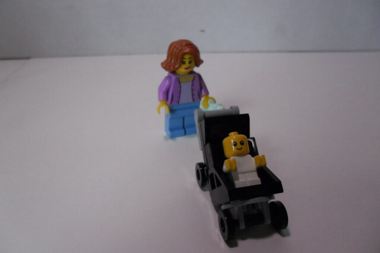](https://www.freelug.org/IMG/jpg/lego-60134-v18.jpg)

Une photo d’ensemble :

[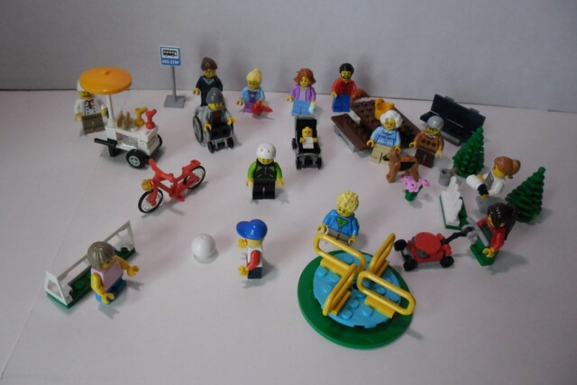](https://www.freelug.org/IMG/jpg/lego-60134-v19.jpg)

Une vue des pièces en "extra" :

[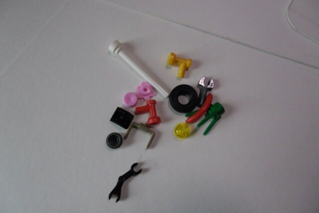](https://www.freelug.org/IMG/jpg/lego-60134-v20.jpg)

Passons vite fait sur le devant/derrière de toutes les minifigs :

[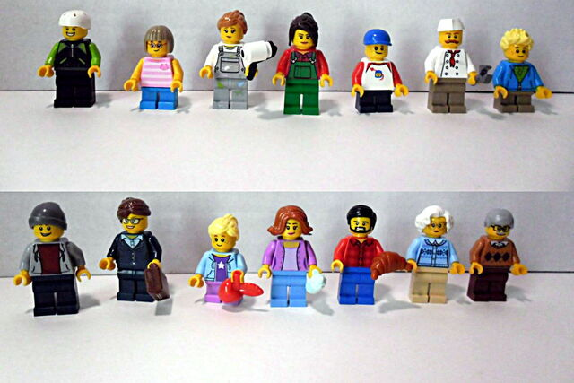](https://www.freelug.org/IMG/jpg/lego-60134-v21.jpg)

[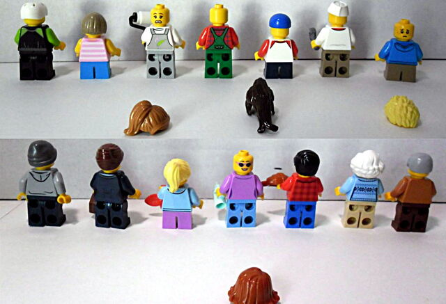](https://www.freelug.org/IMG/jpg/lego-60134-v22.jpg)

**Conclusions :**

Donc oui, on peut trouver que 40€ c’est cher mais :  
dans les shops, 7€ les 3 minifigs et là on en a 14, soit 35€ (et avec le choix) mais sans les accessoires spéciaux...  
Oui le set contient quasi que des minifgs, mais c’est le but et son avantage.  
Moi je retiens surtout : on a pour la deuxième fois un bébé, et surtout une exclusivité, la chaise roulante.  
Donc ils veulent montrer la diversité, pourquoi pas, mais c’est un poil trop cher...
