Bonjour,

Ayant été gâté pour mon anniversaire, je vous propose la revue du set Star Wars 75137 - Carbon Freezing Chamber (La chambre de congélation carbonique).

Nombre de pièces : 231

Nombre de minifigs : 3 + Han Solo version bloc de carbonite

Prix S@H : 29,99€ (mais moi je ne l’ai pas payé vu que c’est un cadeau ;) )

soit un rapport prix/pièce de : 13cts  
(source S@H).

Pour être tout à fait franc, cela fait un moment que je fait l’impasse sur la gamme Star Wars. Entre les refontes à répétition de sets, ceux qui sont loupés (à mon goût) et le prix de la licence qui s’envole, les rares sets que j’ai acheté sont ceux de la gamme MicroFighter, plus certains que j’ai pu trouver en solde à des prix intéressants.

Mais l’annonce d’un set de la chambre de congélation m’a tout de suite interpellé et je me suis demandé pourquoi, alors que LEGO nous a envahi avec des X-Wing à n’en plus finir, avec pléthore de TIE Fighter ou de Snowspeeder, oui, pourquoi cette scène mythique de **"L’Empire contre-attaque"** n’avait-elle jamais fait l’objet d’un set, mis à part le truc moche qui se trouve dans le set 10123 "Cloud City" ?

Les teenagers que nous étions à l’époque ont certainement survécu au traumatisme vécu par la fin de ce second épisode de la trilogie originale. Rappelez-vous : Han Solo est dans la carbonite, emporté par Boba Fett à Jabba, quand à Luke, Dark Vador vient de lui couper une main et de lui révéler qu’il est son père... Fin de l’épisode, la suite dans 2 ans !!!!  
Les plus jeunes ne peuvent pas comprendre, eux ils ont vu les trois films à la suite en VHS.

Mais revenons à nos moutons, ou à nos briques...

Donc, sitôt annoncé, j’avais décidé que ce set serait mien, et j’ai prié le Dieu des AFOLs pour que les designers de Billund assurent un minimum sur ce coup-là et arrivent à nous sortir un chouette set, si possible à prix convenable.

Alors ? Les Dieux de la Brique m’ont-ils entendu ? Que vaut ce set ? Je vous propose d’y jeter un œil...

[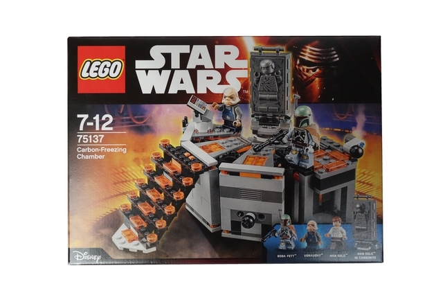](https://www.freelug.org/IMG/jpg/75137_Carbon_Freezing_Chamber_001-2.jpg)

**75137 - Box Front**

Rien à dire, l’emballage claque bien, le fond est particulièrement bien choisi et l’ambiance de la scène originale est bien retranscrite. Bien, bien, bien...

[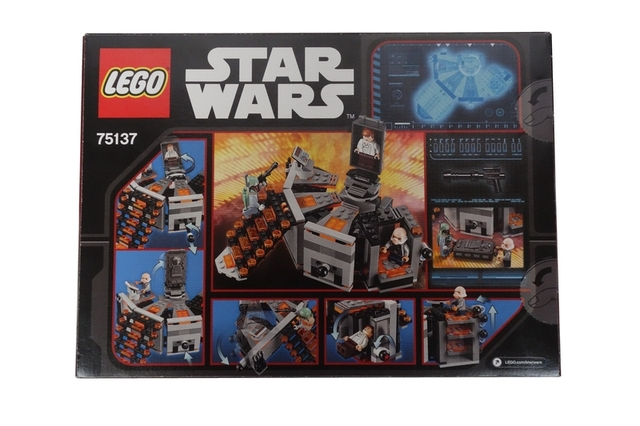](https://www.freelug.org/IMG/jpg/75137_Carbon_Freezing_Chamber_002.jpg)

**75137 - Box Back**

L’arrière de la boîte est à l’avenant, les différentes possibilités d’action sont présentées, et une vue infographique en haut à droite apporte un petit plus visuel agréable.

Pour l’instant tout baigne, extérieurement c’est réussi, allons voir à l’intérieur.

[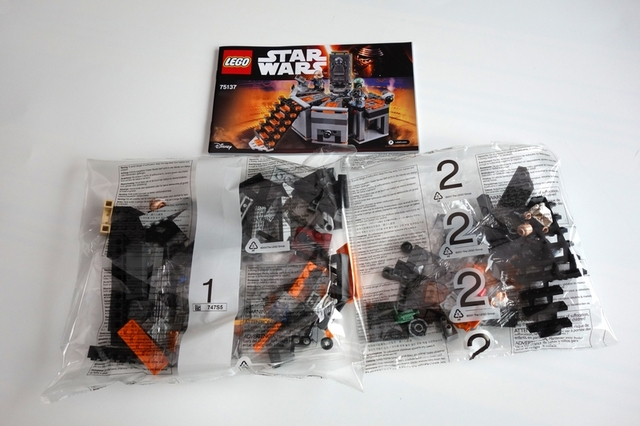](https://www.freelug.org/IMG/jpg/75137_Carbon_Freezing_Chamber_003.jpg)

**75137 - Sachets et Notice**

La boîte est plutôt bien remplie, on est loin des emballages contenant beaucoup de vide d’il y a quelques années.  
Ici nous avons une notice de 66 pages, deux sachets numérotés et une pl.... ah non tiens, pas de planche de sticker. Le panneau de contrôle est une tile 2x2 sérigraphiée vue notamment dans la Barge de Jabba de 2013.

[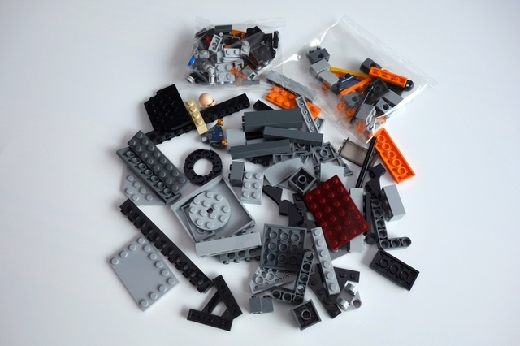](https://www.freelug.org/IMG/jpg/75137_Carbon_Freezing_Chamber_004.jpg)

**75137 - Contenu sachet 01**

[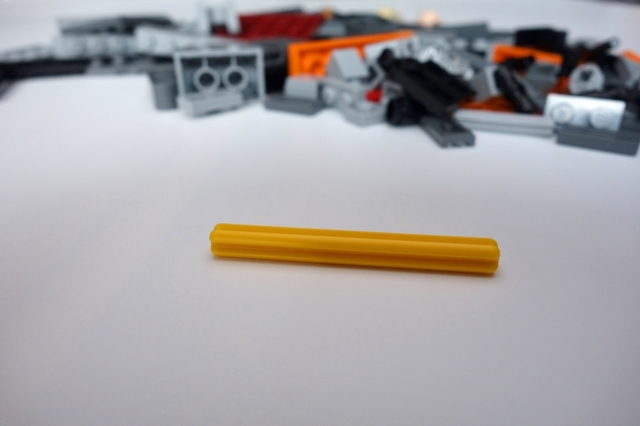](https://www.freelug.org/IMG/jpg/75137_Carbon_Freezing_Chamber_005.jpg)

**75137 - Technic axle 5L Yellow**

Le sachet 1 contient deux autres petits sachets et le Ugnaught (la figurine qui a fait s’enflammer la galaxie des AFOLs collectionneurs de minifigs lorsque le set a été annoncé), mais je reviendrai plus tard sur les minifigs contenues dans ce set.  
Pas de pièces nouvelles, mais un axe technic de 5 tenons de long dans une nouvelle couleur : Yellow. Il apparaît en ce début d’année dans 3 autres sets, tous de la gamme Technic : le 42044 (Le jet), le 42052 (L’hélicoptère) et le 42058 (le Kart de course).

Commençons la construction...

[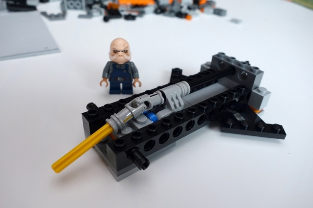](https://www.freelug.org/IMG/jpg/75137_Carbon_Freezing_Chamber_006.jpg)

**75137 - Step 10**

Après la 10ème étape (sur 75 !!), nous arrivons à ceci. Le mécanisme de congélation de la minifig de Han Solo se précise.

[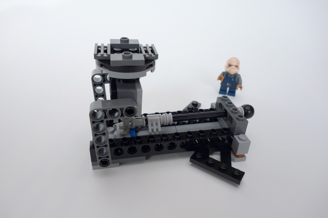](https://www.freelug.org/IMG/jpg/75137_Carbon_Freezing_Chamber_007.jpg)

**75137 - Step 15**

A la 15ème étape, la plateforme de congélation est terminée, il ne reste plus qu’à habiller le tout.

[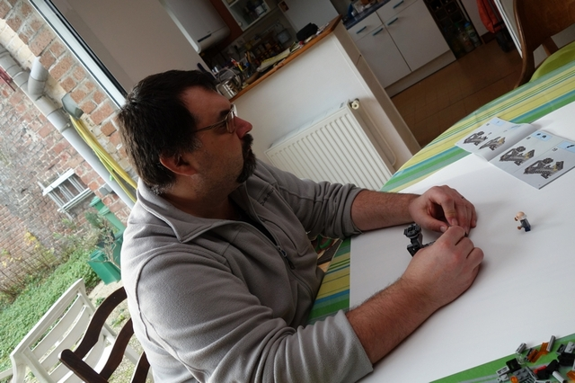](https://www.freelug.org/IMG/jpg/75137_Carbon_Freezing_Chamber_008.jpg)

**75137 - Montage 01**

[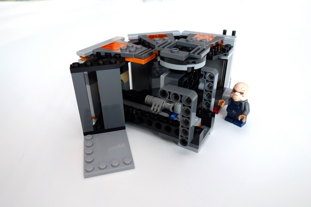](https://www.freelug.org/IMG/jpg/75137_Carbon_Freezing_Chamber_010.jpg)

**75137 - Fin sachet 01**

Et voilà ce qui nous attend à la fin du premier sachet (nous en sommes à l’étape 48).  
Pour le moment, à part la partie technique avec les axes et le cardan, on reste sur une construction basique. Il n’y a pas de technique particulière de mise en œuvre, mais en attend-on d’ailleurs d’un set de ce prix ? Il n’empêche que la construction est agréable et contrairement à ce que l’on pourrait penser, pas trop répétitive.

[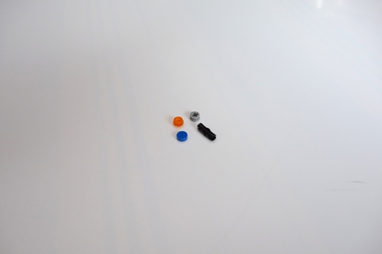](https://www.freelug.org/IMG/jpg/75137_Carbon_Freezing_Chamber_011.jpg)

**75137 - Extra parts sachet 01**

Les traditionnelles extra-parts. Ici 4 pour le sachet 1, rien d’extraordinaire.

Allez hop ! On est reparti pour le sachet 2.

[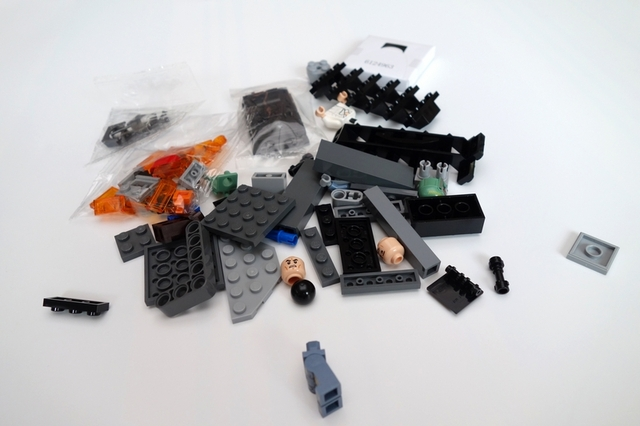](https://www.freelug.org/IMG/jpg/75137_Carbon_Freezing_Chamber_012.jpg)

**75137 - Sachet 02**

Le second sachet contient les minifigs de Boba Fett et Han Solo, un bloc de carbonite dans son sachet plastique, une petite boîte en carton avec le poncho/épaulière du chasseur de prime intergalactique, et deux autres petits sachets, l’un rempli de pièces, l’autre rempli d’accessoires pour casques (viseurs, antennes).

**75137 - Sachet 02**

Une fois terminé, l’ensemble ressemble à ça, voyons maintenant de quoi ça à l’air en situation...

[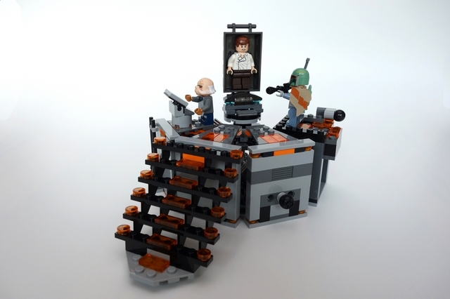](https://www.freelug.org/IMG/jpg/75137_Carbon_Freezing_Chamber_015.jpg)

**75137 - Set fini 01**

[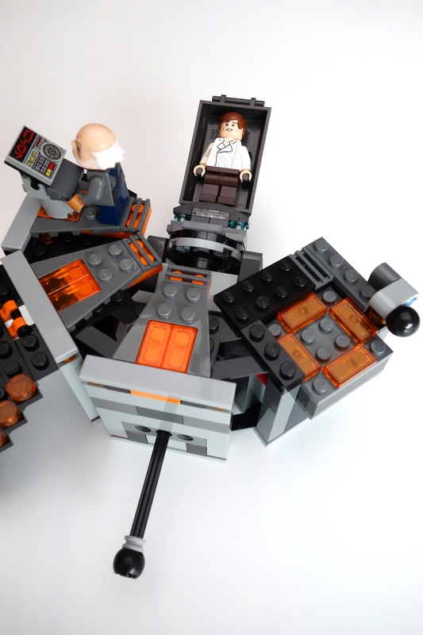](https://www.freelug.org/IMG/jpg/75137_Carbon_Freezing_Chamber_018.jpg)

**75137 - Mécanisme 01**

En tirant sur la barre technique, le mécanisme renverse la plateforme à l’horizontale...

[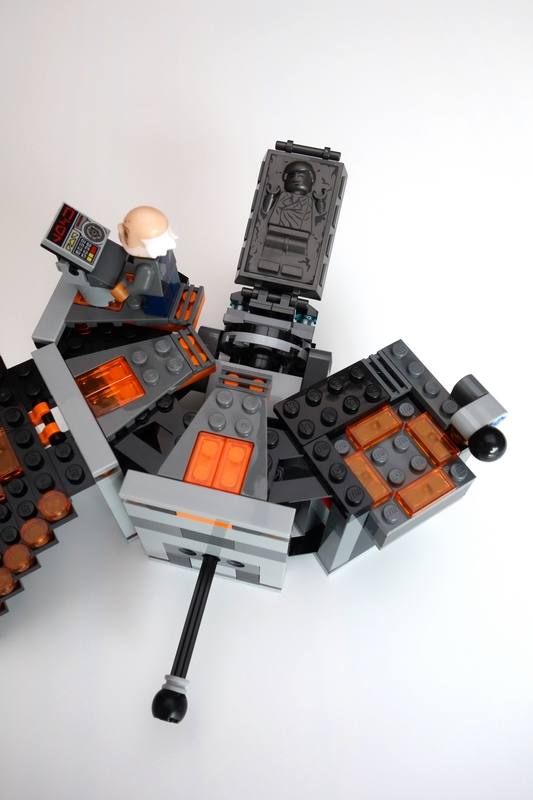](https://www.freelug.org/IMG/jpg/75137_Carbon_Freezing_Chamber_019.jpg)

**75137 - Mécanisme 02**

... et une rotation à 180° permet de plonger le capitaine du Millenium Falcon dans un profond sommeil dans un bloc de carbonite.

[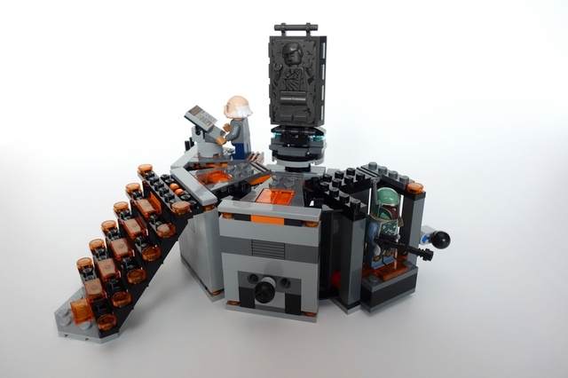](https://www.freelug.org/IMG/jpg/75137_Carbon_Freezing_Chamber_017.jpg)

Il suffit de repousser l’axe technique pour faire remonter la plateforme.  
Et hop !! C’est magique... les gamins vont adorer !  
Du coup Boba Fett peut prendre l’ascenseur pour rejoindre son vaisseau.

[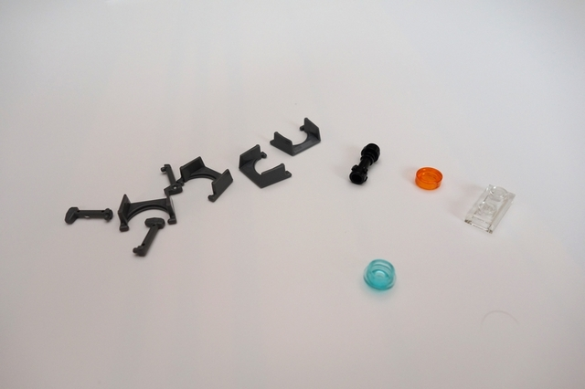](https://www.freelug.org/IMG/jpg/75137_Carbon_Freezing_Chamber_013.jpg)

**75137 - Extra parts sachet 02**

La série de viseurs et d’antennes peut laisser penser qu’il reste plein de pièces en rab’, mais en fait... il n’y a pas grand chose.

Et les minifigs alors ? Ça arrive, ça arrive...

[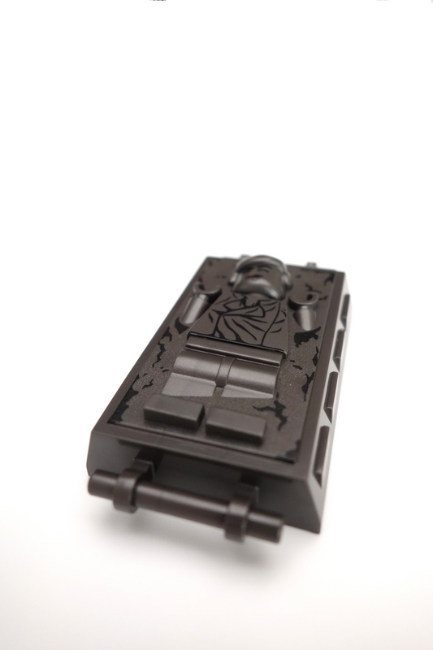](https://www.freelug.org/IMG/jpg/75137_Carbon_Freezing_Chamber_016.jpg)

**75137 - Carbonite**

On a donc un bloc de carbonite. Il est identique à ceux présents dans les deux Slave I et le Palais de Jabba.

[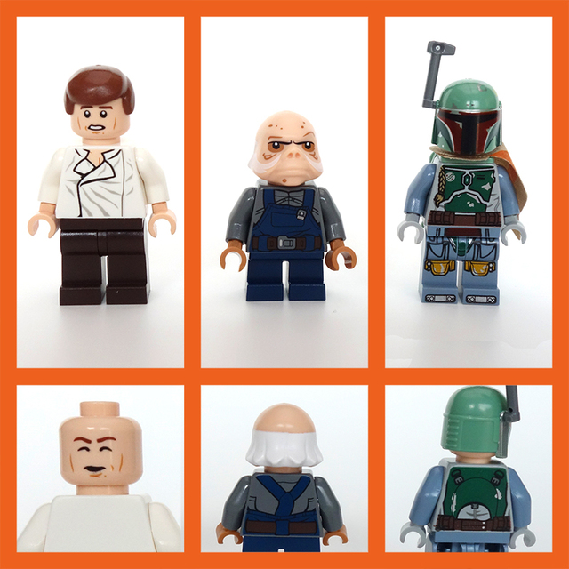](https://www.freelug.org/IMG/jpg/Figurines.jpg)

**75137 - Minifigs**

3 minifigs donc dans ce set :

**Han Solo :** Mis à part les jambes en Dark Brown au lieu de Reddish Brown, il s’agit de la même que celle présente dans le set 75060 "Slave I UCS". Pour certains cela suffira à en faire une minifig exclusive à ce set.  
A noter que le torse est également le même que celui utilisé pour la minifig "Young Han Solo" offerte avec le DVD "La menace Padawan".

**Boba Fett :** Sauf erreur de ma part, il s’agit là également de la même figurine que le 75060.

**Le Ugnaught :** La minifig exclusive de ce set. Et elle est splendide, la sculpture de la tête et son moulage bicolore sont très précis, de même que la sérigraphie 3 couleurs du visage (les sourcils sont d’une belle finesse, et j’aime beaucoup le détail du point de beauté sur le menton). Mention également pour la sérigraphie recto-verso du torse avec de très fines touches d’argenté au niveau de la poitrine et de la boucle de ceinture.

**Conclusion :**  
Pour moi c’est une réussite. ce set combine tout ce qu’on peut attendre d’un set LEGO. Un montage agréable et une belle jouabilité pour un prix somme toute attractif quand il s’agit de la licence Star Wars. le code couleur est respecté et on retrouve sans problème l’ambiance de la cité des nuages.  
Les esprits chagrins diront que le set est petit, qu’on n’a qu’une demi-chambre de congélation, que les designers auraient pu faire ceci ou cela... mais en tout cas, les enfants vont vraiment s’en donner à cœur joie : faire monter Han Solo par l’ascenseur, le placer sur la plateforme et le transformer en bloc de carbonite. Pour peu qu’un Slave I traîne dans les parages il y a moyen de recréer la scène au complet. Et finalement c’est ça le principal, qu’on se fasse plaisir avec un set.  
Seul bémol (parce que sinon c’est pas drôle), je n’ai pas vraiment compris à quoi sert le mécanisme situé sous le panneau de contrôle. On peut y faire basculer Han Solo, mais je n’ai pas saisi la référence.

Bref, vous l’aurez compris, je vous conseille ce set, que l’on pourra très certainement agrandir très facilement avec l’achat d’une seconde boîte.
