Dans le cadre de la seconde vague 2017 des sets de la gamme Star Wars, les designers de chez LEGO® nous proposent de revivre la transformation d’Anakin Skywalker et Darth Vader (nom original de Dark Vador) telle que vécue dans l’épisode III « La revanche des Sith ».

Il s’agit ici d’un remake du set [7251](https://brickset.com/sets/7251-1/Darth-Vader-Transformation), un set d’entrée de gamme de 32 pièces datant de 2005, qui porte d’ailleurs le même nom. La chambre de transformation était également présente dans le set 8096 « Emperor Palpatine’s Shuttle », qui date lui de 2010.

Plus imposante que ces prédécesseurs, cette chambre de transformation, dont la jouabilité promise lorgne vers le set 75137 « Carbon Freezing Chamber » et le 75169 « Duel on Naboo », tient-elle ses promesses ? Ouvrons la boite et allons voir ça de plus près.

**–** Set 75183 – Darth Vader Transformation  
**–** Nbre de pièces : 282  
**–** Prix : 29,99€  
**–** Ratio prix/pièce : 10,63 cts/pièce  
**–** Minifigs : 3  
**–** Sortie : Juin 2017

[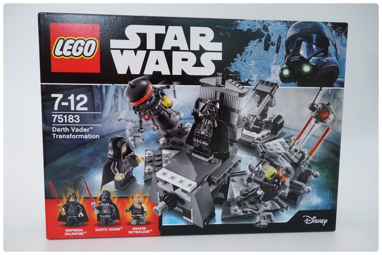](https://www.freelug.org/IMG/jpg/DSC00046_Snapseed.jpg)

Passons rapidement sur la boîte dont l’habillage ne change pas, logos et nom de gamme en partie supérieure avec le visuel « Rogue One » qui s’applique sur tout le merchandising Star Wars cette année, jusqu’à la sortie de l’épisode VIII. Le set nous est présenté dans son environnement de chambre de transformation, au moment du réveil du seigneur Sith, lorsqu’il laisse échapper sa colère et envoie tout balader. De légers effets de flou donnent l’impression de mouvement des éléments.

[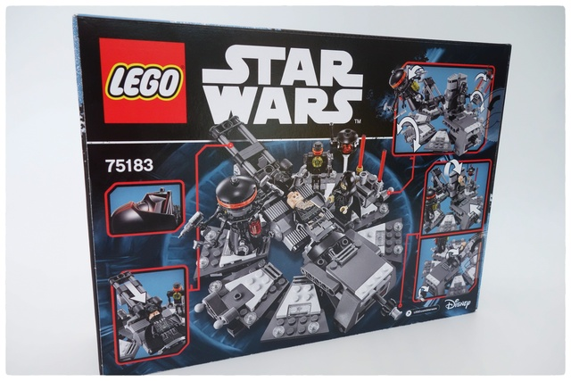](https://www.freelug.org/IMG/jpg/DSC00047_Snapseed.jpg)

L’arrière détaille les éléments de jouabilité du set, et il n’y a pas à dire ça fait envie. Entre la possibilité de mettre son casque à Vader (reprise au set 8096), la rotation de la plateforme de transformation (déjà présente dans le set 7251), et les éléments de décor qui s’envolent, LEGO nous promet un bon moment de jeu.

[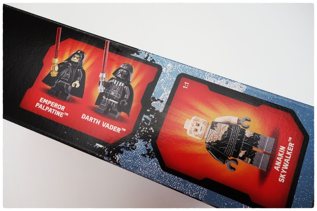](https://www.freelug.org/IMG/jpg/DSC00048_Snapseed.jpg)

Les figurines présentes dans la boîte : Anakin Skywalker en version grand brûlé, l’empereur Palpatine et Darth Vader bien que présents sur la face avant, figurent également sur la tranche.

[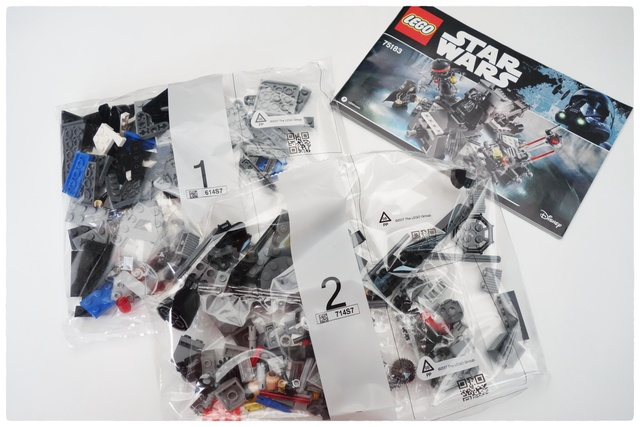](https://www.freelug.org/IMG/jpg/DSC00049_Snapseed.jpg)

A l’intérieur, une notice et deux sachets. Classique pour ce type de set.

[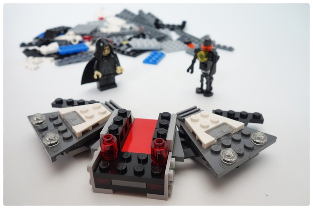](https://www.freelug.org/IMG/jpg/DSC00050_Snapseed.jpg)

Fin de l’étape 14, la structure se met en place, et la forme se dessine.

[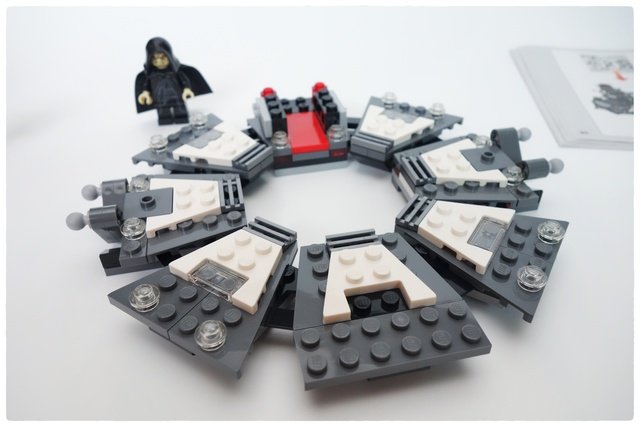](https://www.freelug.org/IMG/jpg/DSC00052_Snapseed.jpg)

A la fin du premier sachet, la base est terminée, il va falloir l’habiller maintenant. Quelques modules répétitifs à construire, mais ils sont vite montés et la lassitude n’a pas le temps de s’installer.

img18247|center>

Deuxième tas de pièce, on attaque la seconde partie…

[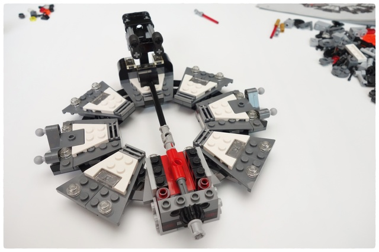](https://www.freelug.org/IMG/jpg/DSC00056_Snapseed.jpg)

Parmi les premières choses mises en place, les constructions « techniques », le système qui servira à placer le casque sur la tête de Vader, et le système de rotation de la plateforme.

[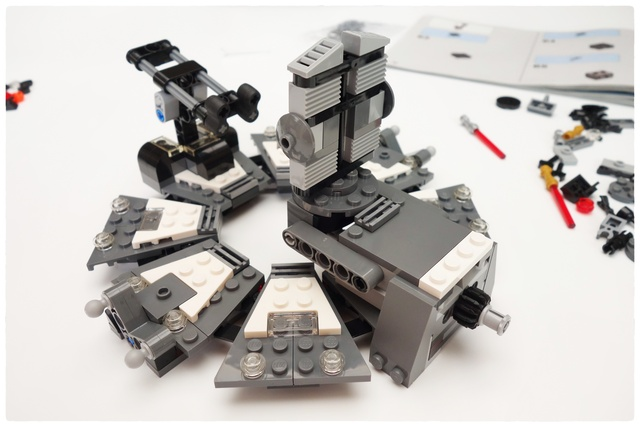](https://www.freelug.org/IMG/jpg/DSC00057_Snapseed.jpg)

Système qui est rapidement habillé par la structure de la plateforme.

[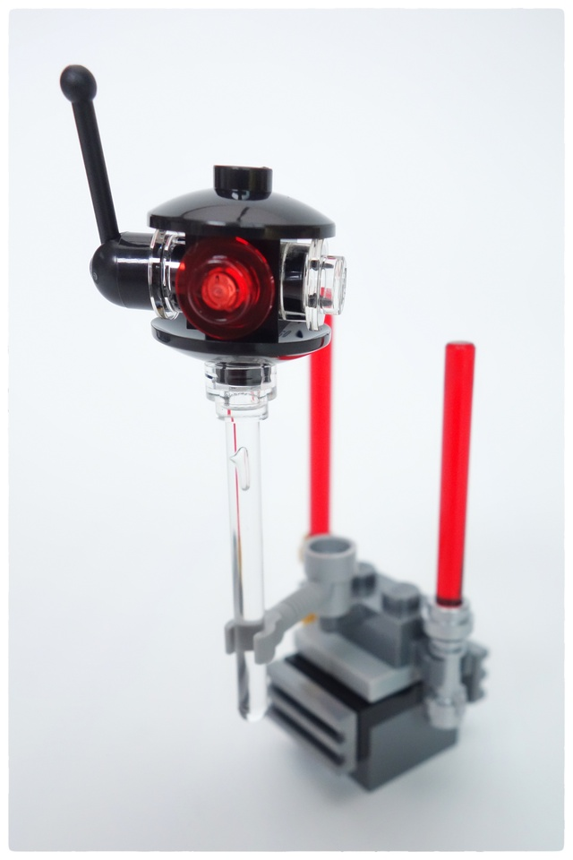](https://www.freelug.org/IMG/jpg/DSC00087_Snapseed.jpg)

[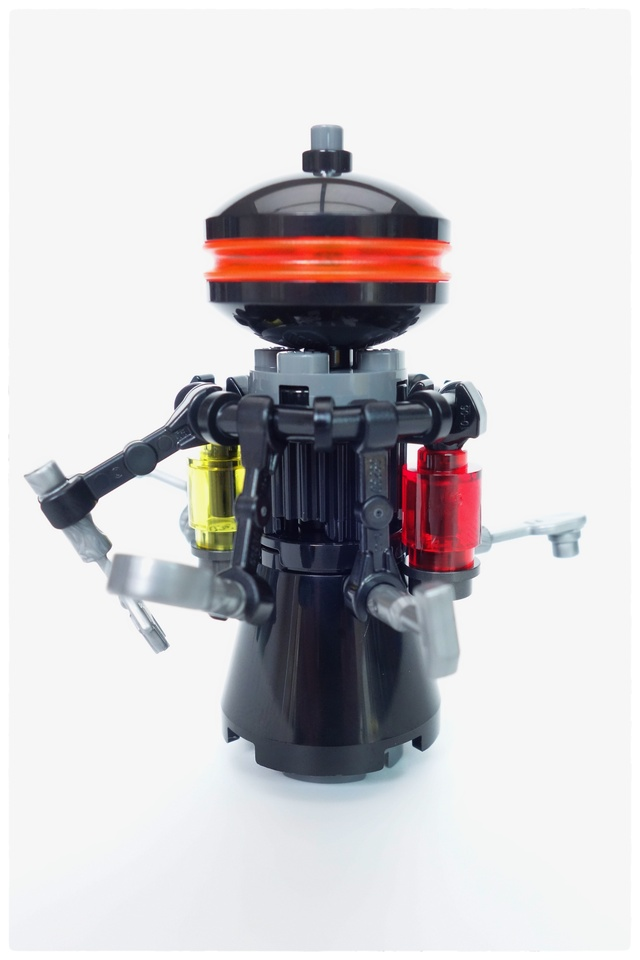](https://www.freelug.org/IMG/jpg/DSC00088_Snapseed.jpg)

On monte ensuite les deux modules amovibles : le rack sur lequel les deux sabres laser sont fixés ainsi qu’un petit droïde, et un gros droïde médical…

[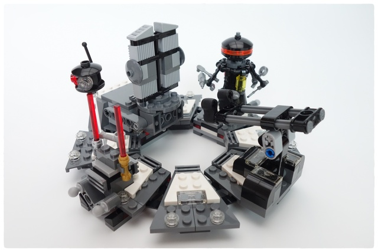](https://www.freelug.org/IMG/jpg/DSC00059_Snapseed.jpg)

Qui sont mis en place autour de la plateforme de transformation.

[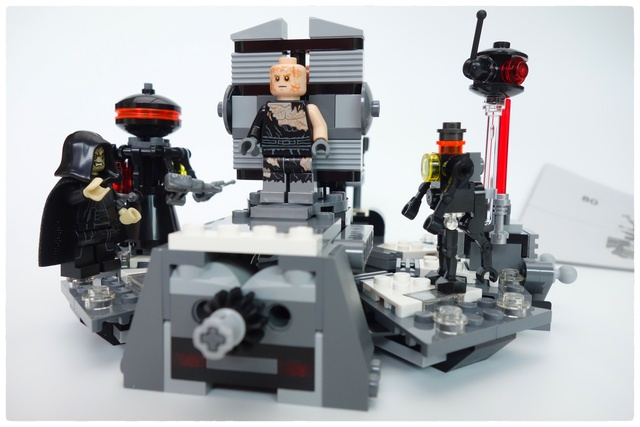](https://www.freelug.org/IMG/jpg/DSC00060_Snapseed.jpg)

Tous les personnages et éléments sont maintenant en place, le drame va pouvoir se jouer.

[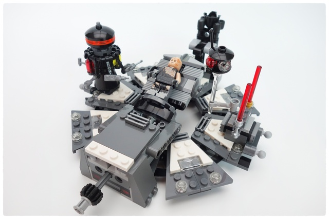](https://www.freelug.org/IMG/jpg/DSC00062_Snapseed.jpg)

[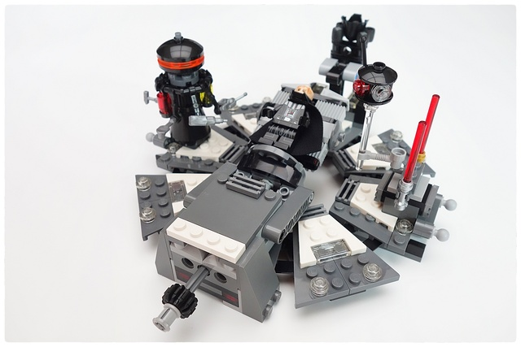](https://www.freelug.org/IMG/jpg/DSC00063_Snapseed.jpg)

En tirant sur la barre Technic, la plateforme se baisse, une rotation permet de faire tourner le support pour découvrir Anakin transformé en Darth Vader.

[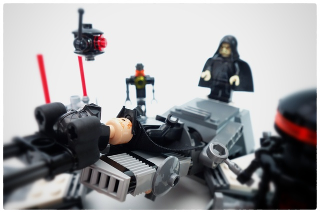](https://www.freelug.org/IMG/jpg/DSC00085_Snapseed.jpg)

« Rise, lord Vader… »

[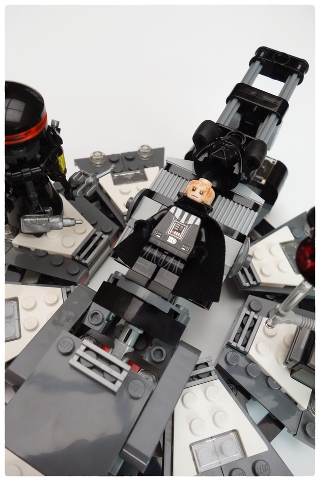](https://www.freelug.org/IMG/jpg/DSC00064_Snapseed.jpg)

[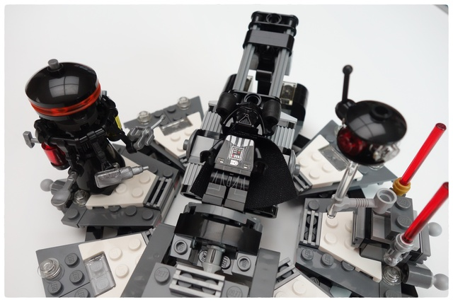](https://www.freelug.org/IMG/jpg/DSC00065_Snapseed.jpg)

Il ne reste plus qu’à faire descendre le casque pour que l’opération soit complète.

[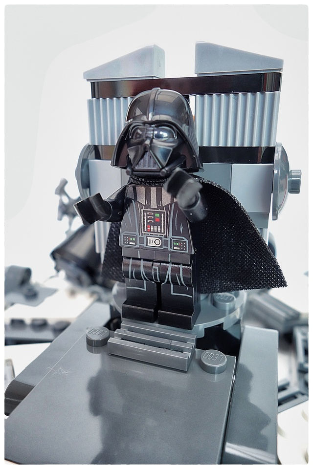](https://www.freelug.org/IMG/jpg/DSC00070_Snapseed.jpg)

Et maintenant, on peu jouer, Vader est en colère, très en colère, et va sombrer définitivement du côté obscur de la force.

[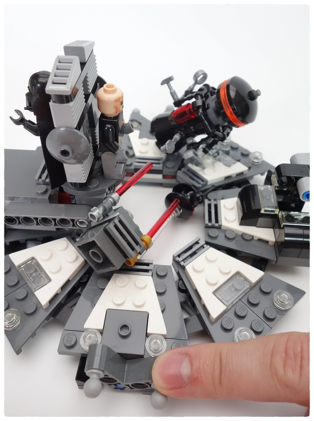](https://www.freelug.org/IMG/jpg/DSC00072_Snapseed.jpg)

[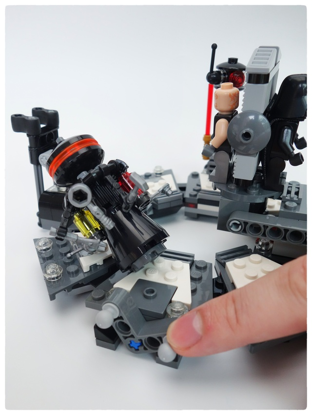](https://www.freelug.org/IMG/jpg/DSC00069_Snapseed.jpg)

Une pichenette sur les mécanismes mis en place permet de faire sauter le rack à lightsaber et le droïde médical.

Le set propose 3 minifigs.

[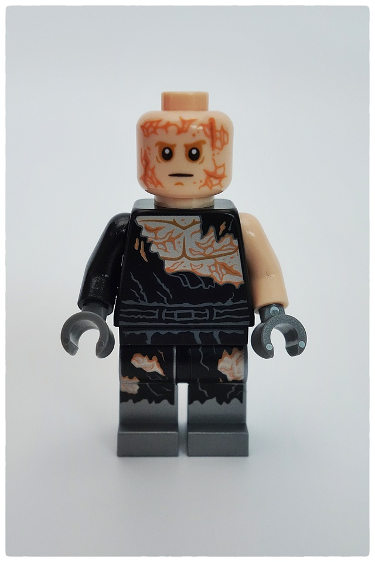](https://www.freelug.org/IMG/jpg/DSC00077_Snapseed.jpg)

[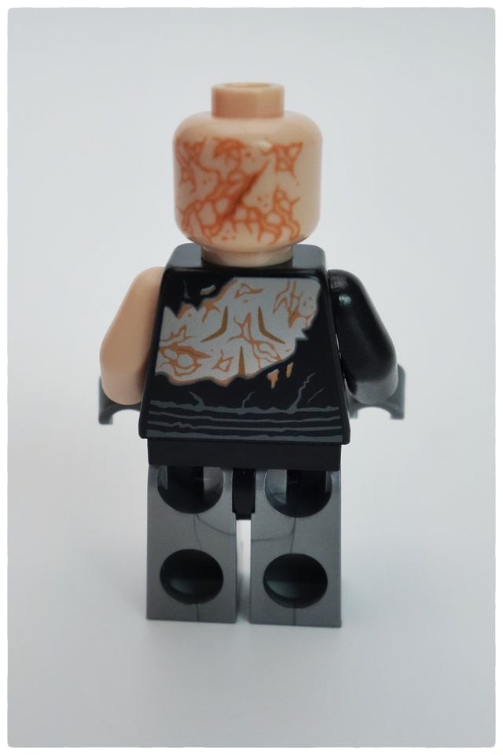](https://www.freelug.org/IMG/jpg/DSC00078_Snapseed.jpg)

Anakin Skywalker, après son bain forcé dans les laves de Mustafar. Très belle sérigraphie sur le torse comme sur le dos, qui retranscrit bien le côté grand brûlé, avec ses brûlures et cicatrices diverses. La tunique est joliment déchirée, et les jambes et les mains en pearl grey, supposent qu’Anakin a déjà reçu un peu de chirurgie reconstructrice.  
Du fait que le personnage ne porte ni casque, ni chevelure, la tête propose également une sérigraphie sur l’arrière du crâne. Aussi réussie que la face avant, elle apporte un plus indéniable à la qualité de cette figurine.

[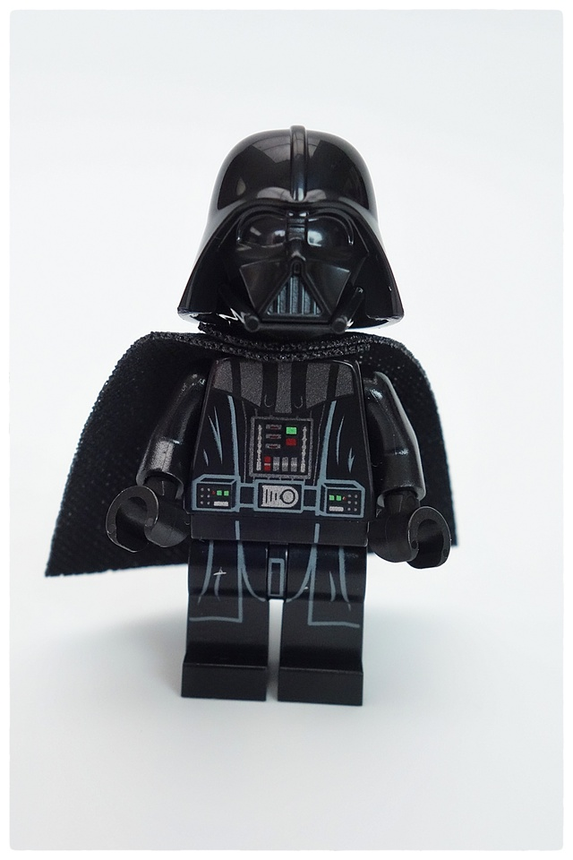](https://www.freelug.org/IMG/jpg/DSC00079_Snapseed.jpg)

[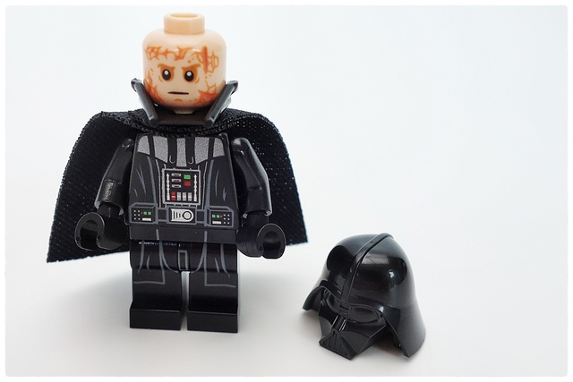](https://www.freelug.org/IMG/jpg/DSC00080_Snapseed.jpg)

Darth Vader est équipé du nouveau casque en deux parties. La sérigraphie du torse et des jambes est propre et bien détaillée, et semble la même que dans les sets 75055 « Imperial Star Destroyer », 75093 « Death Star Final Duel » et 75159 « Death Star UCS » de 2016. Seule la tête est inédite, d’ailleurs il s’agit de la même que sur la figurine d’Anakin Skywalker présentée ci-dessus.

[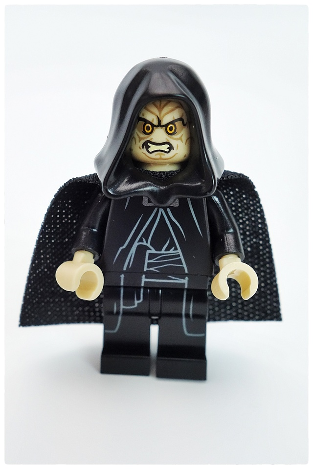](https://www.freelug.org/IMG/jpg/DSC00081_Snapseed.jpg)

[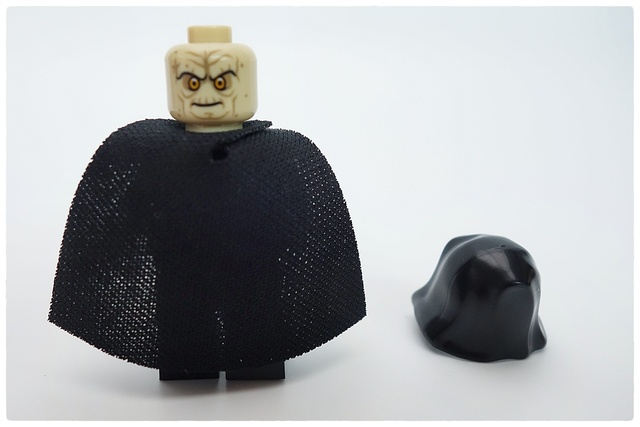](https://www.freelug.org/IMG/jpg/DSC00082_Snapseed.jpg)

La figurine de Palpatine n’est pas inédite, puisqu’elle est identique à celle présente dans le set 75093 « Deat Star Final Duel », pourtant j’apprécie toujours autant le visage particulièrement réussi.

[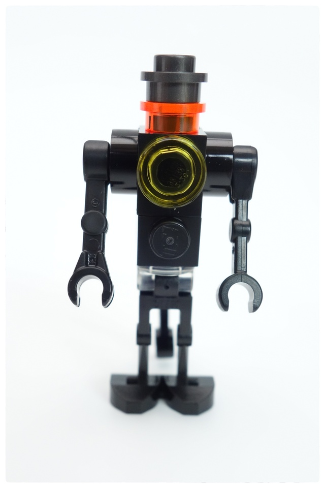](https://www.freelug.org/IMG/jpg/DSC00083_Snapseed.jpg)

[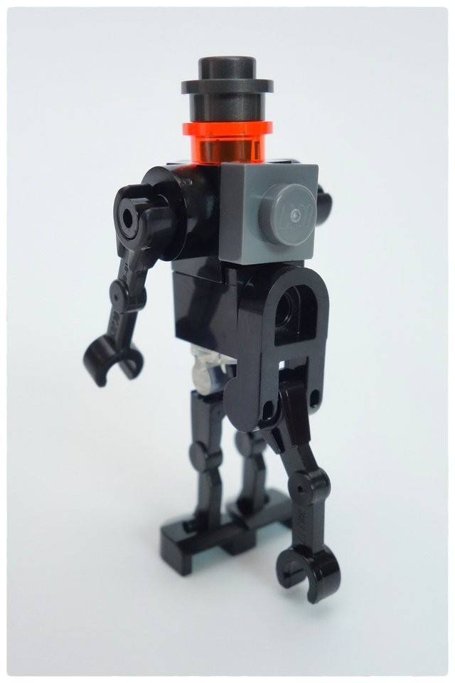](https://www.freelug.org/IMG/jpg/DSC00084_Snapseed.jpg)

Un petit droïde semi-brick-built accompagne ces 3 personnages, il n’est pas présenté comme figurine sur l’emballage.

[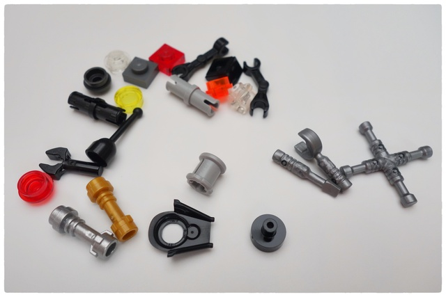](https://www.freelug.org/IMG/jpg/DSC00076_Snapseed.jpg)

Quelques extra parts.

[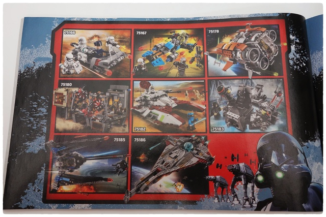](https://www.freelug.org/IMG/jpg/DSC00073_Snapseed.jpg)

[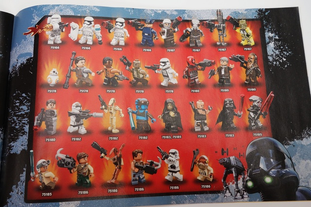](https://www.freelug.org/IMG/jpg/DSC00074_Snapseed.jpg)

[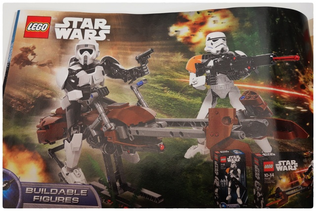](https://www.freelug.org/IMG/jpg/DSC00075_Snapseed.jpg)

Les dernières pages de la notice présentent les sets de cette nouvelle fournée 2017, et une page est consacrée aux différentes figurines qu’il faudra que tout collectionneur digne de ce nom se doive de posséder (j’imagine que c’est le message que TLG souhaite faire passer). Une dernière page est consacrée aux buildable figures et notamment le stormtrooper sur son speeder bike.

**Conclusion.**

Dans la foulée du « Carbon Freezing Chamber » ce set, qui devrait en fait s’appeler Anakin’s Transformation, a vraiment su améliorer le concept, là où le précédent se contentait d’un tiers de plateforme, d’une rotation du support et d’un ascenseur (sic). Ici, nous avons droit à une plateforme complète et plusieurs éléments de jouabilité. Certes, j’aurai apprécié avoir un petit pupitre de commande dans un coin, mais on ne peut vraiment pas reprocher grand-chose à ce set, surtout à ce prix.  
Les MOCeurs et MODeurs se feront un plaisir de le modifier, et les enfants passeront sans aucun doute de longs moments à jouer avec.

[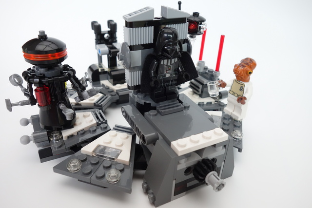](https://www.freelug.org/IMG/jpg/DSC00066-2.jpg)

Un petit café pour vous remettre de vos émotions ?
