Petite erreur du magasin de jouets où je suis passé de façon imprévue, Yoda, référence 75255, est sorti un peu avance sur la date officielle du 4 octobre. C’est surement grâce à la Force.

Du coup, sans hésitation, j’ai pris une des 2 boites disponibles, en profitant au passage de la promo 50% sur la seconde boite (du NinjaGo en l’occurrence).

Quelques chiffres :  
**–** référence : 75255  
**–** nombre de pièces : 1771  
**–** nombre de minifig : 1  
**–** prix : 99,99€ annoncé, 109,99€ dans le magasin en question  
**–** année : 2019

## La boite

[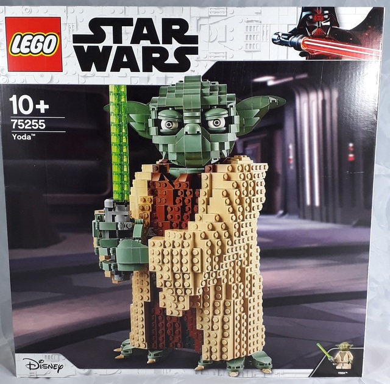](https://www.freelug.org/IMG/jpg/75255_01.jpg)

Pas grand chose à dire, l’avant montre Yoda vu de devant, et l’arrière, vu de derrière !

[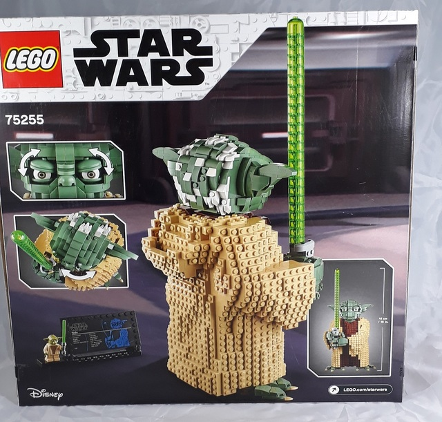](https://www.freelug.org/IMG/jpg/75255_02.jpg)

## Le contenu

A l’intérieur, 13 sachets numérotés, 1 non numéroté, un axe Technic en vrac, et la notice et l’autocollant en pochette.

[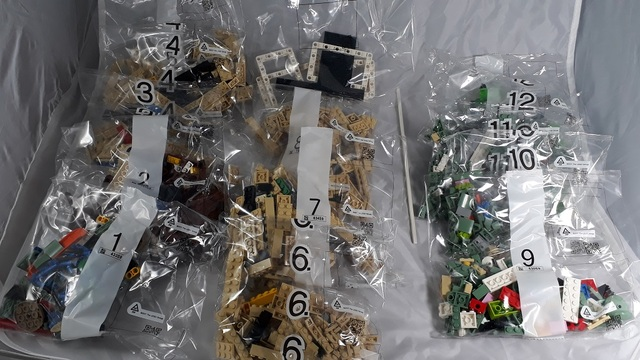](https://www.freelug.org/IMG/jpg/75255_03.jpg)

On constate rapidement que le sachet numéro 1 contient principalement des pins Technic, le sachet 2 une majorité de pièces marron, puis du 3 au 8, ce sera du tan et enfin les derniers du sand green. Ca donne une idée de l’organisation du montage.

Et celle-ci se confirme à l’ouverture de la notice.

[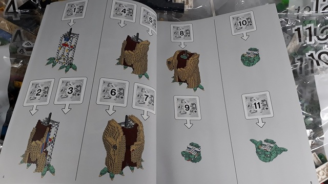](https://www.freelug.org/IMG/jpg/75255_04.jpg)

Première surprise, l’intérieur est une armature en LEGO Technic avec de nombreux demi-pins, et qui sera donc le support du montage en SNOT de tout le corps.

## La structure

On attaque avec le premier sachet, qui nous mène à ce cadre en 3 dimensions, reposant sur les pieds de Yoda.

[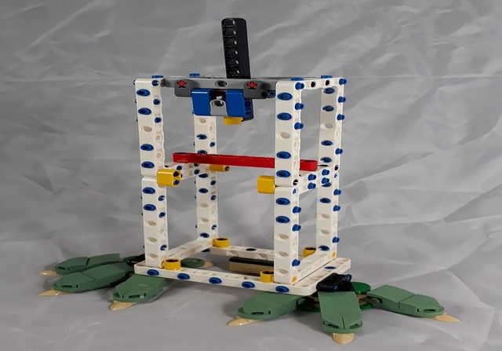](https://www.freelug.org/IMG/jpg/75255_05.jpg)

## Les faces

Les quatre faces qui constituent le corps se montent sur le même modèle : un empilage de très nombreuses plates, les briques sont rares.

Très vite, on se rend compte que la structure en Technic Beam studless a une incidence sur le format : tout est en largeur impaire.

Les sachets 2 et 3 constituent la face avant. Le support pour la première main apparait.

[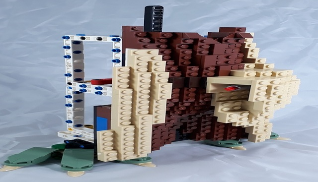](https://www.freelug.org/IMG/jpg/75255_06.jpg)

Les sachets 4 et 5 constituent le côté gauche.

[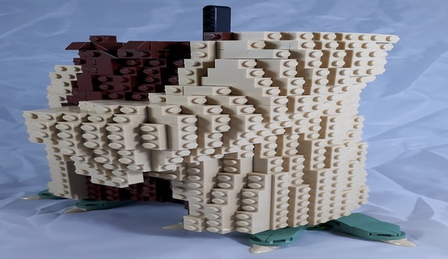](https://www.freelug.org/IMG/jpg/75255_07.jpg)

Les sachets 6 et 7 constituent le côté droit. Le support pour la seconde main fait son apparition.

[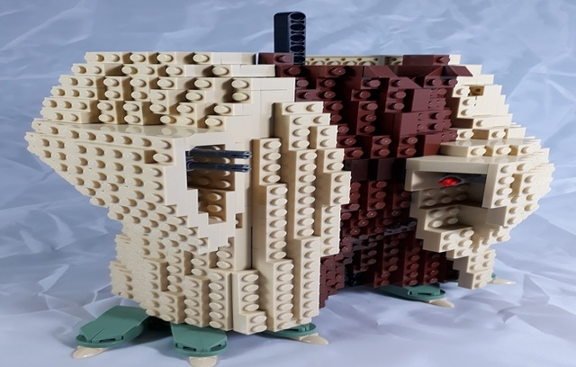](https://www.freelug.org/IMG/jpg/75255_08.jpg)

Le sachet 8 constitue l’arrière et le cou. On appréciera la présence de la capuche.

[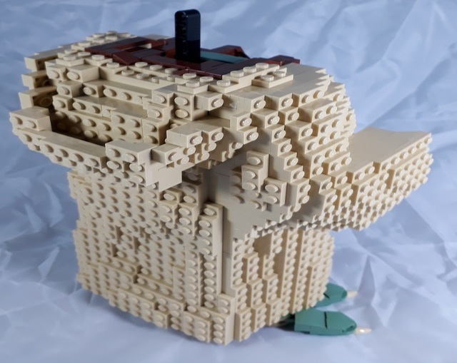](https://www.freelug.org/IMG/jpg/75255_09.jpg)

L’assemblage est un méli-mélo de plates, parfois en porte-à-faux, parfois à assembler par le dessous, parfois par des sous-assemblages à retourner dans tous les sens. La perspective de la notice sème aussi le doute. Heureusement, les nouvelles briques à chaque étape sont cerclées d’une couleur distincte, mais il faudra être parfois vigilant et réfléchir par quelle pièce commencer pour être sûr de ne pas produire de décalage. Ça change des montages souvent très simplifiés à une pièce par étape, et ce n’est pas pour déplaire.

[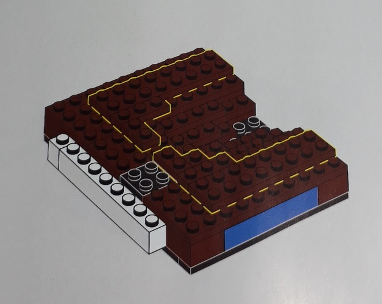](https://www.freelug.org/IMG/jpg/75255_16.jpg)

## La tête

Les sachets 9 à 12 permettent d’assembler la tête. Si pour le corps, la gamme de couleur était très limitée, l’intérieur de la tête est un mélange folklorique de nombreuses couleurs.

[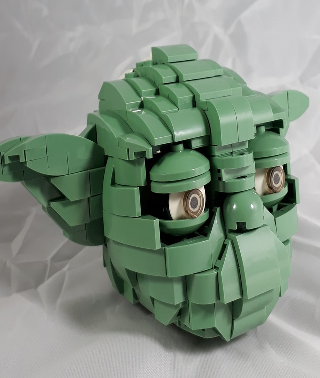](https://www.freelug.org/IMG/jpg/75255_10.jpg)

Au cours du sachet 12, on est contraint de fixer la tête sur le corps par un axe Technic avant de poursuivre avec l’arrière de la tête.

[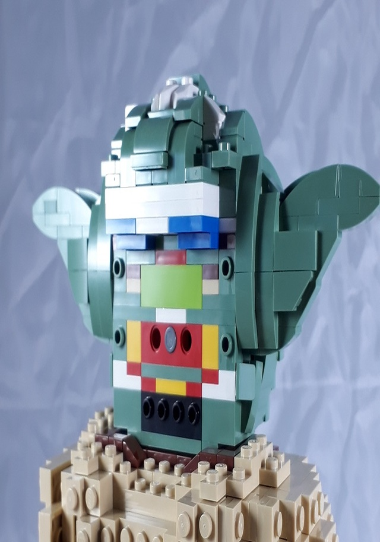](https://www.freelug.org/IMG/jpg/75255_11.jpg)

Le montage de la tête est un réel plaisir, les divers éléments assemblés là aussi en SNOT s’imbriquent avec précision.

[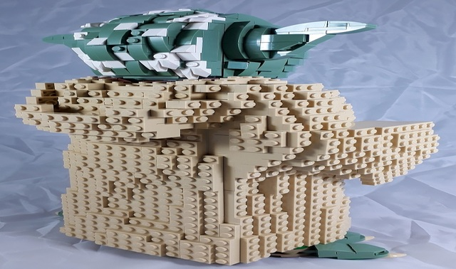](https://www.freelug.org/IMG/jpg/75255_12.jpg)

Les yeux ne font pas aussi globuleux que les photos peuvent laisser suggérer, mais les paupières ne bougent que très peu. La tête est elle aussi peu articulée.

## Mains, sabre et présentoir

Enfin, le sachet 13 permet de construire les mains, le sabre avec ses 23 rondes 2x2 trans-green à enfiler sur l’axe Technic, et le fameux présentoir propre aux modèles UCS, sur lequel vient se placer une minifig de Yoda.

[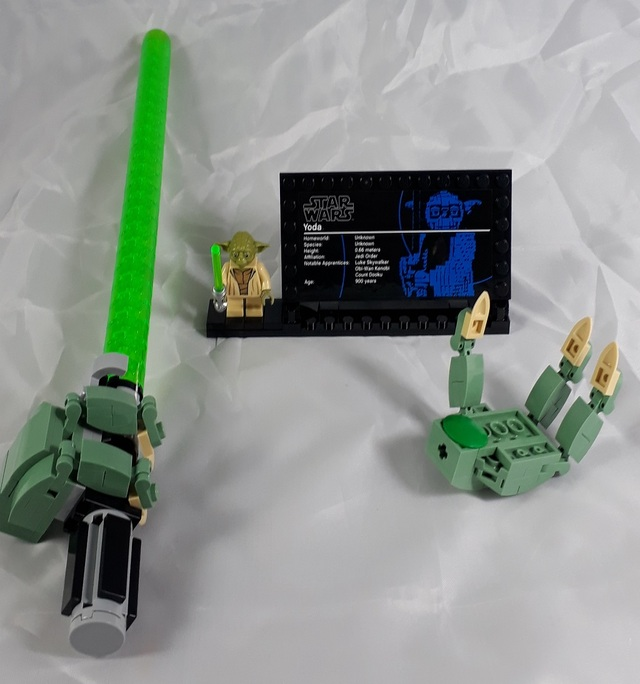](https://www.freelug.org/IMG/jpg/75255_13.jpg)

Le sticker nous apprend que Yoda est âgé de 900 ans, et mesure 0,66 mètres.

[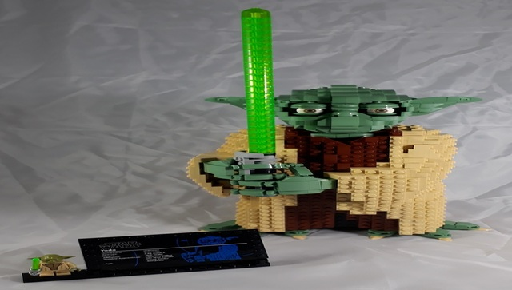](https://www.freelug.org/IMG/jpg/75255_14.jpg)

## Mais il n’y avait pas déjà eu une sculpture de Yoda ?

Les plus assidus de la gamme StarWars se rappelleront que LEGO avait déjà sorti une sculpture de [Yoda en 2002 sous la référence 7194](https://brickset.com/sets/7194-1/Yoda).

Alors, que donne la comparaison ?

[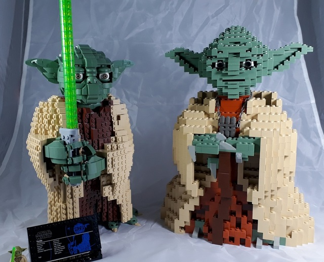](https://www.freelug.org/IMG/jpg/75255_15.jpg)

Je crois que la photo parle d’elle même. La nouvelle version est nettement plus réussie. Alors certes, la technique de montage est totalement différente. Dans la version de 2002, il s’agissait un assemblage ultra-classique de briques pour le corps, et de plates pour la tête qui demandait un peu plus de finesse. Les seules fantaisies se trouvaient dans les yeux (Technic ball) et dans les ongles (ou griffes ?) qui étaient de simples slopes montées en SNOT.

Notons tout de même le changement d’accessoire, où on passe du Yoda sage avec sa canne au Yoda combattant avec son sable laser.

## Conclusion

Après environ 2h30 de construction, je dois dire que j’ai vraiment apprécié le montage de l’ensemble qui, sans être compliqué, demande une concentration dont on avait parfois perdu habitude. Sans compter sur les blagues de la notice, où l’ordre des étapes est permuté :)

[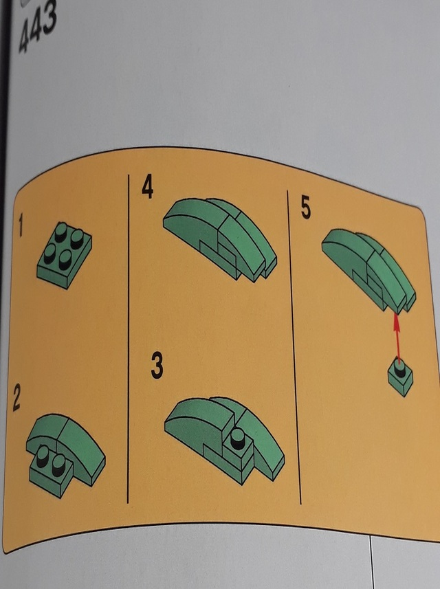](https://www.freelug.org/IMG/jpg/75255_17.jpg)

La différence de technique entre la tenue (en tenons apparents) et la peau en studless (couvertes de tiles et de slopes curved) contribue au rendu global. Le résultat évoque pour moi Yoda lors de son combat contre le comte Dooku sur Géonosis, mais les spécialistes StarWars me contrediront peut-être :)

[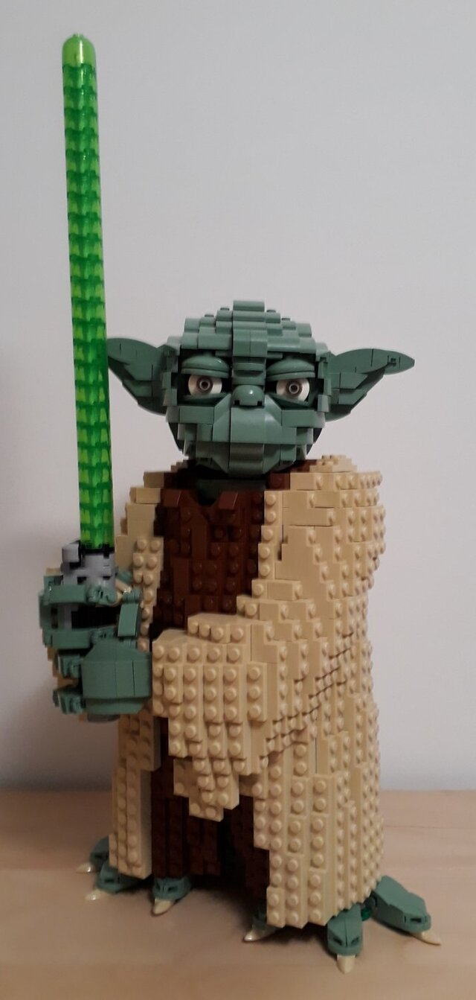](https://www.freelug.org/IMG/jpg/75255_18.jpg)

Pour les fans de StarWars, de Yoda ou des UCS, c’est un choix judicieux. Pour ceux que StarWars ne passionne pas, si vous avez l’occasion de le monter, n’hésitez pas.

[Venez-en discuter sur le forum !](https://forum.freelug.org/viewtopic.php?f=11&t=661)
