Inaugurée en 2015, la gamme Speed Champions s’est concentrée autour du sport automobile. Que ce soit de la F1, du WRC, ou autre championnat, elle reconstitue, en partenariat (sous licence), des mécaniques légendaire de chez Mercedes, Chevrolet, Porsche, Ford, etc.

En 2017, elle a lancé sa troisième saison en alignant six sets sur les rayonnages des stores dès janvier.

C’est pourtant un set de 2016, la Chevrolet Corvette Z06, que nous avons choisi de décortiquer pour vous aujourd’hui.

Set 75870 - Chevrolet Corvette Z06  
Gamme : Speed Champions  
Date de sortie : 2016 - toujours disponible  
Nombre de pièces : 175  
Prix : 14,99€  
Ratio prix/pièce : 8,56 cent/pièce  
Minifig : 1 pilote

[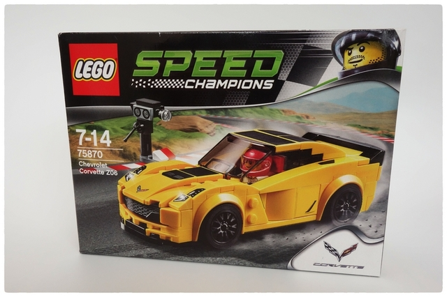](https://www.freelug.org/IMG/jpg/Chevrolet_Corvette_Z06_Speed_Champions_001.jpg)

Comme d’habitude sur les boites LEGO®, la partie supérieure est réservée au logo de la marque danoise, au nom de la gamme et à une tête de minifig pilote.

En 2015, le logo SPEED CHAMPIONS était bleu, en 2016 il était jaune, cette année c’est en vert qu’il est décliné. Il est à noter que l’expression du pilote change parfois selon les boites. Il peut être souriant, mal rasé, concentré,..

Un beau visuel nous présente la Corvette en action sur une route de montagne, dérapage contrôlé, les graviers crissent, sous l’oeil de la caméra. En bas à gauche, le logo Corvette nous renseigne sur la marque du véhicule que nous allons construire.

C’est efficace, ça attire l’oeil, on a envie de prendre cette boite en main pour la regarder de plus près.

[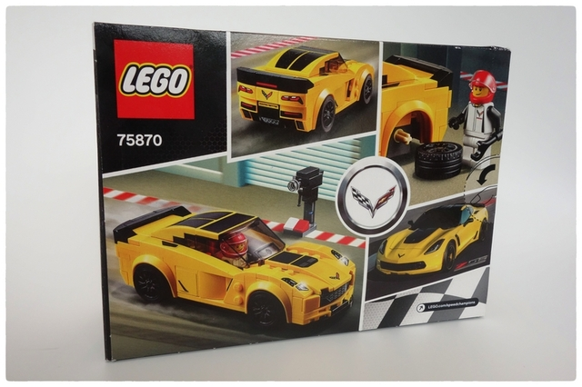](https://www.freelug.org/IMG/jpg/Chevrolet_Corvette_Z06_Speed_Champions_002.jpg)

Le verso nous propose 3 mises en situation sous des angles différents, dont une image montrant le pilote changeant la roue (argument jouabilité). Un quatrième visuel nous montre la véritable voiture, toute en courbes. Les designers ont fait de leur mieux pour les reproduire.

[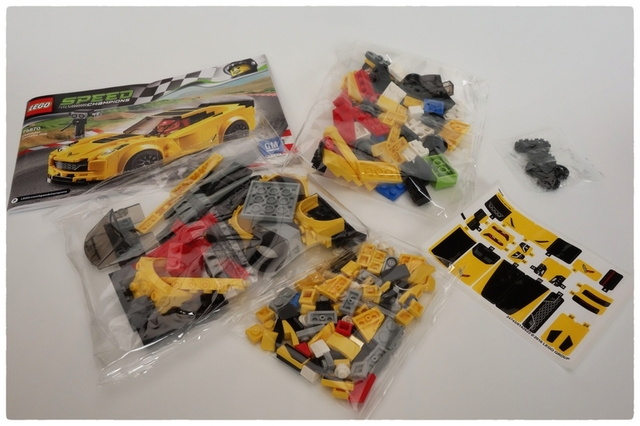](https://www.freelug.org/IMG/jpg/Chevrolet_Corvette_Z06_Speed_Champions_003.jpg)

Une fois la boite ouverte, on délivre 3 sachets de pièces, plus un petit contenant les enjoliveurs de roues, une notice et une belle planche de stickers. C’est quand même un peu la signature de cette gamme les stickers...

[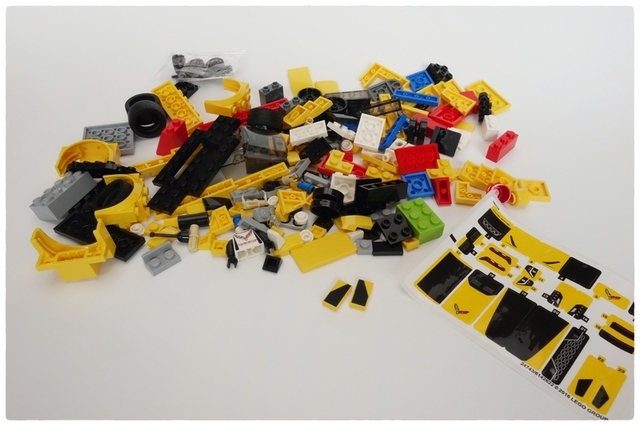](https://www.freelug.org/IMG/jpg/Chevrolet_Corvette_Z06_Speed_Champions_005.jpg)

On mélange le tout, et on fait un tas des 175 pièces.

[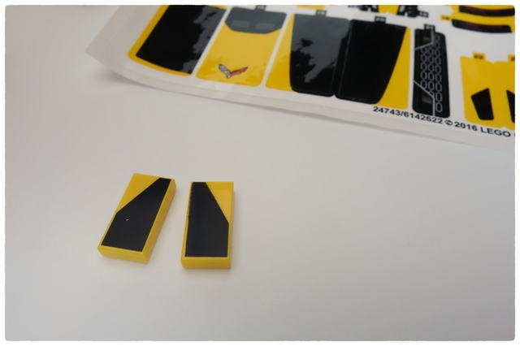](https://www.freelug.org/IMG/jpg/Chevrolet_Corvette_Z06_Speed_Champions_004.jpg)

Deux petites tiles 1x2 jaunes sortent du lot, elles sont sérigraphiées. Ce sont les seules.

[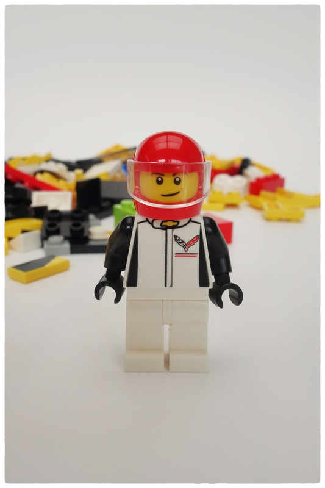](https://www.freelug.org/IMG/jpg/Chevrolet_Corvette_Z06_Speed_Champions_006.jpg)

[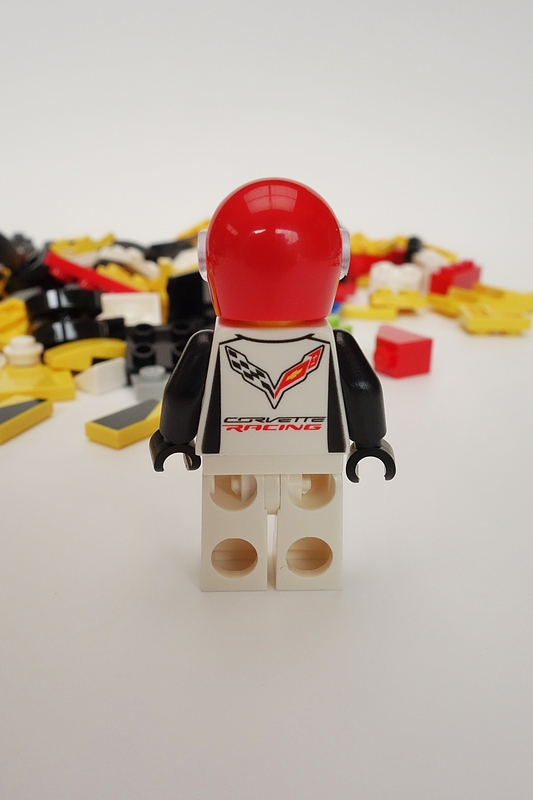](https://www.freelug.org/IMG/jpg/Chevrolet_Corvette_Z06_Speed_Champions_007.jpg)

Service minimum puisque seul le torse est imprimé. La combinaison du pilote est agrémentée du logo Corvette Racing au recto et au verso. C’est minimaliste, mais c’est toujours ça de pris. Il n’empêche que la pièce reste exclusive à ce set. Pourtant, une petite sérigraphie des jambes aurait terminé l’ensemble de plus belle manière.

Même réflexion pour le casque, un modèle de base uni sans fioritures.  
Quand on voit le travail que la firme danoise est capable de faire sur certains casques - notamment sur la gamme Star Wars - on aurait aimé avoir quelque chose de plus "précis".

C’est certainement le "prix à payer" pour bénéficier de sets sous licence de constructeurs automobiles à des tarifs corrects.

[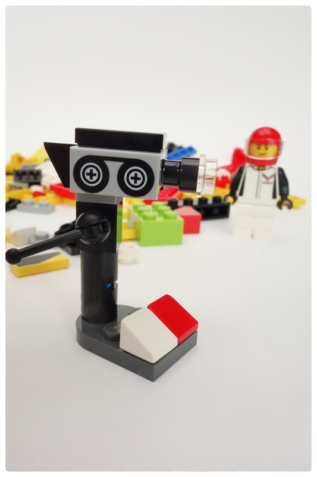](https://www.freelug.org/IMG/jpg/Chevrolet_Corvette_Z06_Speed_Champions_008.jpg)

Chaque set de base de la gamme propose en plus de la voiture un petit accessoire, ici un podium, là un feu de départ, pour cette boite, il s’agit d’une caméra chargée de suivre la course. On imagine qu’elle est automatique puisque aucun caméraman ne la manipule.

Mais attaquons la construction.

[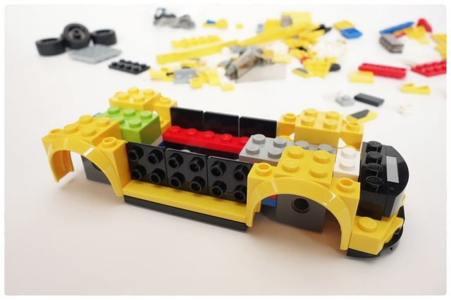](https://www.freelug.org/IMG/jpg/Chevrolet_Corvette_Z06_Speed_Champions_009.jpg)

Après une quinzaine d’étapes de montage, la carcasse est en place. Comme sur la plupart des véhicules de la gamme, c’est en SNOT, grâce à l’utilisation de brackets, que les flancs seront montés.

[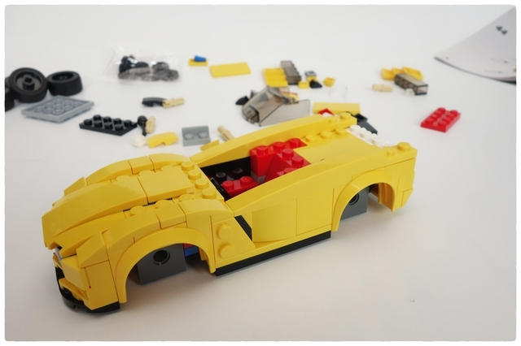](https://www.freelug.org/IMG/jpg/Chevrolet_Corvette_Z06_Speed_Champions_010.jpg)

L’utilisation du SNOT permet donc de donner des courbes aux flancs des véhicules. On aperçoit ici, à moitié dissimulée, une des tiles sérigraphiées.

[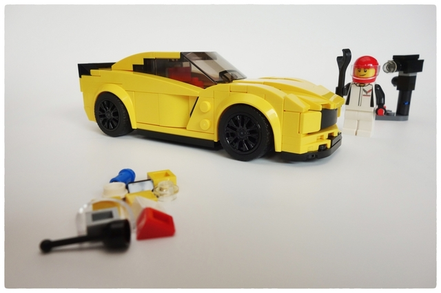](https://www.freelug.org/IMG/jpg/Chevrolet_Corvette_Z06_Speed_Champions_011.jpg)

Le bolide terminé, sans les stickers. Au premier plan, le petit tas d’extra parts.

[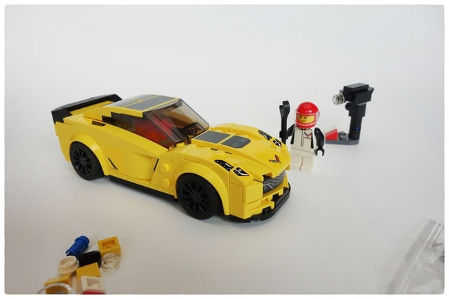](https://www.freelug.org/IMG/jpg/Chevrolet_Corvette_Z06_Speed_Champions_012.jpg)

La version décorée. Il faut reconnaître que les stickers apportent une touche de finition indéniable au modèle.

**Conclusion.** J’avoue, je me suis laissé prendre par cette gamme. A priori le thème n’était pas spécialement fait pour m’attirer, mis à part peut-être un ou deux modèles mythiques, et puis après avoir eu l’occasion d’en monter un, j’ai été très agréablement surpris.

Certes, on pourra toujours reprocher à certains modèles d’être plus ou moins reconnaissable, mais il faut avouer que globalement la gamme se tient.

Les véhicules sont robustes et on pourra laisser sans problème les enfants jouer avec sans craindre que le véhicule ne souffre trop.  
Mais surtout, cette gamme aura été à l’origine de quelques nouvelles pièces, comme de nouveaux garde-boues.

Une petite précision supplémentaire, selon les modèles, le pare-brise peut être sérigraphié.
