Un nouveau train hors de la gamme City/Expert, ce n’est pas courant. Après [le train Toy Story](/articles/toy-story-3-le-train/), la nouvelle licence Disney _The Lone Ranger_ apporte à son tour le sien.

## Résumé

**–** Référence : 79111  
**–** Nom : Constitution Train Chase  
**–** Nombre de pièces : 699  
**–** Année de sortie : 2013  
**–** Prix : 99,99 €

## Le contenu

**La boite**

Boite plutôt compacte, elle fait mine de rien son poids.

[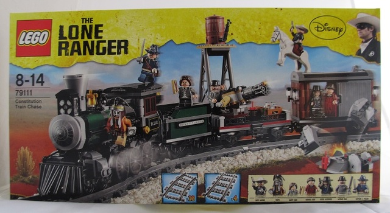](https://www.freelug.org/IMG/jpg/79111_boite_face.jpg)

Le verso présente comme à l’habitude les différents éléments de jeu.

[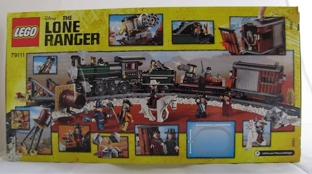](https://www.freelug.org/IMG/jpg/79111_boite_dos.jpg)

La boite contient six sachets numérotés (1 à 6), un sachet avec les éléments spécifiques au train (aimants et grandes roues), 16 rails courbes et 4 droits, 2 notices et une petite planche d’autocollants, le tout en vrac (pas de pochette renforcée).

[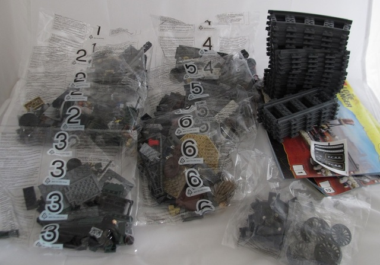](https://www.freelug.org/IMG/jpg/79111_contenu.jpg)

**Pièces particulières**

Tout d’abord les minifigs, au nombre de 7, représentent différents personnages du film.

[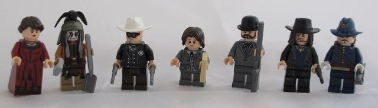](https://www.freelug.org/IMG/jpg/79111_minifigs.jpg)

Précisons que l’oiseau de Tonto se détache. Il y a fort à parier que cet oiseau apparaitra dans de nombreux MOCs de type cimetière ou champ de bataille...

Les minifigs sont réparties dans les 6 sachets, comme cela est le cas depuis quelques temps. C’est surement la réponse de LEGO face aux fausses réclamations devenues trop fréquentes du fameux sachet n°1 contenant toutes les minifigs manquant dans les boites.

Outre les minifigs spécifiques à cette gamme, les nouvelles pièces sont très limitées.

En particulier, nous avons droit à un nouveau modèle de revolver, bien plus réaliste que le précédent.

On peut tout de même citer les nouvelles couleurs de la [caisse 30150 en nougat](http://www.bricklink.com/catalogItem.asp?P=30150), du [lingot 99563 en argent](http://www.bricklink.com/catalogItem.asp?P=99563) ou du [chapeau asiatique 93059 en gris foncé](http://www.bricklink.com/catalogItem.asp?P=93059).

## La locomotive

La locomotive se construit en deux étapes avec les deux premiers sachets.

[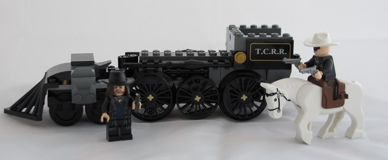](https://www.freelug.org/IMG/jpg/79111_loco01.jpg)

[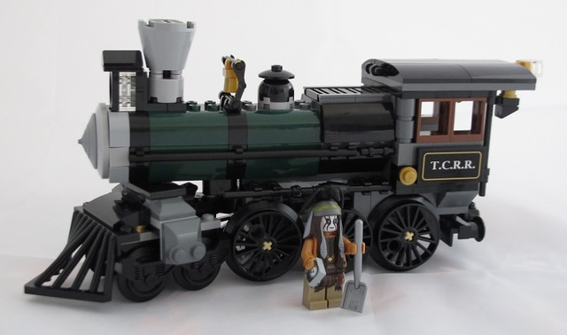](https://www.freelug.org/IMG/jpg/79111_loco02.jpg)

On notera l’usage du fez doré en guise de cloche. L’intérieur de la cabine n’est pas équipé.

[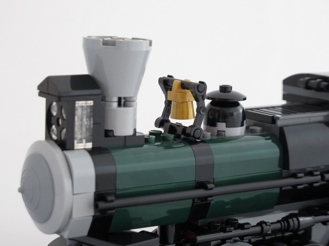](https://www.freelug.org/IMG/jpg/79111_locodetail.jpg)

Le tender (sachet n03) ne permet pas dans la configuration d’origine d’être équipé d’un moteur de train. Dommage.

[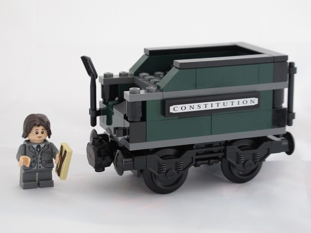](https://www.freelug.org/IMG/jpg/79111_tender.jpg)

## Les wagons

Le sachet n°4 nous apporte un petit wagon équipé d’une mitrailleuse. La caisse contient pierres précieuses et lingots.

[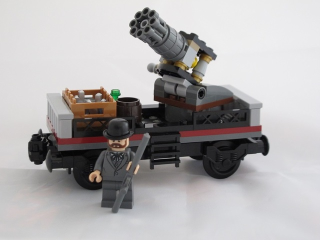](https://www.freelug.org/IMG/jpg/79111_wagon01.jpg)

Le sachet n°5 est un wagon doté de portes coulissantes, et d’une cellule de prison. Un levier accessible sur le toit permet de faire sauter la paroi arrière libérant ainsi le prisonnier.

[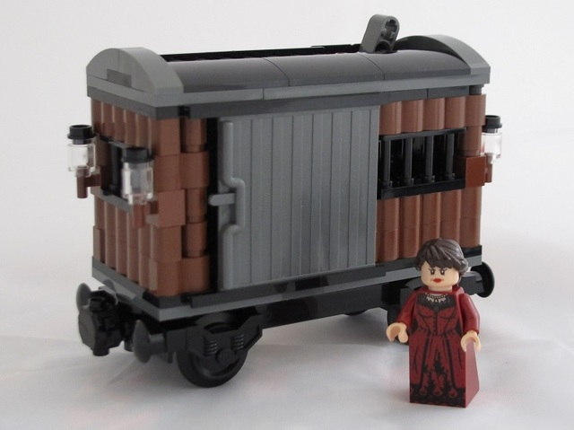](https://www.freelug.org/IMG/jpg/79111_wagon02.jpg)

Enfin, le sachet n°6 nous apporte réservoir d’eau dynamitable, ainsi qu’un rocher n’attendant qu’à exploser, encore une fois à l’aide d’un levier.

[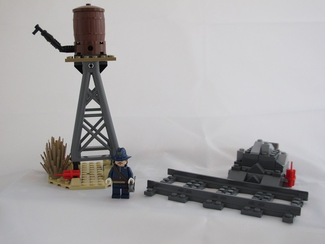](https://www.freelug.org/IMG/jpg/79111_accessoire01.jpg)

[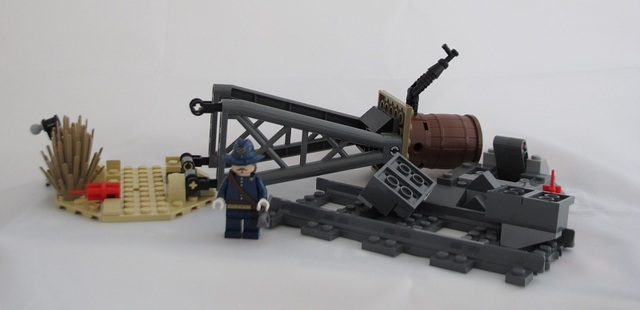](https://www.freelug.org/IMG/jpg/79111_accessoire02.jpg)

## Conclusion

[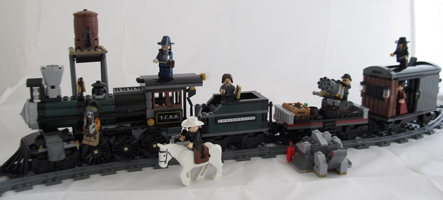](https://www.freelug.org/IMG/jpg/79111_train.jpg)

Si les wagons présentent peu d’intérêt, la locomotive est plutôt sympa. Les minifigs pourront être facilement réutilisées dans différents thèmes.

La présence des rails est un plus, mais il est dommage que le modèle n’ait pas été conçu pour être motorisé.

En gros, si vous n’avez pas un faible pour les vapeurs, ce train ne vous manquera pas.
