Pour le moment 4 sets sont prévus dans cette gamme : 60184 à 60186 et 60188. Il y a fort à parier que le 60187 viendra compléter l’ensemble.  
Penchons nous ici sur le set d’entrée de gamme.  
Nos mineurs vont partir cette fois à la recherche de minerai d’or...

Pour rappel le thème de la mine avait déjà fait l’objet d’une série de 7 sets en 2012 : 4200 à 4204 et 30151 et 30152.

-   Set N° : 60184 - L’équipe minière
-   Nbre de pièces : 82
-   Prix : 9,99€
-   Rapport prix/pièce : 12 cents/pièce
-   Nbre de figs : 4
    
    [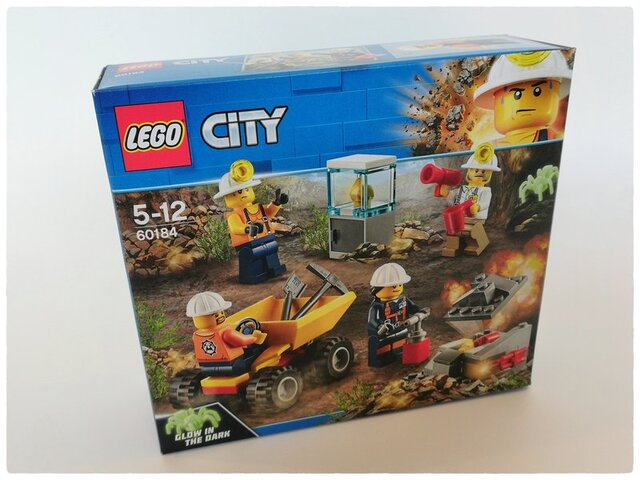](https://www.freelug.org/IMG/jpg/60184_L_equipe_miniere_002.jpg)
    

La première chose que l’on remarque sur cette nouvelle gamme CITY, c’est le relooking de l’emballage. Le bandeau bleu est toujours présent, mais il est travaillé de manière à donner un effet de texture, pas seulement sur la face avant, mais sur 5 des côtés de la boîte (seule la face avec le code barre ne change pas).

La partie droite du bandeau propose toujours une tête de minifig, mais un élément de décor travaillé est placé en arrière plan. Pour cette thématique minière, il s’agit d’une belle explosion. Le contenu de la boîte est également mis en valeur sur un beau décor, dépassant du cadre. L’ensemble est vraiment dynamique.

[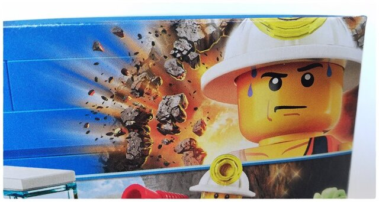](https://www.freelug.org/IMG/jpg/60184_L_equipe_miniere_003.jpg)

La face arrière, à son habitude, propose les différents éléments de jouabilité dans 4 vignettes mises en relief. Là encore, le contenu dépasse des bords, dynamisant l’ensemble.

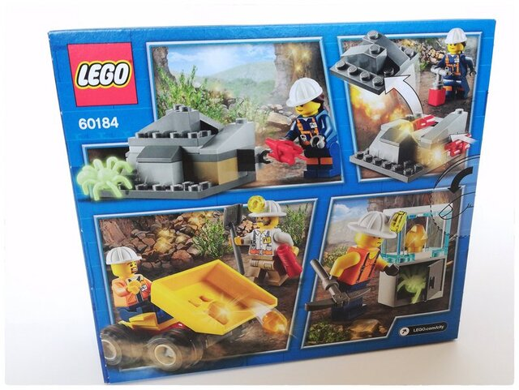

A l’intérieur, deux sachets et une notice de montage, on n’attend pas grand chose de plus d’un set de ce prix.

[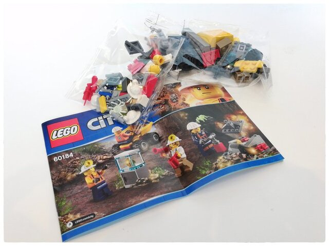](https://www.freelug.org/IMG/jpg/60184_L_equipe_miniere_005.jpg)

Auparavant, les premières étapes de la construction étaient réservées au montage des minifigs. Ici, la notice nous propose 3 étapes distinctes pour monter une minifig et son environnement/accessoire. C’est sympa et ça permet de construire l’histoire au fur et à mesure si des enfants montent la boite à plusieurs.

[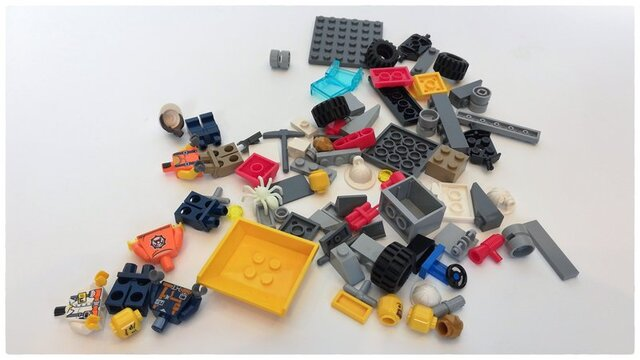](https://www.freelug.org/IMG/jpg/60184_L_equipe_miniere_006.jpg)

Nous commençons donc par le petit chargeur à godet et son conducteur.

[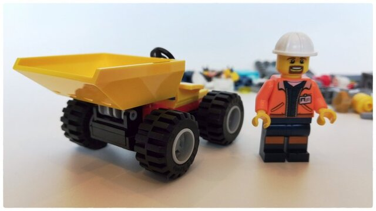](https://www.freelug.org/IMG/jpg/60184_L_equipe_miniere_007.jpg)

Suivi par un ouvrier qui a vraisemblablement mis sous vitrine la première pétite trouvée par l’équipe.  
Une autre surprise l’attend en la personne d’une araignée qui scintille dans le noir !

[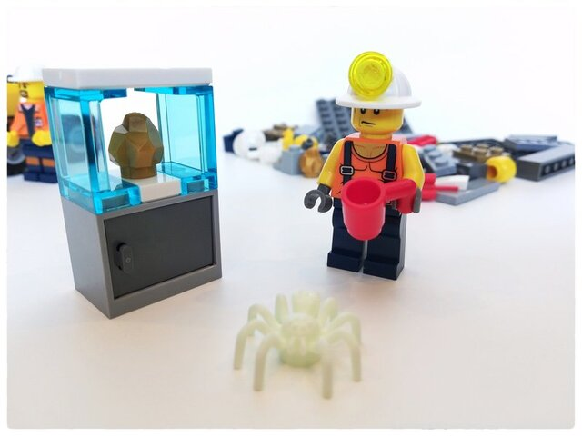](https://www.freelug.org/IMG/jpg/60184_L_equipe_miniere_008.jpg)

C’est l’occasion de nous arrêter sur une des nouvelles pièces de cette fournée 2018 : la pépite d’or. Je pense qu’on peut parier qu’on la retrouvera rapidement en silver, pourquoi pas en trans, voire d’autres coloris lorsque les designers de Billund lui trouveront une autre utilité que simple pépite. Je l’imagine bien faire son apparition en élément de décoration dans un prochain modular.

[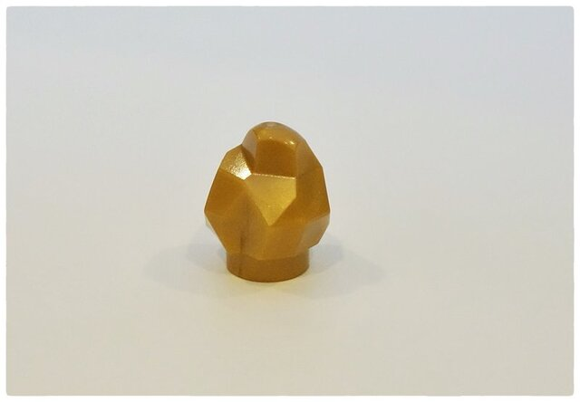](https://www.freelug.org/IMG/jpg/60184_L_equipe_miniere_001.jpg)

La dernière scène, est celle de l’extraction de la pépite. deux minifigs, un contremaître et une spécialiste des explosifs sont chargées de cette opération.

[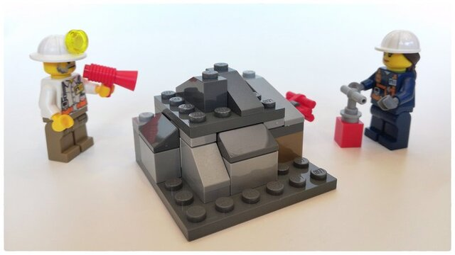](https://www.freelug.org/IMG/jpg/60184_L_equipe_miniere_009.jpg)

Les enfants s’amuseront à actionner le mécanisme qui permet de faire sauter le dessus de la roche et de découvrir l’or convoité. Une simple poussée sur la dynamite et.... BOUM !

[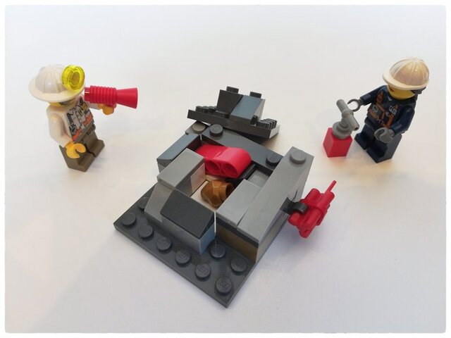](https://www.freelug.org/IMG/jpg/60184_L_equipe_miniere_010.jpg)

Arrêtons nous maintenant sur les figurines qui composent ce set :

_Le conducteur du chargeur à godet :_

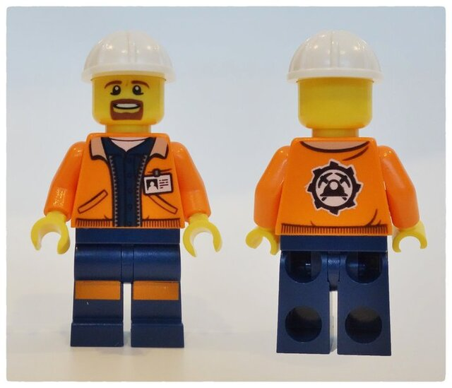

Le torse orange est inédit à cette gamme et se retrouve notamment dans le 60186 et le 60188. Sérigraphie face et dos, plutôt réussie avec le badge d’identification sur le devant et le logo sur le dos, même si le blanc à toujours du mal à bien ressortir sur des couleurs foncées.  
Sérigraphie également sur les jambes, avec deux bandes oranges (certainement des bandes réflectrices).

_L’ouvrier :_

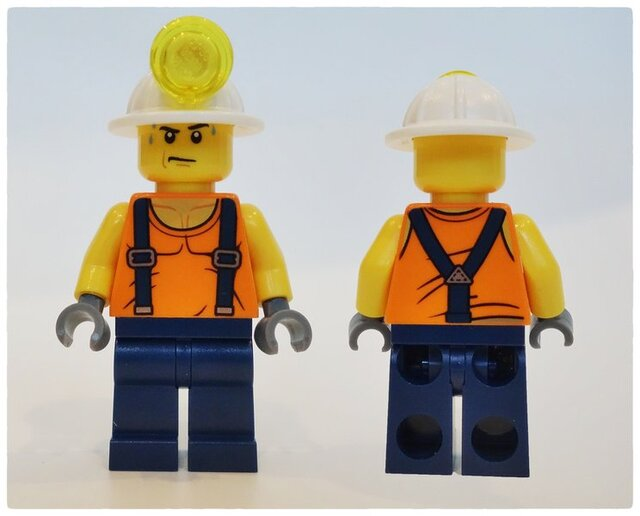

Le casque de mineur passe en blanc au lieu du silver sur la gamme de 2012. Tête simple face, avec des gouttes de sueur.  
Le torse est vraiment chouette, avec les pectoraux du perso et les bretelles. Chouette détail sur le dos, avec le marcel qui ressort du pantalon. dommage que le jaune sur le orange passe au brun, l’effet aurait été top. Un petit côté Village People...

_Le contremaître :_

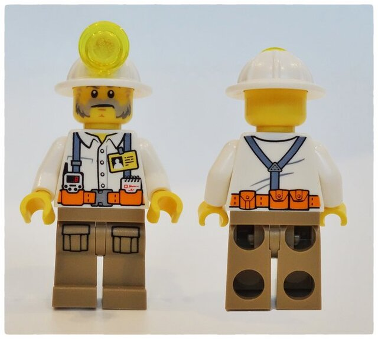

Une belle minifig également, avec une tête qui me fait penser à Sean Connery dans "L’homme qui voulut être roi". Torse inédit à ce thème comme les précédents, très réussi et détaillé, quand aux jambes en dark tan avec leurs poches, elles sont nouvelles également, et réutilisées dans la nouvelle gamme "Police des Montagnes".

_L’experte en explosifs :_

[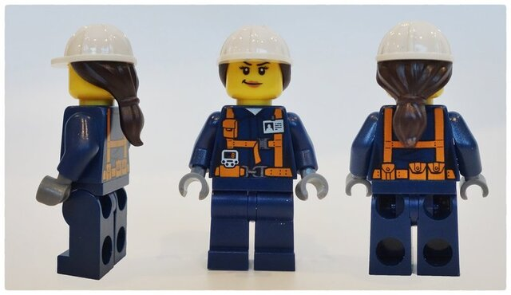](https://www.freelug.org/IMG/jpg/60184_L_equipe_miniere_015.jpg)

Seule minifig féminine de la boite, elle porte une combinaison en dark blue avec un harnais orange. La sérigraphie est réussie, avec de beaux détails.  
Le casque avec la queue de cheval n’est pas inédit.

[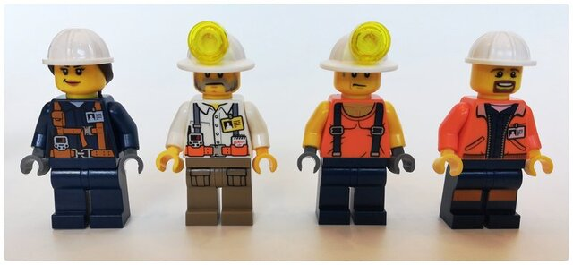](https://www.freelug.org/IMG/jpg/60184_L_equipe_miniere_016.jpg)

**Conclusion :**  
On n’attends jamais grand chose d’un set d’entrée de gamme, mais au moins, avec ses 4 personnages et ces 3 éléments de jouabilité (le chargeur, la vitrine et le rocher à exploser), les enfants auront de quoi s’amuser et créer de petites histoires.  
J’apprécie le fait qu’après les sets à licence, TLC s’applique aussi, depuis quelques années, à faire de belles sérigraphies pour les thèmes CITY, ce qui permet d’avoir un peu de variété pour ceux qui prendront cette boite pour l’inclure dans un diorama.  
Point noir, le rapport prix/pièce à 12 cents, un peu élevé. Mais dans une gamme à licence, il vous faudra débourser entre 5 et 6 euros de plus pour le même nombre de personnages et quelques pièces.

[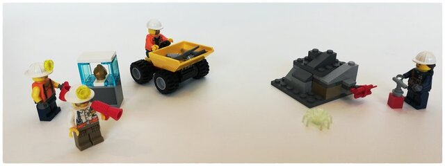](https://www.freelug.org/IMG/jpg/60184_L_equipe_miniere_011.jpg)
