La sortie de « Star Wars épisode VII » a immanquablement été le prétexte à sortir de nouveaux sets, inspirés des vaisseaux visibles dans le nouvel épisode de la saga imaginée par George Lucas il y a maintenant 40 ans. Parmi ceux-ci, le nouvel X-Wing de la Résistance qui figure dans deux livrées dans le film. Une version orange et noir, et une version gris et bleu.

A quelques mois d’intervalle, TLC nous a proposé ces deux versions. Le set 75102 - Poe’s X-Wing Fighter, et le 75149 - Resistance X-Wing Fighter.

La différence entre ces deux sets se limite-t-elle à un changement de couleurs ? Ou les designers de Billund ont-ils opéré quelques changements entre les deux modèles ? C’est ce que nous allons voir avec cette revue comparative des deux sets.

**75102 - Poe’S X-Wing Fighter**  
**–** Sortie : Septembre 2015  
**–** Nombre de pièces : 702  
**–** Prix : 99,99€  
**–** Ratio prix/pièce : 14,24 cts/pièce  
**–** Minifigs : 3 + le droïde BB8

**75149 - Resistance X-Wing Fighter**  
**–** Sortie : Juin 2016  
**–** Nombre de pièces : 716  
**–** Prix : 99,99€  
**–** Ratio prix/pièce : 13,96 cts/pièce  
**–** Minifigs : 3 + le droïde BB8

**Les boîtes.**

Les deux sets nous présentent le vaisseau en action. Au-dessus de montagnes enneigées pour le 75102, une référence certaine à la scène finale du film sur la planète D’Qar, où la base Starkiller est installée.

[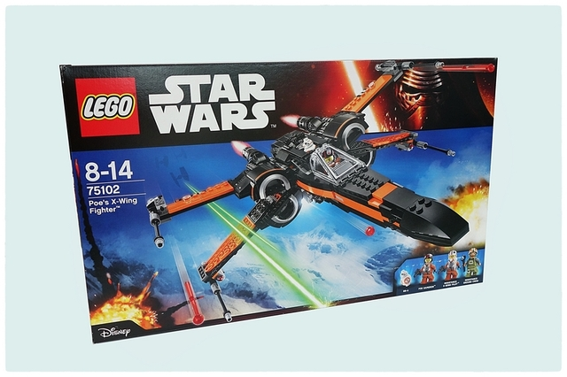](https://www.freelug.org/IMG/jpg/Comparatif_75102_Poe_s_X-Wing_Fighter_vs_75149_Resistance_X-Wing_Fighter_001.jpg)

Pour le 75149, c’est sur Jaaku que se passe le visuel qui nous présente le set.

[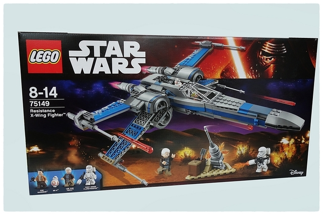](https://www.freelug.org/IMG/jpg/Comparatif_75102_Poe_s_X-Wing_Fighter_vs_75149_Resistance_X-Wing_Fighter_004.jpg)

De facture habituelle, le bandeau supérieur reprend les différents logos ainsi que la tête de Kylo Ren et son sabre laser rouge, visuel d’identification du marketing autour de cet épisode.  
Les tranches nous présentent les figs qui figurent dans les boîtes. Elles seront détaillées en fin d’article.

[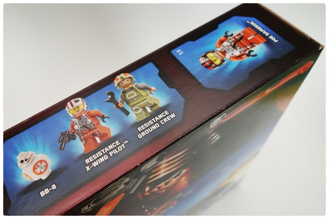](https://www.freelug.org/IMG/jpg/Comparatif_75102_Poe_s_X-Wing_Fighter_vs_75149_Resistance_X-Wing_Fighter_002.jpg)

[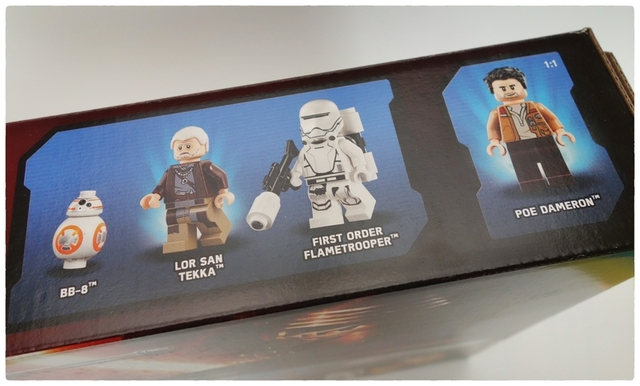](https://www.freelug.org/IMG/jpg/Comparatif_75102_Poe_s_X-Wing_Fighter_vs_75149_Resistance_X-Wing_Fighter_005.jpg)

Le dos propose plusieurs visuels de mise en situation, ainsi que des plans du X-Wing. Le descriptif complet des armes du 75102 est remplacé sur le 75149 par une publicité pour télécharger une application gratuite, Force Builder, dans laquelle le joueur pourra construire des vaisseaux et venir en aide à la Résistance au cours de différentes missions.

[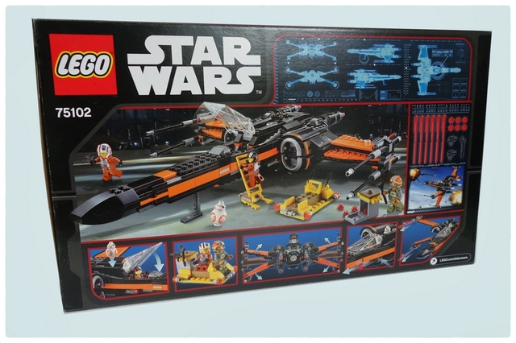](https://www.freelug.org/IMG/jpg/Comparatif_75102_Poe_s_X-Wing_Fighter_vs_75149_Resistance_X-Wing_Fighter_003.jpg)

[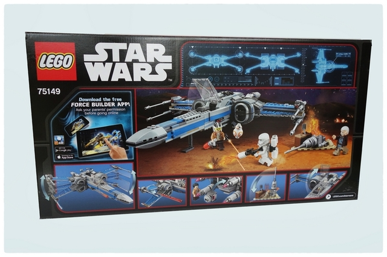](https://www.freelug.org/IMG/jpg/Comparatif_75102_Poe_s_X-Wing_Fighter_vs_75149_Resistance_X-Wing_Fighter_006.jpg)

Chacun des sets est proposé avec des éléments de jouabilité, du matériel de maintenance technique pour le set 75102, un déshumidificateur qui explose pour le 75149, référence à la scène d’ouverture.

Chaque boite comprend une notice, une petite planche de stickers et 5 sachets numérotés. On commence donc chacune de ces constructions dans les mêmes conditions.

[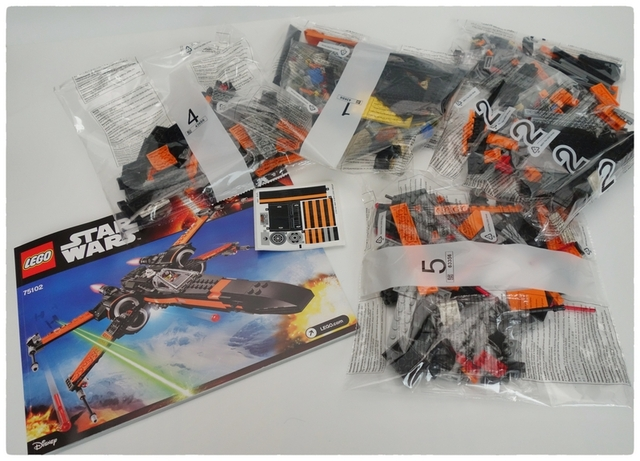](https://www.freelug.org/IMG/jpg/Comparatif_75102_Poe_s_X-Wing_Fighter_vs_75149_Resistance_X-Wing_Fighter_007.jpg)

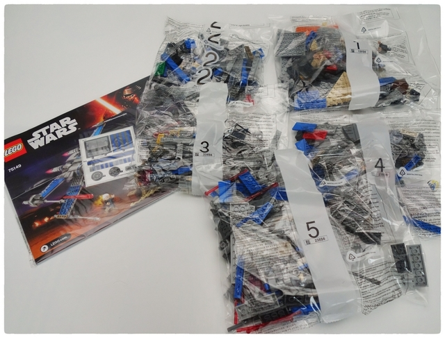

A l’assaut du sachet 1.

[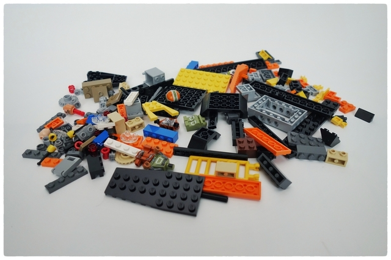](https://www.freelug.org/IMG/jpg/Comparatif_75102_Poe_s_X-Wing_Fighter_vs_75149_Resistance_X-Wing_Fighter_009.jpg)

Sachet 1 du set 75102

[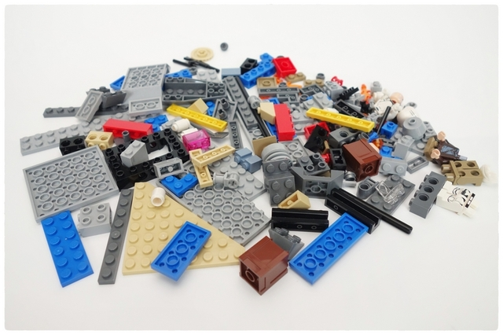](https://www.freelug.org/IMG/jpg/Comparatif_75102_Poe_s_X-Wing_Fighter_vs_75149_Resistance_X-Wing_Fighter_012.jpg)

Sachet 1 du 75149

[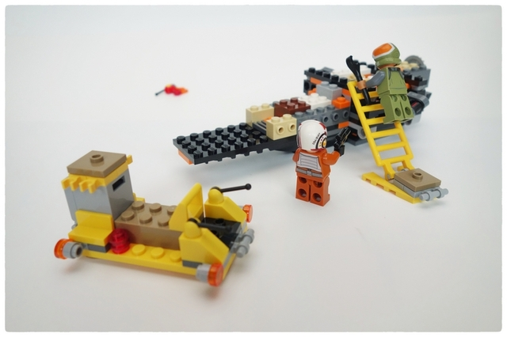](https://www.freelug.org/IMG/jpg/Comparatif_75102_Poe_s_X-Wing_Fighter_vs_75149_Resistance_X-Wing_Fighter_010.jpg)

[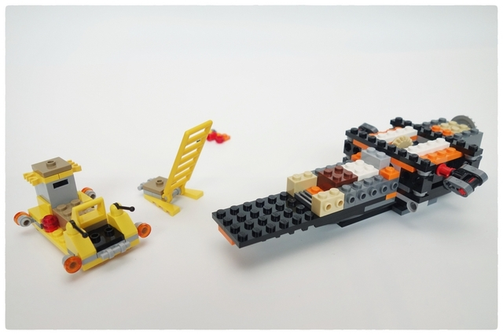](https://www.freelug.org/IMG/jpg/Comparatif_75102_Poe_s_X-Wing_Fighter_vs_75149_Resistance_X-Wing_Fighter_011.jpg)

[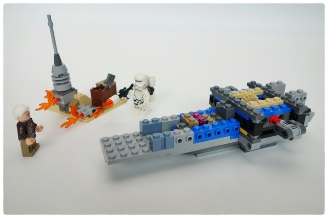](https://www.freelug.org/IMG/jpg/Comparatif_75102_Poe_s_X-Wing_Fighter_vs_75149_Resistance_X-Wing_Fighter_013.jpg)

[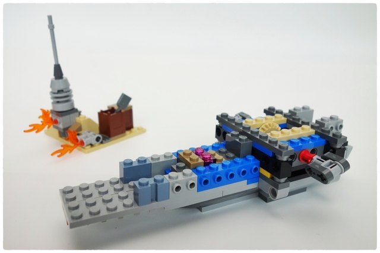](https://www.freelug.org/IMG/jpg/Comparatif_75102_Poe_s_X-Wing_Fighter_vs_75149_Resistance_X-Wing_Fighter_014.jpg)

Chacun de ces sachets nous propose de monter les éléments de jouabilité, deux figurines et une structure de base pour le X-Wing.

[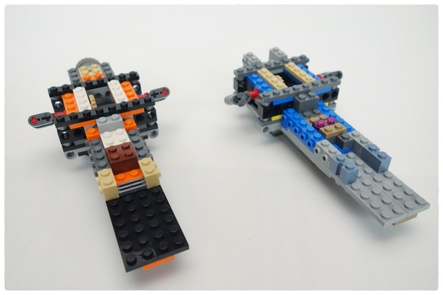](https://www.freelug.org/IMG/jpg/Comparatif_75102_Poe_s_X-Wing_Fighter_vs_75149_Resistance_X-Wing_Fighter_015.jpg)

On notera une toute légère différence de montage sur la partie qui accueillera le droïde. Avec l’emploi de « plate » et « brick » 2x1, à la place de « brick 2x2 ». Rien qui ne laisse pourtant présager d’un changement radical de techniques de construction.

[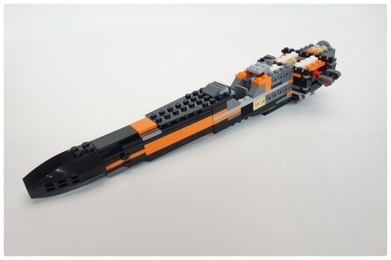](https://www.freelug.org/IMG/jpg/Comparatif_75102_Poe_s_X-Wing_Fighter_vs_75149_Resistance_X-Wing_Fighter_018.jpg)

[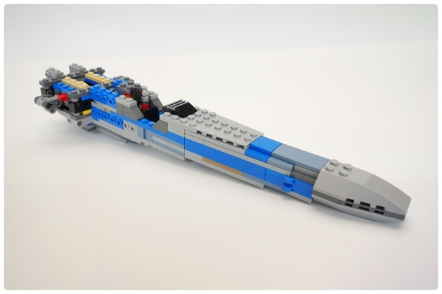](https://www.freelug.org/IMG/jpg/Comparatif_75102_Poe_s_X-Wing_Fighter_vs_75149_Resistance_X-Wing_Fighter_016.jpg)

La fin du sachet 2 nous laisse avec le cockpit et le fuselage du chasseur stellaire. Aucune modification dans cette partie, si ce n’est la présence d’un extincteur dans le cockpit derrière le siège du pilote dans le set 75149.

[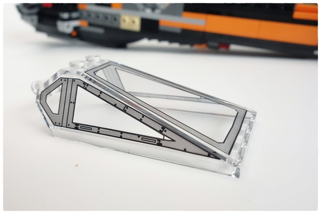](https://www.freelug.org/IMG/jpg/Comparatif_75102_Poe_s_X-Wing_Fighter_vs_75149_Resistance_X-Wing_Fighter_020.jpg)

[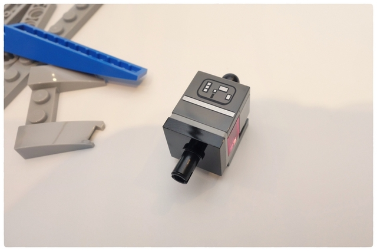](https://www.freelug.org/IMG/jpg/Comparatif_75102_Poe_s_X-Wing_Fighter_vs_75149_Resistance_X-Wing_Fighter_021.jpg)

Le sachet 3 comprend la verrière, avec une tampographie de belle facture, ainsi qu’une « tile » 2x2 qui viendra se fixer à l’arrière du vaisseau. Elle sera d’ailleurs au final invisible.

[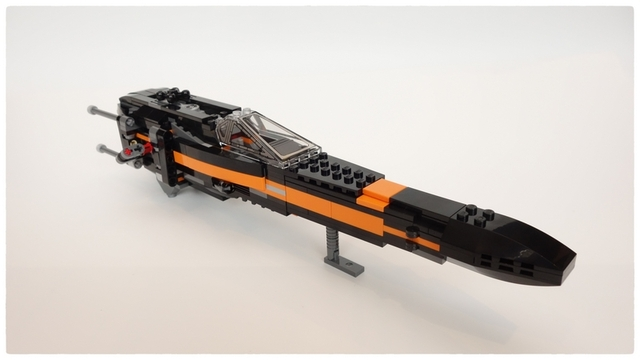](https://www.freelug.org/IMG/jpg/Comparatif_75102_Poe_s_X-Wing_Fighter_vs_75149_Resistance_X-Wing_Fighter_024.jpg)

[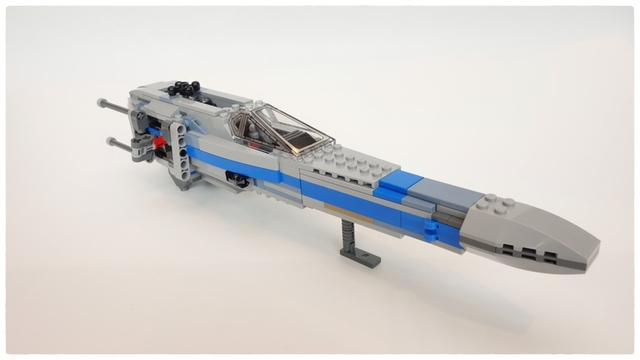](https://www.freelug.org/IMG/jpg/Comparatif_75102_Poe_s_X-Wing_Fighter_vs_75149_Resistance_X-Wing_Fighter_023.jpg)

Cette nouvelle étape nous permet d’habiller l’arrière du fuselage, la partie où viendra se loger le droïde.

[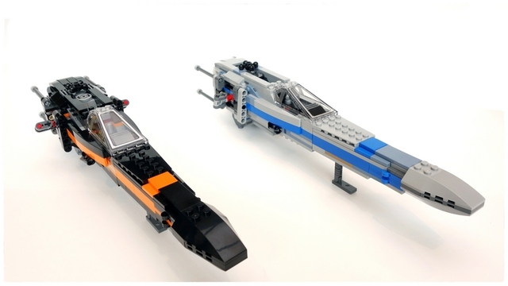](https://www.freelug.org/IMG/jpg/Comparatif_75102_Poe_s_X-Wing_Fighter_vs_75149_Resistance_X-Wing_Fighter_022.jpg)

Le système d’écartement des ailes X, ainsi que leur fixation, est également installé.

[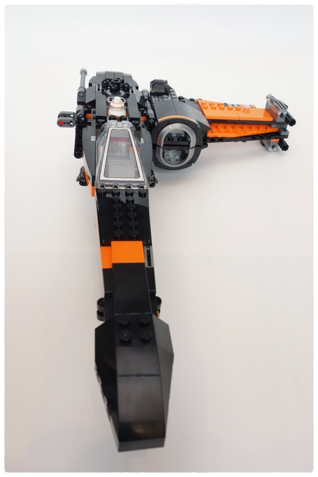](https://www.freelug.org/IMG/jpg/Comparatif_75102_Poe_s_X-Wing_Fighter_vs_75149_Resistance_X-Wing_Fighter_026.jpg)

[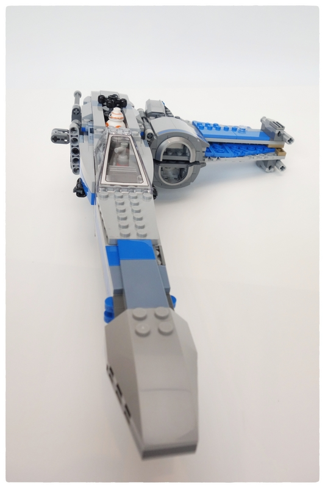](https://www.freelug.org/IMG/jpg/Comparatif_75102_Poe_s_X-Wing_Fighter_vs_75149_Resistance_X-Wing_Fighter_025.jpg)

[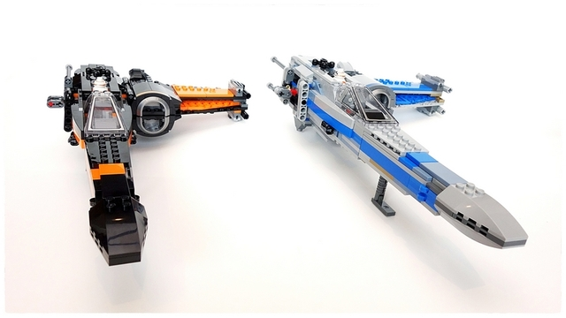](https://www.freelug.org/IMG/jpg/Comparatif_75102_Poe_s_X-Wing_Fighter_vs_75149_Resistance_X-Wing_Fighter_027.jpg)

Les sachets 4 & 5 sont similaires, chacun permettant de construire la partie supérieure et inférieure d’une aile. Droite, puis gauche.

[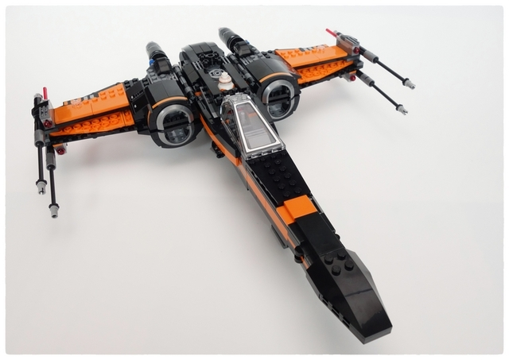](https://www.freelug.org/IMG/jpg/Comparatif_75102_Poe_s_X-Wing_Fighter_vs_75149_Resistance_X-Wing_Fighter_029.jpg)

[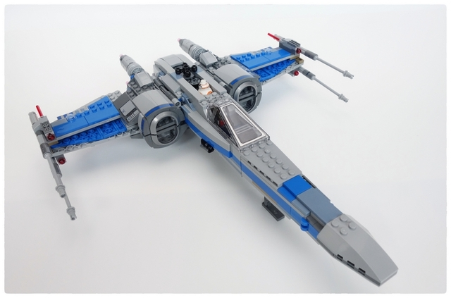](https://www.freelug.org/IMG/jpg/Comparatif_75102_Poe_s_X-Wing_Fighter_vs_75149_Resistance_X-Wing_Fighter_028.jpg)

Au final nous obtenons deux vaisseaux complètement identiques. Mis à part quelques variantes de constructions dans les premiers sachets, cachées par la suite, rien ne permet de distinguer l’un ou l’autre de ces vaisseaux, si ce n’est leur couleur.

[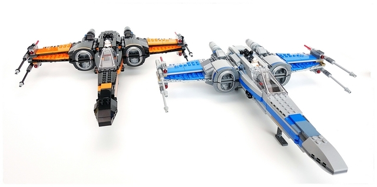](https://www.freelug.org/IMG/jpg/Comparatif_75102_Poe_s_X-Wing_Fighter_vs_75149_Resistance_X-Wing_Fighter_030.jpg)

Passons voir du côté des minifigs présentes dans ces sets.

Le set 75102, « Poe’s X-Wing Fighter » , propose quatre personnages :  
Poe Dameron, un technicien au sol de la Résistance, un pilote de la Résistance, et le droïde BB-8.

[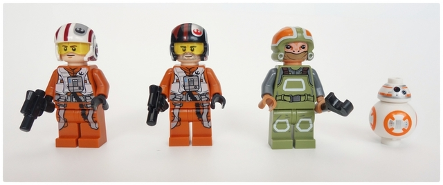](https://www.freelug.org/IMG/jpg/Comparatif_75102_Poe_s_X-Wing_Fighter_vs_75149_Resistance_X-Wing_Fighter_040.jpg)

Combinaisons de vol identiques pour les deux pilotes. Seuls les visages et les casques changent. Il faut noter le travail de sculpture effectué pour les casques, qui bénéficient en plus d’une double injection avec une partie en trans-yellow pour la visière.

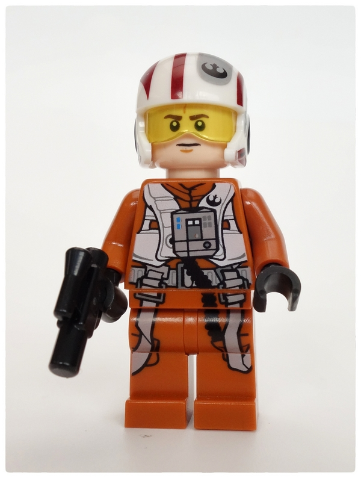

[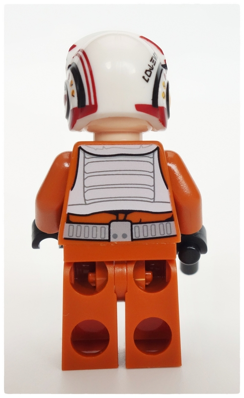](https://www.freelug.org/IMG/jpg/Comparatif_75102_Poe_s_X-Wing_Fighter_vs_75149_Resistance_X-Wing_Fighter_042.jpg)

[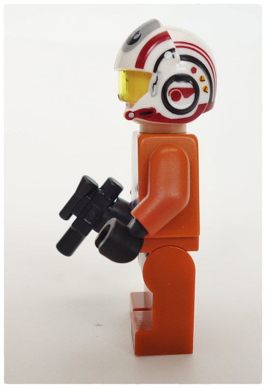](https://www.freelug.org/IMG/jpg/Comparatif_75102_Poe_s_X-Wing_Fighter_vs_75149_Resistance_X-Wing_Fighter_043.jpg)

Rien à dire sur les sérigraphies, si ce n’est un très léger décalage du blanc sur le torse de Poe.

[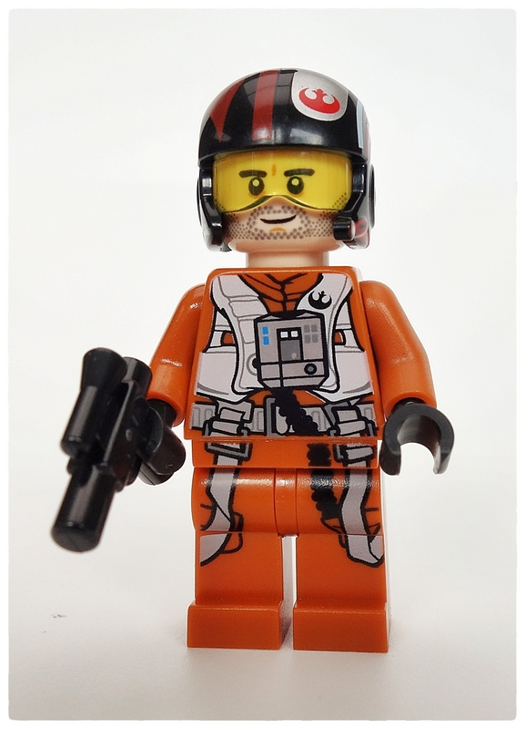](https://www.freelug.org/IMG/jpg/Comparatif_75102_Poe_s_X-Wing_Fighter_vs_75149_Resistance_X-Wing_Fighter_044.jpg)

Pour le reste, le travail est bien détaillé et de très belle facture.

[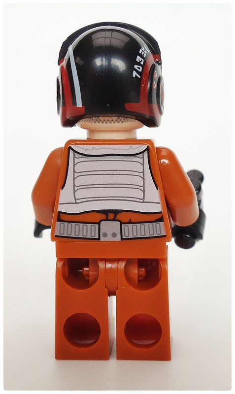](https://www.freelug.org/IMG/jpg/Comparatif_75102_Poe_s_X-Wing_Fighter_vs_75149_Resistance_X-Wing_Fighter_045.jpg)

[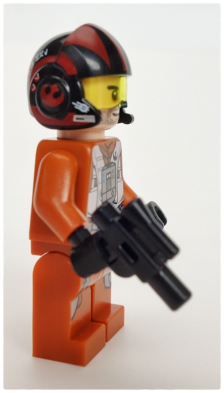](https://www.freelug.org/IMG/jpg/Comparatif_75102_Poe_s_X-Wing_Fighter_vs_75149_Resistance_X-Wing_Fighter_046.jpg)

Le technicien au sol bénéficie lui aussi d’un très beau traitement. Plis sur la combinaison, notamment au niveau de la taille, détails du visage qui lui donnent un beau relief,

[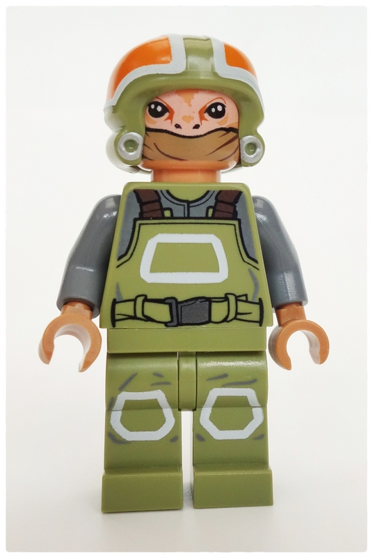](https://www.freelug.org/IMG/jpg/Comparatif_75102_Poe_s_X-Wing_Fighter_vs_75149_Resistance_X-Wing_Fighter_048.jpg)

[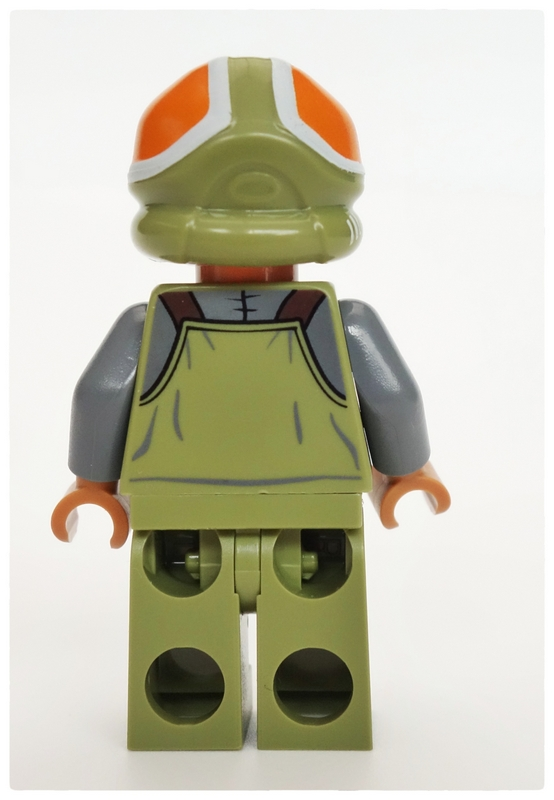](https://www.freelug.org/IMG/jpg/Comparatif_75102_Poe_s_X-Wing_Fighter_vs_75149_Resistance_X-Wing_Fighter_049.jpg)

et toujours un joli travail de sculpture sur le casque, tout en courbes.

[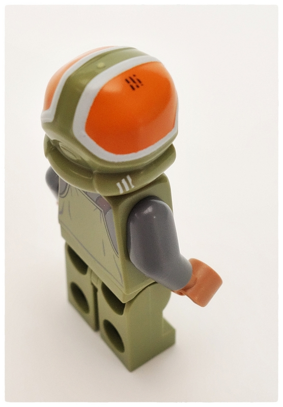](https://www.freelug.org/IMG/jpg/Comparatif_75102_Poe_s_X-Wing_Fighter_vs_75149_Resistance_X-Wing_Fighter_050.jpg)

A noter que Poe est doté d’un double visage.

[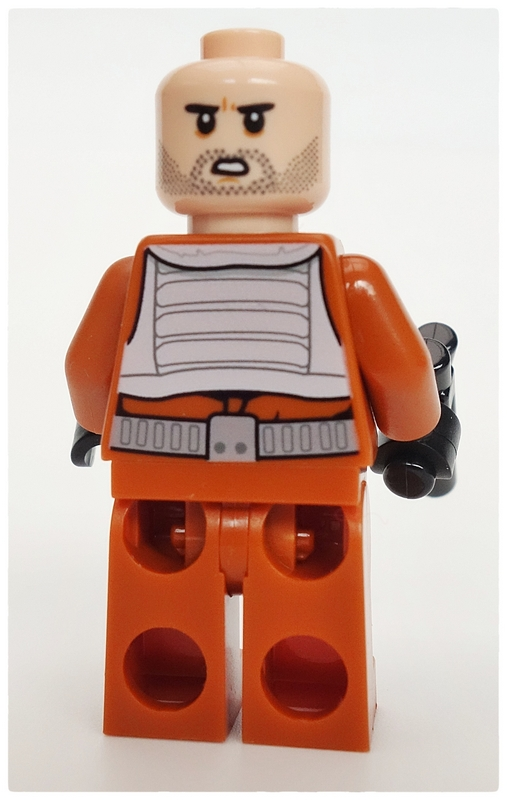](https://www.freelug.org/IMG/jpg/Comparatif_75102_Poe_s_X-Wing_Fighter_vs_75149_Resistance_X-Wing_Fighter_047.jpg)

Quatre figurines également pour le set 75149 « Resistance X-Wing Fighter » :  
Poe Dameron, Lor San Tekka, un 1st Order Flametrooper, et – forcément – l’inusable BB-8,

[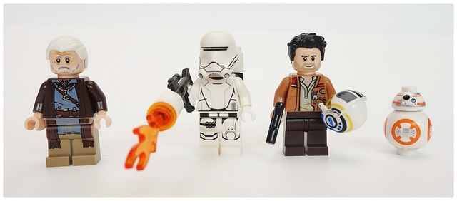](https://www.freelug.org/IMG/jpg/Comparatif_75102_Poe_s_X-Wing_Fighter_vs_75149_Resistance_X-Wing_Fighter_039.jpg)

Poe est présenté avec son blouson, qui deviendra ensuite celui de Finn. Un casque et des cheveux permettent de le présenter en mode variante, en vol, ou au sol avec le casque enlevé.

[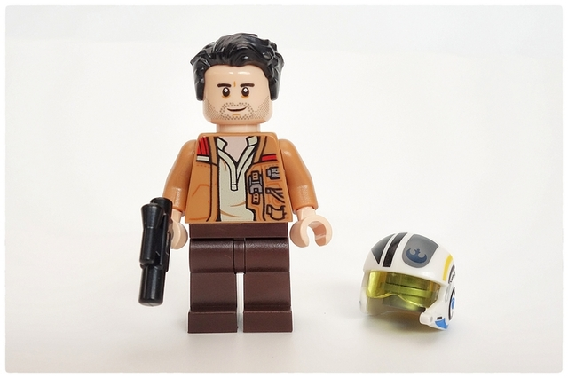](https://www.freelug.org/IMG/jpg/Comparatif_75102_Poe_s_X-Wing_Fighter_vs_75149_Resistance_X-Wing_Fighter_033.jpg)

Notons encore que le casque est différent de celui fourni dans le set 75102. Jolis détails sur le blouson, les jambes restent vierges de toute impression.

[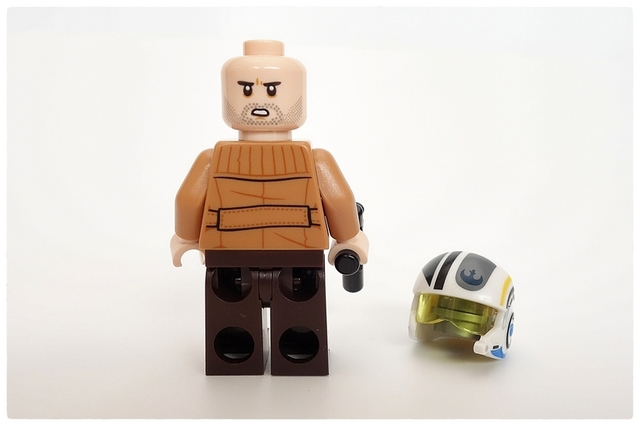](https://www.freelug.org/IMG/jpg/Comparatif_75102_Poe_s_X-Wing_Fighter_vs_75149_Resistance_X-Wing_Fighter_034.jpg)

[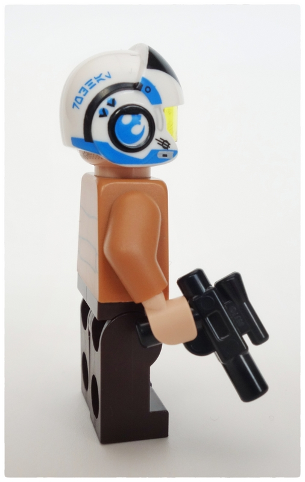](https://www.freelug.org/IMG/jpg/Comparatif_75102_Poe_s_X-Wing_Fighter_vs_75149_Resistance_X-Wing_Fighter_035.jpg)

Lor San Tekka, oui, vous savez ce personnage joué par Max Von Sydow dont tout le monde s’est demandé qui il était et si il avait une importance particulière dans l’histoire, bénéficie, outre son double visage d’un travail soigné sur sa sérigraphie, un tas de jolis détails, colliers foulards, baudriers, flasques, etc. Les jambes sont sérigraphiées, figurant ainsi la tunique et le manteau porté par le personnage. Jolis effets dans la barbe, et un peu plus que le minimum syndical sur le dos.

[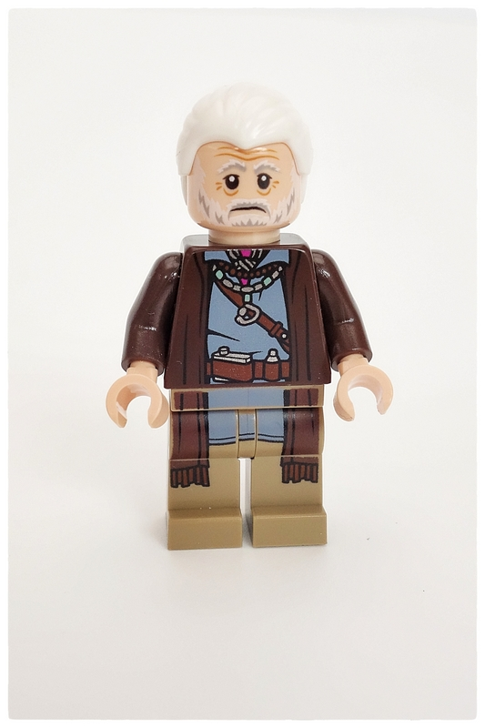](https://www.freelug.org/IMG/jpg/Comparatif_75102_Poe_s_X-Wing_Fighter_vs_75149_Resistance_X-Wing_Fighter_031.jpg)

[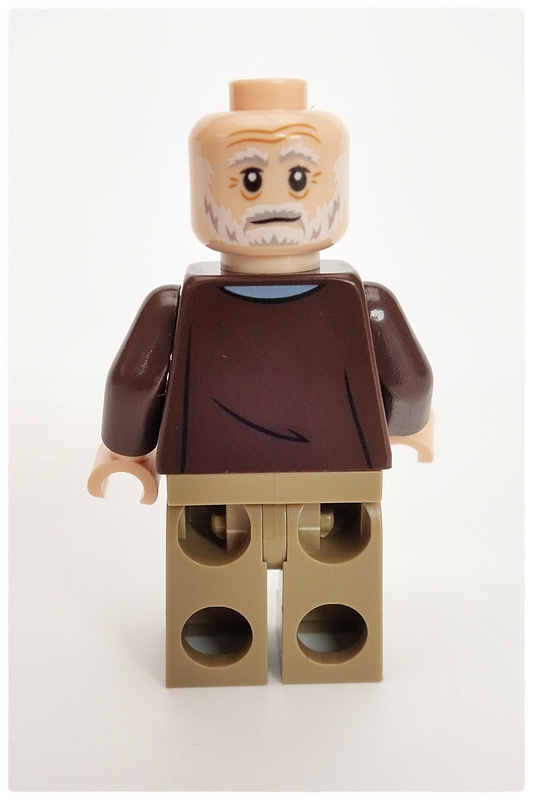](https://www.freelug.org/IMG/jpg/Comparatif_75102_Poe_s_X-Wing_Fighter_vs_75149_Resistance_X-Wing_Fighter_032.jpg)

Le Flametrooper est un 1st Order Stormtrooper équipé de bonbonnes de gaz (napalm) sur le dos et d’un blaster lance-flamme. Cela n’empêche pas un traitement très honorable avec un visuel bien détaillé (torse, dos, jambes, casque).

[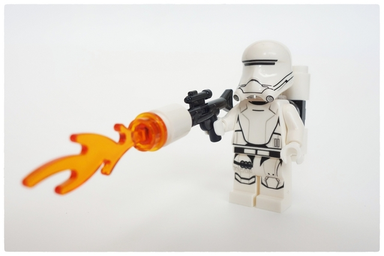](https://www.freelug.org/IMG/jpg/Comparatif_75102_Poe_s_X-Wing_Fighter_vs_75149_Resistance_X-Wing_Fighter_036.jpg)

[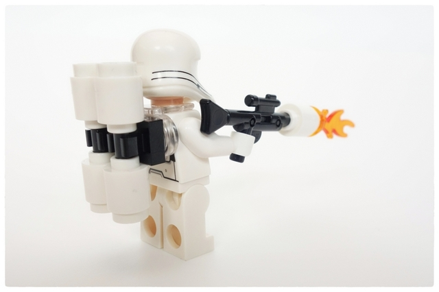](https://www.freelug.org/IMG/jpg/Comparatif_75102_Poe_s_X-Wing_Fighter_vs_75149_Resistance_X-Wing_Fighter_037.jpg)

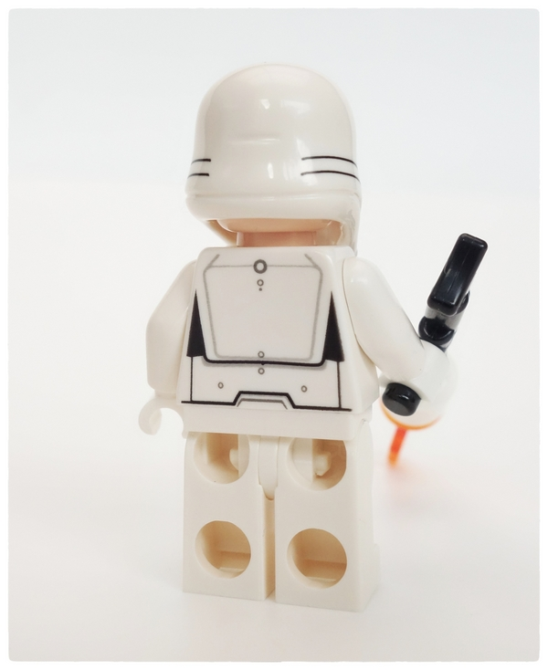

On va vous éviter le BB-8, identique d’un set à l’autre.

**Conclusion.**

Si vous êtes pris par la place et que vous devez faire un choix entre les deux sets, c’est du côté de la couleur et des personnages fournis dans le set que vous devrez trouver la différence, tant ces deux versions du mythique chasseur de la saga « Star Wars » se ressemblent.

Si vous êtes complétiste, ne montez pas ces deux boites l’une après l’autre, un sentiment de répétition vous envahirait à coup sur.
