Il est de coutume désormais pour LEGO® de décliner en version « mini » les véhicules de la gamme Creator Expert. Après le Camping-Car WV de 2013, après la Mini Cooper de 2014, c’est au tour de la VW Beetle d’avoir droit à sa version réduite et d’être offerte pour un minimum d’achat sur le S@H ou dans les stores. Allons voir ça de plus près…

Premier changement, par rapport aux précédentes versions « mini », ce modèle est proposé dans une boîte et non dans un polybag. Le nombre de pièce y est certainement pour quelque chose puisque de 76 pour le mini camping-car (40079), et de 59 pour la mini cooper (40109), il passe ici à 141. De plus, la boîte apporte un côté prestige supplémentaire à ce cadeau. Ça avait d’ailleurs déjà été le cas avec le bus londonien de ce début d’année (40220) et la fontaine (40221) offerte l’an dernier.

[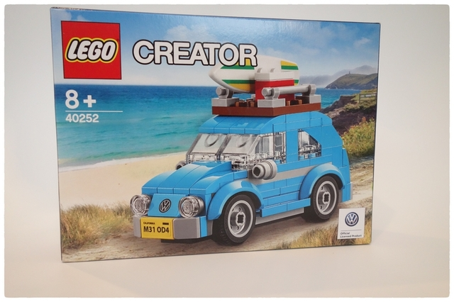](https://www.freelug.org/IMG/jpg/40252_WW_Beetle_Creator_001-2.jpg)

La face de la boîte est relativement sobre, avec une image plein cadre du modèle, incrusté sur un fond de paysage côtier. Serions-nous sur une plage californienne dans les années 60 ? Le surf fixé sur la galerie de toit peut le laisser penser. Le logo de la marque est à son endroit habituel, suivi du logo de la gamme Creator. Mis à part ça, seul un logo Volkswagen, en bas à droite, nous informe qu’il s’agit d’un produit sous licence officielle du constructeur automobile.

[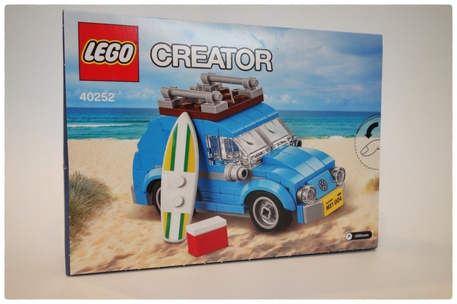](https://www.freelug.org/IMG/jpg/40252_WW_Beetle_Creator_002.jpg)

Le verso est sobre également, mais nous sommes arrivés à destination. La voiture est sur la plage et la glacière et le surf sont prêts. En fait, ces deux visuels sont les mêmes que ceux utilisés pour le set 10252, le modèle mini remplaçant le grand.

[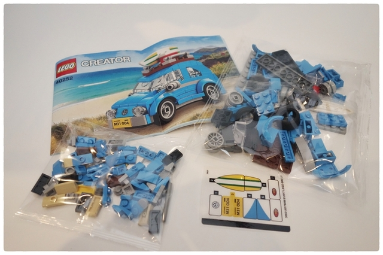](https://www.freelug.org/IMG/jpg/40252_WW_Beetle_Creator_003.jpg)

Au déballage, pas de grande surprise, deux sachets, une notice et une petite planche de sticker. J’avoue avoir eu une petite déception en découvrant que le surf n’était pas imprimé et qu’il allait falloir y mettre des autocollants.

[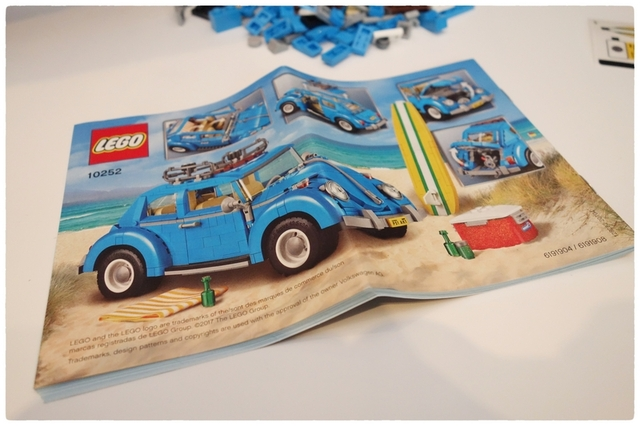](https://www.freelug.org/IMG/jpg/40252_WW_Beetle_Creator_004.jpg)

Le verso de la notice présente le grand modèle du véhicule, le set 10252.

[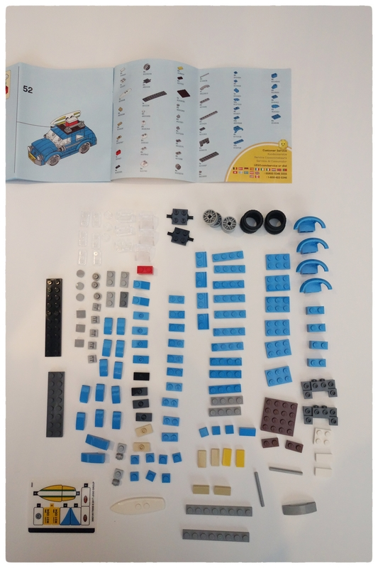](https://www.freelug.org/IMG/jpg/40252_WW_Beetle_Creator_005.jpg)

C’est bon, on a toutes les pièces ? On peut attaquer…

[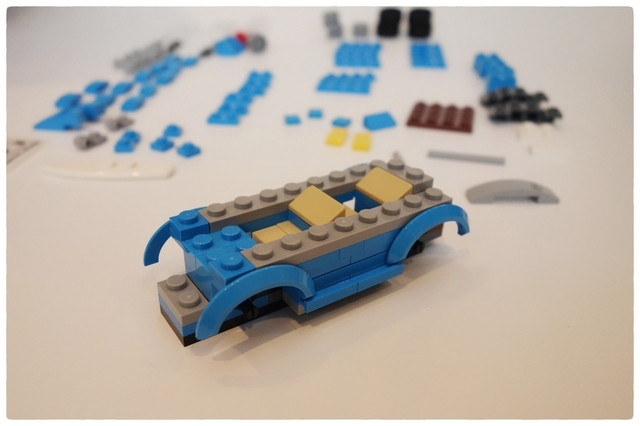](https://www.freelug.org/IMG/jpg/40252_WW_Beetle_Creator_006.jpg)

Une base classique, mais on sent déjà que c’est du solide.

[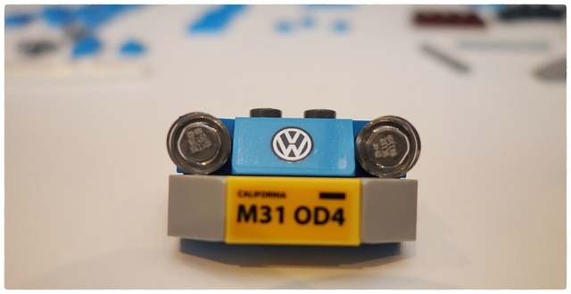](https://www.freelug.org/IMG/jpg/40252_WW_Beetle_Creator_007.jpg)

Les premiers stickers font leur apparition sur la calandre avant, le logo VW et la plaque d’immatriculation, différente du modèle original.

[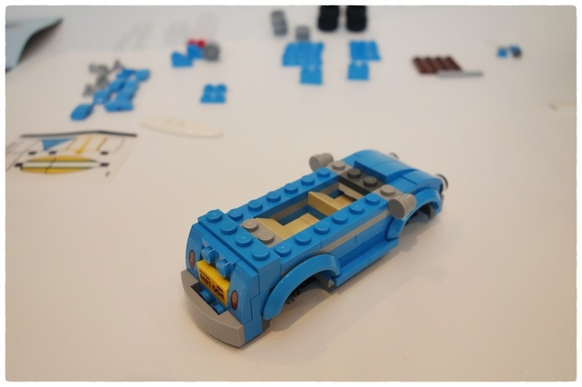](https://www.freelug.org/IMG/jpg/40252_WW_Beetle_Creator_008.jpg)

Mise en place de l’arrière, j’aime bien l’idée de laisser l’espace d’une plate 1x2 libre entre la slope qui figure le parechoc et la carrosserie.

[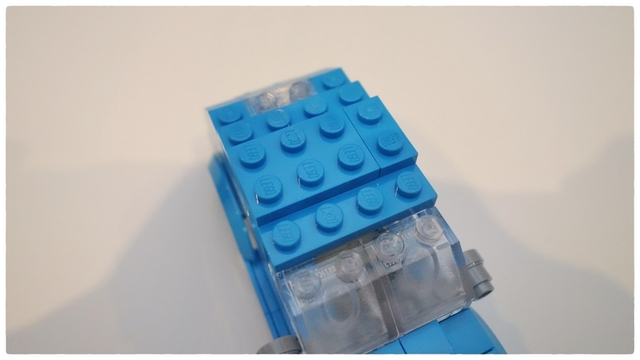](https://www.freelug.org/IMG/jpg/40252_WW_Beetle_Creator_009.jpg)

Pour fermer le toit, on utilisera des plates 2x3, 1x2 et 1x4, puisque les 2x4 et 4x4 n’existent pas dans ce coloris Dark Azure, ce qui oblige à renforcer l’intérieur avec une brique 1x2 qui va séparer l’avant de l’arrière du véhicule.

[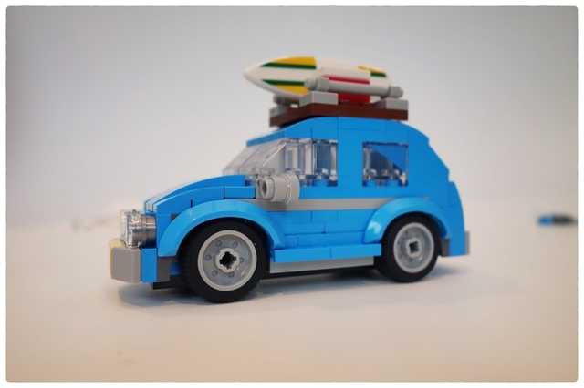](https://www.freelug.org/IMG/jpg/40252_WW_Beetle_Creator_010.jpg)

L’ensemble est rapidement monté, pour un résultat fidèle à ce qui est présenté sur l’emballage.

**Conclusion.** Rien d’exceptionnel sur ce montage, certains pourront lui faire les même remarques qu’au modèle d’origine, qu’il ressemble plus à une Citroën 2CV, mais à cette échelle, les designers ne s’en sortent pas trop mal. Il n’empêche que ce modèle viendra apporter un peu de diversité dans un diorama city.

**Bonus :** Quelques photos exclusives retrouvées au fond de la boîte à gants.

[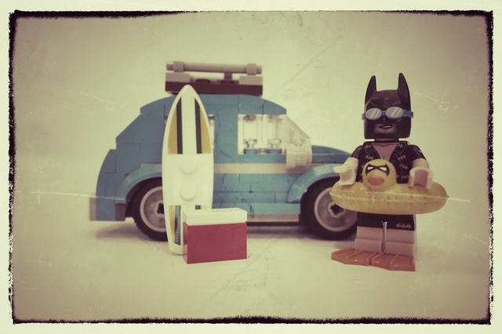](https://www.freelug.org/IMG/jpg/40252_WW_Beetle_Creator_011.jpg)

[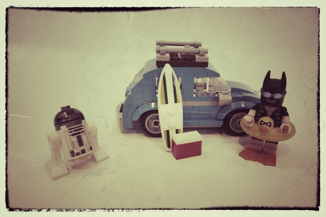](https://www.freelug.org/IMG/jpg/40252_WW_Beetle_Creator_012.jpg)

[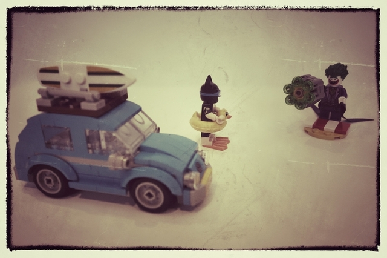](https://www.freelug.org/IMG/jpg/40252_WW_Beetle_Creator_013.jpg)
