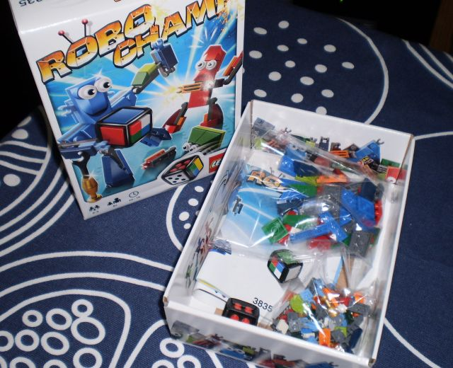
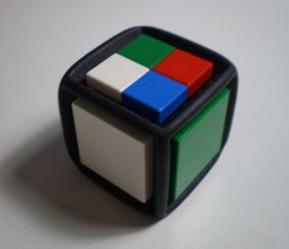
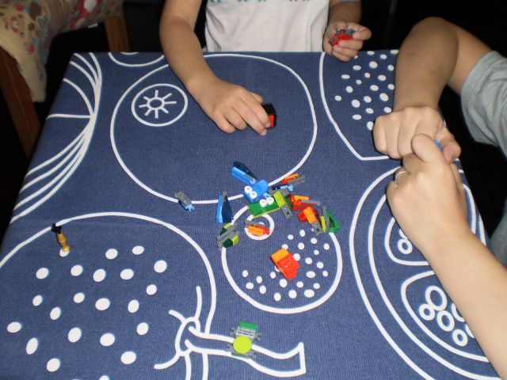
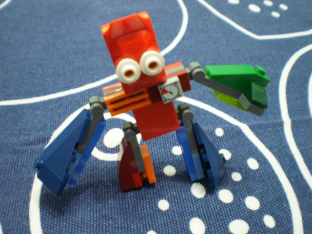
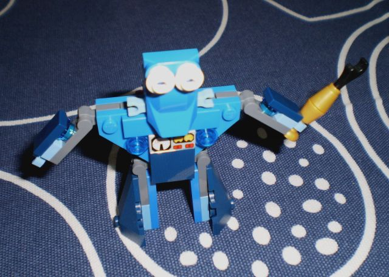

Voici finalement le moment de tester Robo Champ, un jeu de société LEGO avec des robots, trois domaines (LEGO, jeux de société, et robotique) que j’apprécie. Le cocktail sera-t-il fameux ?

A l’ouverture de la boîte, je constate un nombre fourni de pièces, et une notice de montage assez épaisse. Pas de doute, ce jeu laisse une grande part à la construction.

**Ouverture de la boîte**

En fait si je vous montre la configuration du dé, et que vous faites attention aux couleurs des trois robots, vous allez sans doute devinez le principe du jeu.

**Un dé multicolore**

Robo Champ est calqué sur un vieux jeu pour enfant ou chaque joueur devait assembler son petit cochon pour gagner. Il s’agit du ["cochon qui rit"](http://www.lecochonquirit.fr/) né en 1932. Vous y avez sans doute joué dans votre enfance (à moins que les LEGO n’aient accaparer tout votre horizon ludique).

Le principe est donc très simple, on désassemble tous les robots et on place tous les éléments au centre dans un pot commun. Chaque joueur garde le corps de son robot. Ensuite on lance le dé, et on peut choisir une pièce de robot de la couleur indiquée par le dé.

**Début de partie**

Trois faces du dé sont utilisées par les couleurs des trois robots, une face blanche sert de joker (elle permet de piocher un élément de la couleur que l’on souhaite), une face noire, sert à voler un élément chez un autre joueur, et enfin la dernière face composées de 4 tiles 1x1 permet de faire un échange de pièce avec la pioche ou avec un autre joueur.

Je vous passerai les subtilités de règles lorsque la pioche est vide, car cela n’a pas vraiment d’intérêt pour cet article.

Les trois robots sont construits sur un modèle similaire. Les bras et les jambes se clipsent, en revanche la tête tient avec des tenons, ce que je trouve particulièrement décevant. En effet si les designers avait utilisé le même système de clip pour la tête, on aurait pu clipser une jambe sur le cou, ce qui ajoute au caractère comique du robot assemblé. En effet en cours de partie, il n’est pas rare de se retrouver avec un robot à 4 jambes par exemple...

**Le robot à 4 jambes !**

Mais bien sûr pour gagner il faut assembler sur son robot les 5 pièces de la même couleur (la tête, les deux bras, les deux jambes). En revanche cette couleur n’a pas besoin d’être la même que celle du torse pour pouvoir gagner. Là encore, à mon avis, les designers ont fait une erreur. Car si la couleur du torse ne compte pas, il aurait mieux valu faire un torse tout gris (avec des nuances de gris clair, gris foncé et noir) afin de ne pas perturber les joueurs, et aussi de rendre le livre de règles plus simple.

En effet ma fille avait tendance à essayer de monter le robot de la couleur de son torse, alors que les dés avaient tendance à lui donner des éléments d’une autre couleur.

En ce qui concerne les règles alternatives suggérées, il n’y a rien de mirobolant. Le livre de règles propose un vol à l’aveuglette en cas de face noire (pour ajouter encore plus de hasard), ou un échange de toutes les pièces en cas de face d’échange (ce qui fait que si vous étiez en train de gagner avec seulement un élément manquant, vous pouvez vous retrouver à perdre... ou inversement). La règle suggère aussi de construire un robot blanc avec vos propres briques, pour pouvoir jouer à quatre joueurs.

**Le robot champion qui tient sa coupe !**

## Mon impression

Robo Champ, bien que basé sur une idée de jeu à l’épreuve du temps, manque à mon avis d’intérêt. Il y a finalement très peu de stratégie dans ce jeu, car le hasard du dé guide en très grande partie les actions du joueur. Les choix sont très limités (et encore plus quand on joue à deux au lieu de trois) car ils n’apparaissent qu’en cas de joker, vol ou échange (c’est à dire dans une chance sur deux). Cela dit dans le "cochon qui rit", il n’y a aucune stratégie, ce n’est qu’une course à celui qui montera son cochon le plus vite. Dans Robo Champ, le vol et l’échange apporte un peu de stratégie (choisir les couleurs qu’on recherche ou bien priver l’adversaire des couleurs qu’il recherche ?).

Les règles alternatives sont aussi décevantes, et à vrai dire je n’en voie pas d’autres plus intéressantes.

Pour rester dans le même ordre de prix, je préfère donc Magikus qui me semble un peu plus ludique (même si les règles de Magikus sont finalement assez similaires à Robo Champ).

Néanmoins ce jeu pourra sans doute amuser les plus jeunes. Le "cochon qui rit" se joue à partir de trois ans, et je recommanderai le même âge pour Robo Champ, même si la boîte indique 6 ans (cela dit, c’est sans doute parce que la boite contient des petites pièces facilement ingérables).

A bientôt pour le test d’une nouvelle boîte.
