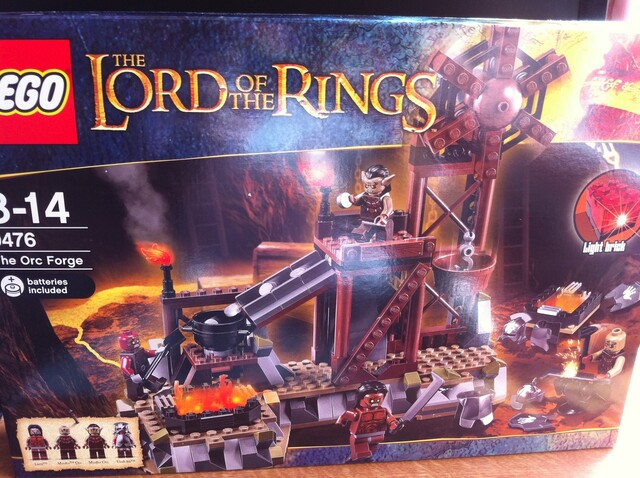
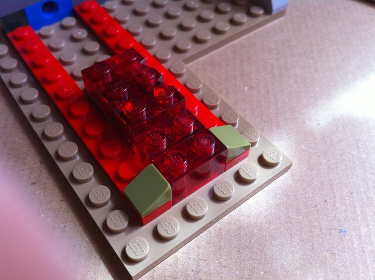
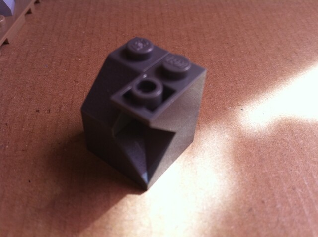
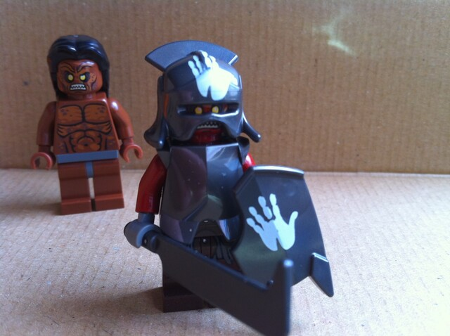
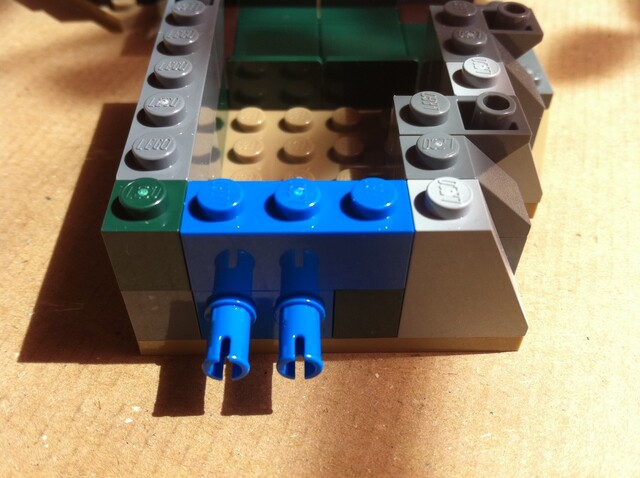
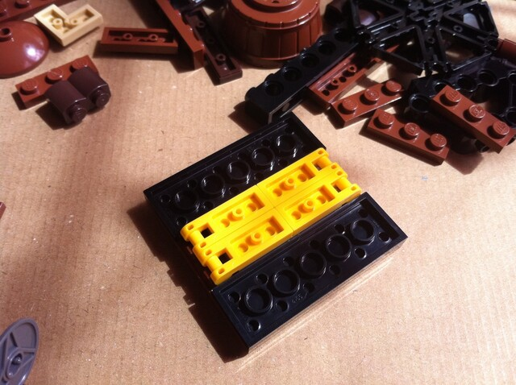
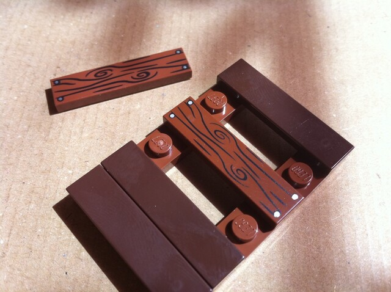
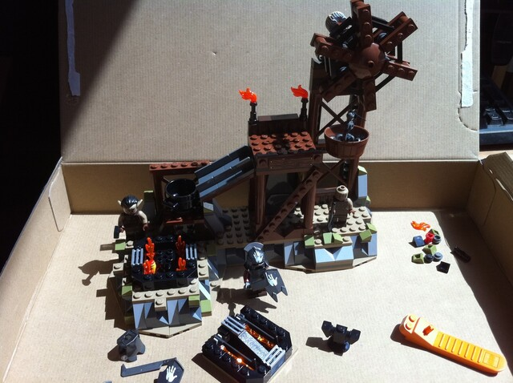

Suite à un déplacement pro, je me suis rendu dans une célèbre boutique. J’ai eu l’occasion de me procurer quelques nouveautés pas encore très diffusées en magasin.

Voici donc la revue de la boite N°9476, la Forge des Orcs .

Tout d’abord, dès l’ouverture, 3 sachets, une notice, et surtout pas d’autocollants ! J’apprécie.

Je commence donc le montage proprement, pour une fois, en suivant la notice scrupuleusement.

## Sachet N°1

Une jolie brique lumineuse rouge est incluse. On trouve aussi des _Cheese slopes_ en "vert Orcs"... Si quelqu’un a la dénomination exacte de cette couleur...

L’ensemble est monté sur deux briques de hauteur. Un très bel effet de roche est réalisé par l’assemblage de trois pièces.

Pour ceux qui veulent gagner du temps, vous pouvez réaliser ce montage autant de fois que vous avez de pièces, c’est le même partout !

L’élément structurel à croisillon apparaît ici en marron.

Première partie avec 2 minifigs.

## Sachet N°2

Les 2 Orcs : double tête, torse recto/verso, et armure originale et sérigraphiée, bref, joli ( si on peut dire pour un Orc... )

Toujours la même question : pourquoi de telles couleurs dans un set qui s’en passerait bien ?

Cette partie est la cache dans laquelle se glisse l’Orc en cours de démoulage.

La forge en elle-même est relativement simple. On aurait pu attendre mieux.

## Sachet N°3

On repart sur la base faite avec le sachet N°2.  
Encore du jaune, qui là, en plus est visible. Du _dark tan_ aurait été plus cool !

Deux tiles 1 x 4 sérigraphiées avec un dessin de planche clouée, dommage qu’il n’y en ait pas plus...

Le treuil à roue est un peu instable. Les barres techniques situées en arrière font un peu léger, et auraient mérité d’être marron pour plus de discrétion.

Mon avis général sur cette boite : plutôt sympa tel que, mais à intégrer forcément dans un grand diorama LOTR !

Pour ma part, je l’ai plus prise pour les pièces et les minifigs.  
Elle sera rapidement démontée et recyclée :)

[Toutes les photos du montage](http://www.brickshelf.com/cgi-bin/gallery.cgi?f=509262)

LEGnOme
