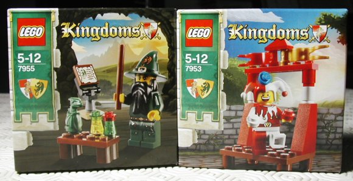
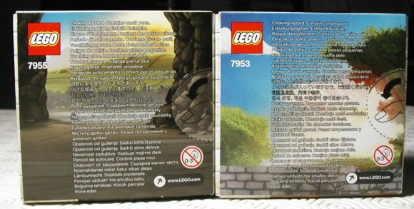
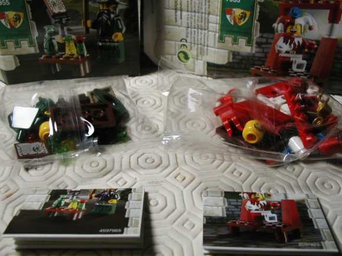
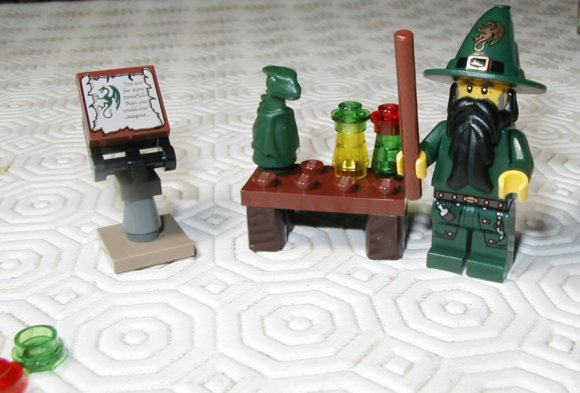
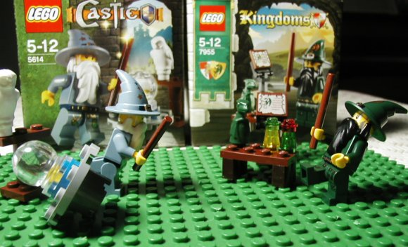
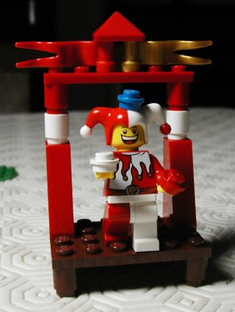
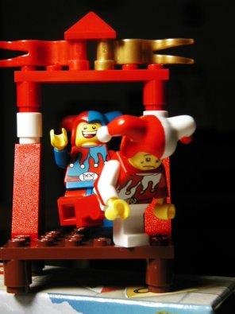

Finie la gamme Castle initiée en 2007, place à la nouvelle, Kingdoms. Cette fois-ci, ce ne sont plus les gentils humains contre les squelettes ou autres orcs, mais deux factions humaines qui se livrent à une guerre, sans doute sans merci !

Mais point de guerriers, de soldats ou de (preux) chevaliers pour cette première revue des premières boîtes disponibles.

C’est en effet à deux personnages d’un autre genre auquel nous avons droit : un bouffon (ou fou du roi, référence 7953) et un sorcier (référence 7955).

Les boîtes sont légèrement plus petites que les précédentes Impulse, on fait l’économie d’un peu de carton.

A l’arrière, comme pour tout Impulse, juste du texte.

22 pièces pour le fou, 19 pour le sorcier, un prix d’environ 4 euro.

## Le sorcier 7955

Nous avons droit ici à un magnifique sorcier de couleur vert foncé (dark green). Chapeau sérigraphié aux armoiries de sa faction, jambes également décorées, seul le buste est uni.

La barbe noire, qui était jusqu’alors une [PNITS](/articles/les-pieces-pnits/), est maintenant banalisée avec cette boîte d’entrée de gamme. [Son prix devrait chuter rapidement sur Bricklink](http://www.bricklink.com/search.asp?itemID=1845&colorID=11).

En accessoire, l’inévitable baguette, mais aussi une table avec fioles, et un petit dragon en dark green, jusqu’alors disponible en noir ou en sand green dans des boîtes Harry Potter. Enfin, un petit présentoir avec un parchemin portant l’inscription _You are more powerfull than you would ever imagine..._, ou en français _Vous êtes plus puissant que vous ne pourriez jamais l’imaginer_. Petit clin d’oeil à une des fameuses répliques issues de StarWars, _I shall become more powerful than you can possibly imagine_ ?

Bien évidemment, on ne peut que rapprocher ce sorcier du [magicien de la gamme précédente, lui-même en boîte Impulse 5614](/articles/sets-impulse-partie-2-2-castle/). Ce qui nous donne un petit combat entre le Bien et le Mal.

## Le bouffon 7953

Du côté des gentils, ce bouffon apportera rires aux bonnes gens de votre cité médiévale, avec son spectacle de jonglerie sur sa petite scène.

Le personnage, très proche du fou de la gamme précédente, est cette fois-ci dans les couleurs blanche et rouge. A la différence de son prédécesseur, le dos est également sérigraphié, et la tête est à double face (qui correspond donc à celle du [set 7079](http://www.brickset.com/detail/?Set=7079-1)).

Mais qu’on se le dise, le "rouge et bleu" ne se laissera pas prendre sa place aussi facilement !

## Conclusion

Voila deux petites boîtes qui nous mettent en appétit pour la [suite de la gamme Kingdoms](http://www.brickset.com/browse/themes/?theme=Castle&subtheme=Kingdoms), et notamment le calendrier de l’Avent !
