Quelle ne fût pas ma surprise de trouver cet après-midi, les modèles de la gamme City 2011 au rayon LEGO du magasin de jouets du coin !

Tous les modèles City Police 2011 disponibles. J’ai donc fait l’acquisition de ce modèle 7279 qui restait à prix convenable, Noël approchant bientôt.

Pourquoi le 7279 ?

Et bien il contient 4 personnages, et le fameux nouveau chien avec un visage !

C’est une boite avec 2 voleurs, une première ! Ils s’organisent et s’équipent d’un pied de biche, le bulldozer n’est pas loin pour attaquer les distributeurs de billets. Y a-t-il donc recrudescence de la délinquance ? Mais la police veille aussi et il y a de nouvelles recrues puisque les policiers sont deux aussi. Et ils ont maintenant des chiens qui voient clair ! :)

Présentation de la boite, devant et derrière :

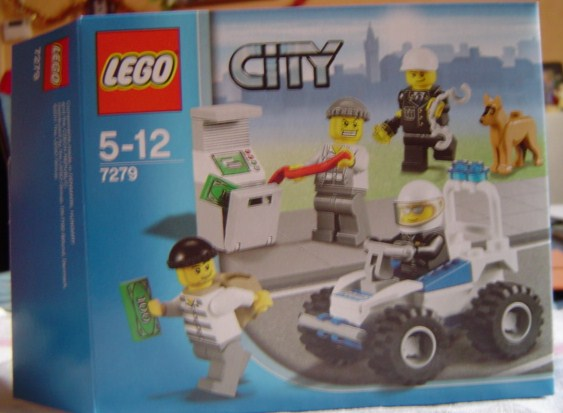

**Boite face avant**

La photo de la boite du modèle 7279

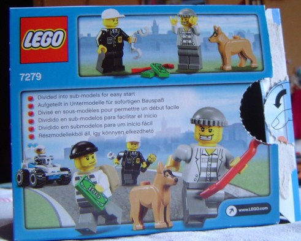

**Boîte face arrière**

La boîte face arrière

Le contenu :

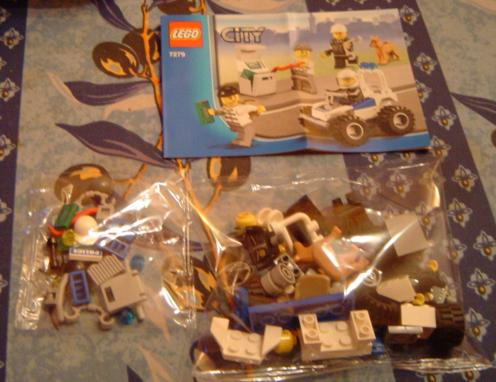

**Contenu**

Le contenu de la boîte : 2 sachets et la notice

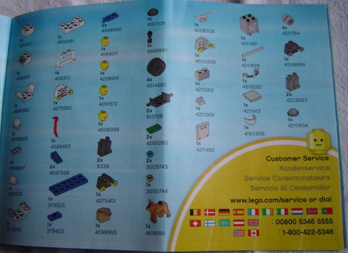

**Inventaire**

Inventaire des pièces avec numéros

Pas de difficultés pour le montage :

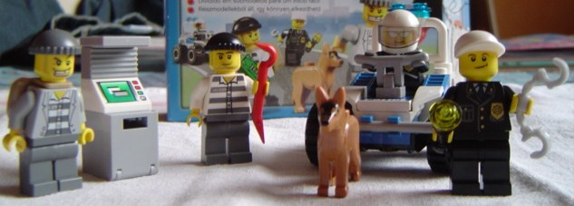

**Montage final**

Le modèle une fois monté !

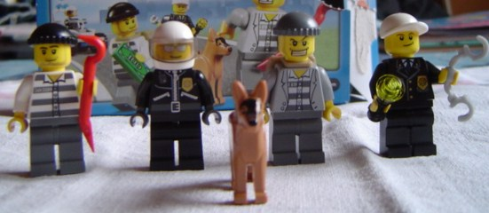

**Personnages**

Les acteurs du film ? :-)

Quelques-unes des pièces intéressantes :

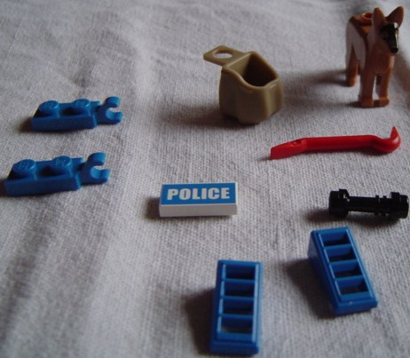

**Pièces remarquables**

Des pièces dans des nouvelles couleurs, et des nouvelles aussi : le sac qui tient sur un tenon et le pied de biche

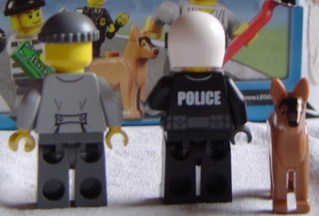

**Sérigraphie**

Deux personnages avec le dos sérigraphiés et le chien avec son visage (il a pris du poids le chien, vous ne trouvez pas ? :-))

Et une petite histoire :

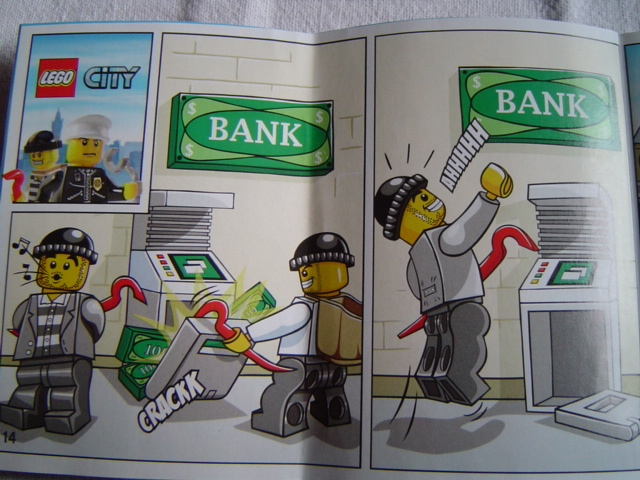

**Histoire page 1**

Le casse de la banque !

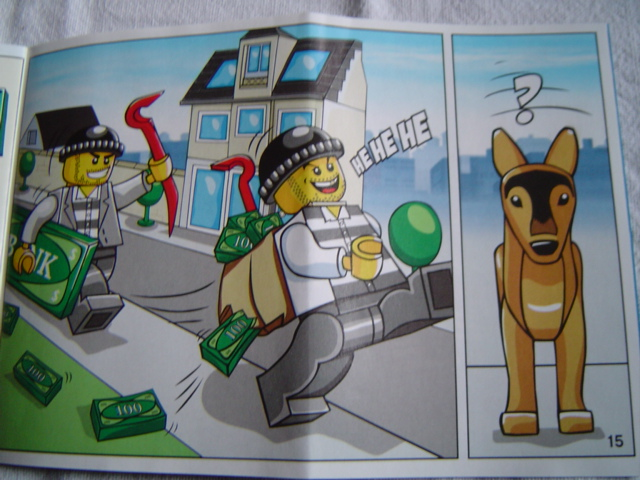

**Histoire page 2**

C’est la fuite ! Mais...

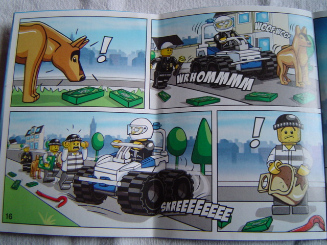

**Histoire page 3**

Snif ! Snif ! L’argent n’a pas d’odeur ? La police est alertée !

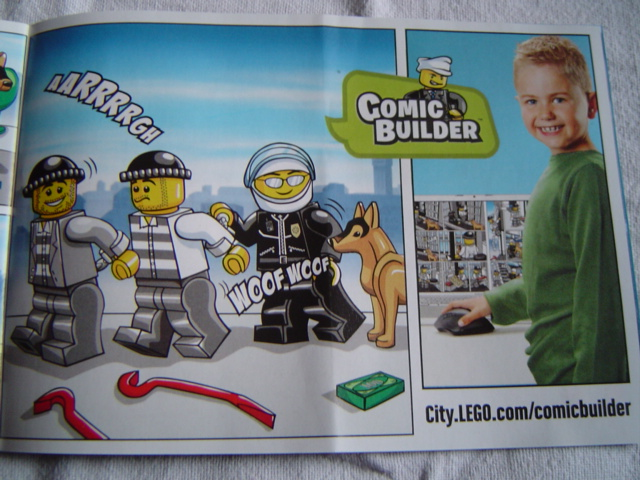

**Histoire page 4**

En voilà un fin limier à la police ! Faites le savoir, les chiens policiers LEGO ont du flair !

Et pour finir quelques photos des gammes à venir et des nouveautés prévues en 2011 :

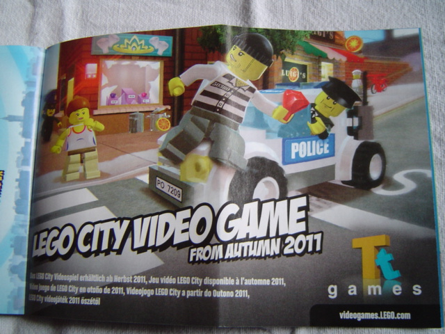

**Annonce 1**

Nouveau jeu vidéo City annoncé pour l’automne 2011

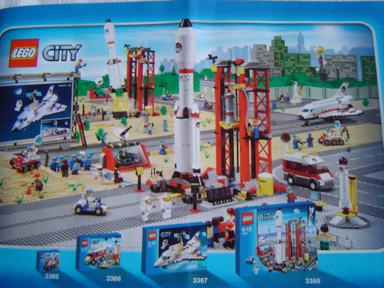

**City Espace 2011**

Présentation de la gamme City Espace 2011

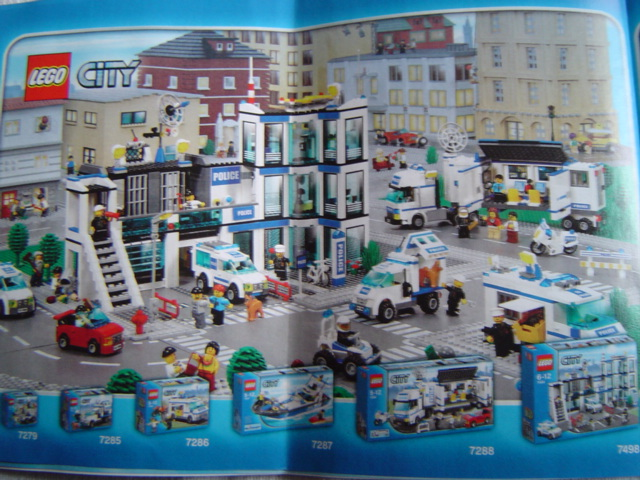

**City Police 2011**

Présentation de la gamme City Police 2011

Un joli petit modèle simple et avec beaucoup de jouabilité, puisque qu’il contient 4 personnages, 2 contre 2, un chien, un distributeur de billets et un quad !
