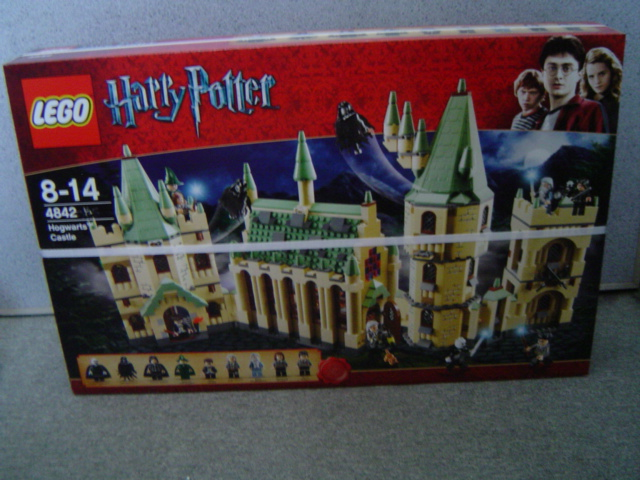
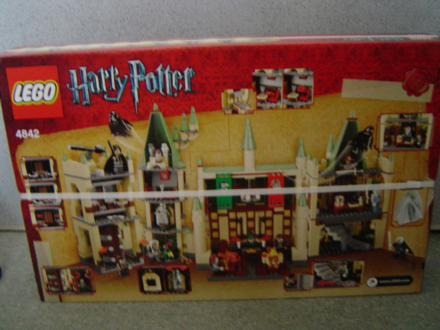
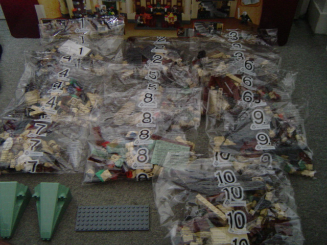
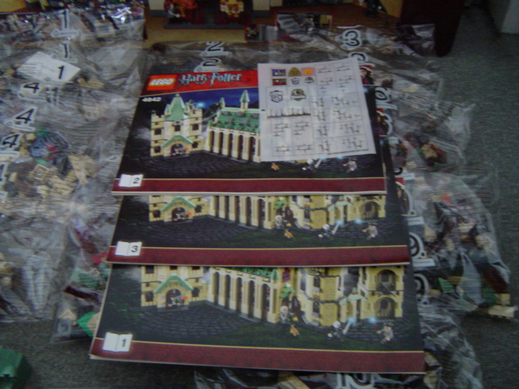
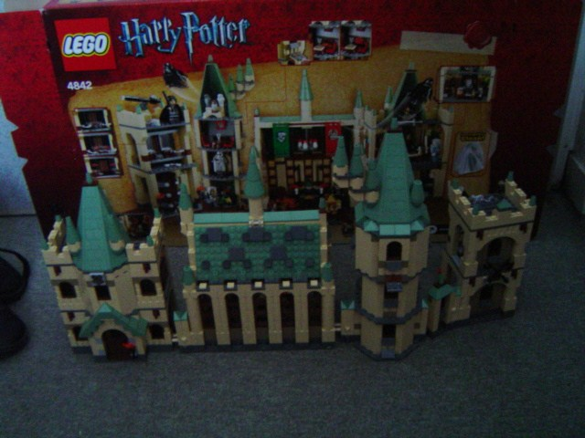
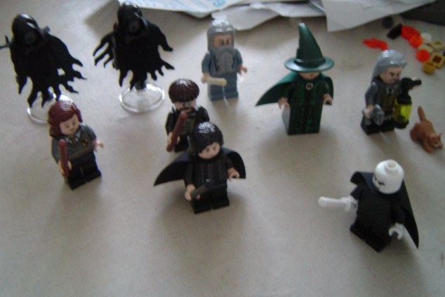
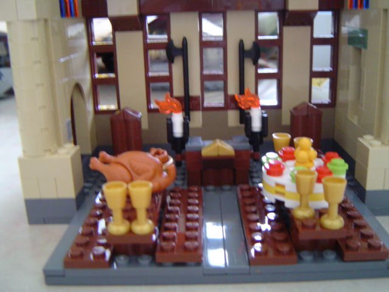
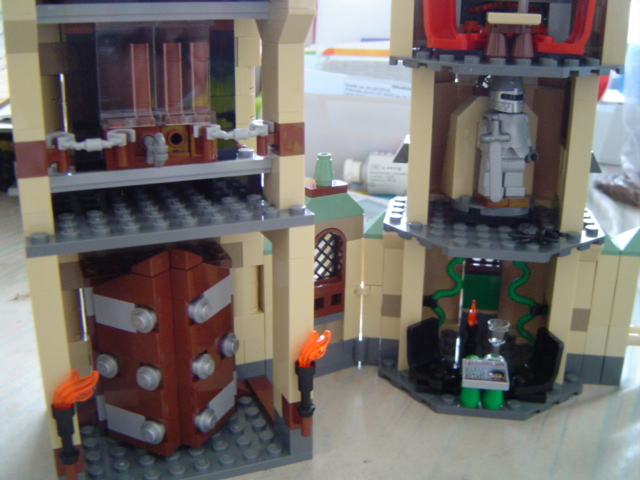
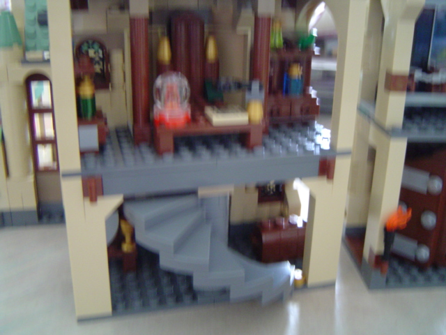
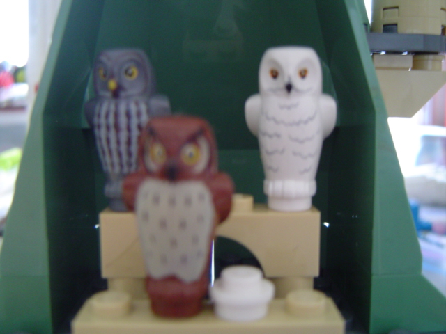

C’est donc le quatrième château Harry Potter en LEGO qui vient de sortir ce mois de septembre 2010 ! Il était annoncé pour le 1er octobre, et le voilà déjà disponible.

Le thème Harry Potter dont LEGO a acquis la licence rentre dans sa cinquième série de modèles.  
Bien qu’il y ait de nombreux lieux dans les livres, c’est bien sûr le château qui arrive en tête de liste !

La traditionnelle photo de la boîte avant l’ouverture :

**Boite**

Face avant

**Boite\_2**

Face arrière

La boîte est bien remplie et compte pas moins de 10 sachets + 3 pièces, suivis de 3 notices et d’une planche d’autocollants.

Le contenu :

**Contenu**

Contenu

**Contenu\_2**

Notices + Autocollants

Le montage, 10 sachets, 9 étapes, pas beaucoup de pièces par sachets, ce qui montre un effort pour que les plus jeunes puissent monter le modèle sans trop de difficultés.

**Château monté**

Les personnages :

**Minifigs**

Seuls les moldus ne voient pas Harry sur la photo !

Je vous laisse le soin d’admirer Harry avec sa cape d’invisibilité !

**Grande salle**

La grande salle avec bien sûr toujours des plats et desserts exceptionnels !

**Salle sur demande + Salles communes Griffondor et Serpentard**

La salle sur demande avec l’armoire à disparaître utilisée par Drago et les mangemorts pour investir le château !  
Et oui, fait important, contrairement à ce qu’indique Bricklink , c’est l’épisode 5 + 6 qui est représenté.  
Ainsi que les 2 salles communes Griffondor et Serpentard.

**Bureau du directeur**

Le bureau du directeur.

**Chouettes**

Les nouvelles chouettes, enfin décorées, c’est beaucoup mieux.

Un très beau château, construit pour jouer, il permet de recréer l’histoire de 2 livres, les tomes 5 et 6.
