Depuis 2009, nous avons droit chaque année à un nouveau modèle pour constituer un village de Noël. 2015 n’échappe pas à la règle, avec ce modèle qui n’est rien d’autre qu’une réédition du modèle de 2009, la référence 10199. Jouons aux 7 différences, la déception passée...

**–** Référence : 10249  
**–** Nom : Toy Shop, Le magasin de jouets  
**–** Année : 2015  
**–** Nombre de pièces : 898  
**–** Prix : 74,99 €

## La boite

Même largeur, mais hauteur moindre. On assiste bien ici à la politique de LEGO consistant à réduire le volume de ses boites.

[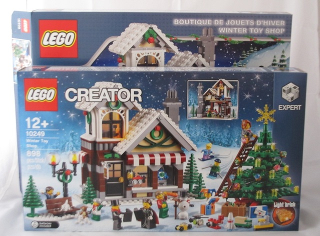](https://www.freelug.org/IMG/jpg/10249_boite.jpg)

Le contenu est composé de 3 sachets n°1 et 5 sachets n°2, associés chacun à une notice.

[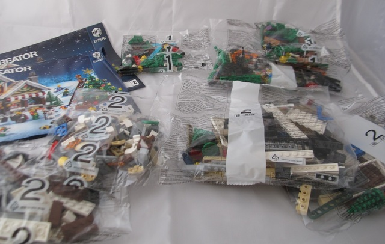](https://www.freelug.org/IMG/jpg/10249_sachets.jpg)

_Pour la suite, sur les photos, à gauche la version 2015, à droite la version 2009_

## Les minifigs

Le set de 2015 gagne une minifig.

[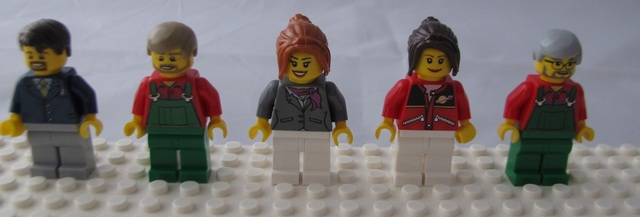](https://www.freelug.org/IMG/jpg/10249_adultes.jpg)

Le couple de la chorale aborde de nouveaux visages (homme et femme) et non asexués comme la version de 2009. La femme gagne une jolie sérigraphie sur sa robe, tandis que l’homme perd son uniforme de pilote d’avion pour celui de Dracula.

[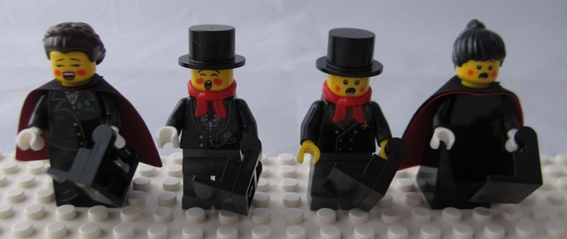](https://www.freelug.org/IMG/jpg/10249_chorale.jpg)

Les enfants troquent leur skis vielle génération pour les nouveaux et un snowboard.

[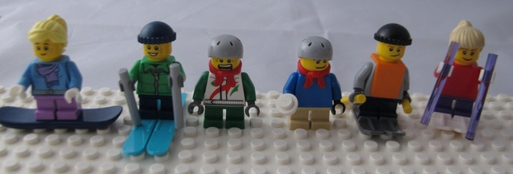](https://www.freelug.org/IMG/jpg/10249_enfants.jpg)

## Partie 1 - Le sapin, le décor

Le sapin semble être le même mais la construction est un peu plus intelligente grâce à l’usage de pièces récentes. Quelques changements pour la guirlande (qui passe au nombre de deux au lieu d’une seule).

L’escabeau est plus grand. Et oui, l’échelle fait deux tenons de plus depuis 2013 !

[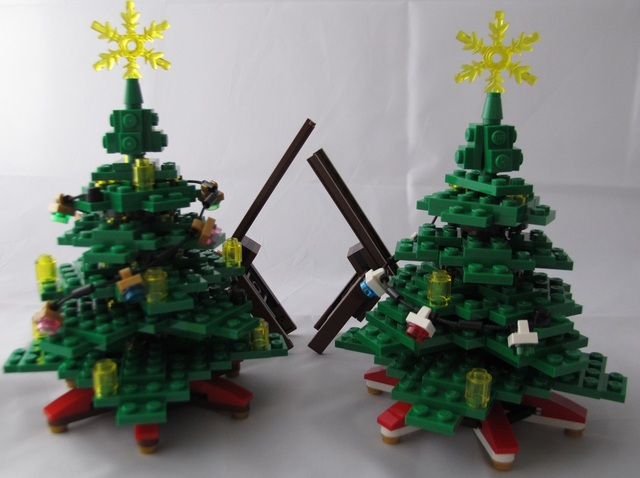](https://www.freelug.org/IMG/jpg/10249_sapin.jpg)

Le lampadaire est le même, exception faite des couronnes, pour lesquelles l’utilisation de la bouée de sauvetage en vert est devenue la norme depuis 2013.

[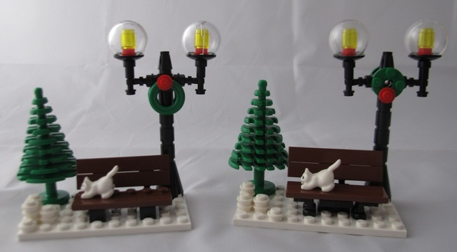](https://www.freelug.org/IMG/jpg/10249_banc.jpg)

Le banc est un peu plus simple (les robinets ne sont plus utilisés pour faire les pieds).

Quant aux jouets, si on perd le joli ours fait de toutes pièces, on gagne plusieurs petits véhicules. On notera l’utilisation particulièrement originale des patins à roulettes comme roues pour le camion.

[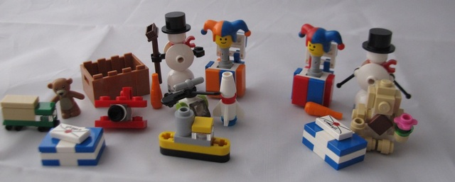](https://www.freelug.org/IMG/jpg/10249_jouets.jpg)

Le joker de la boite à ressort porte une couleur exclusive au set, orange et bleu.

Enfin, le bonhomme de neige a des pinces plutôt que des antennes en guise de bras, ce qui lui permet de tenir un balais.

## Partie 2 - La boutique

[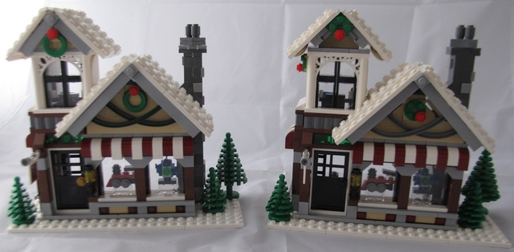](https://www.freelug.org/IMG/jpg/10249_avant.jpg)

De l’extérieur, peu de différences semblent séparer les deux versions. Tout comme le lampadaire, les couronnes ont été changées. La poignée de la porte devient dorée, quelques plates sous les vitres passent du dark red au marron, et les arceaux passent du gris au vert foncé. Bon, pas de grands changements.  
Seule vraie évolution, l’enseigne qui était blanche est désormais une jolie pièce sérigraphiée "Toy shop".

[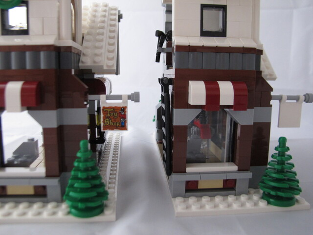](https://www.freelug.org/IMG/jpg/10249_enseigne.jpg)

De l’intérieur, ça semble être la même chose : même jouets en vitrine, même atelier.

[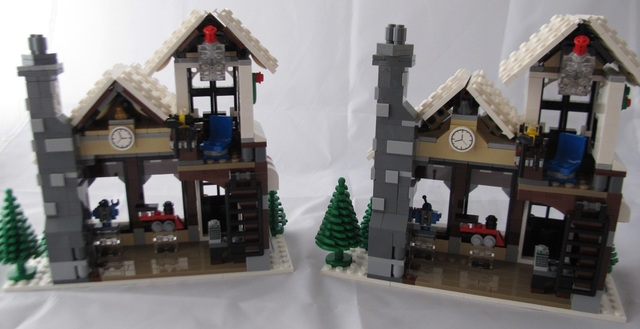](https://www.freelug.org/IMG/jpg/10249_arriere.jpg)

Mais l’assemblage des toits diffère et je dois le concéder, celui de 2015 assure une construction plus simple.

## Conclusion

[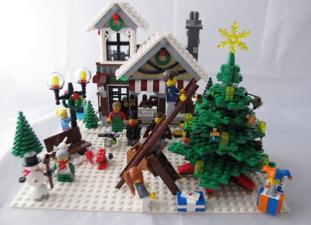](https://www.freelug.org/IMG/jpg/10249_complet.jpg)

Pour l’originalité, évidemment LEGO va devoir revoir sa copie. Quand on attend chaque année un nouveau modèle et à la place obtenir une réédition, c’est un peu la déception.  
Pour ceux qui avaient raté le premier modèle de la série, c’est en tout cas une bonne façon de rattraper le retard.  
Les collectionneurs y trouveront comme toujours les deux ou trois éléments qui donneront le prétexte d’acheter la boite.

On apprécie tout de même qu’il ne s’agisse pas d’une réédition 100% identique, et que les éléments comme le sapin ou les toits aient été retravaillés pour un meilleur rendu. Les designers ont quand même remis un peu la main à la pâte.

Espérons que ce ne soit pas le début d’un cycle, et que pour 2016 nous aurons droit à une vraie nouveauté !

[Revue du modèle de 2009 par Raoulz](/articles/revue-du-set-10199-la-boutique-de-jouets-de-noel/).
