Ce set en édition limitée est né d’un concept japonais : le site web japonais Cuusoo ("voeux") est une plateforme où les visiteurs laissent leurs idées pour de nouveaux produits. Lorsqu’un produit atteint un certain nombre de votes, sa production peut-être envisagée. LEGO s’est donc lancé dans l’aventure.

Un utilisateur, Guy, a proposé en décembre 2008 qu’une version LEGO du sous-marin japonais Shinkai 6500 soit produite, et lorsque son idée a atteint les 1000 votes, LEGO a réalisé un modèle, désormais commercialisé au Japon.

## Présentation de la boîte

**–** Référence : 21100  
**–** Date de sortie : 17 février 2011  
**–** Nombre de pièces : 412  
**–** Prix : 4600 Yen (environ 41 euro)  
**–** Edition limitée à 10000 exemplaires, vendue exclusivement au Japon  
**–** Age : 12+  
**–** [Notice (PDF)](http://cache.lego.com/bigdownloads/buildinginstructions/4641429.pdf)

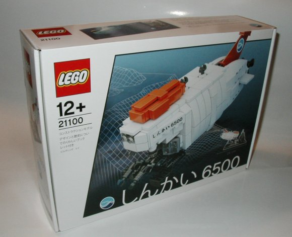

La boîte, entièrement en japonais montre sur la face le sous-marin. En encart, la taille réelle de l’ensemble : 24 cm.

L’emballage est similaire aux autres produits du même genre, comme les [sets Architecture](/articles/gamme-architecture-21000-sears-tower-21001-john-hancock-center/), les [vases](/articles/sumo-ii-le-retour-de-la-revanche/) ou les [sets MUJI](/articles/lego-muji-quand-les-briques-se-melent-au-papier-japonais/).

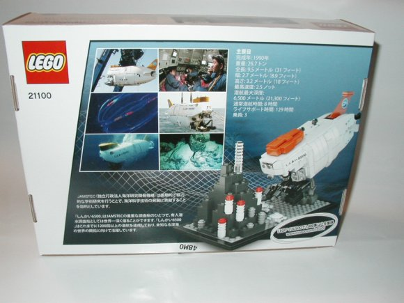

L’arrière de la boîte offre des illustrations du vrai sous-marin, et de sa reproduction en briques LEGO intégrée au décor.

Une des tranches rappelle le principe de Cuusoo.

## Le contenu

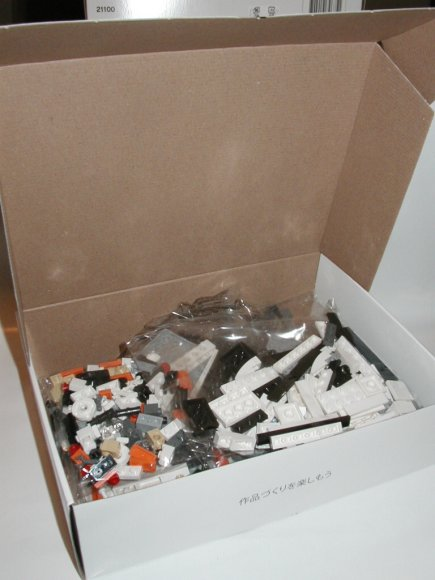

La boîte contient cinq sachets de pièces, 2 LURP en vrac, une planche d’autocollants et le livret de la notice. Celui-ci, bien que de petite taille, est pourtant bien épais. Des illustrations et du texte (en japonais) présente le sous-marin.

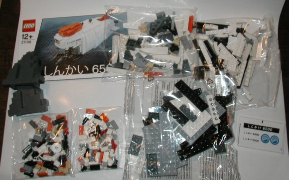

L’assortiment des pièces est principalement blanc pour le sous-marin, et gris pour le décors.

**Le décor**

La construction débute par le décor.

Le support est similaire aux sets de la gamme Architecture, un cadre noir lisse avec le nom de l’objet reproduit.

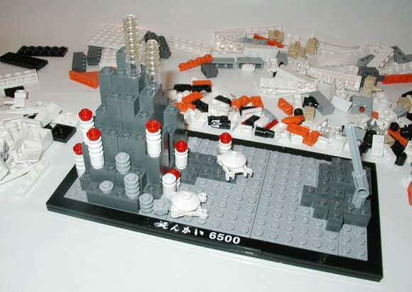

Le décor est constitué d’un rocher, d’un support pour le sous-marin, de plusieurs éléments reproduisant je pense toute sorte d’êtres sous-marins (voir page 72 et 73 de la notice), ainsi que deux crabes tout mignons.

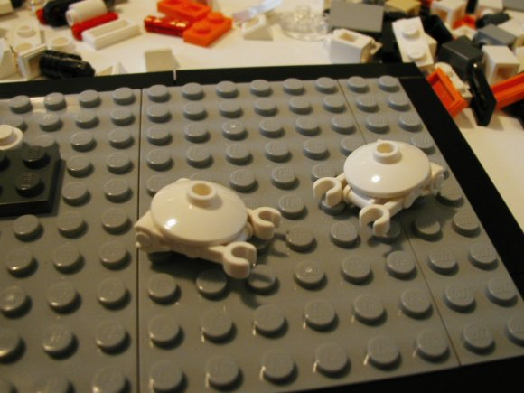

Notons toutefois la difficulté à différencier les plates rondes 1x1 blanches et transparentes dans la notice.

**Le sous-marin**

La construction du sous-marin est modulaire, et se découpe en 4 parties.

Le premier élément est l’arrière

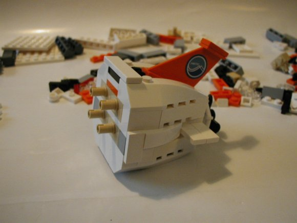

le second la partie centrale

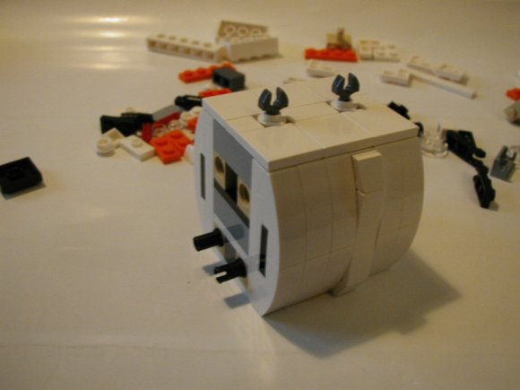

le troisième l’avant du sous marin

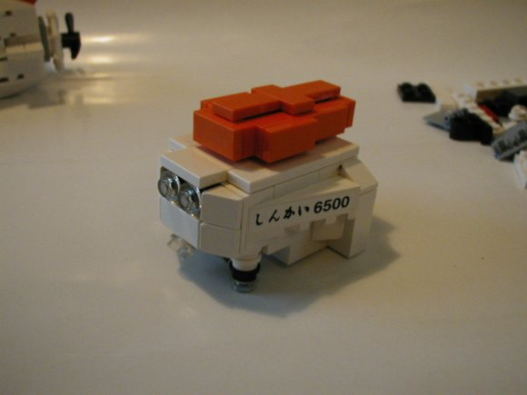

et le dernier les pinces

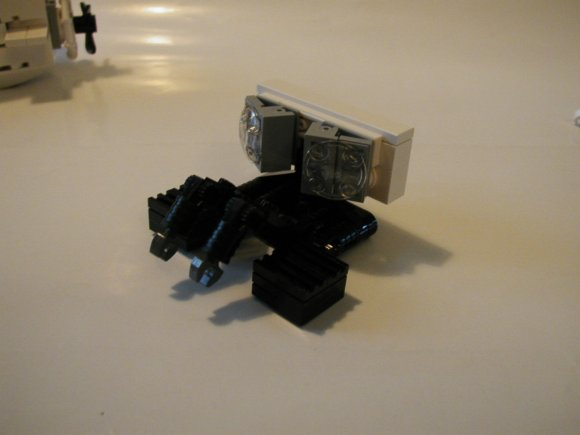

Voici l’ensemble

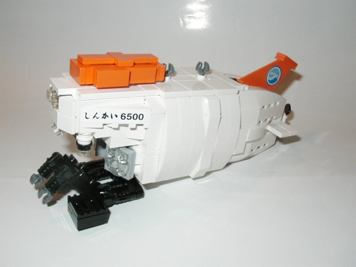

Un assemblage détaillé avec de nombreuses pièces, beaucoup de SNOT, et une technique rarement employée dans un modèle officiel, le placement d’un tenon dans le trou d’une brique Technic.

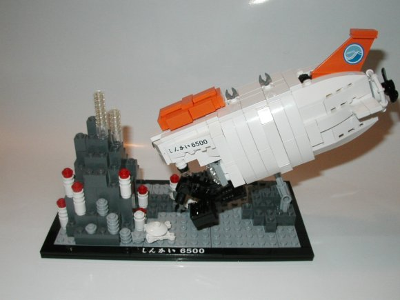

## Conclusion

Entre les sets MUJI et la programme Cuusoo, il semblerait que le Japon tienne aujourd’hui une place importante dans la stratégie de la compagnie LEGO.

Ce set est plaisant à construire, et tout droit dans la lignée des sets Architecture.

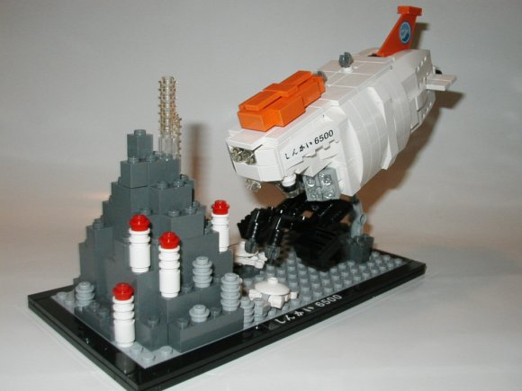

En bémol, l’import, qui augmente considérablement le coût de produit. Entre les frais d’envoi et les taxes douanières, sur un achat groupé de 2 exemplaires et en se répartissant les frais, le modèle revient au final à 75 euro. C’est dommage, quand on sait que le set est produit en Europe.

En attendant l’arrivée de ce concept dans d’autres pays, quel sera le prochain set qui gagnera le suffrage des visiteurs de Cuusoo ?

## Liens

**–** [Article BrickJournal sur le set 21100](http://brickjournal.com/view/article/54/)  
**–** [Page LEGO sur Cuusoo](http://www.cuusoo.com/LEGO/)  
**–** [Page du voeux pour le sous-marin](http://www.cuusoo.com/LEGO/user/024081/0020/)  
**–** [Page wikipedia du sous-marin](http://fr.wikipedia.org/wiki/Shinkai_6500)
