Voici la revue du set 7415, un des sets de la gamme "Orient Expedition" en 2003, et qui se trouve être un de mes thèmes favoris :)

Grâce à un site de vente en ligne, j’ai pu acquérir ce set pour compléter ma collection Orient Expedition. Et la boîte n’étant pas ouverte, j’ai eu l’idée de faire un article.  
**–** Référence : 7415  
**–** Nom : Aero Nomad  
**–** Pièces : 118  
**–** Minifigs : 2  
**–** Prix : 25 € en rayon en 2003 si ma mémoire est bonne

## La boîte

Présentation du set, classique.

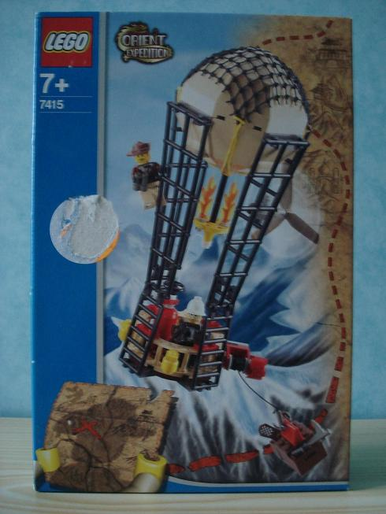

**Face avant**

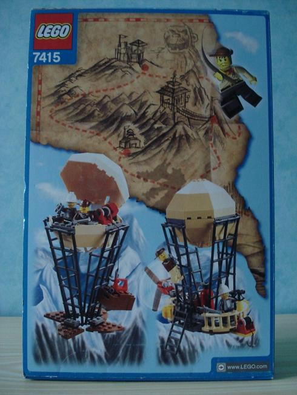

**Face arrière**

## Les sachets

Les trois sachets de pièces, prometteurs !

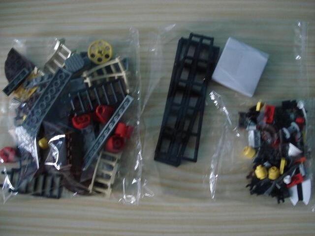

**Désolé, c’est un peu flou...**

## La notice

Et voilà la notice, la publicité, les deux pièces qui forment le ballon d’air et le paquet de cartes, véritable innovation de la gamme (détaillé plus tard dans l’article).

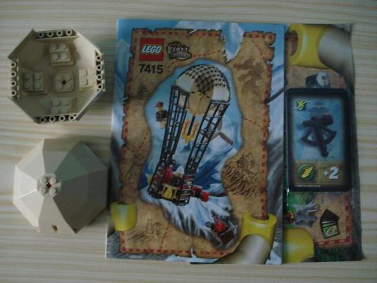

**Le reste de la boîte**

## Le montage

On commence, comme pour chaque set Orient Expedition, par une petite bande dessinée mettant en scène le set à construire.

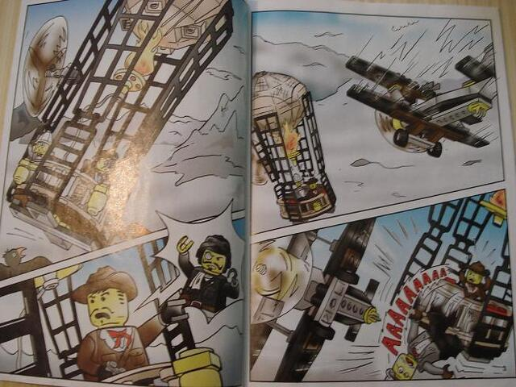

Et c’est parti pour le montage avec les minifigs !

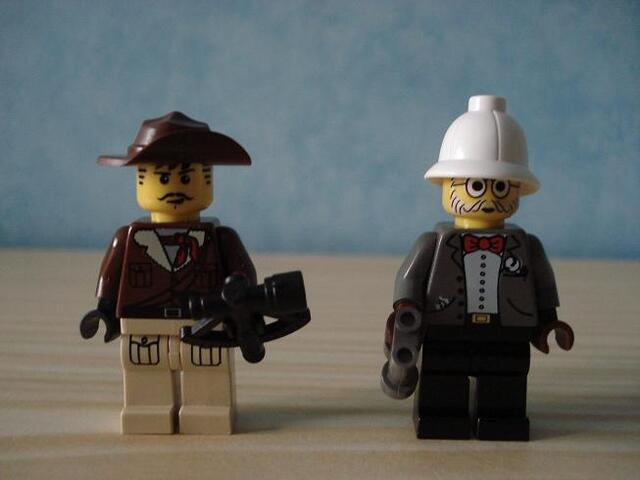

**Johnny Thunder et Docteur Kilroy**

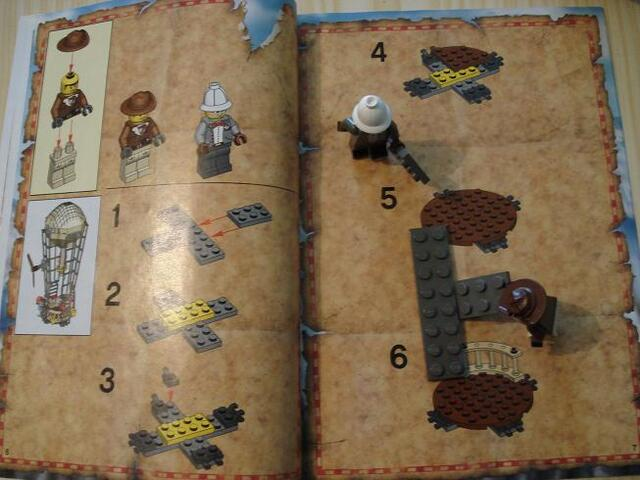

**Etape 1**

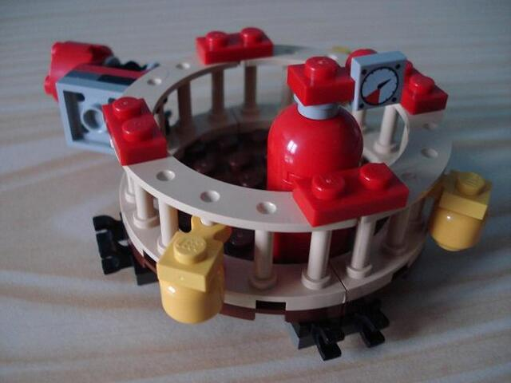

**Etape 11**

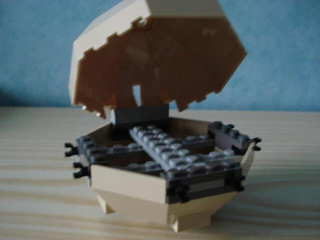

**Etape 12-7**

La construction se fait sans problème, excepté la mise en place des élastiques et de la ficelle pour les plus jeunes.

Et voilà le résultat final, nos deux héros vont enfin pouvoir se rendre au Mont Everest !

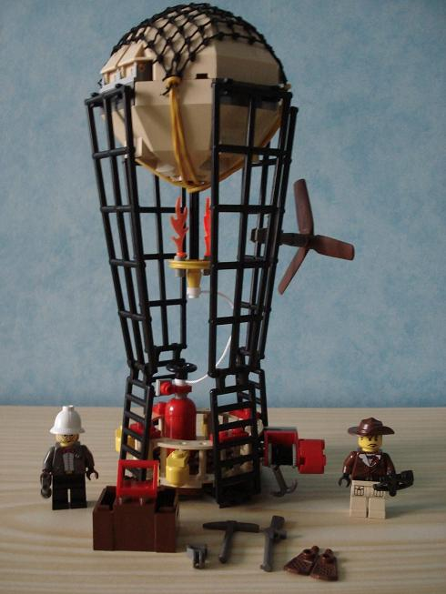

**Etape finale**

## Les pièces qui ne servent pas

4 pièces supplémentaires, dont une qui n’est pas dans la bonne couleur ! Il s’agit de l’axe Technic qui aurait du être beige, si quelqu’un peut résoudre ce mystère...

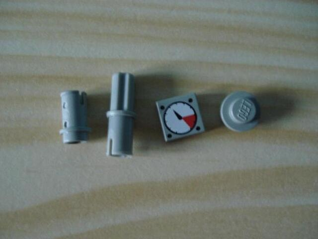

**Les "extra parts"**

## Impression de déjà vu ?

Eh oui, il s’agit d’un "remake" de la mongolfière du set 5988 Le temple d’Anubis de la gamme Egypt !

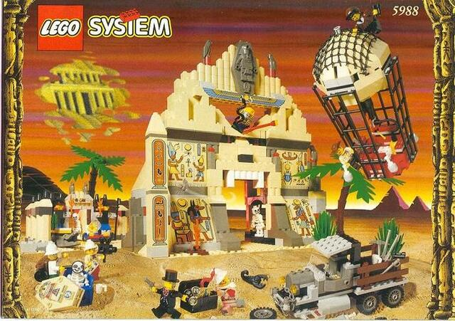

**Le set en question**

Les principales différences :  
**–** les échelles pour réhausser le ballon  
**–** la base arrondie  
**–** le réalisme de la bonbonne  
**–** le grappin  
**–** la tyrolienne  
**–** les raquettes (enfin, pas très utile dans le désert ^^)

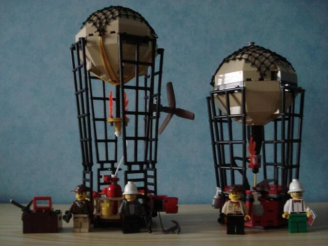

**Les deux mongolfières**

## Orient Expedition, un jeu de société !

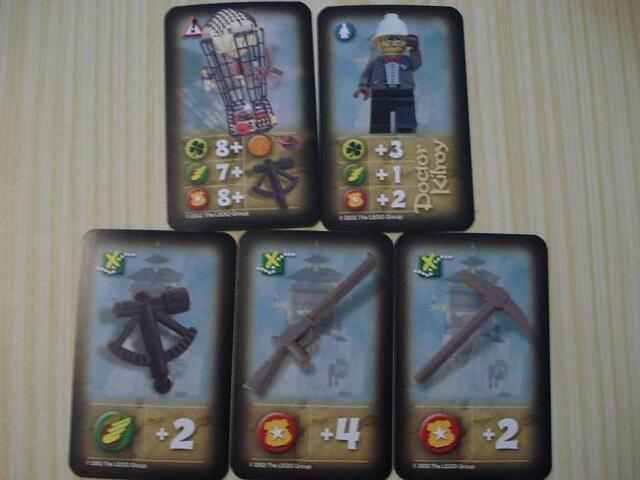

**Les 5 cartes**

Cette boîte contient 5 cartes à jouer, pour rendre une "partie de base" plus intéressante. En fait, il y a deux types de sets :  
**–** les sets avec les trésors en or, qui permettent de jouer avec le set, un plateau de jeu, un dé et des cartes  
**–** les sets optionnels, qui ajoutent des défis, des trésors ou des moyens de transport pour aller plus vite sur le plateau. Un autre article sera consacré à la gamme entière, avec plus de photos et d’explication sur le jeu de société.

## Conclusion

Dans la lignée des gammes Adventure, ce set respecte très bien l’univers des aventures de Johnny Thunder et de sa bande avec un mode de transport peu commun dans le monde LEGO.

Quelques pièces intéressantes et assez peu répandues.

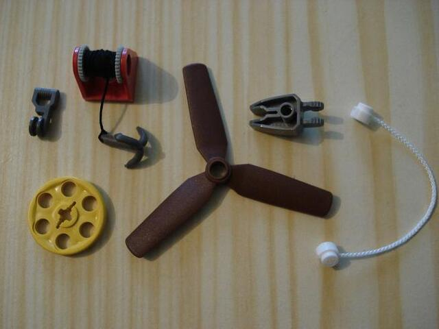

**Des pièces intéressantes**

La possibilité de l’intégrer dans un jeu de société ajoute un véritable plus à l’ensemble.

On pourra regretter l’absence de trésor, c’est le seul point noir...
