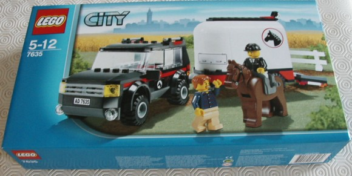
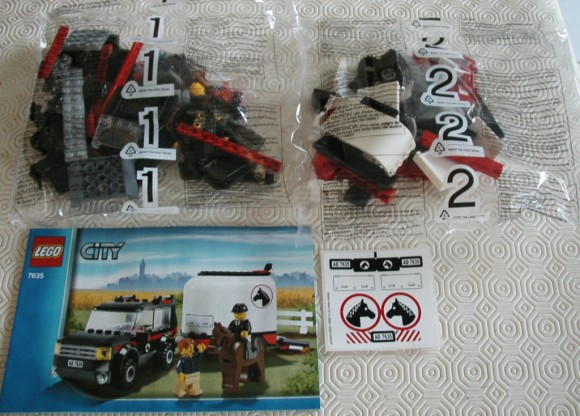
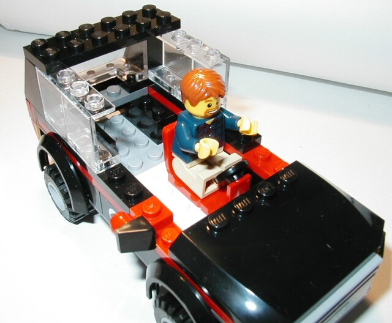
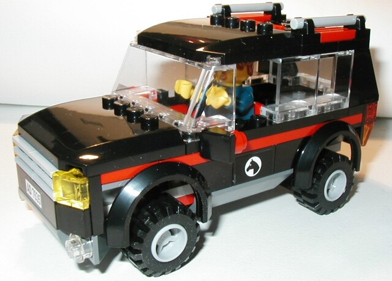
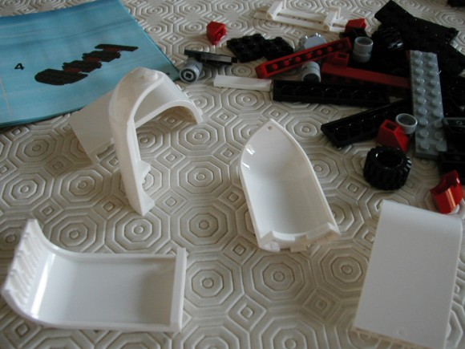
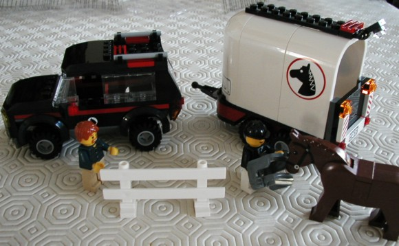
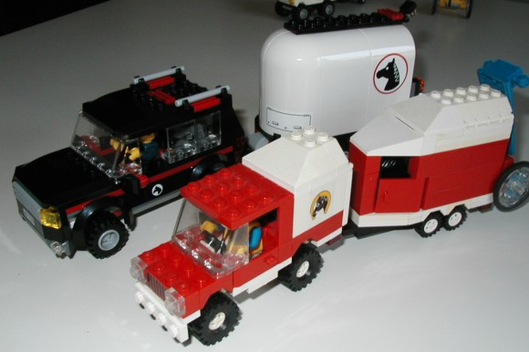
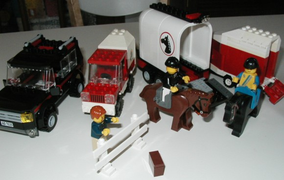
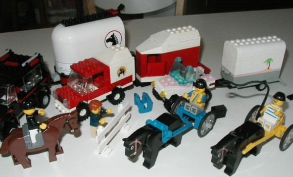
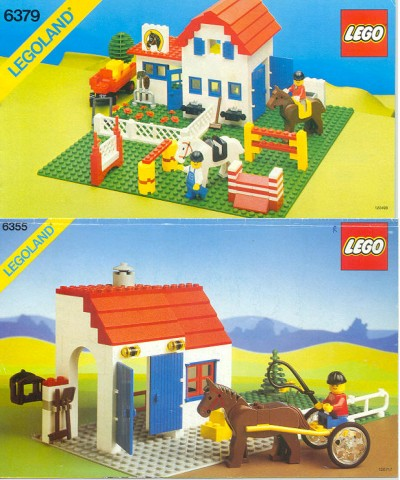

L’année 2009 introduit une nouvelle gamme, la ferme. C’est un thème nouveau pour LEGO dans la gamme System (ce thème existe depuis longtemps en Duplo par exemple). Dans cette gamme, nous trouvons le transport de chevaux 7635, composé d’un véhicule type 4x4 et d’une remorque.

_Résumé :_  
**–** Nombre de pièces : 176  
**–** Prix : environ 20 euro  
**–** Année : 2009  
**–** Gamme : City Ferme

La boîte offre un beau volume pour le prix. Le contenu est raisonnable et se décompose en deux sachets (l’un pour le 4x4 et l’autre pour la remorque), une planche d’autocollants et la notice.

## Le 4x4

Le premier sachet contient les pièces pour le véhicule et les deux figurines.

Le montage se fait aisément. Le modèle est particulièrement robuste. Cela s’explique par l’absence de toute ouverture (portes, toit ou hayon), ce qui permet l’utilisation de grandes pièces et leur bonne fixation.

Malgré ce défaut d’ouverture, le résultat est superbe, la livrée noire nous fait même hésiter à le prendre en main de peur de laisser des traces de doigts dessus :)

On reprochera aussi la présence d’un seul siège, malgré la place disponible.

Le look final est très proche d’un Range Rover, il n’y a pas à douter que ce modèle aura du succès au Royaume-Uni où ce type de véhicule est très prisé.

## La remorque

Second sachet à construire, la remorque fait vivre d’anciennes pièces, notamment la paroi en courbe, [qui n’a existé qu’en transparent dans des boîtes de la gamme Paradisa en 1992](http://www.bricklink.com/catalogItem.asp?P=6059) !

A nouveau, pas de difficulté particulière pour le montage. La largeur en 6 tenons offre suffisamment de place pour le cheval.

Au final, l’ensemble comprend également une barrière et la brique complémentaire pour remplacer la selle.

## Son grand frère le 6359

Nouveau thème certes, mais le transport de chevaux n’est pas nouveau. Une boîte, [la 6359](http://www.brickset.com/detail/?Set=6359-1), comprenant déjà un 4x4 et une remorque était sortie en 1986, soit 23 ans en arrière ! Encore une fois, LEGO revient sur les classiques, tant mieux !

A l’époque, le 4 tenons de large était roi, mais globalement, les proportions sont conservées. Le modèle d’époque offre en plus un sulky, mais ne contenait qu’une seule minifig.

On regrette simplement que le logo ne soit pas le même.

On ne pourra pas terminer sans citer la boîte [6419, le ranch Paradisa](http://www.brickset.com/detail/?Set=6419-1) qui contient également une telle remorque (et accessoirement un sulky).

Enfin, pour compléter la gamme hippique, on se remémorera les boîtes [6379](http://www.brickset.com/detail/?Set=6379-1) et [6355](http://www.brickset.com/detail/?Set=6355-1).

