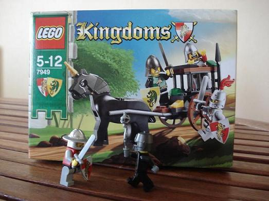
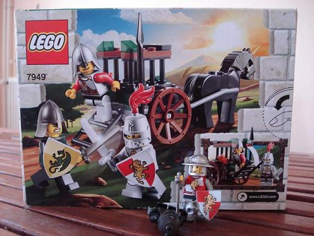
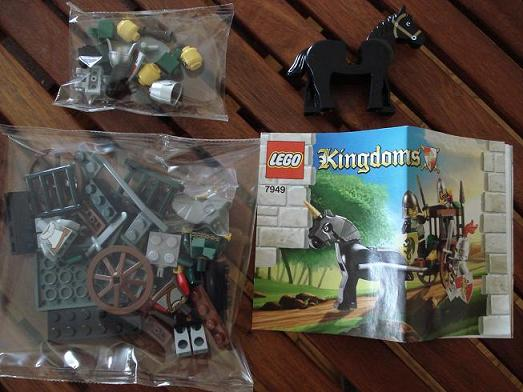
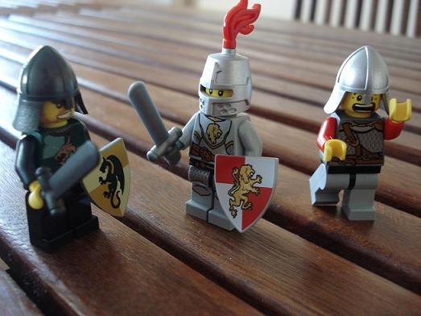
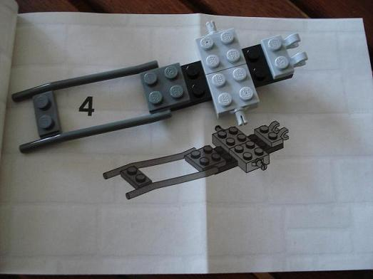
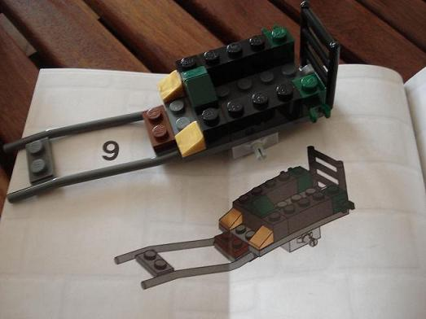
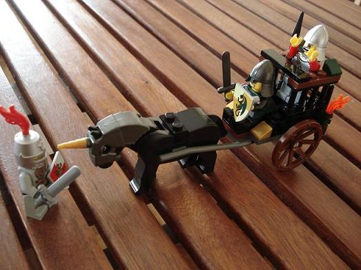
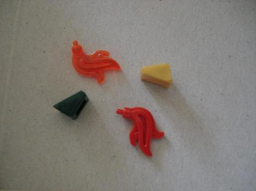
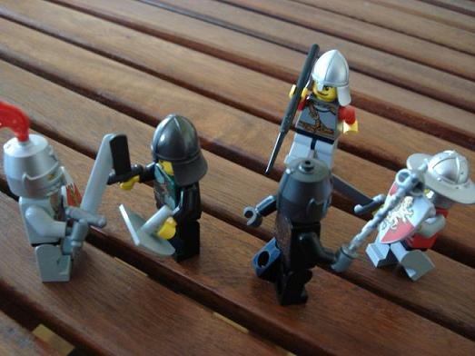

Voici la revue du set 7949 mettant en scène un chevalier devant sauver l’un de ses camarades retenu prisonnier !

Fiche technique :  
**–** Thème : Castle  
**–** Sous-thème : Kingdoms  
**–** Année : 2010  
**–** Pièces : 50  
**–** Minifigs : 3

## La boîte

Voilà des photos de la boîte avant ouverture, les chevaliers qui se battent devant sont d’un autre set :)

**Face avant**

**Face arrière**

## Les sachets

Voici la notice, le cheval qui deviendra licorne et les sacs de pièces.

**Contenu**

## Le montage

Sans plus attendre, commençons la construction avec de belles minifigurines et leurs accessoires !

**La belle équipe !**

Et ensuite la charrette !

**Etape 4**

**Etape 9**

**Final**

Et c’est fini ! Le chevalier n’a plus qu’à délivrer son ami, mais un combat s’impose !

## Les pièces supplémentaires

**Extra parts**

Conclusion

Un set classique qui permet de créer une scène d’action avec peu de pièces, qui viendra s’intégrer sans problème dans un champ de bataille :)

**Combat final !**
