Je vous propose une revue du set 8211 : L’attaque de la banque. Titre qui n’a aucun rapport avec la version anglaise qui se traduit plutôt par : Fuite de la rue de Brique.  
Mais bon quand on voit les traductions dans les autres langues, écrites sur la boîte, on se dit que finalement on s’en sort pas si mal... bref.

La gamme des modèles tiny turbos dure maintenant depuis plusieurs années et c’est vrai que les set commencent à manquer un peu d’originalité. Mais peu importe car je trouve que les produits Racers/Tiny turbos sont excellents.

Pourquoi, parce qu’ils offrent un plaisir double.  
Celui de jouer avec des LEGO bien sûr, mais également celui de jouer aux petites voitures. Car l’intérêt des véhicules Tiny Turbos c’est qu’ils sont proches de l’échelle 1/60 de nos petites voitures d’antan.

Mais passons à la description du Set.

Tout d’abords la fiche signalétique  
**–** référence du set : 8211  
**–** nom : Brick Street Getaway/L’attaque de la banque  
**–** année : 2010  
**–** nombre de pièces : 553  
**–** prix (indicatif) : 49,90 €  
**–** age : 7-12  
**–** gamme : LEGO / Racers / Tiny Turbos

## La boîte

Devant

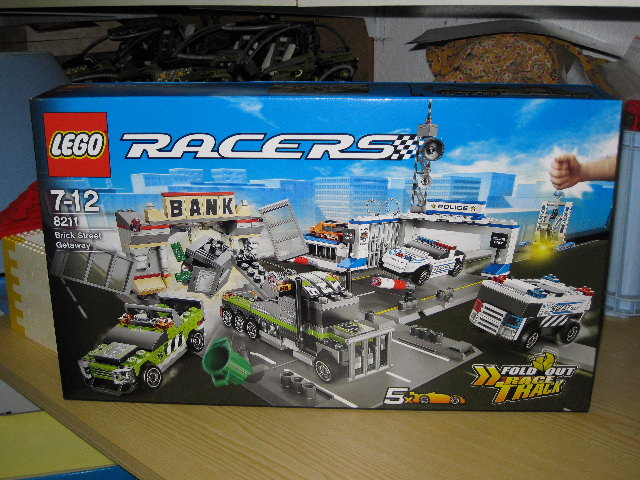

**boite face avant**

Derrière

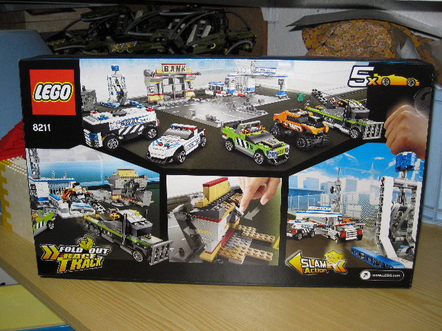

**boite face arrière**

Les sachets, la boîte/plaque et la notice

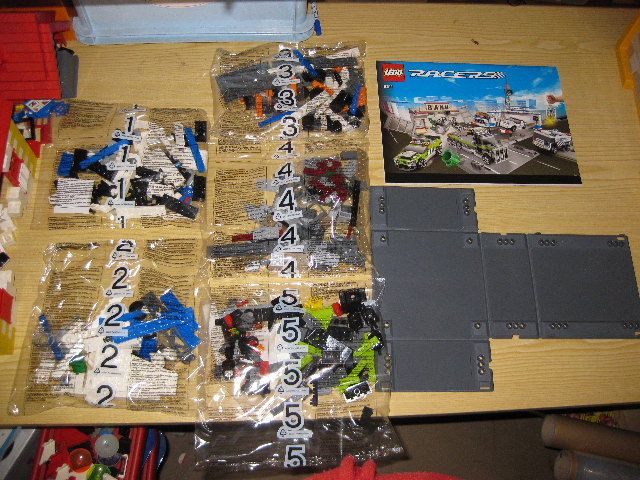

**Les sachets, la boîte/plaque et la notice**

Les sachets sont numérotés de 1 à 5, il y a une seule notice pour tout le set, et on trouve une boite/plaque de route. Et il y a aussi deux planches d’autocollants (non photographiées car en cours d’aplanissement, bin oui elles ont bougé dans la boite et sont ressorties, comme souvent, tordues)

## Première étape : les véhicules de police et le propulseur

Nous commençons par la construction de la voiture. Bien sûr ce n’est pas la première voiture de police de la gamme, mais celle là a un aspect très sport, prête pour aller courser le "sauvageon" braqueur de banque. D’ailleurs sans les autocollants et les gyrophares c’est une voiture de sport.

Le camion est très... cubique. Oui ça fait un peu brique roulante mais entre les autocollants, les faces avant et arrière, il est finalement bien personnalisé.

Je ne m’étendrai pas sur la construction du propulseur elle est identique à tout ceux vues jusqu’ici. Vous mettez le véhicule devant, en l’insérant entre entre les deux barres horizontales, vous tapez dessus (euh les plus de 70 kilos avec modération quand même) et le véhicule part à fond la caisse... et va percuter le premier truc placé devant.

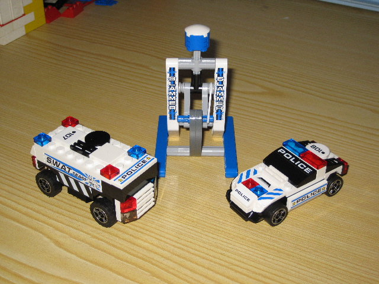

**Etape 1 : les véhicules de police et le propulseur**

## Seconde étape : les routes et le poste de police

Cette seconde étape commence par la pause des autocollants sur la boite/plaque qui sert de plaque de base pour fixer les bâtiments et d’aire de circulation pour les véhicules.  
Alors soyons bien clair : c’est une vrai galère !

Bon, déjà, à la base les autocollants j’aime pas ça, même si la plupart des set que je construis ne sont jamais démontés. Je préfère les pièces sérigraphiées car elles ne bougent pas dans le temps, contrairement aux autocollants qui souvent finissent par se décoller sans possibilité de les recoller.

Mais c’est vrai que les autocollants apportent une dose de réalisme supplémentaire, notamment pour ce genre de set, et qu’à partir du moment où ils ne chevauchent pas plusieurs briques je les utilisent.

Par contre dans le cas présent un bon conseil : munissez-vous d’un cuter fin et bien pointu. Car vu les alignements qu’il faut réaliser, j’ai du m’y reprendre à plusieurs fois, notamment pour les courbes, pour obtenir un résultat propre et conforme au modèle.

Mais bon après avoir pris 5 anti-dépresseurs et 2 litres de tisane zen-apaisante made by Katmandou, je suis arrivé au résultat potable que voilà.

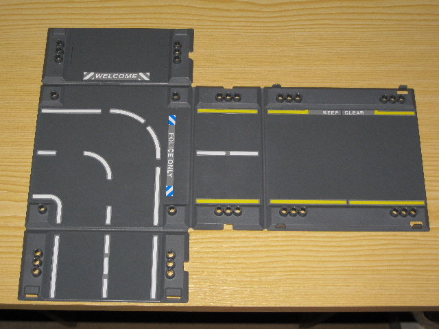

**Etape 2 : la boîte/plaque avec les autocollants**

Ensuite on passe à la réalisation de la première partie du poste de police. Il comprend l’entrée de la fourrière, surmonté de fil de fer barbelé, et un porche. Nous pouvons y positionner les deux véhicules. Le poste de police est fermé par deux demi barrières.

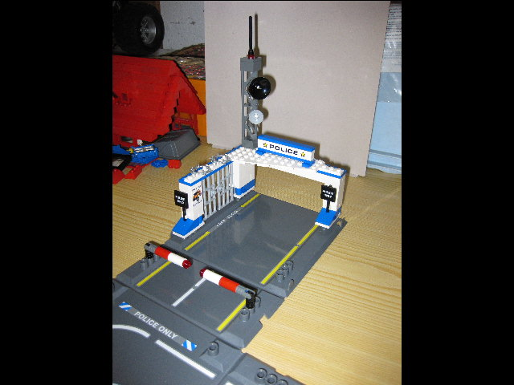

**Etape 2 : le poste de police**

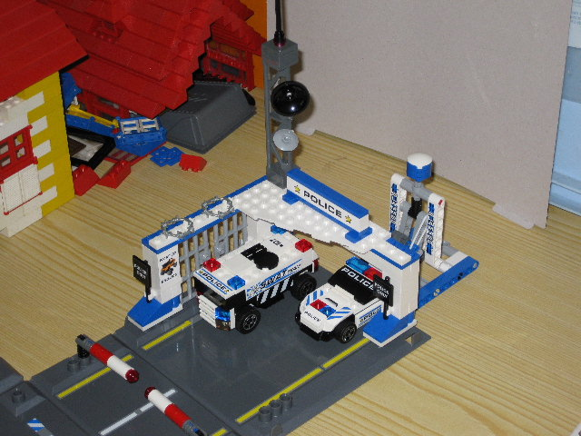

**Etape 2 : le poste de police et ses véhicules**

## Troisième étape : la fourrière et le 4X4 orange

Cette étape est courte. Elle consiste à construire la fourrière qui est en fait un box à barreaux pour garer le 4X4 orange. La porte arrière de cette fourrière est posée sur 3 plates 1x2 à 1 tenon pour pouvoir être arrachée par la dépanneuse.

Voici la fourrière et le 4X4

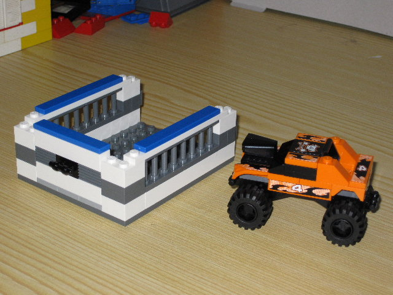

**Etape 3 : la fourrière et le 4X4 orange**

Et le tout raccroché au poste de police.

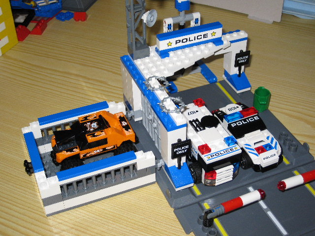

**Etape 3 : la fourrière raccordée au poste de police**

## Quatrième étape : la banque

Comme pour la fourrière la banque est équipée de portes fixées sur 4 plates 1x2 à 1 tenon pour pouvoir être propulsées vers l’avant, à l’aide d’un basculeur, comme sous l’effet d’un explosion.

Nous commençons par construire la base de la banque que l’on fixe sur la boîte/plaque.

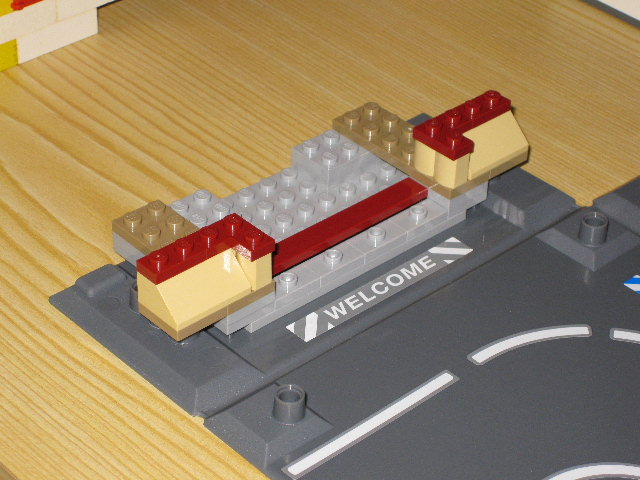

**Etape 4 : la base de la banque**

Ensuite nous construisons la façade de la banque.  
Le mot banque est réalisé à l’aide de 4 autocollant, ainsi chaque brique portant un autocollant reste indépendante de ses voisines.  
Et enfin on fini par la construction du coffre que l’on positionnera à l’intérieur de la banque.

La façade de la banque et le coffre

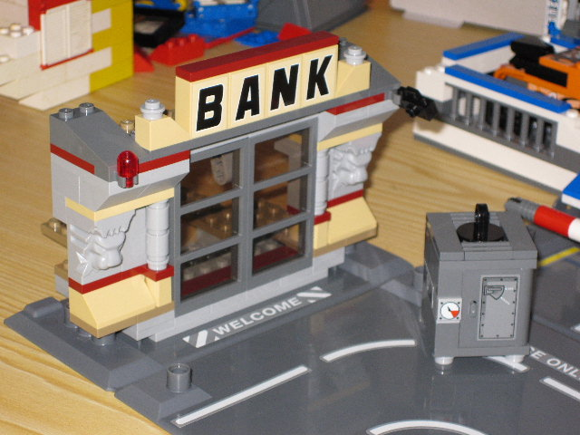

**Etape 4 : la banque et le coffre vue avant**

L’arrière de la banque avec le coffre en place.

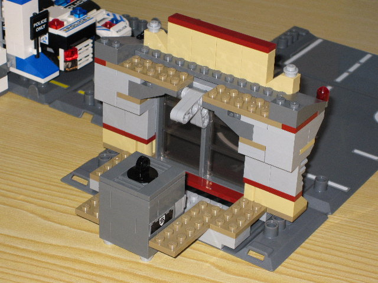

**Etape 4 : la banque et le coffre vue arrière**

Le coffre vient buter contre la base de la banque. Il faut donc qu’il soit tiré, avec force, pour être extrait de la banque.

## Cinquième étape : le pick-up et la dépanneuse

Cette dernière étape consiste en la construction des deux derniers véhicules du set : un pickup et une dépanneuse.  
La dépanneuse est munie d’un crochet raccordé à un treuil ce qui lui permet d’arracher les portes de la fourrière et d’emporter le coffre qui est muni d’un attache pour le crochet.

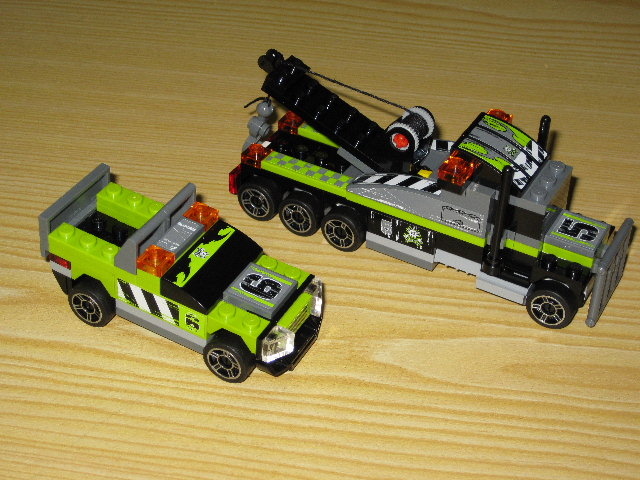

**Etape 5 : le pickup et la dépanneuse**

Et voilà le set complet

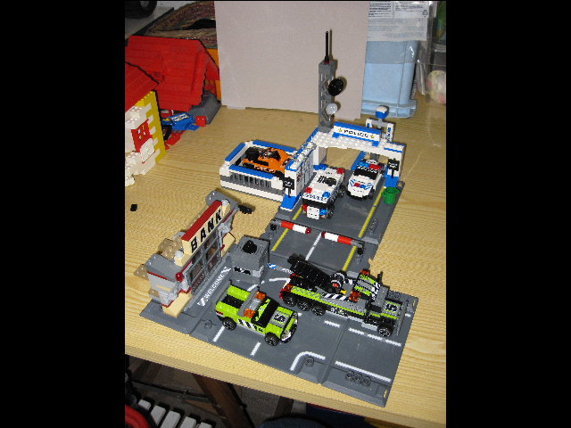

**Le set complet**

Et les 5 véhicules

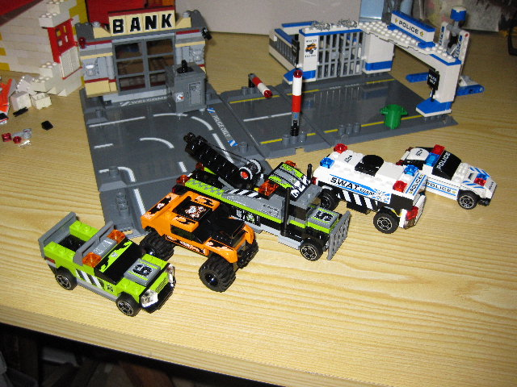

**Les 5 véhicules**

En conclusion je dirais que ce set 8211 est très agréable à construire et complète bien la gamme Racers/Tiny turbos. Les véhicules ne sont pas particulièrement originaux mais ils sont bien variés pour ce set.

Les bâtiments auraient pu être un peu plus détaillés et il manque quelques panneaux de signalisation.

Il plaira beaucoup aux jeunes garçons évidemment mais également aux fans de cette gamme (dont je fais parti)

Le nombre de pièces est pas mal pour ce type de set et permet de construire d’autres véhicules selon son imagination.

Un mot sur le prix, je le trouve un peu élevé vu qu’il contient surtout des petites pièces, alors guettez les soldes, et allez faire un tour sur le fleuve sud américain.

A bientôt

Raoulz
