Bonjour à toutes et à tous.  
Aujourd’hui je vous propose d’examiner le set 8214 : GALLARDO LP 560-4 POLIZIA. Bon cette fois pas besoin de traduire le nom du set, je pense que tout le monde comprend de quoi il s’agit.  
Alors rentrons tout de suite dans le vif du sujet.

TLC nous propose donc la reproduction d’une voiture de police. Bon pas une bonne vieille Renault 4L, une Peugeot 308 ou une Skoda Octavia, mais une Lamborghini GALLARDO LP 560-4 dans sa version Polizia italienne... C’est autrement plus classe quand même.

Des supers sportives, en version sérigraphiée, utilisées par les forces de police il y en a beaucoup. Elles sont, en générale, utilisées par les brigades de contrôle des autoroutes.

Si vous faites un petit tour sur le Web vous pourrez trouver des photos de Porsche, Lamborghini, Ferrari (eh oui), Corvette, Aston Martin, etc.

Euh sinon en France finalement pour remplacer les Subaru Impreza WRX nous allons avoir des Renault Megane RS. Bon préparées à 260 Ch quand même, soit deux fois moins que les Lambo de la Polizia. Mais rappelez-vous, dans le temps c’était des Alpines.

Alors pourquoi TLC a choisi ce modèle ?  
Loin de moi l’idée de penser à leur place mais personnellement j’y vois deux raisons :  
**–** tout d’abord c’est un véhicule actuellement en cours d’utilisation dans plusieurs pays, donc il bénéficie d’une publicité indirecte.  
**–** ensuite la base existe déjà : le set 8169. Du coup TLC limite les coûts et la durée du développement d’un modèle 100% nouveau, et donc augmente sa marge puisque le set n’est pas vendu à un prix particulièrement discount.

Il faut donc que je fasse une petite précision avant de commencer la revue de ce set.  
Bin oui, parce que j’entends déjà les commentaires de ceux qui auraient commencé à lire cet article : _"Tu es bien gentil mon petit Raoulz, mais [la description de la Lamborghini LP 560-4 elle existe déjà, depuis 1 an et demi, grâce à l’article que lui a consacré JAC](/articles/lamborghini-gallardo-lp560-4-8169/) en septembre 2009. Donc à moins que tu fasses 3 pages sur la différence entre le jaune et le bleu, est-ce vraiment la peine de nous pondre un article la dessus ? Sachant que tu vas forcément redire ce qui a été décrit dans l’article de JAC ?"_

Dans le fond, vous qui faites ce raisonnement, vous n’avez pas tort. Et je dois vous dire qu’avant de faire cet article je me suis moi même posé cette question, et j’en ai d’ailleurs discuté avec JAC. Sauf qu’entre le set 8169 et le set 8214, les différences ne se limitent heureusement pas uniquement à la couleur et aux accessoires polices rajoutés ça et là dans la voiture.

Je vous propose donc aujourd’hui une revue un peu différente de celles que je réalise habituellement.  
Plutôt que de décrire la construction, je vous propose de découvrir le modèle grâce à beaucoup de photos et peu de texte (ce qui est un exploit pour moi qui suis, comme vous vous en êtes déjà rendu compte, plutôt du genre bavard).  
Les explications seront orientées vers la description des différences entre les deux modèles.

Avant de commencer (bis) quelques détails sur l’histoire de la marque Lamborghini (source [Wikipédia](http://fr.wikipedia.org/wiki/Lamborghini)).  
Ferruccio Lamborghini ayant fait fortune dans la fabrication de tracteurs, il décide enfin de s’adonner à sa passion pour les automobiles de prestige. En 1958, il fait l’acquisition de plusieurs Ferrari 250 GT. Lamborghini considère que les Ferrari sont des automobiles performantes mais trop bruyantes, peu confortables et peu fiables. Frustré par la nature récurrente des problèmes, Lamborghini n’hésite pas à s’en plaindre au près d’Enzo Ferrari lui-même. Il serait allé adresser à Enzo Ferrari des conseils sur la manière d’améliorer ses automobiles. Ferrari, furieux, lui aurait alors répondu : « Lamborghini, tu sais surement conduire un tracteur, mais tu ne seras jamais capable de conduire une Ferrari. » Lamborghini, conscient que personne ne serait capable de lui offrir la voiture parfaite, se décide alors de la concevoir lui-même. Quelques années plus tard, il avoua que "si Enzo Ferrari ne lui avait pas asséné cette mesquinerie un jour où il se plaignait d’insolubles problèmes sur sa propre Ferrari, il n’aurait peut-être jamais construit ses voitures".

Lamborghini a été un précurseur dans la conception de GT à moteur central, architecture décriée à l’époque par Enzo Ferrari lui-même qui considérait qu’une GT ne se concevait qu’avec un moteur en position longitudinale avant. L’avenir donna tort à ce dernier et Ferrari fini par venir au moteur central même si aujourd’hui il conçoit des véhicules basés sur les deux architectures.

Bon allez hop cette fois c’est parti pour de bon (enfin).

Pour commencer la fiche signalétique :  
**–** référence du set : 8214  
**–** nom : GALLARDO LP 560-4 POLIZIA  
**–** année : 2010  
**–** nombre de pièces : 801  
**–** prix (s@h) : 69,90 €  
**–** âge : 9+  
**–** gamme : RACERS

Description de la boîte

La face avant

[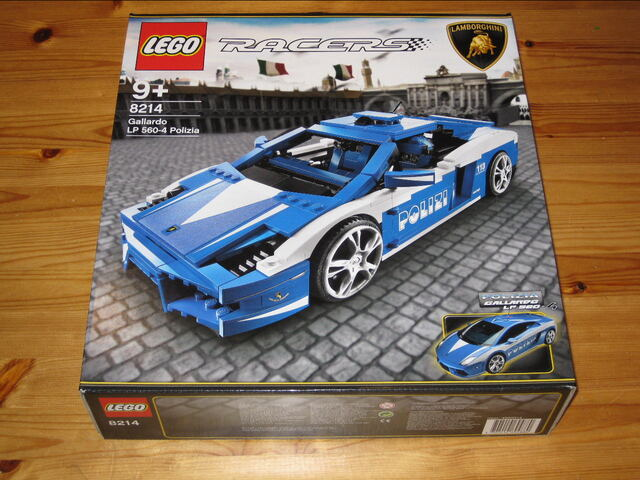](https://www.freelug.org/IMG/jpg/DSC00048.jpg)

**boite face avant**

La face arrière

[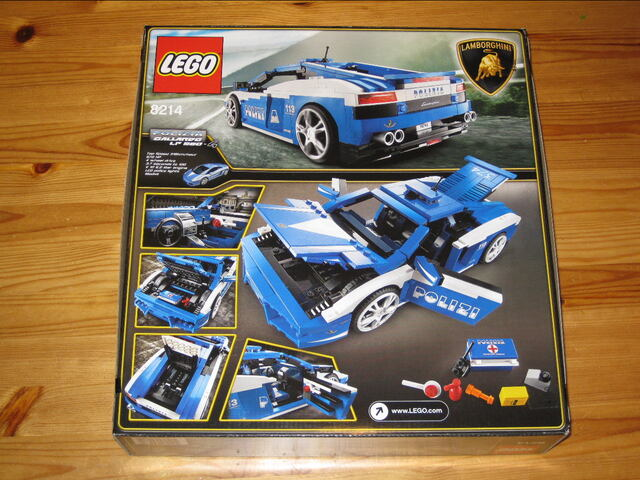](https://www.freelug.org/IMG/jpg/DSC00049.jpg)

**boite face arrière**

La boîte est classique. Le recto présente le modèle et le verso montre les détails à savoir les ouvrants et les accessoires "Police".

Elle contient deux notices, une planche d’autocollants et 7 sachets numérotés. Tiens voilà une différence avec le 8169 où les sachets n’étaient pas numérotés. TLC aurait-il voulu orienter son set vers les jeunes constructeurs plutôt que vers les "vieux" collectionneurs ? Je pense qu’il y a un peu de ça, car les enfants aiment bien les voitures de police. La gamme City Police que TLC décline depuis plus de 30 ans en atteste.

Les notices, la planche d’autocollants et les sachets

[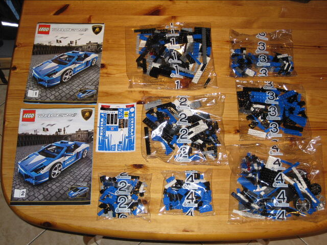](https://www.freelug.org/IMG/jpg/DSC00050.jpg)

**Les sachets, les notices et les autocollants**

Il n’y a pas deux versions possibles de la Gallardo 560-4 Polizia comme pour le set 8169.  
Dans le cas présent seul le coupé peut-être construit.  
Au fait une des premières différences entre les deux set c’est quand même le nombre de pièces :  
**–** 742 pour le 8169  
**–** 801 pour le 8214  
Et oui alors qu’on ne peut construire qu’un seul modèle les pièces sont plus nombreuses. Vous comprendrez pourquoi tout au long de cet article, mais c’est notamment du à la transformation "Police" de la Gallardo.

Un petit mot sur les autocollants. Évidemment vous pouvez ne pas les coller mais le réalisme du modèle en prend un coup. Et un véhicule de police où il n’y a pas marqué police dessus franchement ça ne ressemble à rien.  
Par contre il faut savoir que certains autocollants chevauchent plusieurs pièces. Donc si vous les collez il faut envisager de ne jamais démonter le set, sauf si vous n’avez que faire de bousiller les autocollants.  
Et puis c’est un modèle de collection. Il a plus sa place sur une étagère à côté des autres véhicules de la même échelle, qu’entre les mains de joyeux bambins adeptes des crash tests avec les portes de placard. D’autant plus que certains éléments de carrosserie sont assez légèrement fixés et résisteront peu aux courses poursuites endiablées.

Au fait l’échelle, parlons-en un peu, car comme sur le 8169 rien n’est écrit à ce sujet sur la boîte ou la notice.  
Mais bon on peut quand même dire, sans prendre de risque, que cette Lamborghini est à l’échelle 1/17.

Bon allez pour ceux qui ne se seraient pas encore lassés de mon bavardage, alors que j’avais promis d’écrire peu (oups), et qui ont eu le courage de tenir jusqu’à maintenant, démarrons, enfin, la construction du set 8214.

Dès le départ, la construction ne démarre pas de la même manière. Bien sûr dans les deux cas nous commençons par le châssis, mais le fond entièrement plat du 8169 est ajouré à l’arrière sur le 8214, là où sera placé le moteur.

Le châssis

[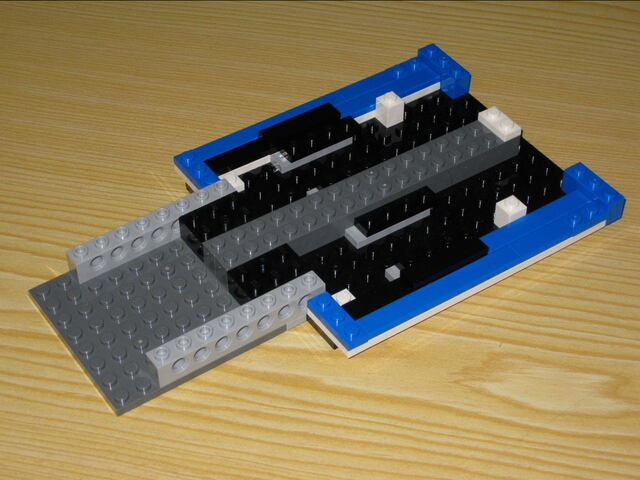](https://www.freelug.org/IMG/jpg/DSC00051.jpg)

[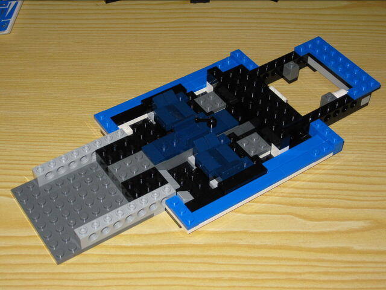](https://www.freelug.org/IMG/jpg/DSC00052.jpg)

Je constate aussi entre les deux modèles une différence fondamentale dans le mode de construction.  
Pour le 8169 nous sommes sur de la construction horizontale. On empile les briques niveau par niveau sur toute la longueur du modèle. Pour le 8214 nous sommes sur une construction plus modulaire : châssis, bouclier arrière, moteur, carrosserie arrière, intérieur, etc.

Support du bouclier arrière avec extracteur.

[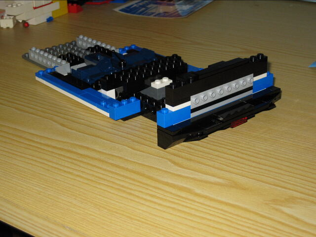](https://www.freelug.org/IMG/jpg/DSC00053.jpg)

Je trouve le moteur beaucoup plus réaliste sur le 8214 car la position des cylindres en V est cette fois modélisée.  
Il est placé plus en arrière et du coup la construction de la partie arrière de la voiture est différente entre les deux sets et les pièces utilisées ne sont plus du tout les mêmes.

Moteur.

[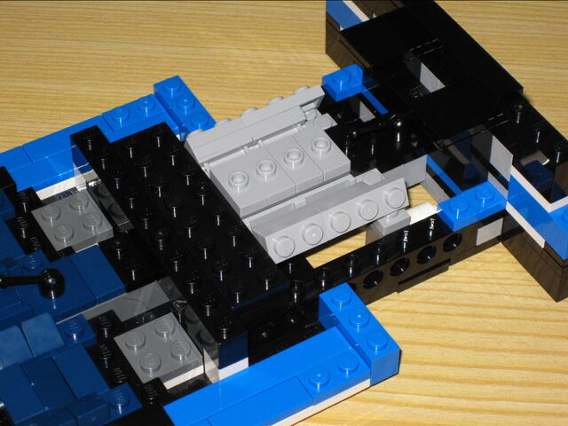](https://www.freelug.org/IMG/jpg/DSC00054.jpg)

Moteur avec sa culasse.

[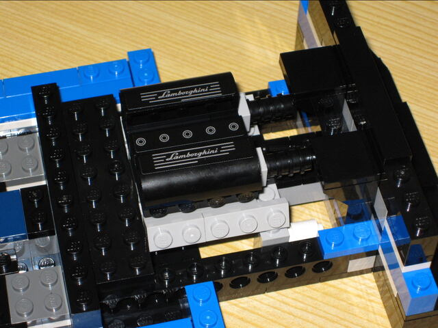](https://www.freelug.org/IMG/jpg/DSC00055.jpg)

L’agencement interne des briques est également modifié par l’utilisation de Flat Tile 1\*3, pièce qui n’existait pas en 2009, et qui sont notamment utilisées pour les seuils de porte.

Pour la construction de la partie arrière de la carrosserie, si extérieurement je ne vois pas de différence, à l’intérieur tout est différent.  
Vous remarquerez sur la photo suivante que les Corner Plate 2x4x4 ne sont pas positionnés de la même façon.

La partie arrière

[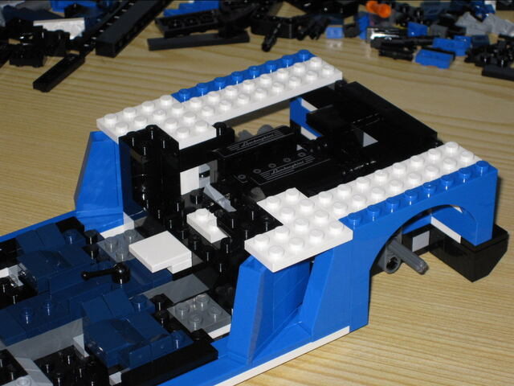](https://www.freelug.org/IMG/jpg/DSC00056.jpg)

En revanche le bouclier arrière est strictement identique sur les deux modèles. A part l’intégration de deux Plate 1x1 bleues transparentes pour les feux polices sur le 8214.

Le bouclier arrière

[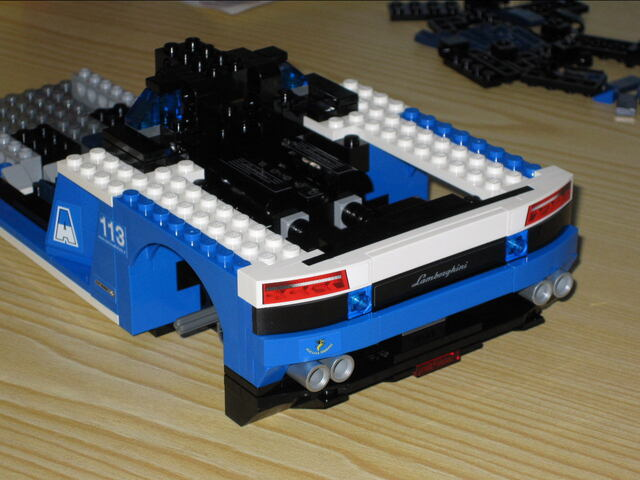](https://www.freelug.org/IMG/jpg/DSC00057.jpg)

Pour l’intérieur de la voiture les différences sont nombreuses, pas forcément dans le résultat, mais dans les pièces utilisées pour arriver à ce résultat.  
Et c’est là qu’on se rend compte que finalement TLC a un peu bossé sur ce modèle. Ils se sont attachés à reproduire un modèle similaire mais avec des techniques et des éléments de construction différents, ce qui explique la l’écart du nombre de pièces entre les deux sets.

Les sièges

[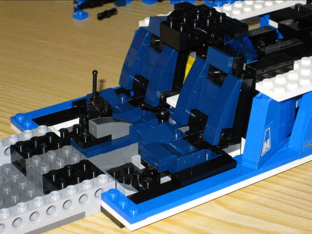](https://www.freelug.org/IMG/jpg/DSC00058.jpg)

Bien sûr, au final le visuel est forcément le même puisque nous construisons bien la même voiture.

Ensuite nous passons à la construction des portes et là, par contre, aucune différence entre les deux sets, si ce n’est le support du panneau stop dans la portière droite.  
A noté quand même que sur le 8169 on construit une grande partie de l’avant de la voiture avant de monter les portes alors que sur le 8214 les portes sont montées d’abord.

Les portes en place

[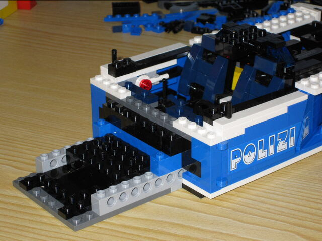](https://www.freelug.org/IMG/jpg/DSC00059.jpg)

On finalise ensuite la construction du tableau de bord avec là aussi une grosse différence dans les pièces utilisées, mais par contre un gros avantage visuel pour la 8169 qui apparait plus réaliste avec ses compteurs et sa casquette derrière le volant (absent sur le 8214).

La construction de la partie avant concentre les plus grandes différences visuelles entre les deux modèles.  
Tout d’abord un vrai coffre est aménagé sous le capot pour pouvoir y mettre une trousse de premiers secours et un extincteur.

Le coffre avant

[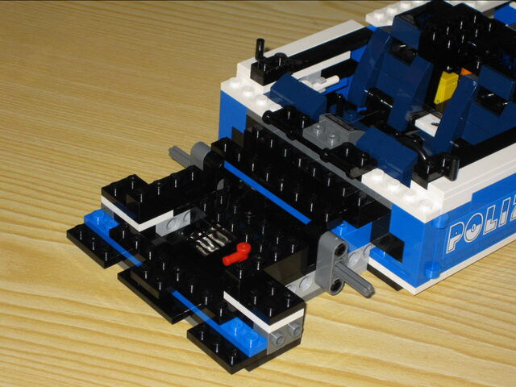](https://www.freelug.org/IMG/jpg/DSC00060.jpg)

Le bouclier avant comprend deux différences importantes. La partie central n’est pas creuse mais pleine. Les côtés du bouclier présentent un décrochement au milieu, comme sur la vrai.  
Ces deux différences renforcent le réalisme du modèle en collant plus à l’original.  
Autre détail qui rajoute au réalisme, la partie supérieure du bouclier avant, là où viendra s’appuyer le capot, est studless.

Le bouclier

[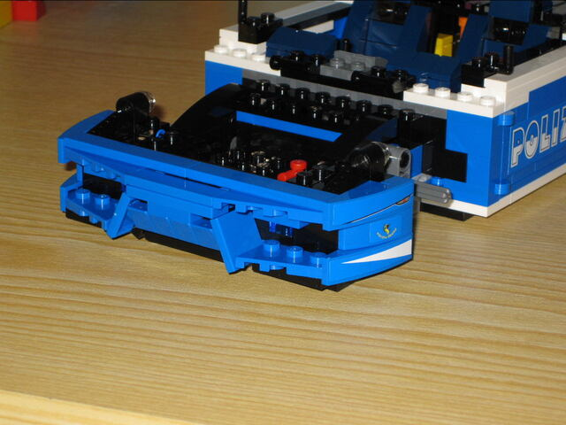](https://www.freelug.org/IMG/jpg/DSC00061.jpg)

Une vue d’ensemble du véhicule à ce stade de la construction

[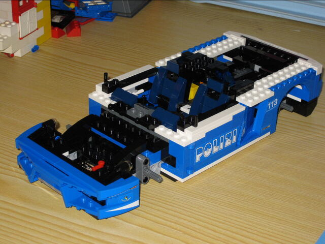](https://www.freelug.org/IMG/jpg/DSC00062.jpg)

Ensuite nous installons les passages de roue avant.  
Nouvelle différence importante avec le 8169 : ils sont plus fin puisqu’ils font 1 tenon de large au lieu de 3.  
Pourquoi ???  
Nous le verrons un peu plus loin lors de la construction du capot.

Nous positionnons ensuite le pare-brise.  
La modélisation différente des passages de roues permet également une implantation différentes du pare-brise dont les montants sont entièrement studless et iront disparaître sous le capot avant.

Passages de roues et pare-brise.

[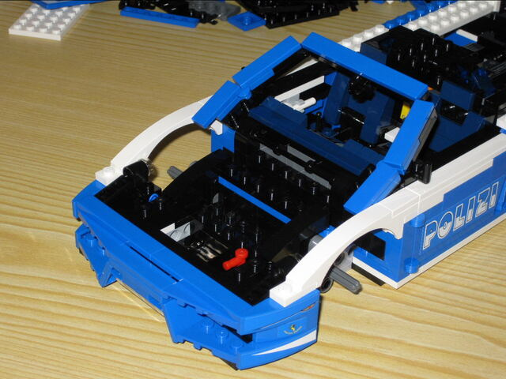](https://www.freelug.org/IMG/jpg/DSC00063.jpg)

Comme vous l’avez certainement constaté sur la photo précédente, nous voyons là une des importantes différences visuelles entre les deux set : les phares.  
Sur le 8169 les phares sont représentés par des autocollants (beurk), qui plus est en deux parties (rebeurk), et ils recouvraient plusieurs pièces (rerebeurk).

Sur le 8214 les phares sont modélisés en pièces, ce qui rajoute au réalisme du véhicule et va permettre la réalisation d’un capot avant plus fidèle à l’original.

D’ailleurs à ce stade de la construction il aurait été logique de le faire ce capot avant. Et bien non on passe à la construction du toit, des montants de custodes et du capot moteur.

Le toit du 8214 est forcément différent puisqu’il intègre une rampe de gyrophare et deux antennes (et hop quelques pièce de plus que sur le 8169), dont une doit être celle d’un GPS. Nous trouvons également une caméra sous le toit. Et oui car je vous rappelle qu’en ce moment la grande mode c’est la vidéo surveillance - euh pardon la vidéo protection. Ca fait moins peur dit comme ça ;-)

Le toit

[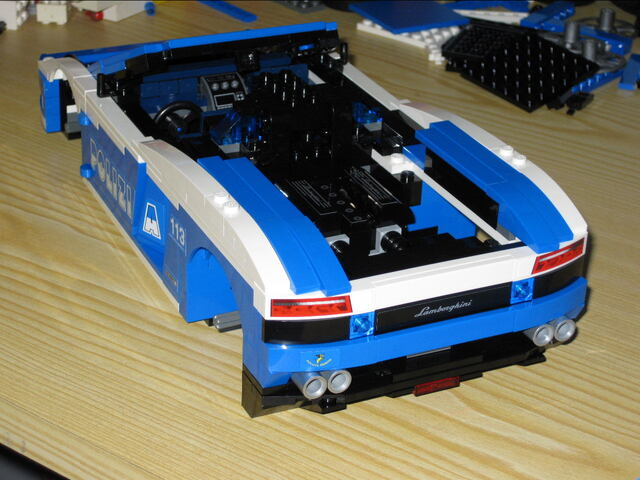](https://www.freelug.org/IMG/jpg/DSC00064.jpg)

[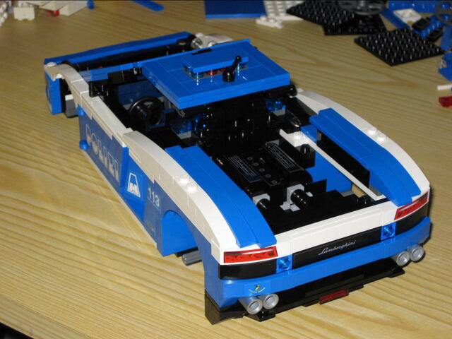](https://www.freelug.org/IMG/jpg/DSC00065.jpg)

Les montants de custodes sont strictement identiques entre les deux modèles, dans leur forme. Mais comme pour beaucoup d’autres parties de la voiture les pièces employées pour les construire ne sont pas les mêmes.  
Quant au capot moteur et bien là aussi grosse différence entre les deux modèles puisqu’il est plein sur la 8214 alors qu’il était ajouré sur la 8169 (sur la version coupé seulement).

Les montants de custode et le capot moteur

[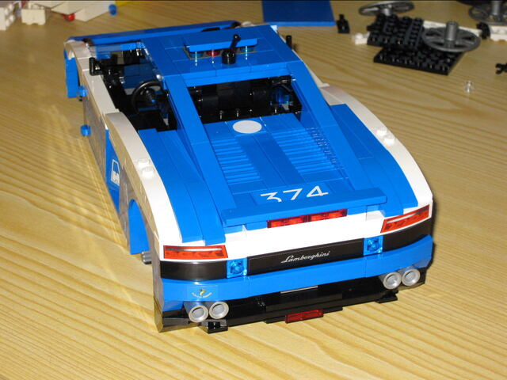](https://www.freelug.org/IMG/jpg/DSC00066.jpg)

Bon et bien il ne manque plus qu’un morceau à construire pour que notre modèle soit complet : le capot avant.  
Sur le 8169 le capot avant est quand même très simpliste, rectangulaire et sans les décrochements liés à la forme des phares. Il n’épouse pas les formes de l’original.  
Par contre sur la 8214 nous avons à faire à un capot beaucoup plus élaboré qui épouse au plus prêt la forme des phares, vient mourir au bord des ailes (d’où les passages de roues plus étroits à 1 tenon) et qui remonte complètement jusqu’au pied du pare-brise.

Le capot avant

[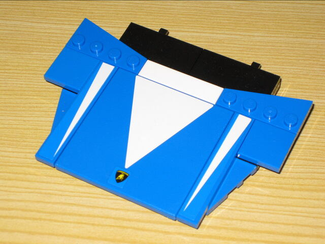](https://www.freelug.org/IMG/jpg/DSC00081.jpg)

**capot avant**

Le capot monté sur la voiture.

[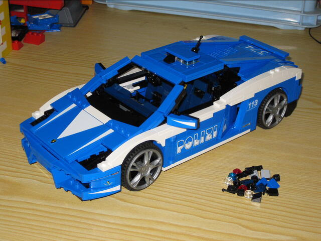](https://www.freelug.org/IMG/jpg/DSC00067.jpg)

Et voilà c’est terminé le modèle est fini avec, en prime, un joli tas de pièces supplémentaires comme vous pouvez le constater sur la photo précédente.

Elle est quand même sacrement jolie cette Gallardo et fidèlement reproduit par TLC. Et oui effectivement comme le 8169 en son temps.  
Pour vous en convaincre je vous propose de l’observer sous toutes les coutures.

[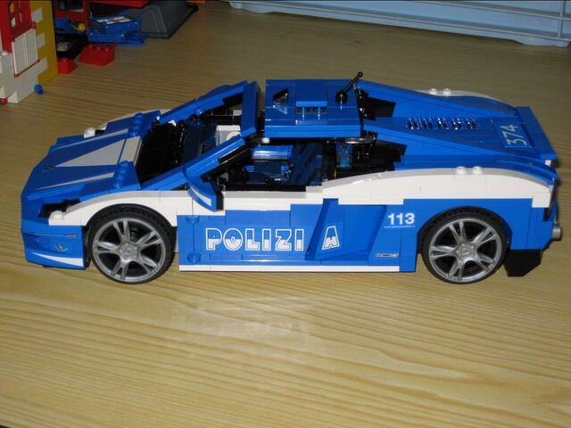](https://www.freelug.org/IMG/jpg/DSC00068.jpg)

[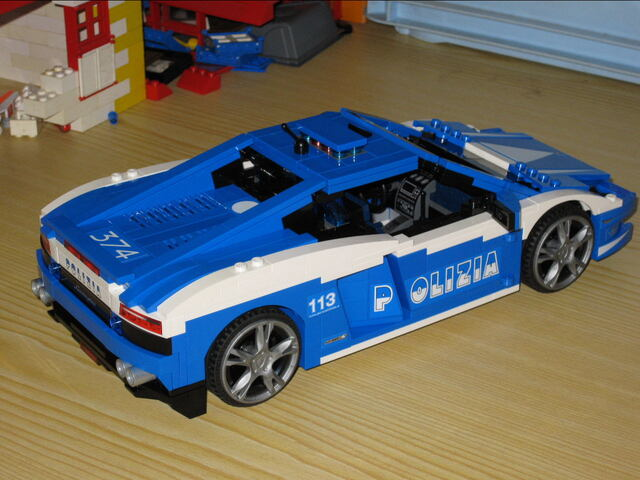](https://www.freelug.org/IMG/jpg/DSC00069.jpg)

[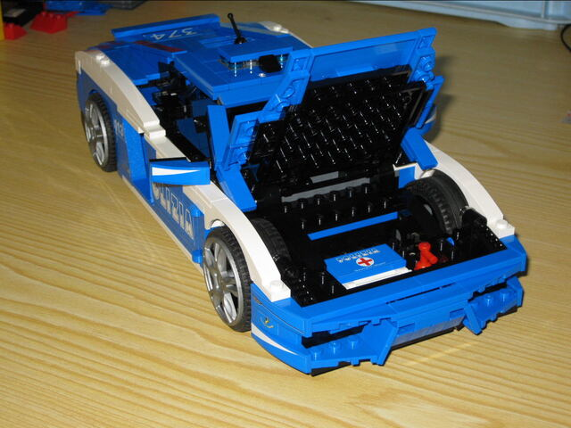](https://www.freelug.org/IMG/jpg/DSC00070.jpg)

[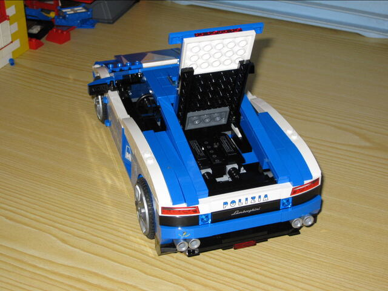](https://www.freelug.org/IMG/jpg/DSC00071.jpg)

[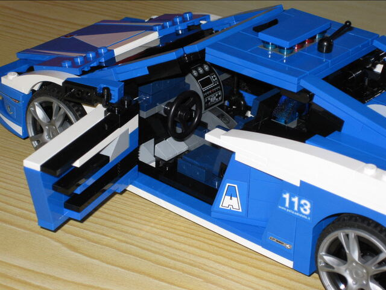](https://www.freelug.org/IMG/jpg/DSC00072.jpg)

[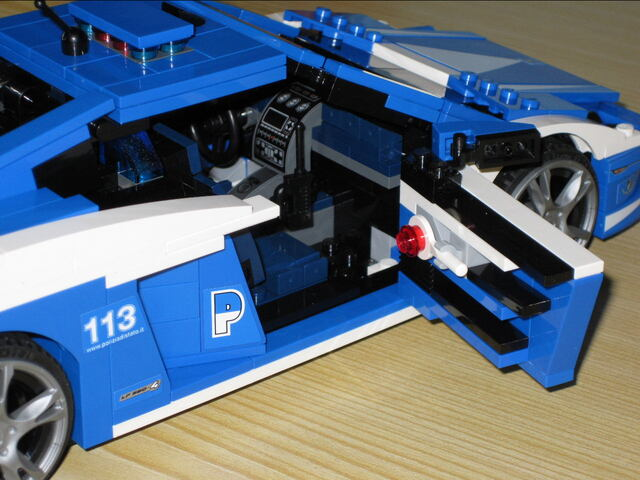](https://www.freelug.org/IMG/jpg/DSC00073.jpg)

[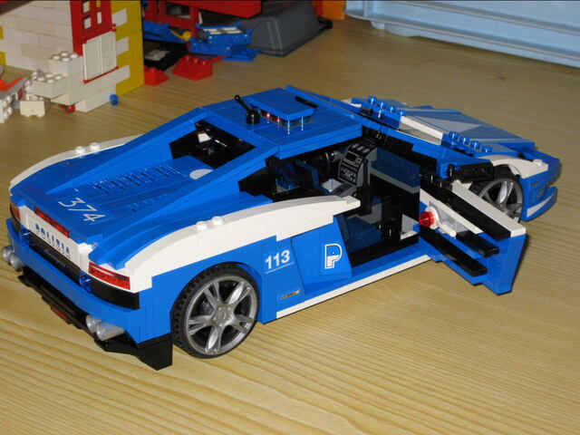](https://www.freelug.org/IMG/jpg/DSC00074.jpg)

[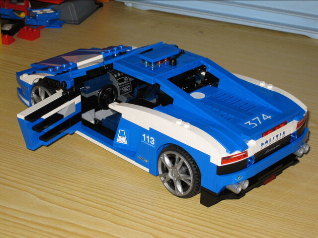](https://www.freelug.org/IMG/jpg/DSC00075.jpg)

[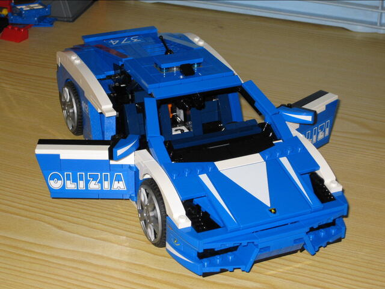](https://www.freelug.org/IMG/jpg/DSC00076.jpg)

[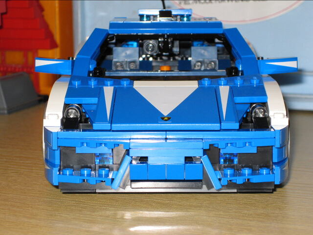](https://www.freelug.org/IMG/jpg/DSC00077.jpg)

[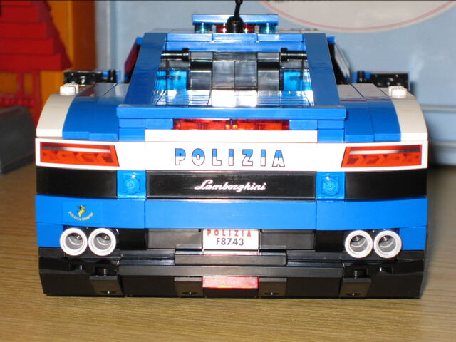](https://www.freelug.org/IMG/jpg/DSC00078.jpg)

[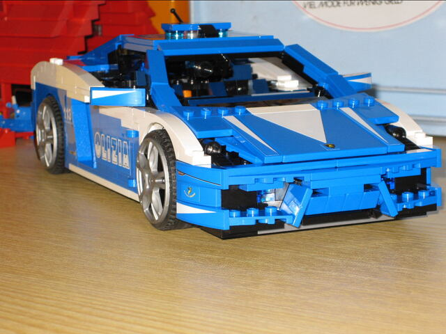](https://www.freelug.org/IMG/jpg/DSC00079.jpg)

[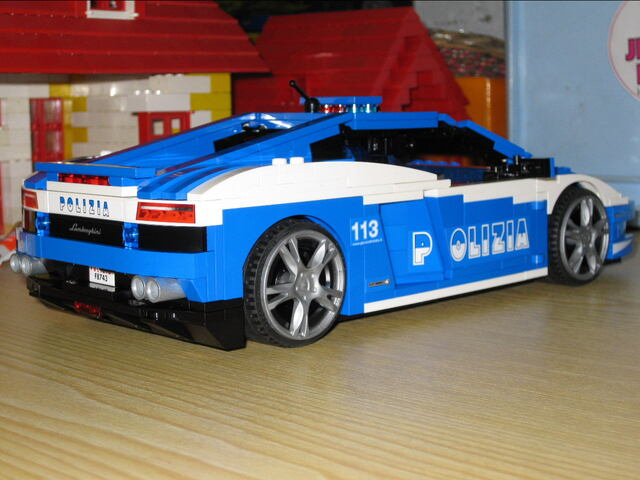](https://www.freelug.org/IMG/jpg/DSC00080.jpg)

Bon et bien c’est pas tout ça mais il est peut-être temps de conclure maintenant. Parce que ça commence à faire long, surtout pour vous, moi j’adore ;-)

Alors ce set 8214 présente-t-il un réel intérêt ou est-ce juste un moyen pour TLC de rajouter un modèle de plus dans une gamme sans dépenser un sous en développement ?

Et bien je dirais : les deux, ou presque.  
Car oui ce modèle a un vrai intérêt. Même si il n’y a rien de révolutionnaire dans sa construction ou son niveau de réalisme, il est malgré tout inédit car TLC n’a jamais reproduit de voiture de police à cette échelle.  
Cette Gallardo Polizia aura une place de choix entre les Ferrari Enzo, FXX, F430, F430 challenge, Lamborghini Gallardo Spyder et coupé. Tout collectionneur de la gamme se doit de l’acquérir.

Maintenant, que TLC ait employé une base existante, le set 8169, pour réaliser sa Gallardo Polizia, peut être critiquable car on pourrait penser qu’il cherche à faire de l’argent facile.  
D’ailleurs je dois vous avouer que c’était un peu mon avis au début avant de l’acheter.

Mais finalement, en construisant ce modèle, je me suis rendu compte que TLC ne nous a pas servi un produit réchauffé en changeant simplement la couleur. Ils ont réussi à faire varier la construction entre deux modèles identiques en utilisant des techniques de montage et des pièces très différentes. Tout cela étant notamment induit par la transformation police.

Finalement est-ce que je conseillerai ce modèle ?  
Oui bien sûr sans hésitation et même si vous possédez déjà le 8169 (que je ne possède pas d’ailleurs).  
Il est incontournable pour les collectionneurs de la gamme, très sympa pour les plus jeunes, et intéressant pour les autres par rapport au stock de pièces qu’il représente. Car même si le prix peut paraître un peu élevé sur le S@H, vous le trouverez sur certains sites internet (notamment celui qui a le même nom qu’un "petit ruisseau" d’Amérique du Sud) à un tarif beaucoup plus intéressant.

A bientôt

Raoulz
