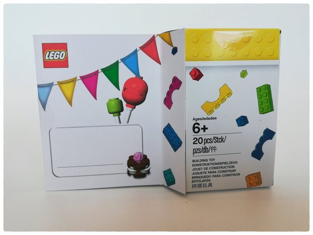
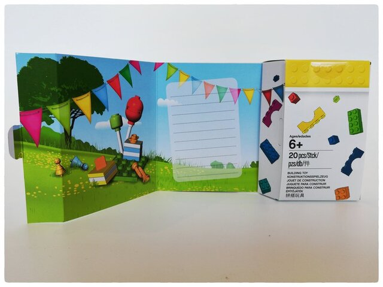
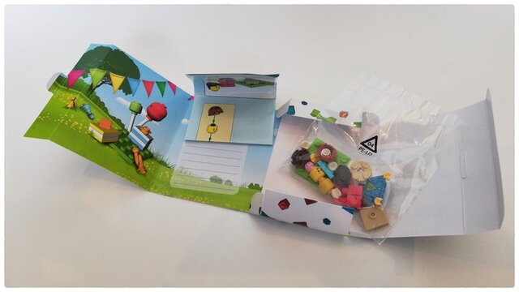
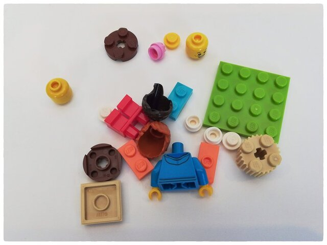
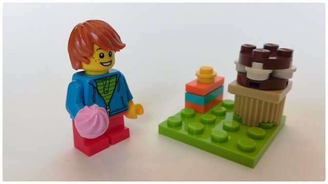
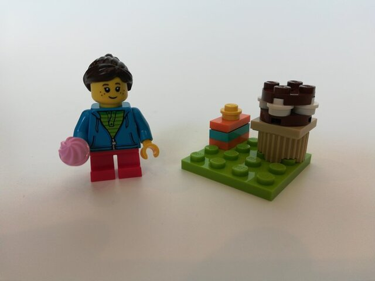

Ceux qui ont la chance d’avoir un LEGO® Store à proximité de chez eux ont certainement déjà obtenu le calendrier remis en fin d’année pour un achat de 20€. Ces calendriers proposent une planche de coupons divers et variés à aller "échanger" tout au cours de l’année dans votre magasin préféré. Bien souvent, il faut dépenser une certaine somme d’argent pour obtenir la contrepartie, parfois, c’est gratuit.

Le coupon qui nous intéresse ici est le cadeau gratuit remis pour l’anniversaire du porteur. Contrairement aux autres, valables sur une période donnée, il est échangeable toute l’année. Heureusement... J’imagine bien le coupon _"si ton anniversaire tombe entre le 08/03 et le 27/03 un cadeau te sera remis si tu fais un achat de 55€"_...

Le set, qui date de 2017, est celui que j’ai reçu en échange du coupon 2017, le même coupon avec le même visuel est inclus dans le calendrier 2018, j’imagine que le cadeau sera identique.

Bref, il est temps de regarder cette petite Birthday Card

Vu la taille de la boîte, on se doute bien qu’il ne va pas y avoir grand-chose dedans, d’ailleurs c’est indiqué dessus : 20 pièces.  
Visuellement c’est assez sobre, le fond blanc fait ressortir les couleurs vives, un emplacement est prévu pour marquer un nom si on souhaite offrir le set.  
Il y a une banderole, des ballons, un gâteau, et des briques qui volent dans tous les sens : c’est la FÊTE !!!

En dépliant un premier volet, on accède à une zone qui permet d’inscrire un petit message à l’heureux bénéficiaire du cadeau. Le tout sur un fond champêtre.

Ce n’est qu’une fois tout déplié que l’on découvre le petit sachet qui contient les 20 pièces et une notice de montage.

Et voilà, un gâteau sur une petite table, un cadeau et un enfant qui mange une meringue.  
Le torso blouson bleu à capuche et t-shirt rayé vert est apparu en 2016 dans le set [60134 Fun in the park](/articles/revue-60134-le-parc-de-loisir/), et revu depuis dans le set réservé à l’enseigne britannique Sainsbury’s, et dans 5 autres sets en 2017, dont le 21310 Old Fishing Store.

Le cadeau fonctionne aussi si vous êtes une fille, puisqu’une tête et des cheveux de remplacement sont fournis.

**Conclusion :**  
Si vous allez dans votre store à la période de votre anniversaire, et que vous avez le coupon, profitez-en, sinon ce n’est vraiment pas la peine de faire le déplacement pour si peu. Ça risque de vous coûter plus cher en transport.  
Et si vous n’avez pas le calendrier, et que vous ne pouvez pas obtenir ce "set", ne vous morfondez pas, toutes les pièces sont basiques et seront très facilement trouvables dans votre vrac.  
Et si vous souhaitez vraiment l’ensemble complet, on le trouve sur BrickLink à partir de 2,50€.
