Aujourd’hui, je vous propose la revue de la boîte 31040, **Les bolides du désert**.

Cet ensemble sorti en 2016 comporte 65 pièces pour un coût de 4,99 €, soit environ 8 centimes par pièce.

* * *

Le recto de la boîte présente les habituelles mentions « CREATOR », « 3-in-1 », et montre les trois véhicules pouvant être construits avec le set (un tout-terrain, un buggy du désert, et un 4x4).

[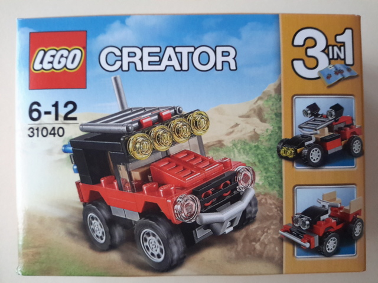](https://www.freelug.org/IMG/jpg/20170122_135759.jpg)

Le verso quant à lui met les trois véhicules en scène simultanément, dans un environnement désertique et sableux.

[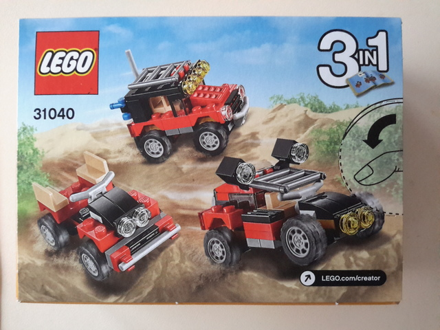](https://www.freelug.org/IMG/jpg/20170122_135818.jpg)

Sans surprise la boîte contient une notice et un sachet de pièces.

[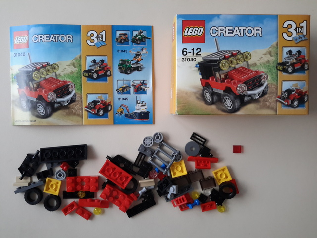](https://www.freelug.org/IMG/jpg/20170122_135742.jpg)

* * *

La construction commence avec une barre 2x6 noire sous laquelle on attache un crochet qui permettra d’attacher le pare-choc.

[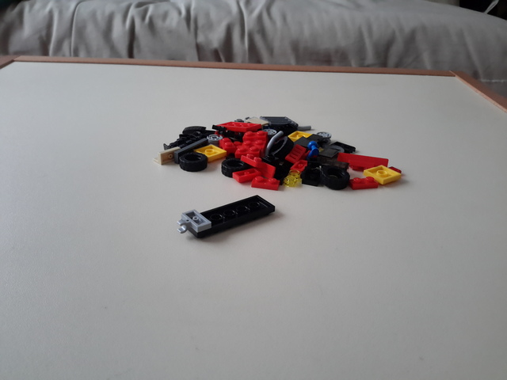](https://www.freelug.org/IMG/jpg/20170122_135914.jpg)

On ajoute les essieux dessous et deux pièces jaunes 2x2 sur le dessus, pour donner un peu de couleur (pièces qui seront presque cachées au final, en fait...).

[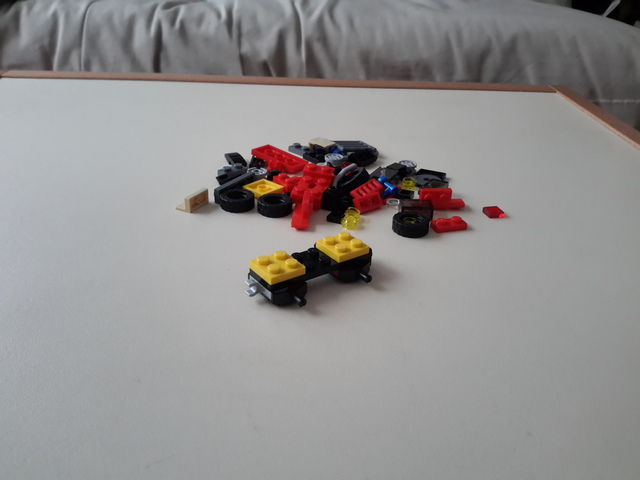](https://www.freelug.org/IMG/jpg/20170122_140012.jpg)

Les étapes suivantes permettent de monter l’avant, avec deux phares et un radiateur, et le pare-choc, ainsi que la base de l’habitacle, tout en rouge.

[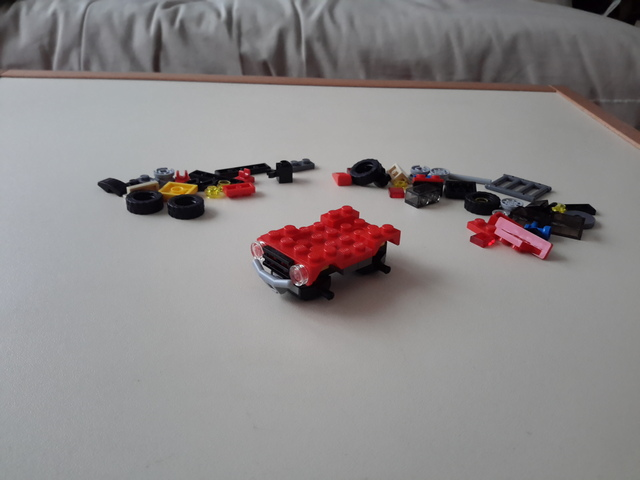](https://www.freelug.org/IMG/jpg/20170122_140153.jpg)

La construction continue avec le capot (deux pièces inclinées), le pare-brise avant (deux briques 1x2 transparentes), l’arrière (deux pièces avec crochet vertical et une 1x2 transparente). Les sièges, couleur tan, sont deux simples pièces 1x2.

[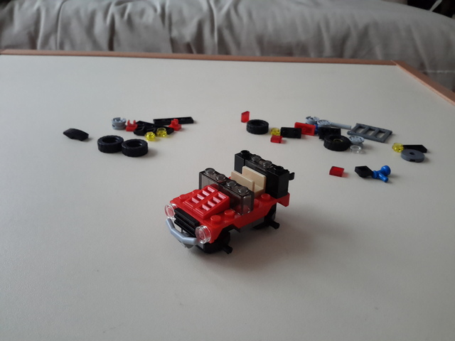](https://www.freelug.org/IMG/jpg/20170122_140415.jpg)

Le tour du toit est constitué de deux plaques 1x4 noires, une petite grille. Sur l’avant, deux crochets rouges qui serviront à accrocher le tronçon d’échelle ou grille du toit lui-même, tandis que les 4 phares à l’avant permettent d’éclairer la piste de nuit.

[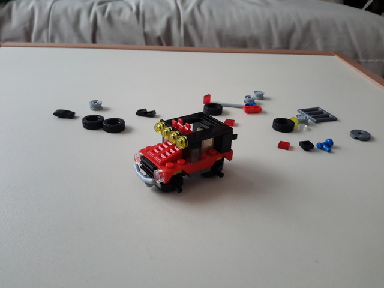](https://www.freelug.org/IMG/jpg/20170122_140529.jpg)

Enfin, équipement indispensable pour un rallye, un pneu de rechange et un réservoir d’essence, sans oublier l’antenne pour la radio, histoire de pouvoir poster des billets de blog en temps réel durant la course.

[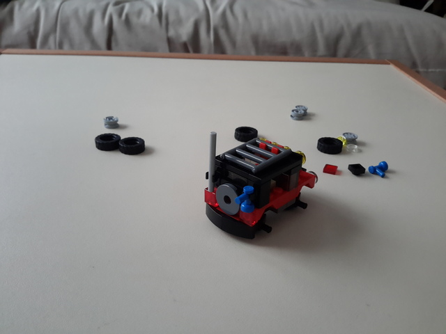](https://www.freelug.org/IMG/jpg/20170122_140702.jpg)

Et voici la construction terminée, avec les quelques pièces bonus.

[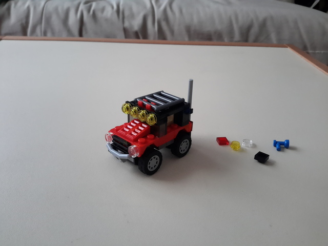](https://www.freelug.org/IMG/jpg/20170122_140741.jpg)

[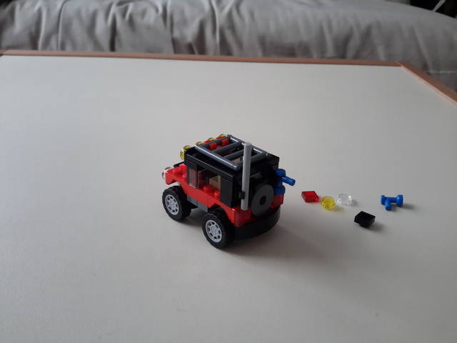](https://www.freelug.org/IMG/jpg/20170122_140751.jpg)

[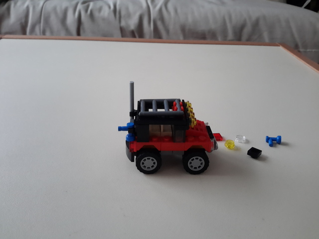](https://www.freelug.org/IMG/jpg/20170122_140803.jpg)

* * *

**Avis :** de petits véhicules sympathiques, sans grande surprise côté construction mais avec un rendu agréable, comme d’habitude pour cette gamme.

**Bonus 1 :** les deux autres véhicules pouvant être construits,  
le buggy des dunes, avec deux phares puissants sur le dessus...

[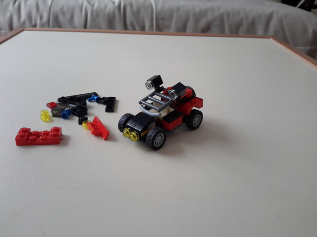](https://www.freelug.org/IMG/jpg/20170122_124755.jpg)

[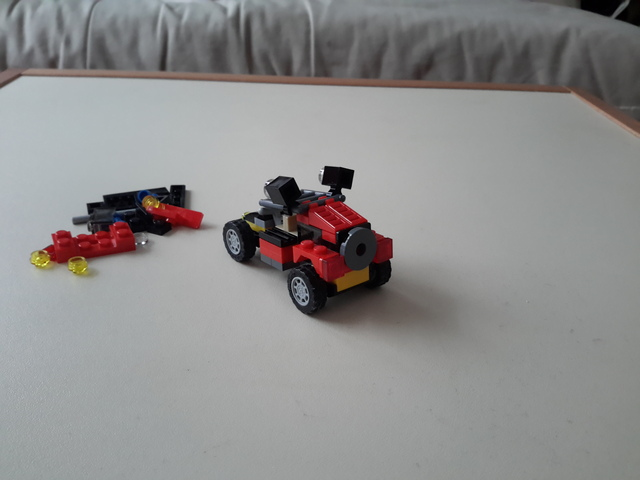](https://www.freelug.org/IMG/jpg/20170122_124833.jpg)

[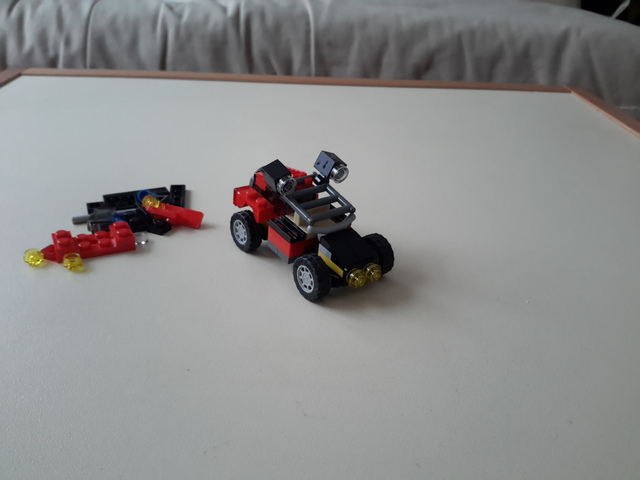](https://www.freelug.org/IMG/jpg/20170122_124851.jpg)

et le 4x4, qui seul des trois véhicules est suffisamment large pour une mini-figurine. À noter la conversion de l’antenne en pare-choc avant.

[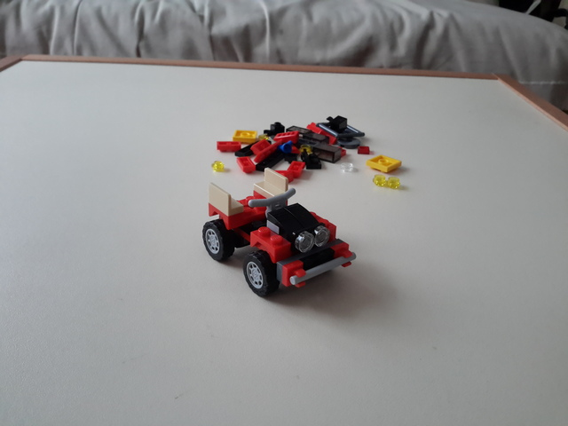](https://www.freelug.org/IMG/jpg/20170122_135153.jpg)

[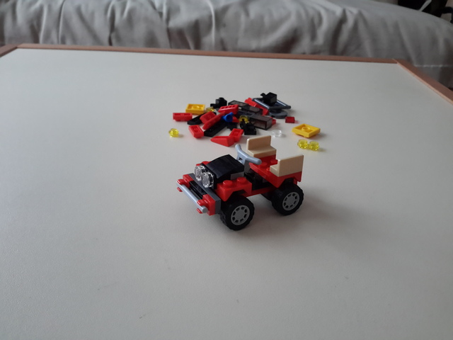](https://www.freelug.org/IMG/jpg/20170122_135201.jpg)

**Bonus 2 :** animation de la construction du premier bolide (cliquer pour lancer).

[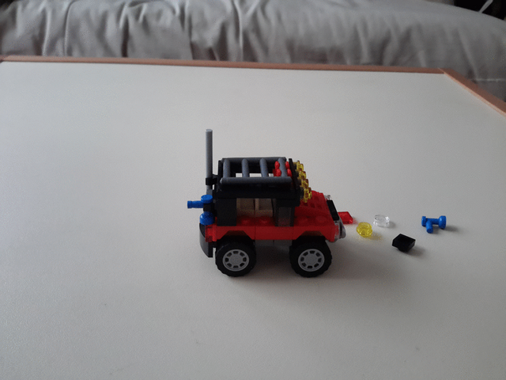](https://www.freelug.org/IMG/gif/31040-les-bolides-du-desert.gif)
