Pour commencer doucement la rentrée, je vous propose la revue de l’ensemble 31041 de la gamme _CREATOR_, **Les véhicules de chantier**.

Cet ensemble sorti en 2016 comporte 64 pièces pour un prix de 4,99 €, soit un ratio de 8 centimes environ par pièce.

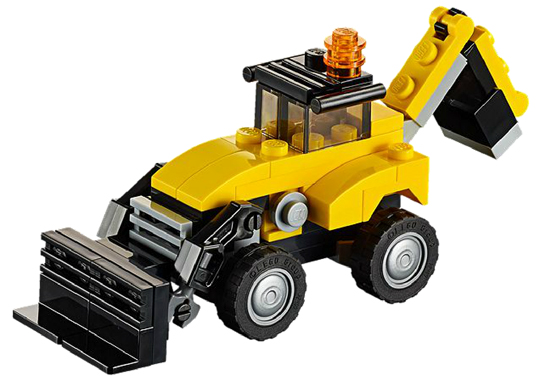

* * *

La boîte, comme pour les ensembles de la gamme, affiche sur le devant le logo CREATOR et la mention « 3-in-1 », avec le véhicule principal et les deux alternatifs sur le côté.

[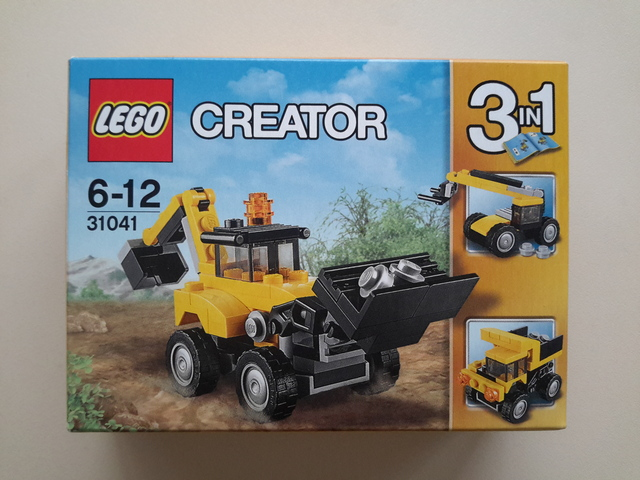](https://www.freelug.org/IMG/jpg/20161002_134852.jpg)

L’envers montre les trois véhicules ensemble, dans un décor rappelant un chantier.

[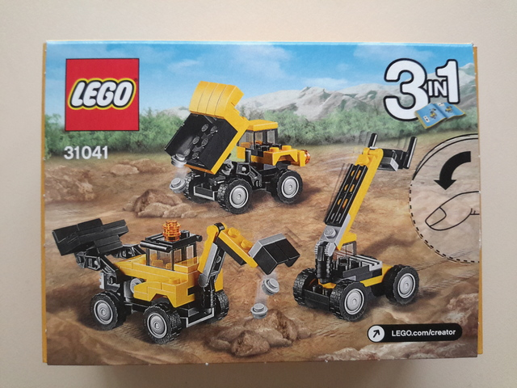](https://www.freelug.org/IMG/jpg/20161002_134914.jpg)

La boîte contient une notice pour les trois modèles et un sachet de pièces.

[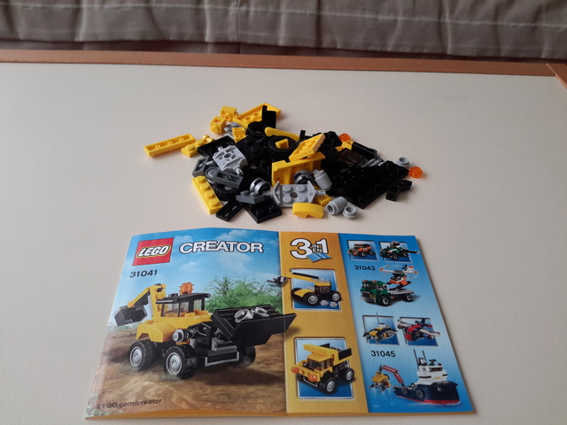](https://www.freelug.org/IMG/jpg/20161002_135002.jpg)

* * *

La construction de la pelleteuse, véhicule principal, commence par le corps. À noter sur l’arrière une articulation sur laquelle viendra se greffer la pelle arrière.

[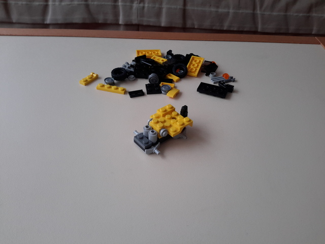](https://www.freelug.org/IMG/jpg/20161002_135303.jpg)

Les différentes pièces arrondies assouplissent la forme générale, pour une ligne courbe.

[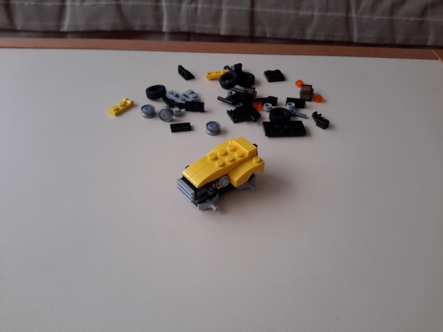](https://www.freelug.org/IMG/jpg/20161002_135431.jpg)

L’habitacle est simplement constitué de deux pièces transparentes, avec une pièce en « U » pour habiller.

[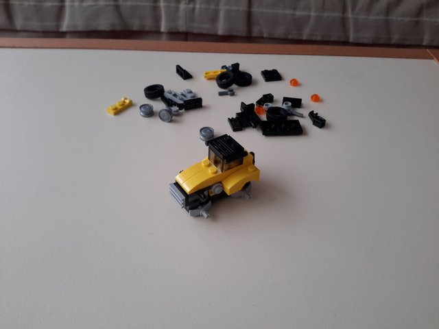](https://www.freelug.org/IMG/jpg/20161002_135520.jpg)

La pelle arrière comporte trois articulations, et sera montée sur une pièce rotative, pour plus de mobilité.

[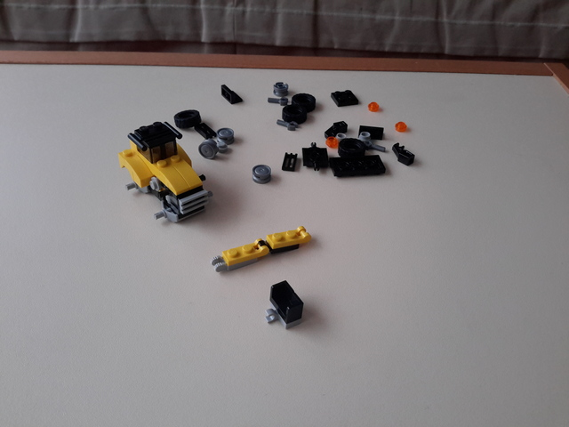](https://www.freelug.org/IMG/jpg/20161002_135610.jpg)

La pelle montée.

[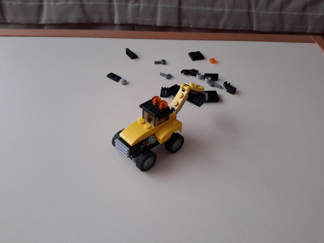](https://www.freelug.org/IMG/jpg/20161002_135721.jpg)

On termine par la pelle avant, qui montée sur des charnières peut se lever et se baisser.

[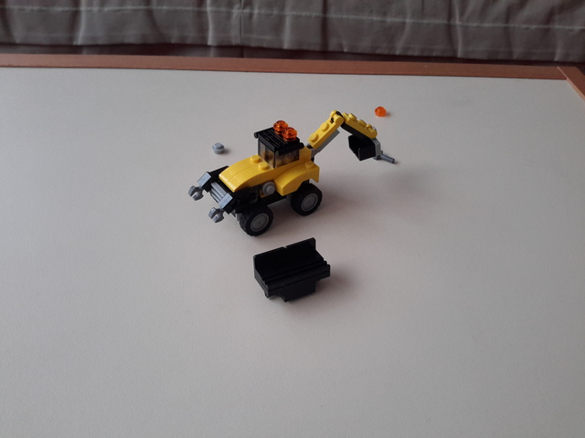](https://www.freelug.org/IMG/jpg/20161002_144337.jpg)

Et voici le modèle terminé, avec dans la benne avant les deux pièces indiquées par la notice, plus les trois pièces bonus.

[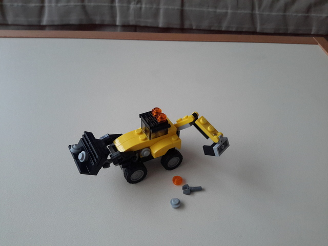](https://www.freelug.org/IMG/jpg/20161002_144421.jpg)

* * *

**Avis** : la construction n’est pas particulièrement compliquée ni longue, mais le rendu est très sympathique, et il y a quelques pièces intéressantes. Bref un petit ensemble amusant sans être renversant.

**Bonus 1 :** les deux autres véhicules pouvant être construits, tout d’abord un camion dont la benne peut s’incliner...

[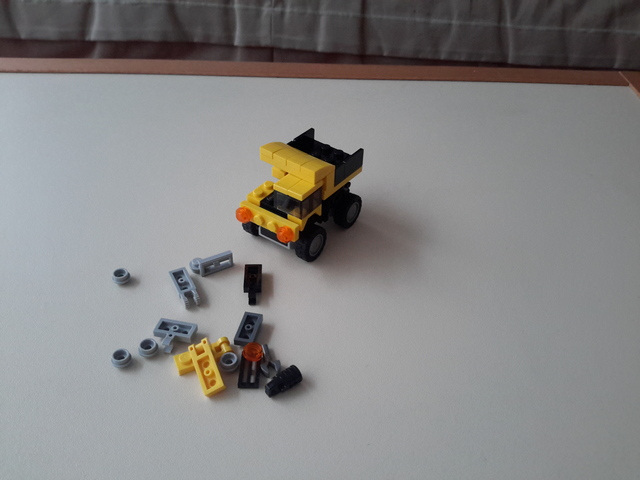](https://www.freelug.org/IMG/jpg/20161002_130718.jpg)

[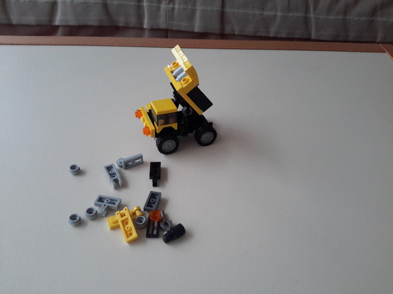](https://www.freelug.org/IMG/jpg/20161002_130729.jpg)

... puis un chariot élévateur, très schématisé mais reconnaissable (bien que je trouve qu’il ressemble à une moissonneuse-batteuse !).

[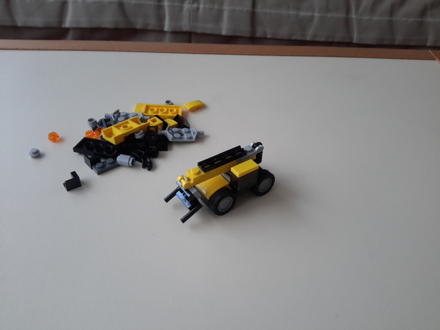](https://www.freelug.org/IMG/jpg/20161002_132601.jpg)

[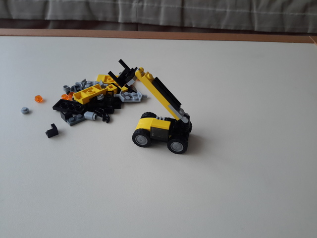](https://www.freelug.org/IMG/jpg/20161002_132609.jpg)

**Bonus 2 :** toutes les étapes de construction en animation (cliquez pour lancer).

[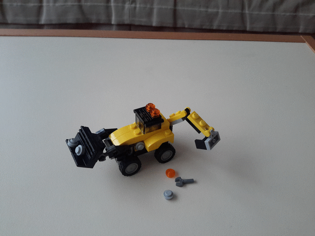](https://www.freelug.org/IMG/gif/31041-vehicules-chantier.gif)
