Aujourd’hui je vous propose la revue du set 31044 de la gamme _Creator_, **Les Animaux du parc**.

Ce set sorti en 2016 comporte 202 pièces pour un prix de 14,99 €, soit un ratio prix/pièce d’environ 7 centimes.

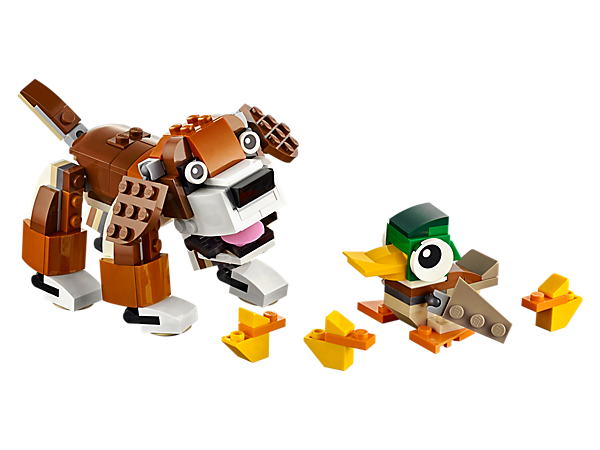

* * *

L’avant, outre la présence des logos LEGO et Creator, présente les modèles principaux, un chien, un canard et trois canetons, avec sur la droite, comme pour (toutes ?) les boîtes de la gamme, les modèles alternatifs.

[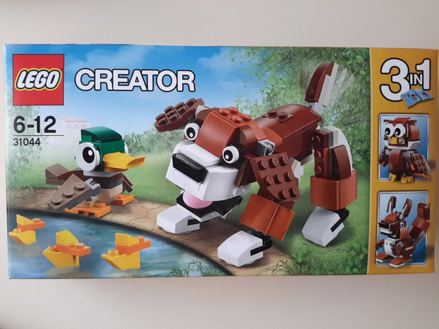](https://www.freelug.org/IMG/jpg/20160522_153909.jpg)

Le dos lui présente simultanément les trois modèles mis en scène.

[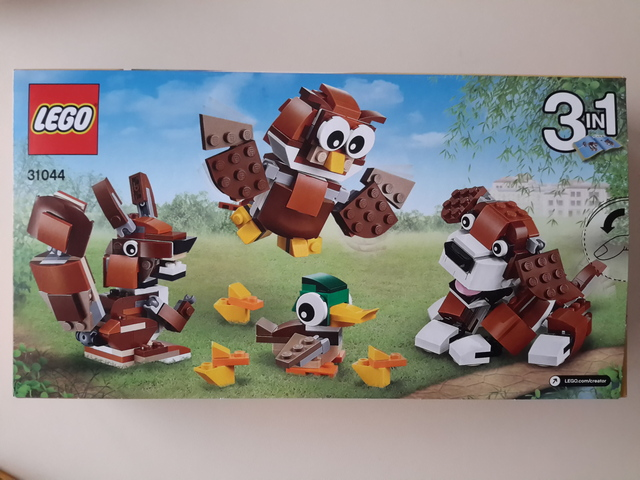](https://www.freelug.org/IMG/jpg/20160522_153929.jpg)

Enfin la tranche met en scène les modèles principaux dans trois petites vignettes, avec une classique pièce en taille 1:1.

[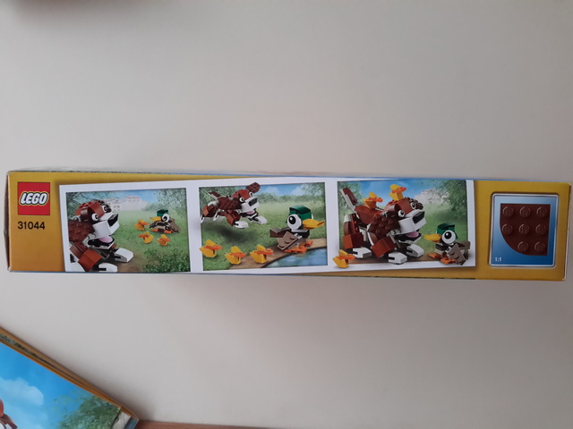](https://www.freelug.org/IMG/jpg/20160522_154027.jpg)

La boîte contient trois notices, et une belle pile de pièces.

[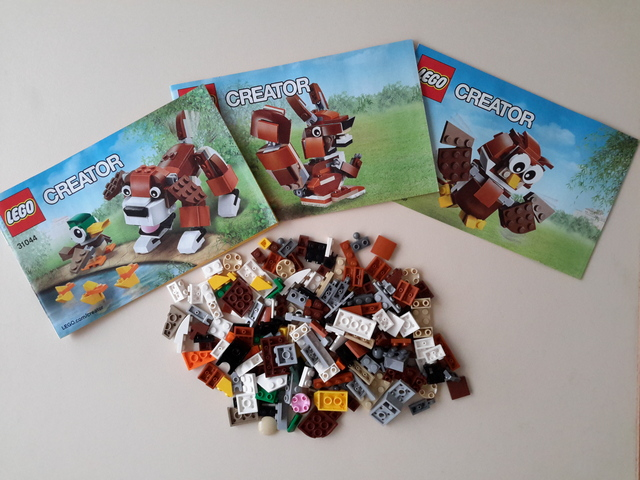](https://www.freelug.org/IMG/jpg/20160522_133357.jpg)

* * *

La construction commence par les trois petits canetons, qui comportent simplement trois pièces mais ont je dois dire un joli rendu [^1].

[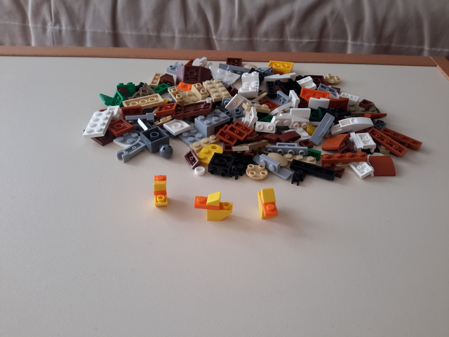](https://www.freelug.org/IMG/jpg/20160625_113456.jpg)

L’on continue avec le corps du canard, qui a deux belles palmes orange du plus bel effet.

[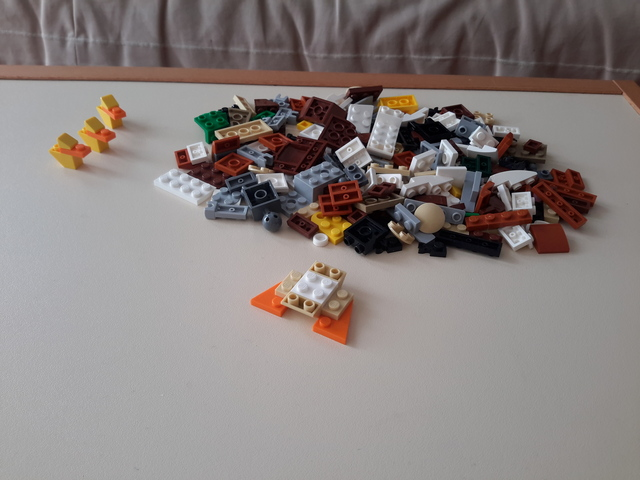](https://www.freelug.org/IMG/jpg/20160625_113601.jpg)

Le canard présente trois articulations : la tête tourne, et les ailes tournent avec deux degrés de liberté. La queue remontante est amusante à voir.

[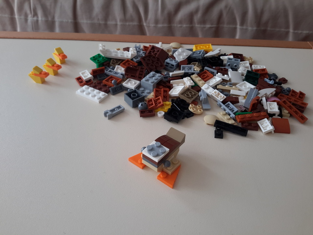](https://www.freelug.org/IMG/jpg/20160625_113813.jpg)

Voici le canard terminé, avec un joli bec jaune (dont une pièce assez rare me semble-t-il), deux grands yeux, et des ailes simples mais efficaces.

[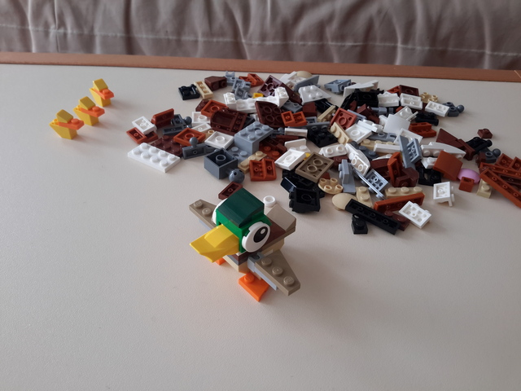](https://www.freelug.org/IMG/jpg/20160625_114102.jpg)

Enfin on s’attaque au modèle central de la boîte, le chien, dont le corps comporte au final six articulations (la queue apparaît sur la photo suivante). Le cou est une belle charnière.

[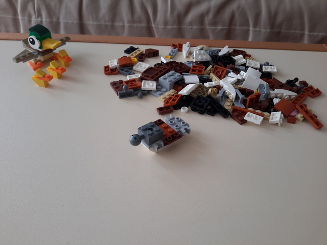](https://www.freelug.org/IMG/jpg/20160625_114244.jpg)

L’arrière du corps est une pièce amusante, courbée et couvrant 3x2 tenons.

[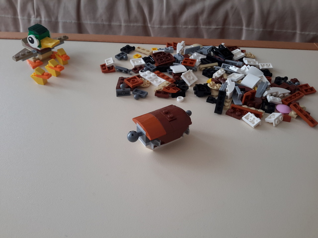](https://www.freelug.org/IMG/jpg/20160625_114437.jpg)

Le corps terminé, on commence à monter les deux pattes gauches...

[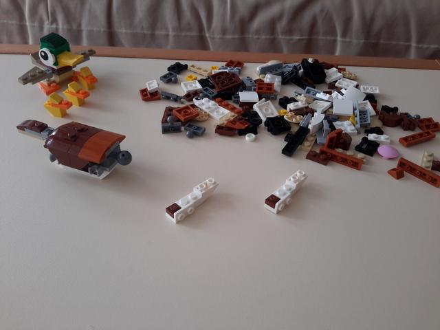](https://www.freelug.org/IMG/jpg/20160625_114613.jpg)

... qui sont recouvertes de plaques arrondies, pour leur donner un côté rond. À noter les deux pinces, qui seront utilisées pour les dessous des pattes.

[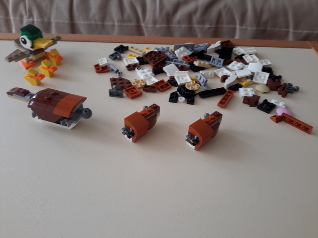](https://www.freelug.org/IMG/jpg/20160625_114921.jpg)

Les pattes de droite se construisent de façon parfaitement symétrique, sans surprise.

[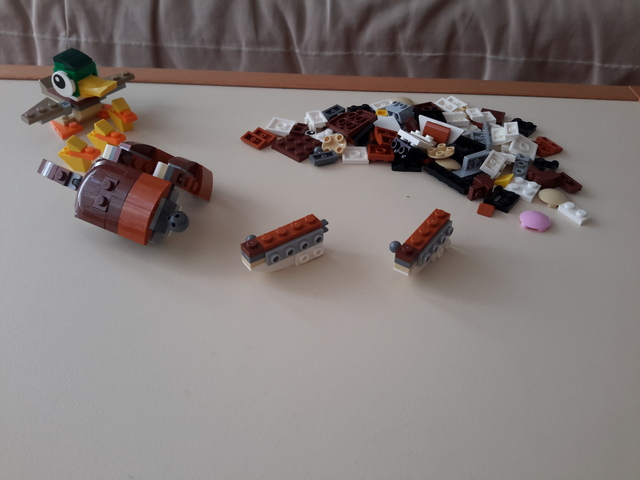](https://www.freelug.org/IMG/jpg/20160625_115208.jpg)

Et voici le chien avec ses quatre pattes, il est enfin stable contrairement à la photo précédente. Mais il lui manque encore une tête et des coussinets.

[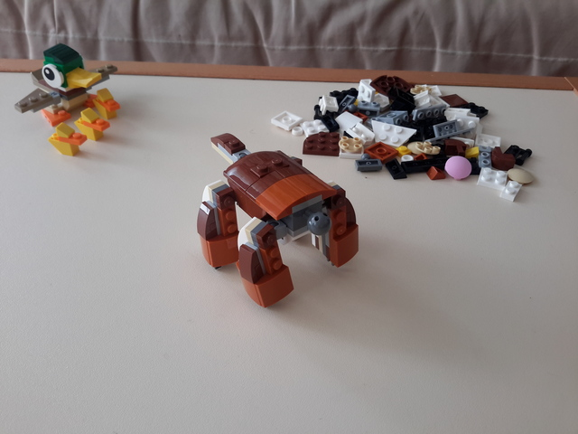](https://www.freelug.org/IMG/jpg/20160625_115349.jpg)

Ces derniers sont tous les quatre identiques, avec cinq pièces dont une accroche.

[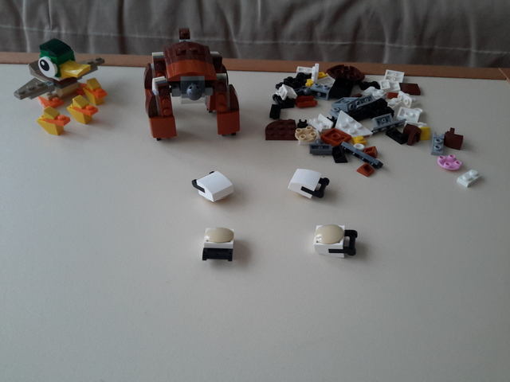](https://www.freelug.org/IMG/jpg/20160625_115524.jpg)

Enfin on monte la tête, avec un museau noir et des tenons dans tous les sens.

[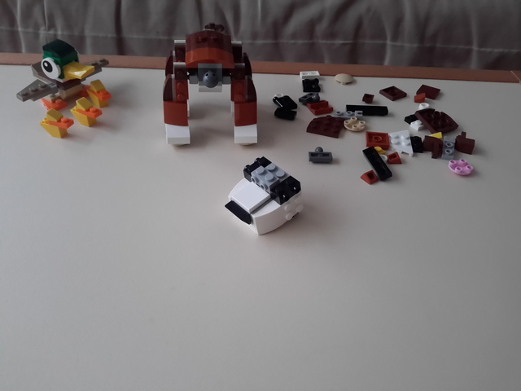](https://www.freelug.org/IMG/jpg/20160625_115929.jpg)

Les yeux du chien, bien plus petits que ceux du canard, sont montés sur une plaque et assemblés verticalement, pendant que les oreilles s’attacheront avec des articulations.

[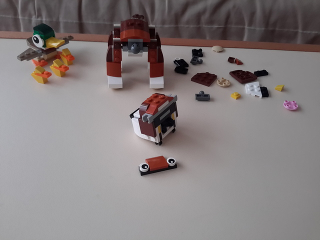](https://www.freelug.org/IMG/jpg/20160625_120135.jpg)

Le chien a comme il se doit une belle langue rose, faite d’une simple pièce.

[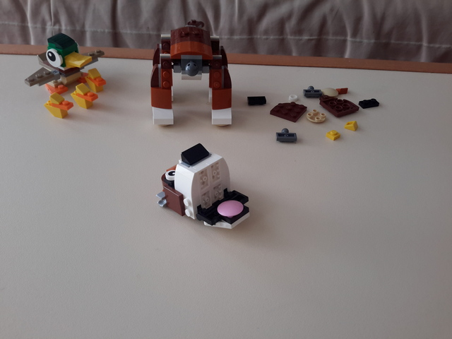](https://www.freelug.org/IMG/jpg/20160625_120236.jpg)

Enfin les derniers éléments sont les oreilles, articulées également.

[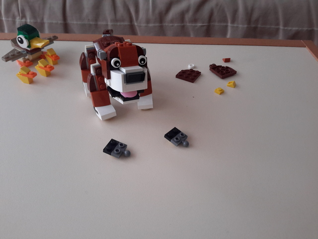](https://www.freelug.org/IMG/jpg/20160625_120343.jpg)

Et voici le chien terminé, en position assez neutre.

[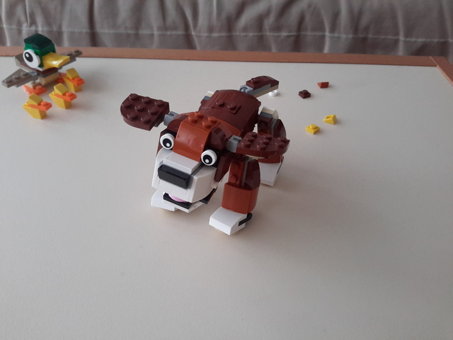](https://www.freelug.org/IMG/jpg/20160625_120412.jpg)

Les trois modèles mis en scène, contemplant les pièces en rab...

[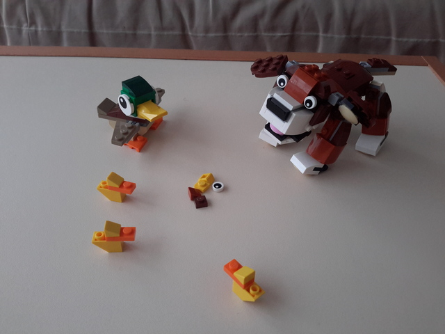](https://www.freelug.org/IMG/jpg/20160625_120444.jpg)

... et le canard ignorant superbement les aboiements du chien.

[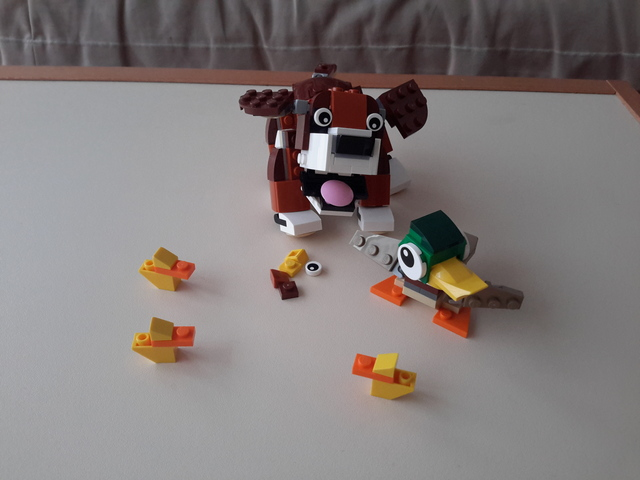](https://www.freelug.org/IMG/jpg/20160625_120512.jpg)

* * *

**Avis** : set très mignon, avec des animaux bien rendus, à la fois la forme et la couleur, très articulés, bref un très bon cru pour moi.

**Premier bonus** : voici le second modèle, l’écureuil, qui utilise bien moins de pièces que les premiers modèles mais a un joli rendu, avec une queue articulée et des petites mains.

[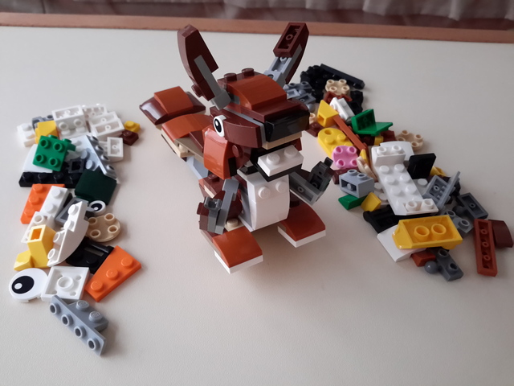](https://www.freelug.org/IMG/jpg/20160522_143138.jpg)

[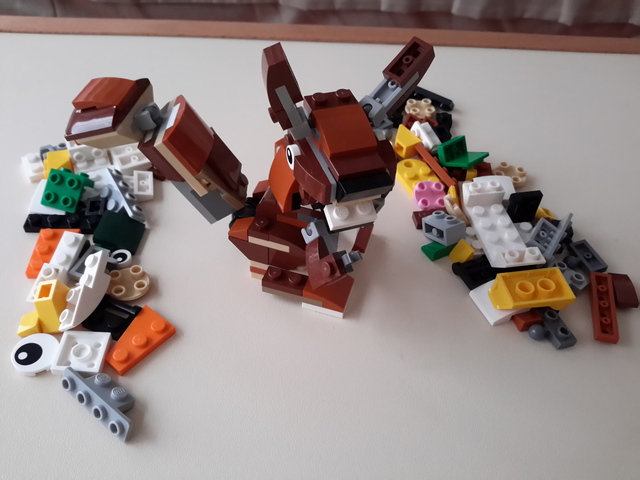](https://www.freelug.org/IMG/jpg/20160522_143149.jpg)

[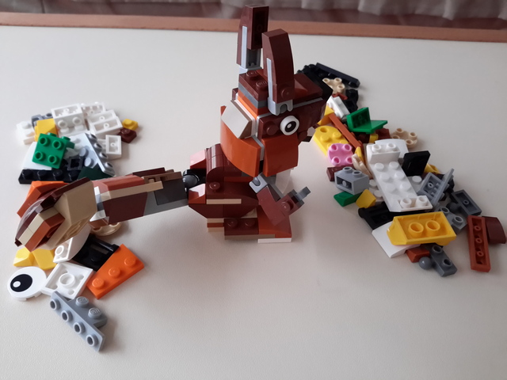](https://www.freelug.org/IMG/jpg/20160522_143201.jpg)

**Second bonus** : le troisième modèle, le hibou, avec un joli bec jaune, des ailes articulées, une queue orange.

[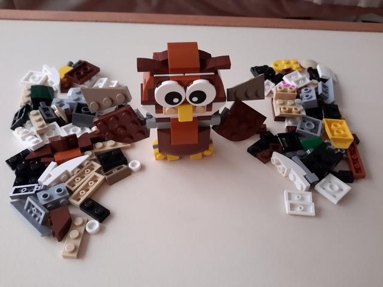](https://www.freelug.org/IMG/jpg/20160522_151512.jpg)

[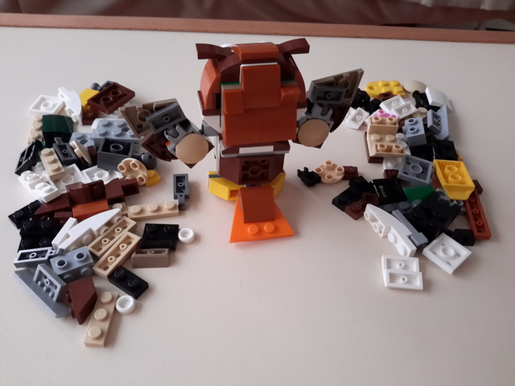](https://www.freelug.org/IMG/jpg/20160522_151539.jpg)

[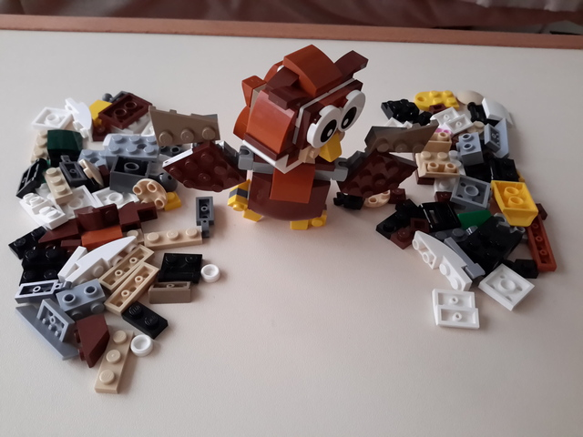](https://www.freelug.org/IMG/jpg/20160522_151557.jpg)

Pas de troisième bonus sous forme d’images prises durant la construction, pour cause d’image trop grosse malgré mes tentatives de réduction...

[^1]: J’ai d’ailleurs honteusement repris ces canetons dans un MOC.
