Aujourd’hui je vous propose une revue des boîtes 41560, 41561 et 41562, Mixels série 7 sur un thème musical.

Pour conclure la série 7 des Mixels, après ceux de [thème policier](/articles/review-lego-41554-41555-et-41556-mixels-serie-7-kuffs-busto-et-tiketz/) puis ceux de [thème médiéval](/articles/revue-lego-41557-41558-et-41559-mixels-serie-7-camillot-mixadel-et-paladum/), je vous propose une revue des boîtes _41560_, _41561_ et _41562_, à savoir **Jamzy**, **Tapsy** et **Trumpsy**.

Ces sets sortis en 2016 comportent respectivement 70, 57 et 54 pièces, soit environ 6 ou 7 centimes par pièce.

## Le set 41560, Jamzy

Comme d’habitude le sachet contient un sac de pièces et une notice de construction.

[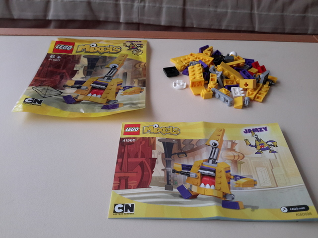](https://www.freelug.org/IMG/jpg/20161002_123140.jpg)

La base du corps présente deux articulations sur le côté, pour les bras, une pince à l’arrière pour décorer, et des tenons verticaux sur l’avant qui serviront à fixer les dents du bas.

[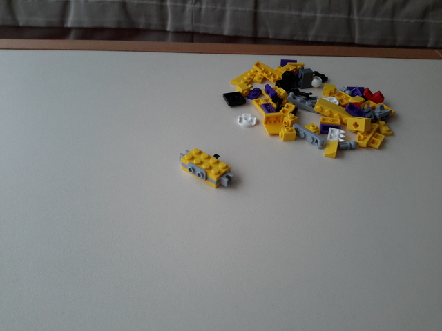](https://www.freelug.org/IMG/jpg/20161002_123240.jpg)

Le fond de la bouche est constitué de deux pièces rouges du plus bel effet, et voici lesdites dents du bas.

[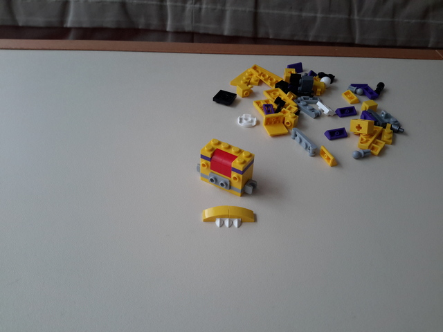](https://www.freelug.org/IMG/jpg/20161002_123417.jpg)

La mâchoire du haut est articulée, tandis que quatre tenons verticaux prennent place afin de fixer de futures petites ailes. Deux pinces serviront à accrocher les bras.

[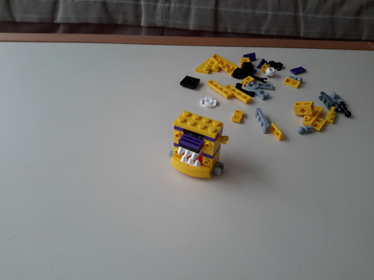](https://www.freelug.org/IMG/jpg/20161002_123623.jpg)

On monte les ailes verticales, qui donnent une forme triangulaire, renforcée par la tête, rendant le personnage similaire à une guitare.

[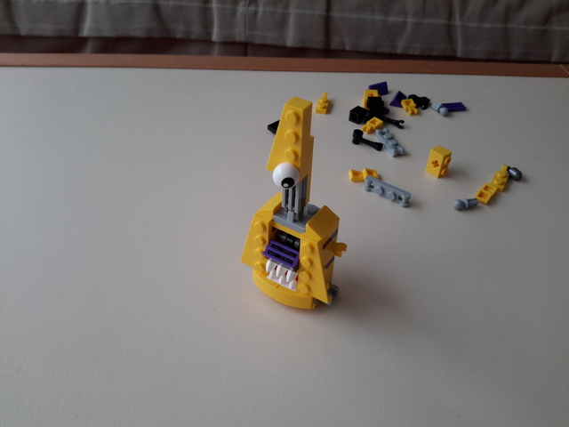](https://www.freelug.org/IMG/jpg/20161002_123806.jpg)

Les bras, symétriques, peuvent bouger horizontalement selon deux charnières. Le personnage tient un micro dans la main gauche (sur le sachet et la photo de la notice il est dans la main droite, incohérence amusante). Les pieds sont des pièces Technic avec des ronds d’articulations.

[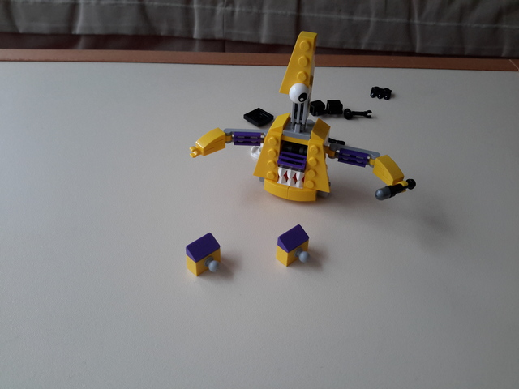](https://www.freelug.org/IMG/jpg/20161002_124003.jpg)

Et voici Jamzy terminé, avec le Nixel [^1] (Aux grands yeux pleins d’étoiles !) associé à la série. À noter que ce sachet ne comporte aucune pièce supplémentaire.

[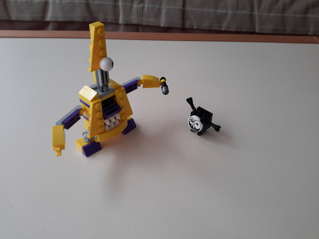](https://www.freelug.org/IMG/jpg/20161002_124114.jpg)

## Le set 41561, Tapsy

Pour le principe, présentation des classiques sachets de pièces et notice de construction !

[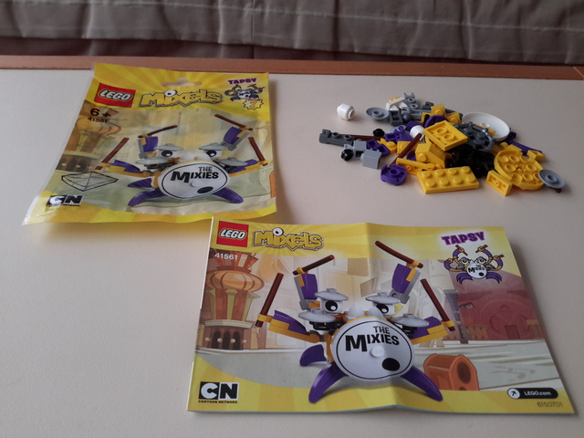](https://www.freelug.org/IMG/jpg/20161002_124235.jpg)

La base est une pièce « en toile d’araignée », sur laquelle est posée une plaque cylindrique 2x2 violette du plus bel effet (qui ne sera malheureusement pas très visible à la fin). La pièce servira à accrocher les pattes.

[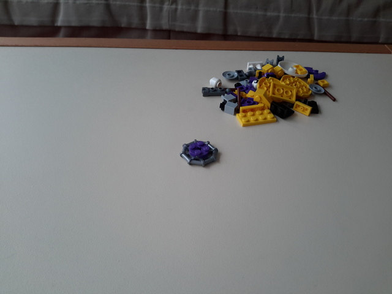](https://www.freelug.org/IMG/jpg/20161002_124304.jpg)

Le corps est assez classique, avec des pièces triangulaires sur le bas, deux articulations sur l’arrière (pour des bras), deux pinces sur le côté (autres bras) et deux tiges verticales (pour des cymbales).

[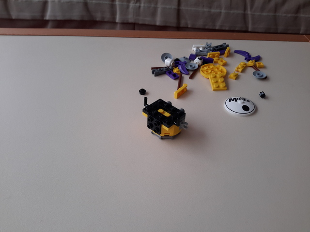](https://www.freelug.org/IMG/jpg/20161002_124600.jpg)

Voici le corps assemblé, avec les pattes (violettes également) en place, et le tambour, pièce sérigraphiée probablement exclusive au personnage. Les quatre pattes assurent une bonne stabilité.

[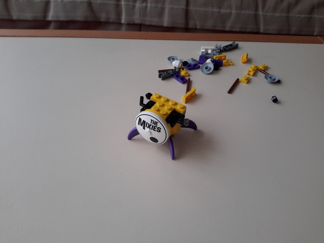](https://www.freelug.org/IMG/jpg/20161002_124700.jpg)

Les deux bras arrière, identiques, comportent une articulation à deux degrés de liberté, qui se fixera sur celle de l’arrière du corps, permettant aux bras de beaucoup bouger.

[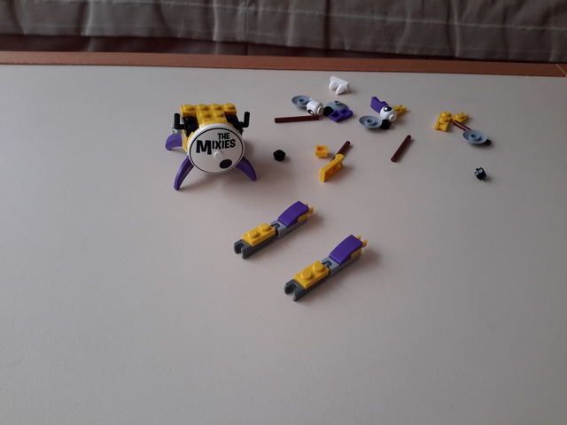](https://www.freelug.org/IMG/jpg/20161002_124814.jpg)

Les bras latéraux eux sont très simples, et ne pourront bouger que verticalement.

[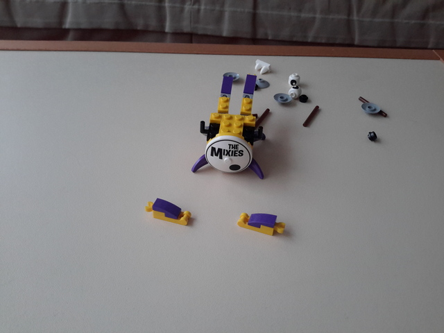](https://www.freelug.org/IMG/jpg/20161002_130357.jpg)

Les bras fixés, on ajoute les deux têtes, en symétrique, et les dents, puis on met les bâtons au bout des bras, il faut quand même qu’il puisse taper ses cymbales ! Bizarrement, les bras latéraux arrivent juste aux cymbales, et gênent presque les bras arrière... Petit défaut de conception ?

[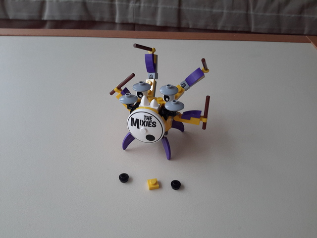](https://www.freelug.org/IMG/jpg/20161002_130622.jpg)

## Le set 41562, Trumpsy

Troisième et dernier personnage de la série, il se présente comme ses compagnons sous la forme d’un sac de pièces et d’une notice de construction.

[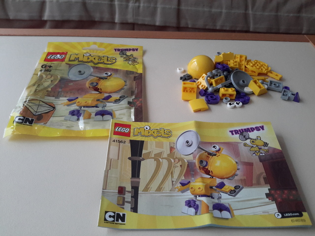](https://www.freelug.org/IMG/jpg/20161002_130834.jpg)

Et afin d’éviter qu’il se sente seul, j’ai demandé à Jamzy et Tapsy de m’aider à construire.

Le corps, resserré, présente quatre articulations à deux degrés de liberté, qui serviront pour les bras et jambes.

[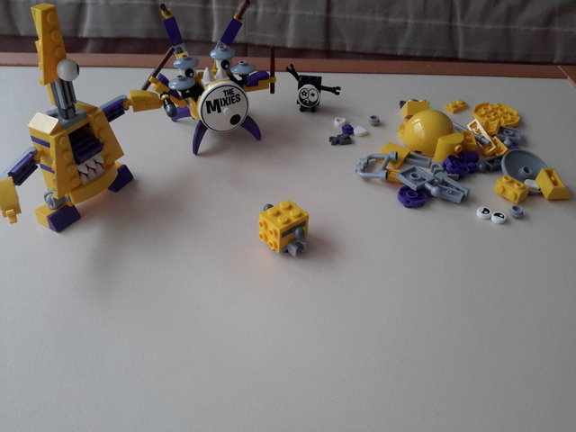](https://www.freelug.org/IMG/jpg/20161002_131038.jpg)

Quelques pièces cylindriques donnent un effet un peu gonflé, ce qui tombe bien puisque le thème du personnage est un instrument à vent comme un cor ou une trompette. Les bras sont un peu basiques.

[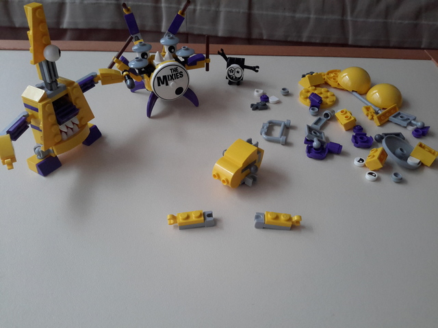](https://www.freelug.org/IMG/jpg/20161002_131202.jpg)

Une fois les bras attachés, et une cassette audio (les plus jeunes risquent de ne pas comprendre ce que c’est tellement c’est vieux :)) mise dans une main, on construit la tête. Le centre de celle-ci est composé de deux pièces 1x2 avec tenons verticaux des deux côtés, pièce qui me paraît assez rare.

[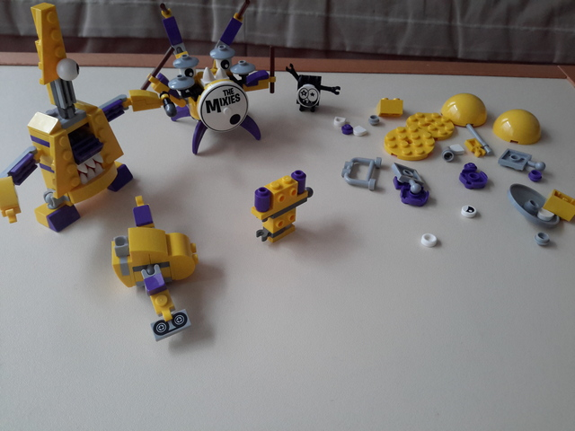](https://www.freelug.org/IMG/jpg/20161002_131422.jpg)

Sur ces deux pièces on vient fixer deux demi-sphères, pour simuler des joues bien gonflées pour souffler dans l’instrument.

[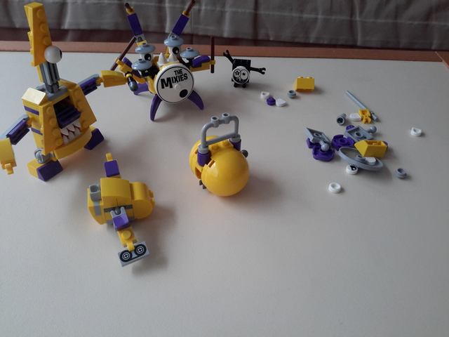](https://www.freelug.org/IMG/jpg/20161002_131512.jpg)

Une fois la trompette installée, la tête devient instable, donc le petit personnage noir doit la soutenir.

[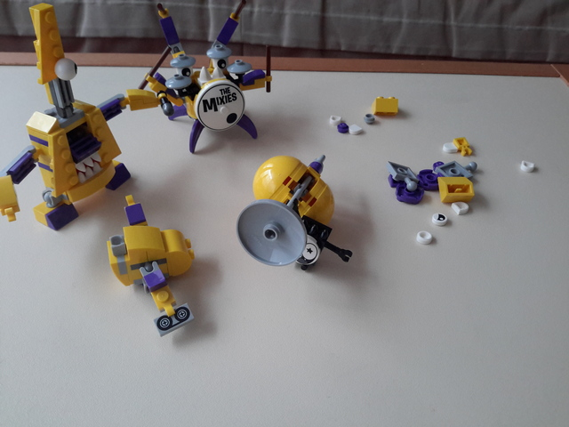](https://www.freelug.org/IMG/jpg/20161002_131623.jpg)

Et voici Trumpsy terminé, contemplant les pièces bonus. Les pieds ont des petits doigts du plus bel effet, et le personnage est plutôt stable au final.

[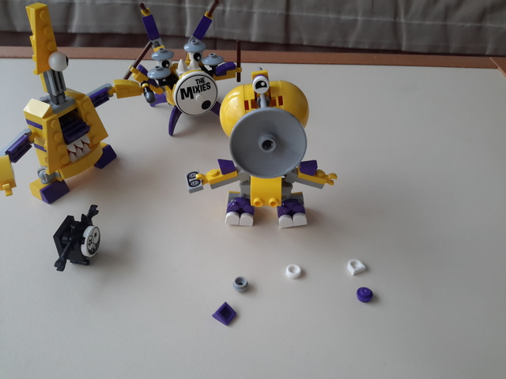](https://www.freelug.org/IMG/jpg/20161002_131943.jpg)

* * *

**Avis :** comme les autres Mixels, les personnages sont bien déjantés, de couleurs violette et jaune qui rendent très bien. Les personnages ont des formes qui correspondent vraiment à ce qu’ils incarnent.

Bref une bonne série de personnages.

**Bonus 1 :** petites photos de famille, avec les trois personnages plus le Nixel.

[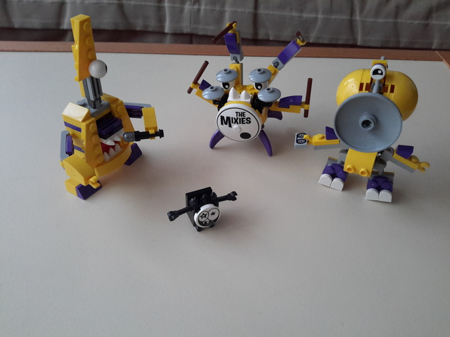](https://www.freelug.org/IMG/jpg/20161002_132028.jpg)

[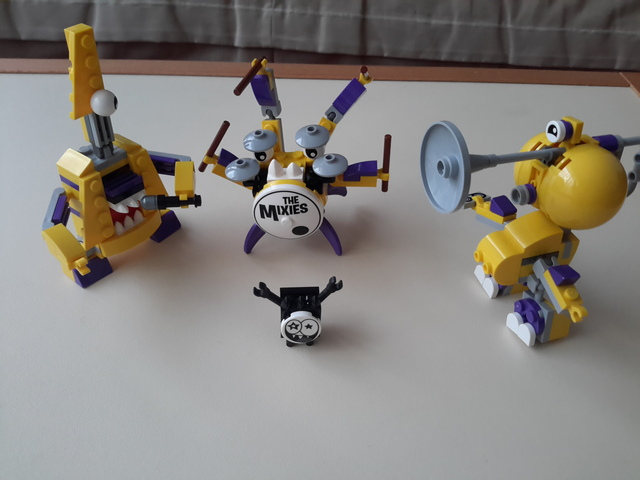](https://www.freelug.org/IMG/jpg/20161002_132047.jpg)

**Bonus 2 :** animations de toutes les étapes de construction (cliquer pour lancer).

_Jamzy_

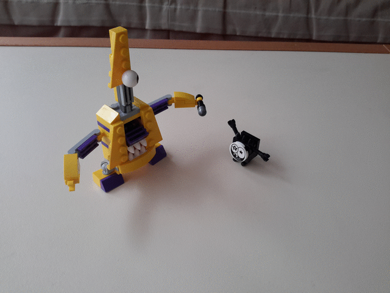

_Tapsy_

[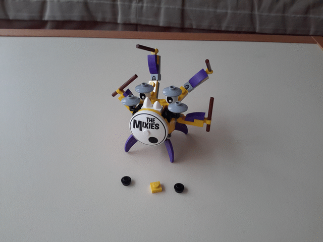](https://www.freelug.org/IMG/gif/41561-tapsy.gif)

_Trumpsy_

[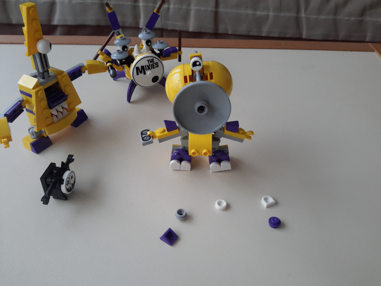](https://www.freelug.org/IMG/gif/41562-trumpsy.gif)

**Bonus 3** (ajouté le 14/11/2016 : combinaison des trois Mixels en _Mixies Max_. Il reprend les joues joufflues de Trumpsy, la combinaison cymbales-bâtons ainsi que le blason « Mixies » de Tapsy, et le micro et la tête (recyclée en queue) de Jamzy. J’aime bien également la crête faite avec les pieds de Tapsy, le rendu est amusant.

[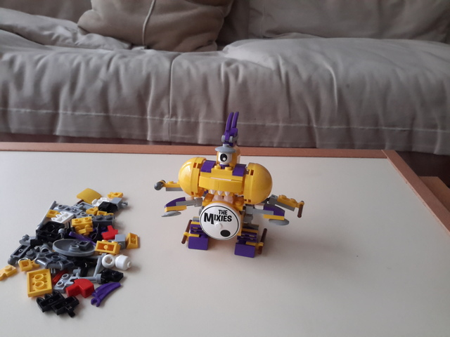](https://www.freelug.org/IMG/jpg/mixies-max-1.jpg)

[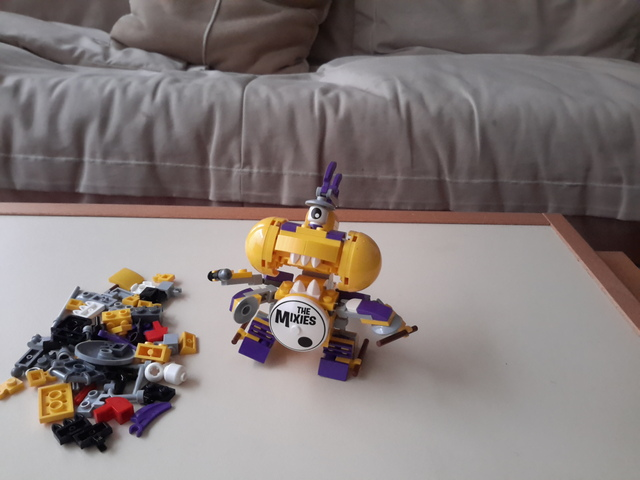](https://www.freelug.org/IMG/jpg/mixies-max-2.jpg)

[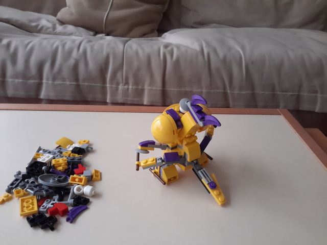](https://www.freelug.org/IMG/jpg/mixies-max-3.jpg)

[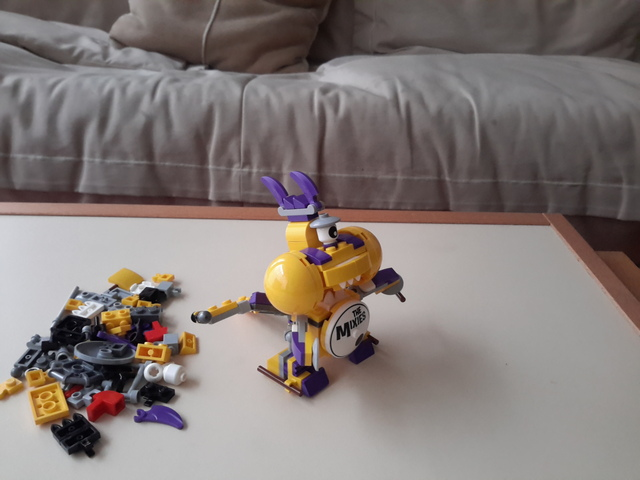](https://www.freelug.org/IMG/jpg/mixies-max-4.jpg)

[^1]: D’après Wikipédia, l’ennemi des Mixels.
