Pour continuer sur les séries de Mixels, je vous propose aujourd’hui une revue des trois sets de la thématique « pompiers », les numéros _41563_, _41564_ et _41565_.

Ces sachets sortis en 2016, qui proposent les Mixels **Splasho**, **Aquad** et **Hydro**, comportent 67, 70 et 70 pièces pour 3,99 €, soit un peu moins de 6 centimes par pièce.

## Le set 41563, Splasho

Comme il se doit, le sachet contient un sac de pièces et une notice de construction. Splasho est clairement un pompier humanoïde.

[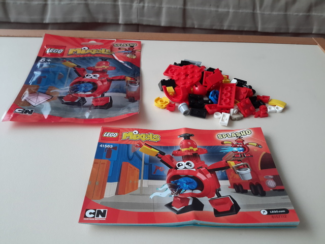](https://www.freelug.org/IMG/jpg/20161002_144821.jpg)

Le corps de forme assez basique comporte deux pinces, qui serviront à accrocher les bras, deux tenons verticaux de chaque côté qui permettront d’assembler la bouche, et un réceptacle pour chaque pied.

[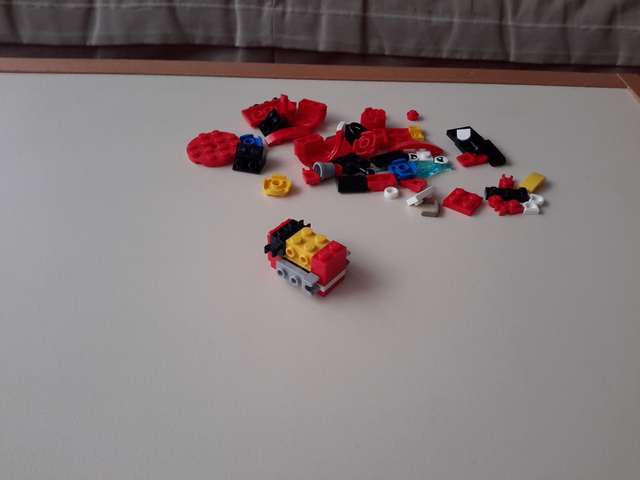](https://www.freelug.org/IMG/jpg/20161002_145022.jpg)

Une fois les yeux posés, on assemble la moitié de la bouche, avec un garde-boue de voiture rouge, le centre de la bouche étant constitué de deux plaques cylindriques 2x2 bleues.

[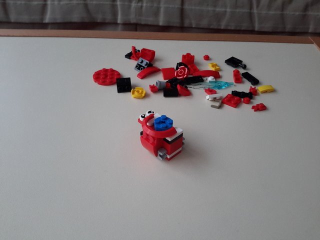](https://www.freelug.org/IMG/jpg/20161002_145216.jpg)

Voici la bouche terminée, d’une belle forme un peu ovale.

[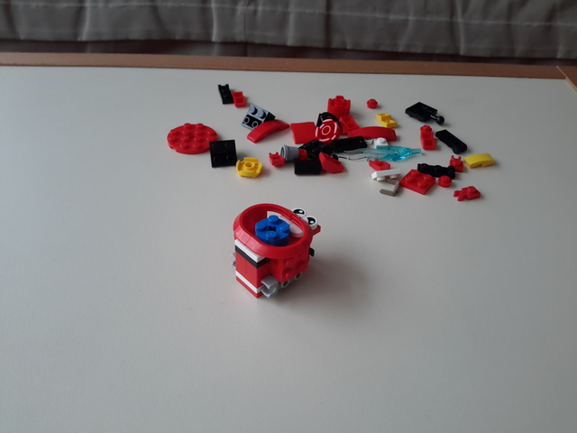](https://www.freelug.org/IMG/jpg/20161002_145236.jpg)

Les avant-bras pour leur part sont assez simples, avec une pince orientée verticalement à l’extrémité pour connecter les bras, ce qui donnera deux degrés de liberté aux mains.

[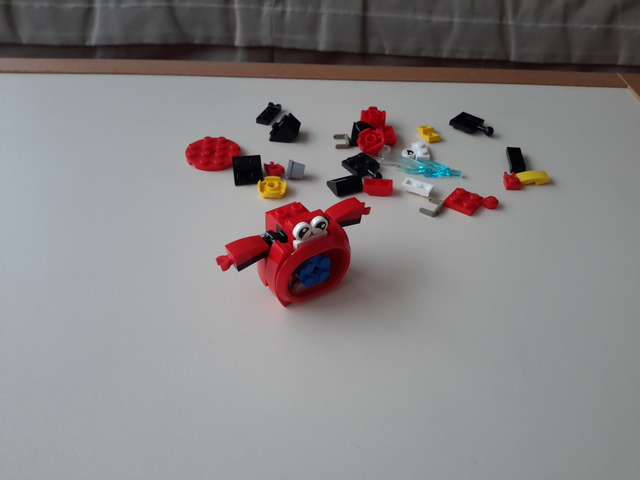](https://www.freelug.org/IMG/jpg/20161002_145410.jpg)

On monte ensuite la tête, qui a au sommet un volant certainement pour contrôler l’arrivée d’eau du pompier. Splasho tient dans un main un seau, pour lutter plus efficacement contre les incendies. Les pieds sans surprise sont assez simples (ils auront une pièce inclinée à l’arrière).

[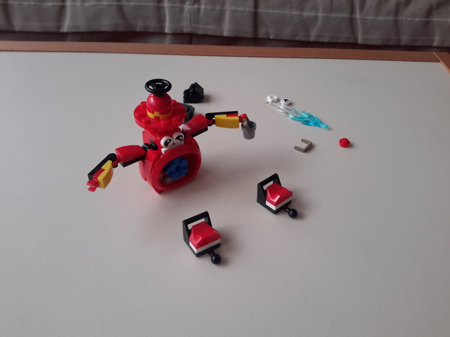](https://www.freelug.org/IMG/jpg/20161002_145647.jpg)

Et voici Splasho terminé, contemplant les différentes pièces bonus, dont une anse de seau.

[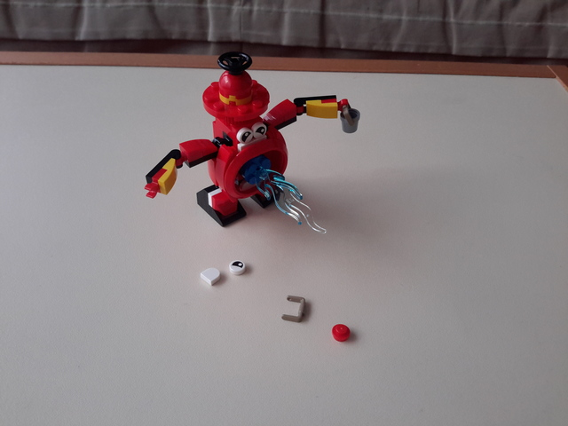](https://www.freelug.org/IMG/jpg/20161002_145737.jpg)

## Le set 41564, Aquad

Le personnage de ce set est clairement un avion bombardier d’eau. Le sachet contient les habituels sac de pièce et notice.

Et pour ne pas qu’il se sente seul, Splasho va contempler le montage.

[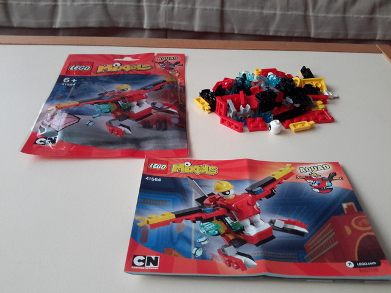](https://www.freelug.org/IMG/jpg/20161002_150617.jpg)

Le corps principal comporte un point d’attache de chaque côté pour les pieds, qui seront des patins d’hydravion — logique pour un tel personnage. Les deux fenêtres permettent d’avoir un volume creux, dans lequel "l’eau" sera transportée par le personnage.

[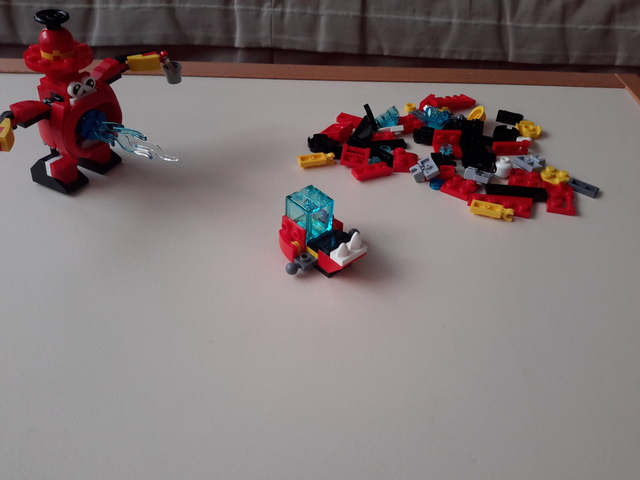](https://www.freelug.org/IMG/jpg/20161002_150906.jpg)

On rajoute un point d’attache pour la tête, des demi-sphères sur les côtés, et on s’attaque aux patins, qui ont quand même une dent à l’extrémité, on reste sur du « un peu décalé ».

[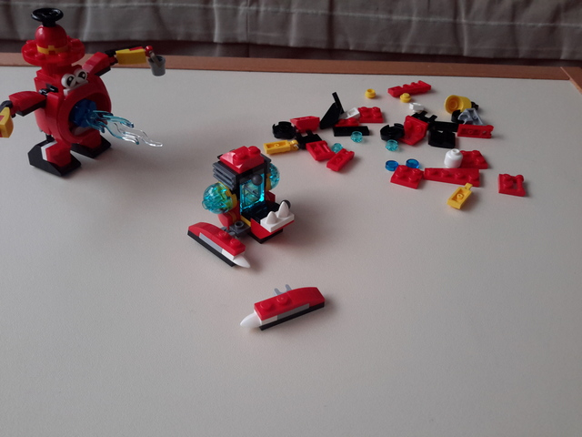](https://www.freelug.org/IMG/jpg/20161002_151145.jpg)

Une fois les patins terminés, on construit la queue de l’avion, qui sera attachée à l’arrière, fermant la soute à eau mais permettant de larguer la cargaison sur les incendies.

[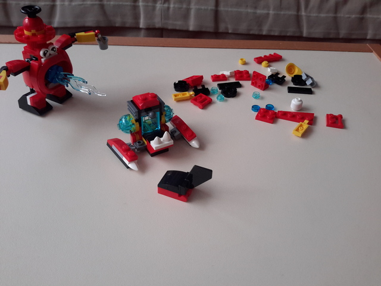](https://www.freelug.org/IMG/jpg/20161002_151250.jpg)

L’étape suivante est la construction de la partie comportant la tête, qui est coiffée d’un magnifique chapeau jaune du plus bel effet. Sur la tête seront les ailes, qui font office de bras.

[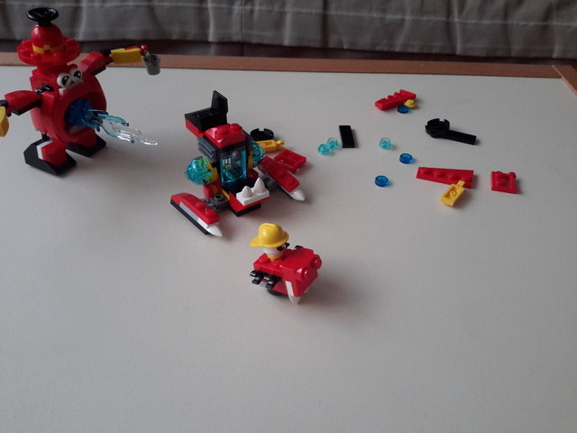](https://www.freelug.org/IMG/jpg/20161002_151523.jpg)

Une fois la tête fixée, les dernières étapes concernent les ailes, symétriques, qui pourront battre verticalement. À noter que les « lumières » de signalisation sont bleues de chaque côté, et non rouge ou vert comme d’habitude sur un avion.

[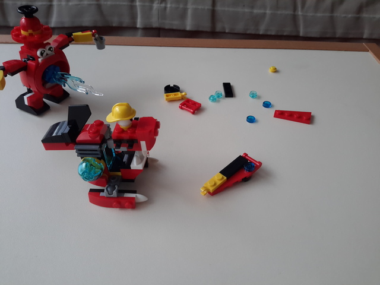](https://www.freelug.org/IMG/jpg/20161002_151646.jpg)

Et voici Aquad terminé, avec quelques pièces bonus. Deux pièces 1x1 bleu pâle sont ajoutées dans la soute à eau, simulant l’eau utilisée pour lutter contre les incendies.

[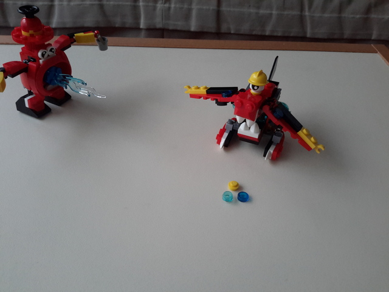](https://www.freelug.org/IMG/jpg/20161002_151849.jpg)

## Le set 41565, Hydro

Dernier set de la thématique, ce personnage est une échelle, afin de pouvoir accéder aux étages en danger. Sac de pièces et notice sont présents dans le sachet.

[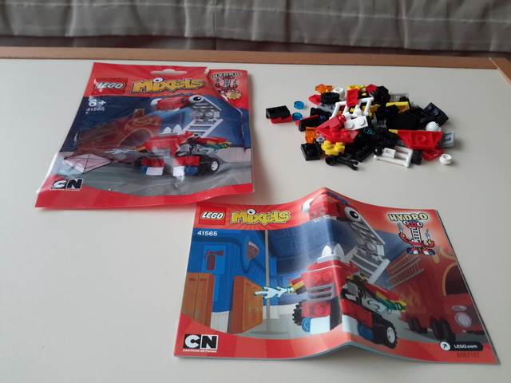](https://www.freelug.org/IMG/jpg/20161002_151955.jpg)

Le corps, vu ici de dos, comporte deux pinces pour les bras, deux supports pour les pieds, et un support arrière sur lequel se connectera le cou.

[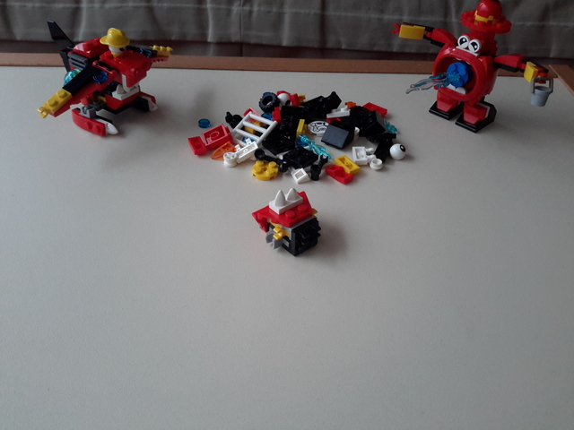](https://www.freelug.org/IMG/jpg/20161002_152400.jpg)

La tête, avec un gros œil de chaque côté et deux dents plates sur la lèvre supérieure, est assez amusante à mon avis, donnant un air naïf au personnage.

[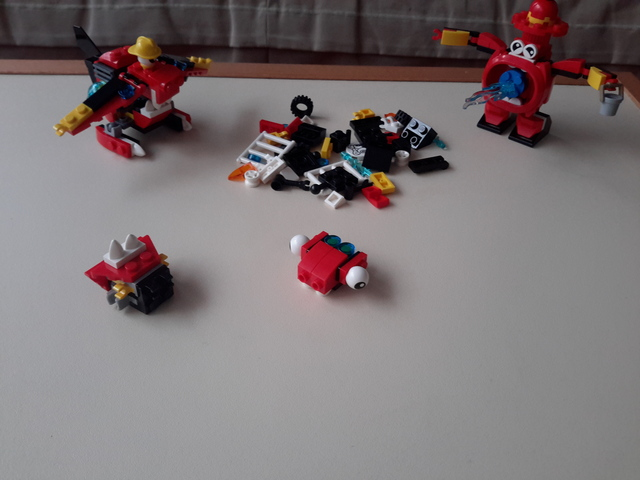](https://www.freelug.org/IMG/jpg/20161002_152622.jpg)

Le corps est constitué de deux échelles connectées, permettant à la tête de monter jusqu’à une hauteur non négligeable — il faut pouvoir sauver les gens en danger en altitude !

[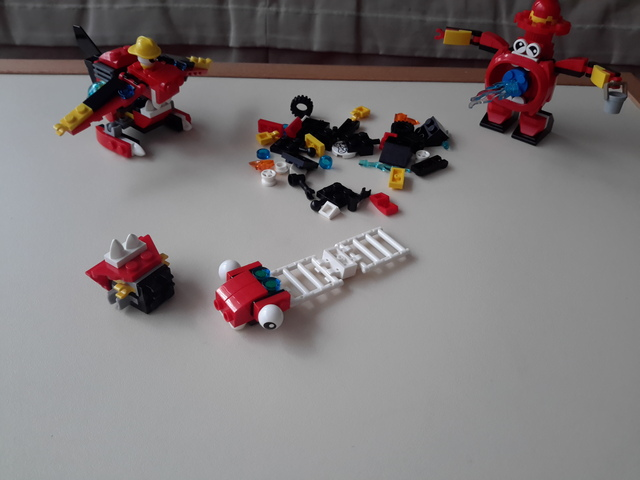](https://www.freelug.org/IMG/jpg/20161002_152729.jpg)

Les pieds pour leur part reprennent les couleurs des sets, rouge-bleu-jaune-blanc. Ils comportent une roue, qui cependant est au même niveau que le reste du pied, et ne peut donc pas vraiment tourner...

[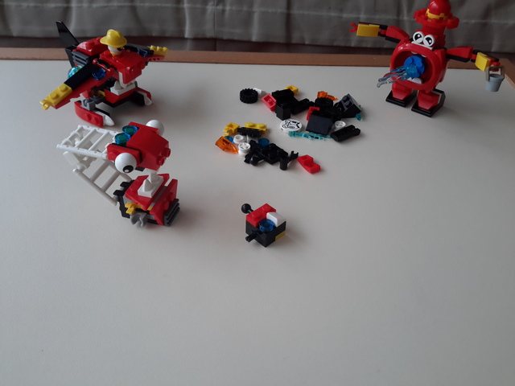](https://www.freelug.org/IMG/jpg/20161002_152850.jpg)

Enfin les bras, qui ne pourront bouger que verticalement, sont similaires à ceux de Splasho, avec une inversion du rouge et du jaune, ainsi que du sens de la pince finale.

[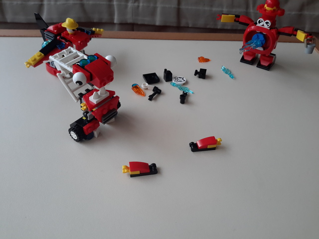](https://www.freelug.org/IMG/jpg/20161002_153159.jpg)

Et voici Hydro terminé, avec le Nixel, qui comporte des dents orange transparent au lieu des habituelles dents blanches, et quelques pièces bonus.

[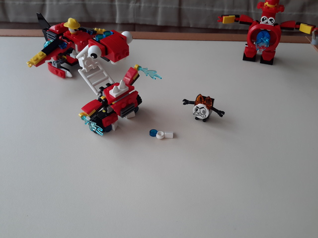](https://www.freelug.org/IMG/jpg/20161002_153426.jpg)

* * *

**Avis :** trois sets très sympathiques, qui se complètent vraiment sur la thématique de pompiers — un luttant avec un seau et crachant de l’eau, le second larguant de l’eau, le troisième donnant accès aux étages.

Le rendu est très amusant, comme tous les Mixels, et les différentes pièces sont intéressantes.

Bref des sets très agréables.

**Bonus 1 :** photos de familles avec tous les Mixels et le Nixel.

[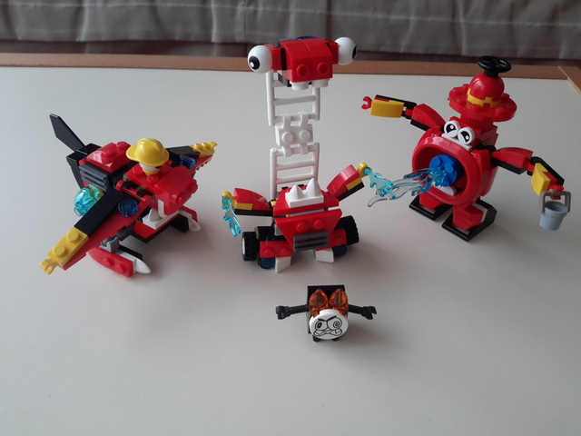](https://www.freelug.org/IMG/jpg/20161002_153457.jpg)

[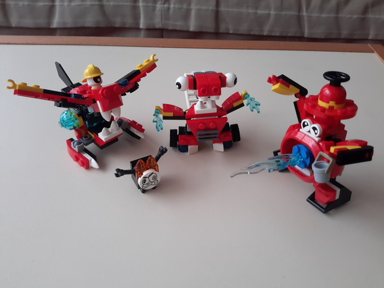](https://www.freelug.org/IMG/jpg/20161002_153539.jpg)

**Bonus 2 :** animations de toutes les étapes de construction (cliquer pour lancer).

_Splasho_

_Aquad_

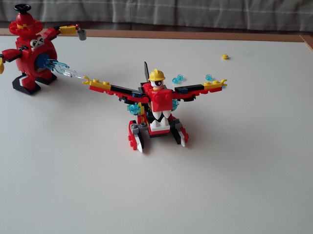

_Hydro_

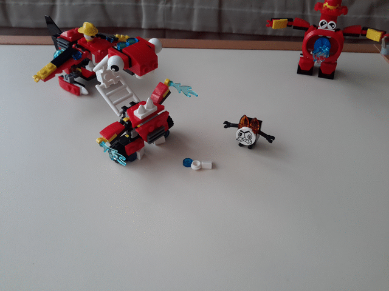

**Bonus 3 :** comme tous Mixels, ces trois personnages peuvent se combiner, donnant naissance à _MCFD Max_. Il reprend l’échelle de Hydro, agrémentée d’eau, mais sinon à mon sens ne rappelle pas trop les personnages. En revanche, il peut se transformer en camion de pompiers, en cliquant un doigt de chaque côté du pare-brise. Mais il ne peut pas rouler, car seulement deux roues à l’arrière...

[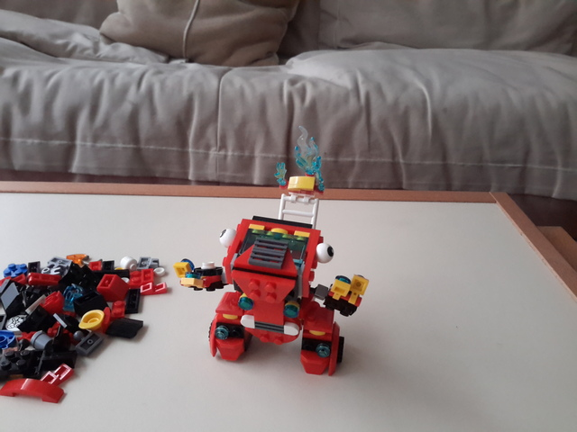](https://www.freelug.org/IMG/jpg/mcfd-max-1.jpg)

[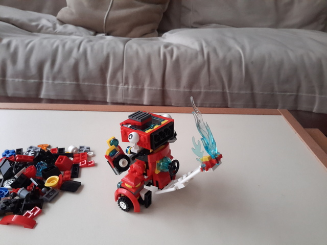](https://www.freelug.org/IMG/jpg/mcfd-max-2.jpg)

[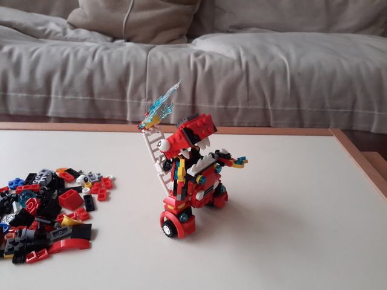](https://www.freelug.org/IMG/jpg/mcfd-max-3.jpg)

[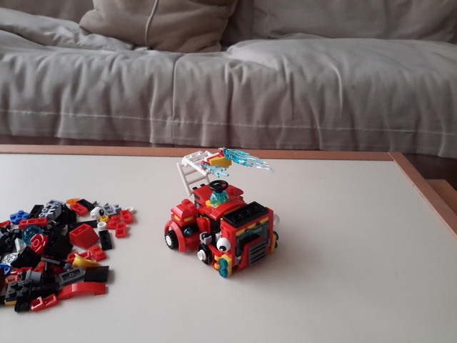](https://www.freelug.org/IMG/jpg/mcfd-max-4.jpg)

[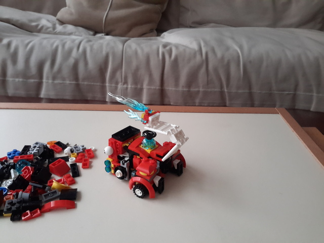](https://www.freelug.org/IMG/jpg/mcfd-max-5.jpg)
