Salut tout le monde !

Noël est encore loin mais la société LEGO prend de l’avance avec la sortie récente de ses calendriers de l’avent. Je vous propose donc un petit aperçu de la version City™ sortie en septembre 2016 au prix de 19,99€ pour 290 pièces (soit un ratio de 6,8cts / pièce).

[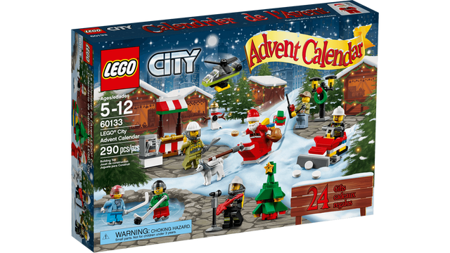](https://www.freelug.org/IMG/png/LEGO_60133_Box1_na_1488.png)

* * *

Comme il est de coutume, le recto de la boîte met en scène les minifigurines présentes dans la boîte avec leurs accessoires ou éléments de décor. Tout cela dans une ambiance de Noël (logique me direz-vous). Cette année, les pompiers semblent être à l’honneur.

[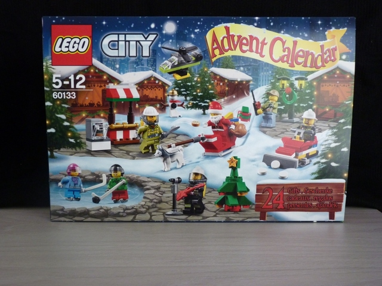](https://www.freelug.org/IMG/jpg/1_-_Face.jpg)

De l’autre côté, un petit schéma nous montrant que la boîte une fois ouverte peut servir de présentoir et le Père Noël en profite pour faire un peu de publicité pour d’autres sets de la gamme.

[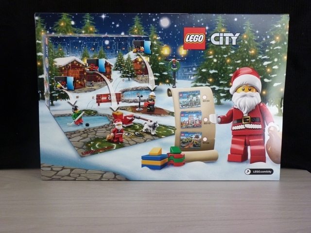](https://www.freelug.org/IMG/jpg/2_-_Dos.jpg)

Une fois la boîte ouverte comme sur l’exemple, nous avons droit à nos 24 petites cases ainsi que le fameux petit décor pour poser nos futurs mini-sets.

[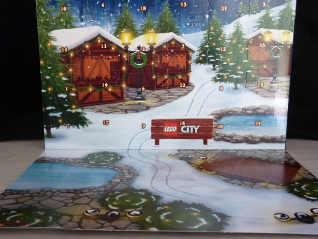](https://www.freelug.org/IMG/jpg/3_-_Boite_ouverte.jpg)

[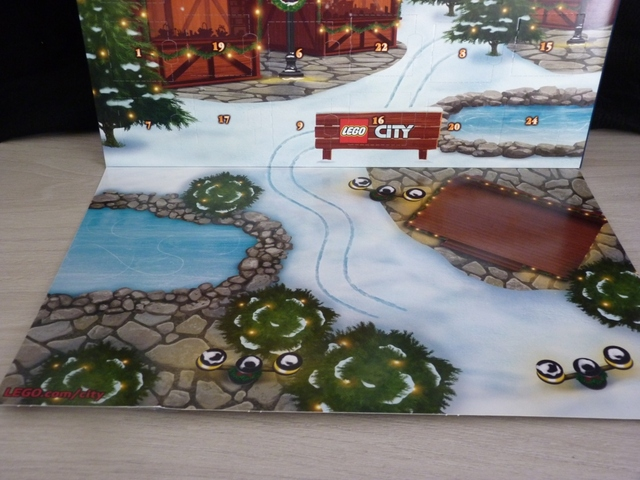](https://www.freelug.org/IMG/jpg/4_-_Bas_boite_ouverte.jpg)

A chaque case, la fenêtre ouverte sert de mini-notice extrêmement succincte (avec pour exemple, ici, la fenêtre de la première case).

[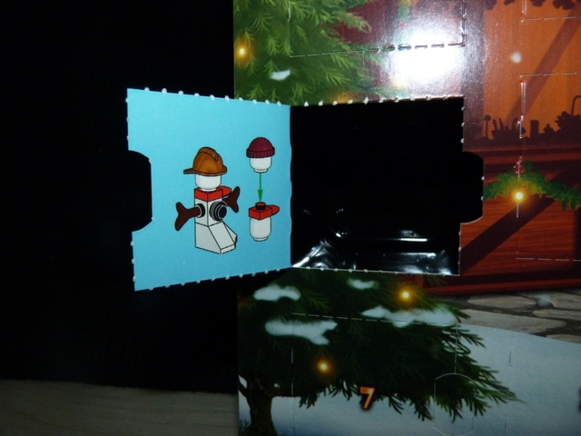](https://www.freelug.org/IMG/jpg/5_-_Exemple.jpg)

Et dans chaque case, on retrouve bien évidemment un petit sachet contenant les pièces nécessaires à la construction.

[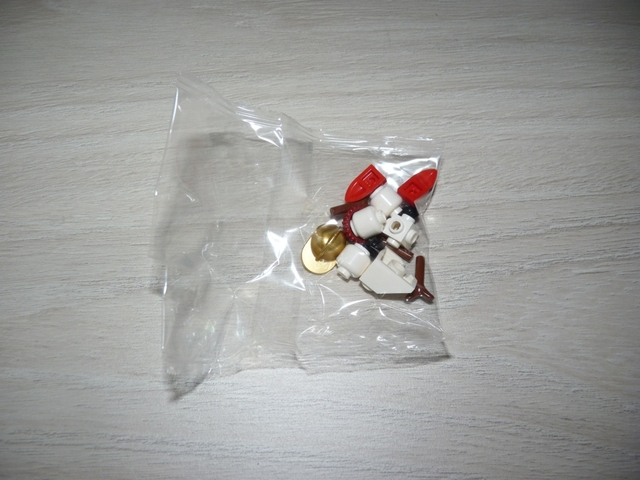](https://www.freelug.org/IMG/jpg/6_-_Pochette.jpg)

Le principe étant exposé, on commence de ce pas.

* * *

[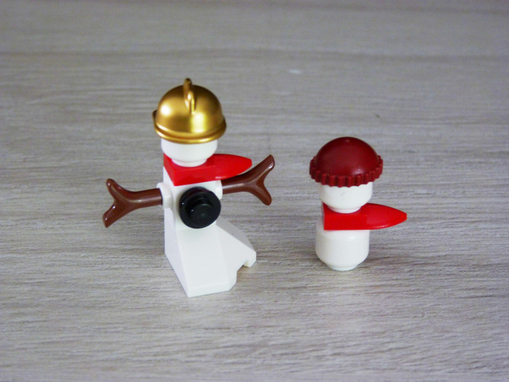](https://www.freelug.org/IMG/jpg/7_-_Case_1.jpg)

Première case, deux petits bonhommes de neige portant des accessoires reconnaissables des sapeurs-pompiers.

[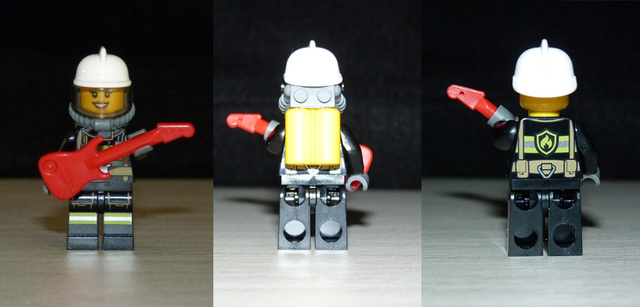](https://www.freelug.org/IMG/jpg/8-3.jpg)

La première minifigurine se trouve dans la deuxième case et est justement un pompier ou plutôt une pompière qui a troqué la lance ou la hache contre une guitare électrique. Après tout, c’est la fête ! La sérigraphie est très réussie autant recto que verso sur le torse et les jambes. Seul petit bémol, une fois tout son accoutrement en place, la sérigraphie du dos est totalement cachée...

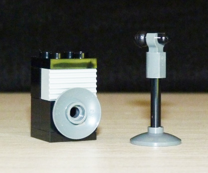

La case suivante donne à notre combattante du feu quelques accessoires supplémentaires : un ampli et un micro.

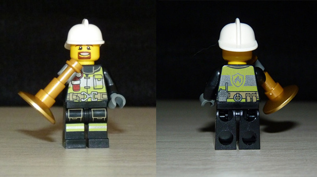

La quatrième case renferme un autre pompier et sa trompette. Une nouvelle fois, les sérigraphies sont superbes et très détaillées.

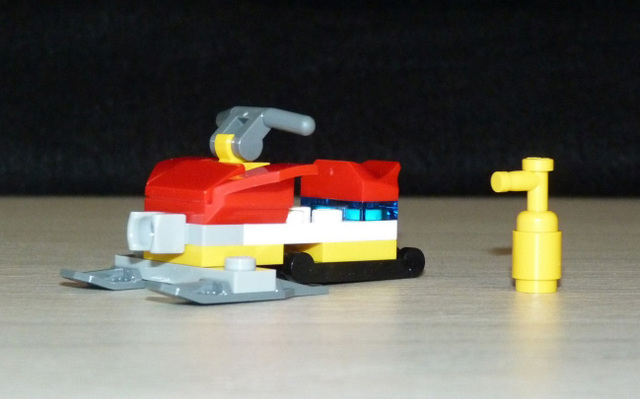

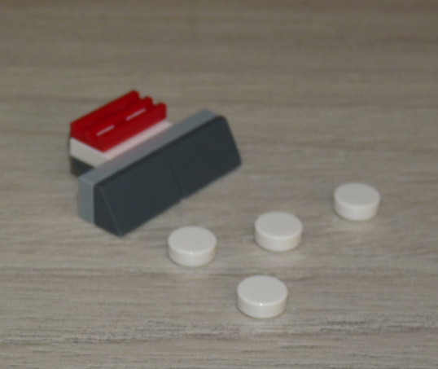

Les cases 5 et 6 vont ensemble et permettent de monter un petit chasse-neige.

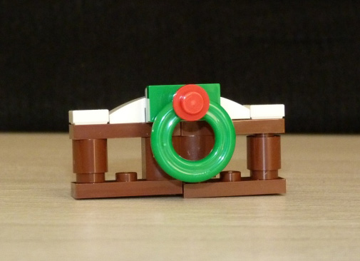

Une décoration se cache derrière la fenêtre 7.

[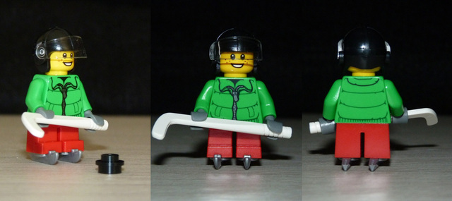](https://www.freelug.org/IMG/jpg/17.jpg)

En case 8, on retrouve une minifigurine, ici un jeune garçon qui joue au hockey. La sérigraphie du torse recto-verso est bien sympa une fois de plus avec la représentation d’une doudoune.

[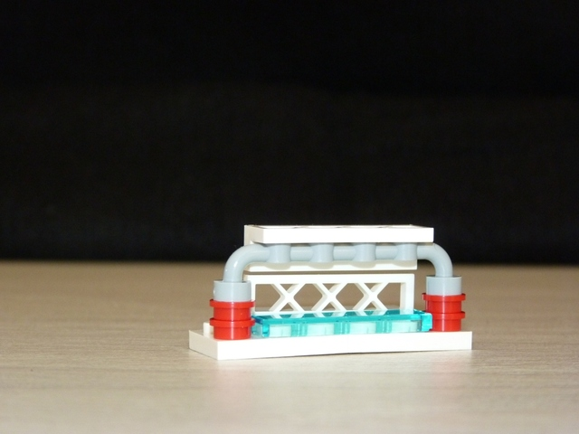](https://www.freelug.org/IMG/jpg/20_-_Case_9.jpg)

Les pièces contenues dans la case 9 nous font monter le but de hockey.

[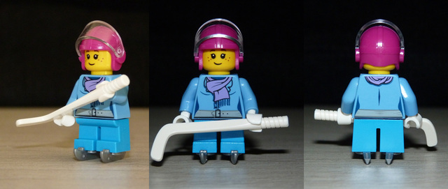](https://www.freelug.org/IMG/jpg/21.jpg)

Et pour terminer cette petite scénette en 3 parties, derrière la dixième fenêtre, on trouve une minifigurine d’une jeune fille (qui, comme le petit garçon, a des tâches de rousseur et un beau sourire) avec, à nouveau, un joli torse sérigraphié recto-verso.

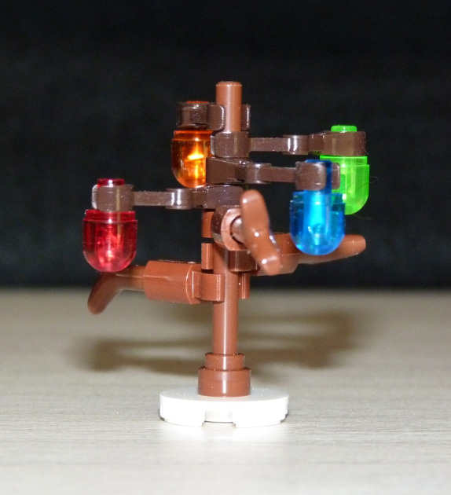

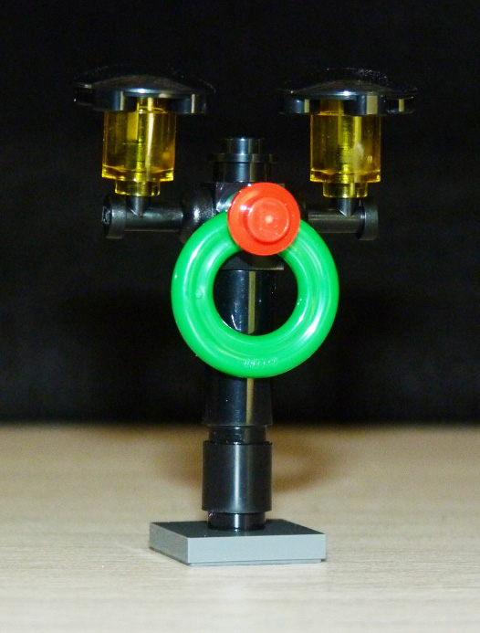

Les cases 11 et 12 nous offrent de petites décorations avec un arbre de Noël improvisé et un lampadaire.

[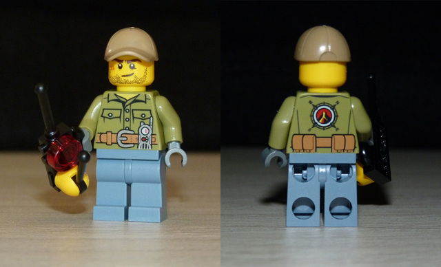](https://www.freelug.org/IMG/jpg/26.jpg)

Une minifigurine de plus se cache derrière la fenêtre numéro 13 en la personne du... (comment le traduire...?) surveillant de volcan. Les détails sur le torse (sérigraphié recto-verso une nouvelle fois) sont sympathiques avec le petit talkie-walkie à la ceinture (totalement ridicule à côté de celui que notre minifig a dans la main !) et ses petites poches à l’arrière. La tête de baroudeur ajoute un petit plus à la tenue.

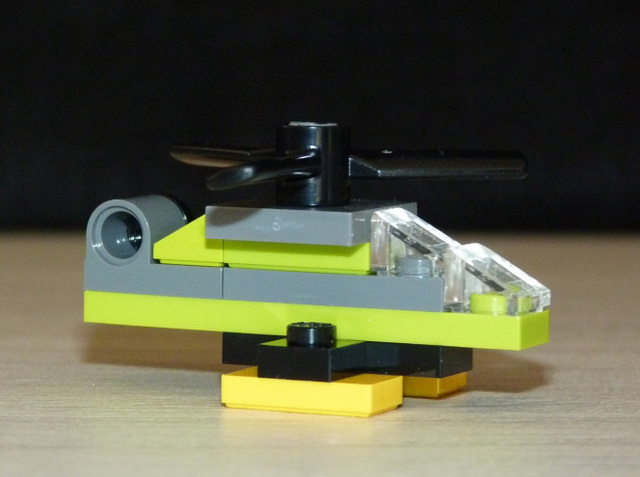

La quatorzième case renferme un hydravion miniature.

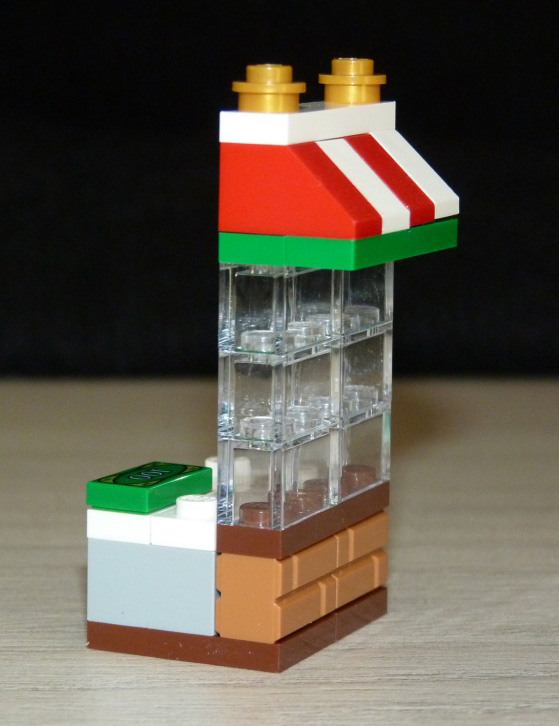

Derrière la fenêtre 15, nous trouvons les pièces pour monter ce que je suppose être un petit stand.

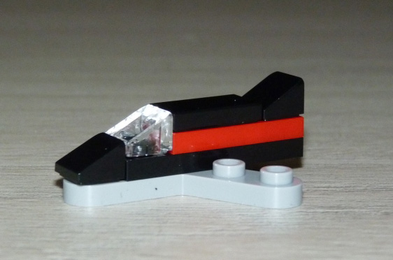

A nouveau, un petit jouet nous attend dans la case suivante avec un avion miniature.

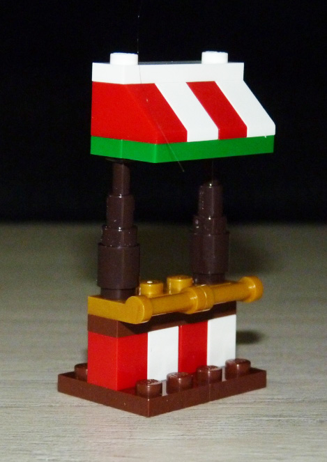

Un stand de plus se trouve dans la case numéro 17.

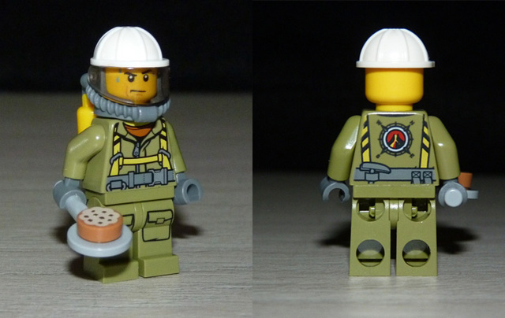

Et je pense que la minifigurine de la dix-huitième case - oserais-je dire le vulcanologue ? - est rattachée à ce stand car il nous présente un petit biscuit. Autant les accessoires que les sérigraphies (torse recto-verso et jambes) sont vraiment très détaillés et donnent vie au personnage. Mention spéciale pour les petites gouttes de sueur sur le visage !

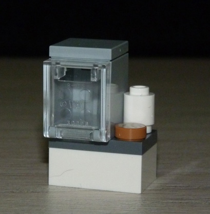

Pour aller avec les deux dernières cases, la fenêtre 19 cache ce que je suppose être un petit four.

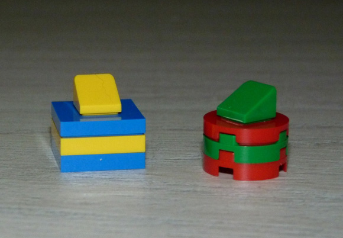

Deux petits cadeaux se trouvent dans la vingtième case.

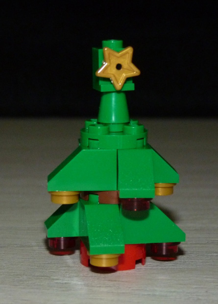

Et ces petits cadeaux vont trouver leur place sous le sapin que nous pouvons construire avec les pièces contenues dans la case suivante.

[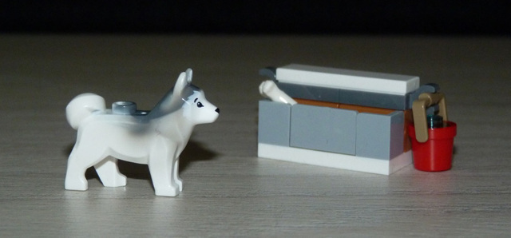](https://www.freelug.org/IMG/jpg/37_-_Case_22.jpg)

On s’approche de la fin avec la case 22 où on trouve un husky avec sa grande gamelle.

[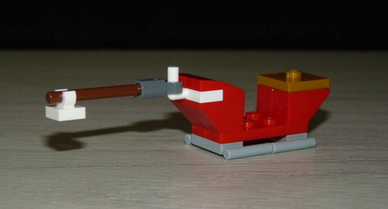](https://www.freelug.org/IMG/jpg/38_-_Case_23.jpg)

La case 23 permet de construire un petit traîneau pour le Père Noël qui peut être fixé au chien de traîneau de la case précédente.

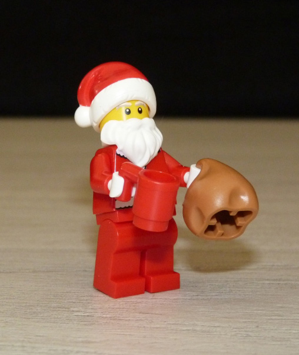

Et enfin, pour finir, pas de surprise, le Père Noël. Je pense que d’année en année, la société LEGO ne change pas trop son design donc je ne m’étendrai pas sur cette minifigurine qui n’a rien d’extraordinaire (seul le torse recto est sérigraphié). A noter qu’elle tient ses habituels mug et sac.

[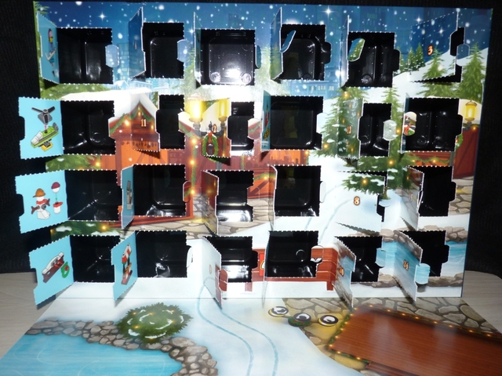](https://www.freelug.org/IMG/jpg/40_-_Boite_ouverte_finie.jpg)

Voici la boîte une fois entièrement ouverte.

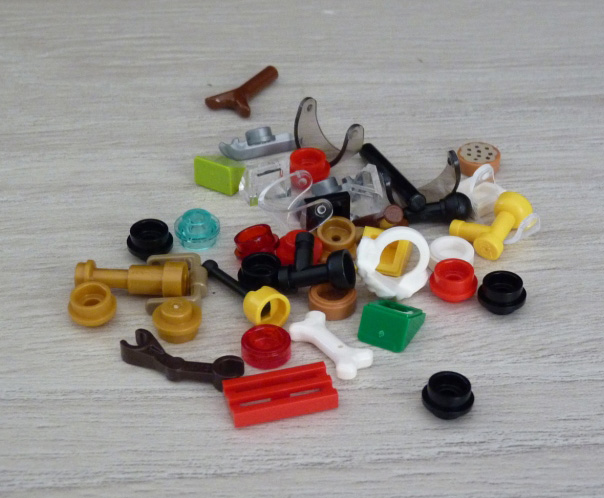

Et les habituelles pièces supplémentaires. Vu que chaque case contient au moins une pièce supplémentaire, on se retrouve avec pas mal de doublons une fois la boîte vidée.

* * *

En conclusion, comme chaque calendrier de l’avent, rien d’extraordinaire au niveau construction mais comme j’envisage de faire toute ma décoration de Noël en LEGO, cela me permettait d’ajouter des détails et de petits éléments à mon environnement général.

Mention supplémentaire à la présence des pompiers (ma compagne étant ancienne jeune sapeur-pompier). Les minifigurines (hormis le personnage principal) sont très détaillées et on retrouve l’esprit de Noël dans toutes les décorations malgré l’aspect minimaliste des constructions.

Je recommande ce set à ceux qui, comme moi, veulent ajouter quelques décorations à leurs sets de Noël ou se rajouter quelques jolies minifigs à leur collection ou encore, bien sûr, aux petits enfants qui s’amuseront chaque jour à découvrir ce qui se cache derrière la case à ouvrir.

[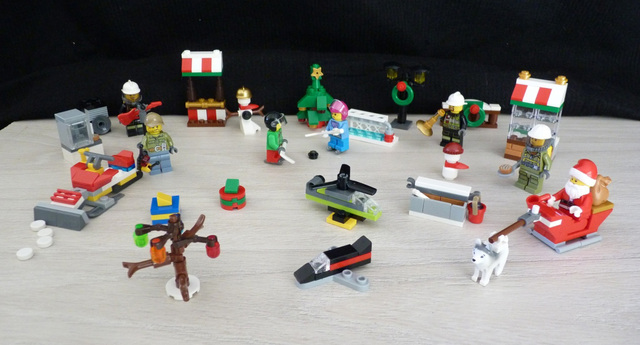](https://www.freelug.org/IMG/jpg/42_-_Fin.jpg)

Pour finir, voici tous les éléments réunis. En vous souhaitant, avec BEAUCOUP d’avance, de joyeuses fêtes !

Merci de m’avoir lu et à bientôt !
