Pour changer de mes gammes habituelles, je vous propose la revue d’un des premiers sets Nexo Knights, **La catapulte du chaos**.

Sorti en janvier 2016, ce set comporte 93 pièces et coûte 9,99 €, soit un ratio d’un peu plus de 10 centimes par pièce, avec deux figurines.

* * *

L’avant de la boîte montre la catapulte en pleine action, lançant un projectile, et le méchant utilisant son arbalète. Le logo Nexo Knights est présent sur le haut, avec Jestro, tenant un grimoire et ricanant, en bas à gauche.

[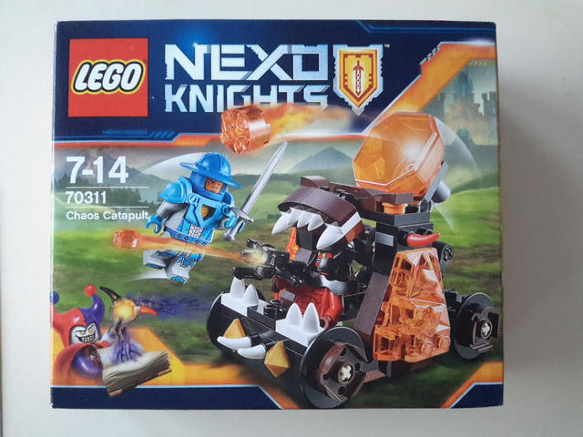](https://www.freelug.org/IMG/jpg/20170122_125808.jpg)

L’arrière reprend d’un côté la catapulte, fonctionnelle, et l’arbalète du soldat ennemi, et présente la publicité pour l’application.

[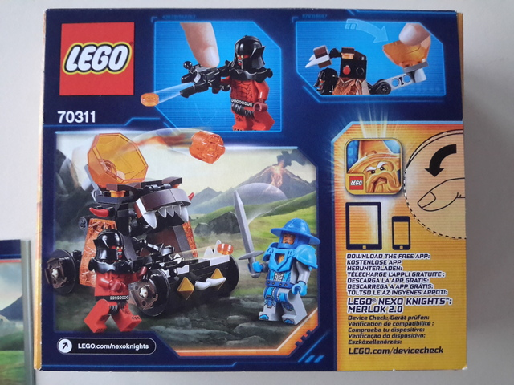](https://www.freelug.org/IMG/jpg/20170122_125754.jpg)

À l’intérieur, sans surprise, un livret de construction et un sachet de pièces.

[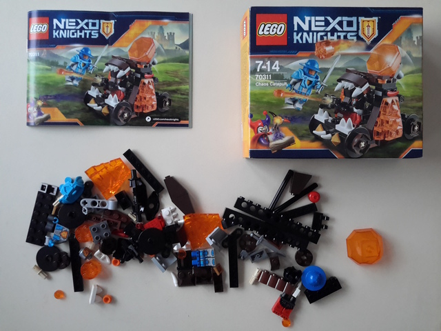](https://www.freelug.org/IMG/jpg/20170122_125733.jpg)

Le modèle contient quelques pièces Technic, en bas de la photo. En particulier il y a quatre pièces en caoutchouc permettant de relier deux barres tout en pouvant se tordre, ce qui permet de faire élastique pour faire fonctionner la catapulte.

[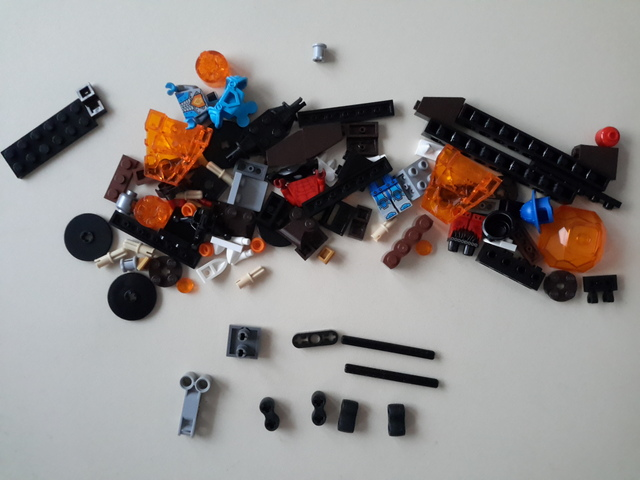](https://www.freelug.org/IMG/jpg/20170122_125958.jpg)

* * *

Le premier personnage, soldat Nexo Knight, sera équipé d’une armure ventrale bien complète, d’une simple épée, et d’un casque protégeant tout le visage. La sérigraphie du corps est visuellement bien rendue, avec différentes plaques d’armure, et le symbole Nexo Knight bien visible. Le visage a l’air sérieux, presque perplexe.

[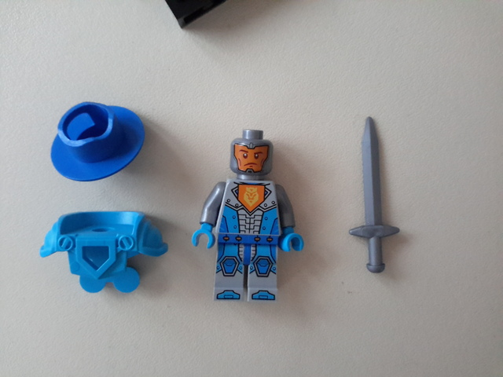](https://www.freelug.org/IMG/jpg/20170122_130222.jpg)

Le dos reprend les plaques d’armures, mais pas sur les jambes, uniformes. Le visage alternatif ressemble fortement à l’avant, juste un peu plus sérieux moins perplexe. Pas de sérigraphie sur les côtés.

[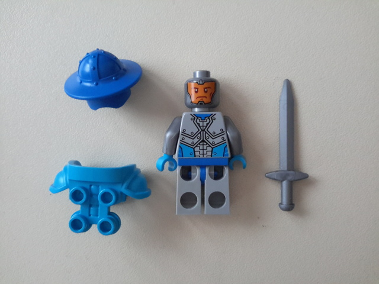](https://www.freelug.org/IMG/jpg/20170122_130411.jpg)

Le soldat de Jestro, lui, est tout en rouge et noir, avec une sorte de pagne, et de jolis muscles apparents. Il portera un casque et une arbalète, ainsi que des épaulettes. Le visage, comme il se doit pour un méchant, est grimaçant.

[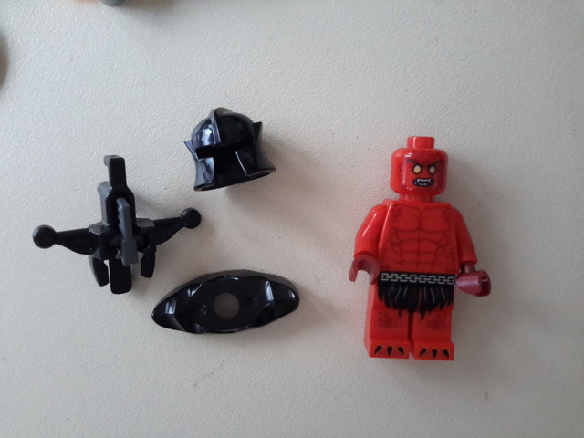](https://www.freelug.org/IMG/jpg/20170122_130246.jpg)

De dos pas grand-chose, juste quelques simili-écailles qui ne rendent finalement pas si mal.

[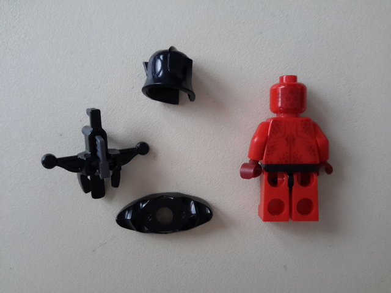](https://www.freelug.org/IMG/jpg/20170122_130434.jpg)

Voici les deux personnages assemblés, l’arbalète chargée d’une pièce orange transparent.

[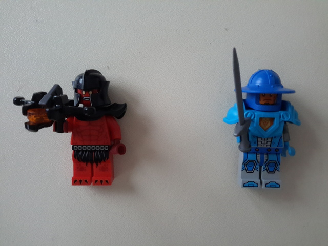](https://www.freelug.org/IMG/jpg/20170122_130623.jpg)

* * *

La construction commence par le cadre de la catapulte. À l’avant un siège inclinable, sur lequel viendra s’asseoir le conducteur. Et pendant ce temps les deux soldats se disputent, après tout ils sont là pour ça...

[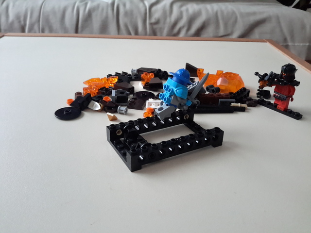](https://www.freelug.org/IMG/jpg/20170122_131052.jpg)

La catapulte, protégée par le soldat de Jestro, gagne un avant renforcé de deux blindages, et des supports pour les roues.

[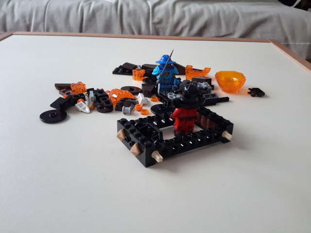](https://www.freelug.org/IMG/jpg/20170122_131525.jpg)

On complète l’avant de deux magnifiques dents et deux cornes, pour donner un aspect un peu plus méchant, et on monte les supports du panier.

[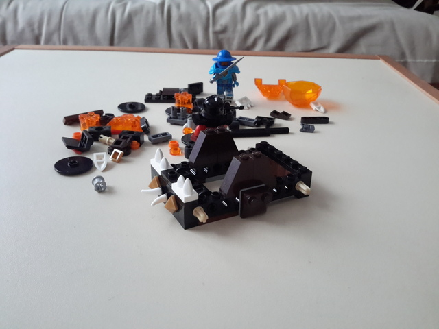](https://www.freelug.org/IMG/jpg/20170122_132029.jpg)

L’étape suivante est de monter les ressorts en caoutchouc, qui permettront de propulser les projectiles. Une défense se rajoute de chaque côté, sur le bas.

[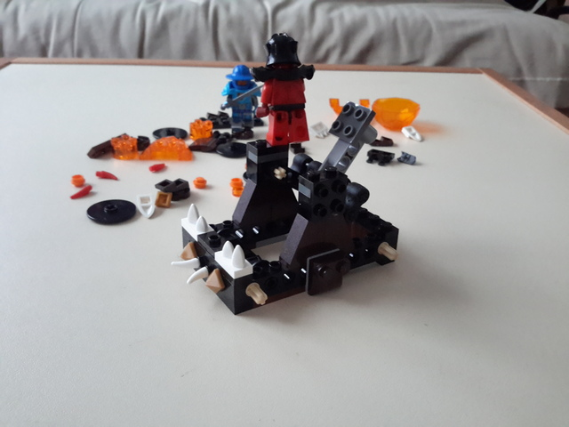](https://www.freelug.org/IMG/jpg/20170122_132635.jpg)

On rajoute de chaque côté une magnifique protection orange, ainsi qu’une corne rouge, pour dire que c’est vraiment méchant.

[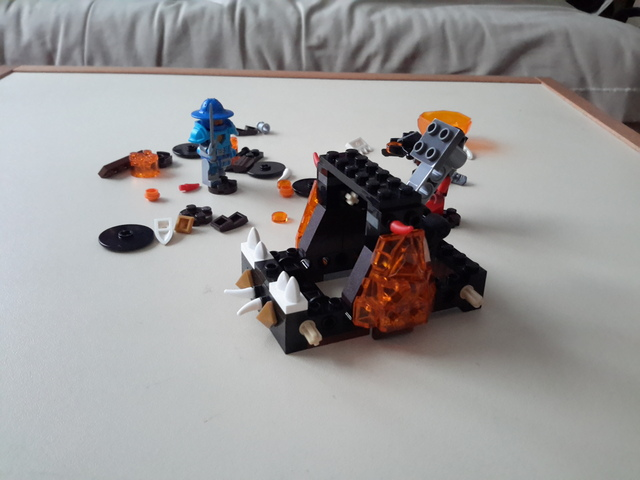](https://www.freelug.org/IMG/jpg/20170122_132822.jpg)

Pendant que les soldats font une pause (notez que le soldat de Jestro est végétarien !), on rajoute quelques détails sur le dessus, pour habiller le tout. Le crochet permettra de fixer un morceau de toit, sans doute pour protéger le conducteur.

[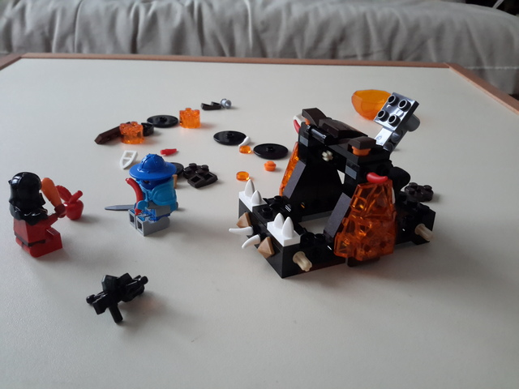](https://www.freelug.org/IMG/jpg/20170122_133229.jpg)

Et voici la catapulte terminée, avec son conducteur en position, toit rabattu. Le panier est, conformément à la gamme, orange transparent. Entre les soldats, les pièces supplémentaires, et sur la droite les munitions de rechange pour la catapulte et l’arbalète.

[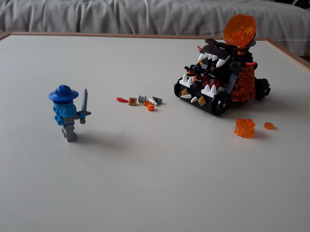](https://www.freelug.org/IMG/jpg/20170122_133805.jpg)

* * *

**Avis :** le rendu est sympathique, et la catapulte est redoutablement efficace — les quatre pièces en caoutchouc permettent de propulser le projectile assez loin. En revanche je suis réservé car à la détente le panier vient heurter ou frotter le dessus, et j’ai peur de l’usure à la longue.

Remarquez également que les deux soldats sont aussi incompétents (ou compétents ?) l’un que l’autre — le Nexo n’a pas réussi à empêcher la construction, mais le soldat de Jestro n’a pas réussi à mettre son adversaire hors de nuire...

**Bonus :** animation de la construction, avec la redoutable bataille entre les soldats (cliquez pour lancer).

[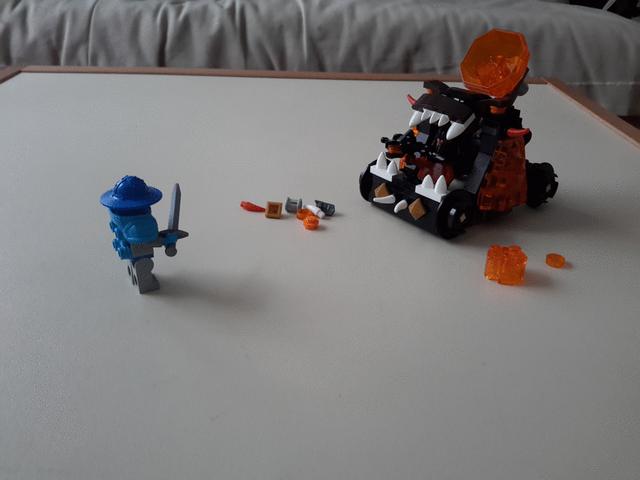](https://www.freelug.org/IMG/gif/70311-la-catapulte-du-chaos.gif)
