Aujourd’hui je vous propose la revue du set 70599 de la gamme Ninjago, **Le Dragon de Cole**.

Ce set sorti en 2015 au prix de 9,99 euros est composé de 98 pièces, soit un ratio prix/pièce d’environ 10 centimes d’euros.

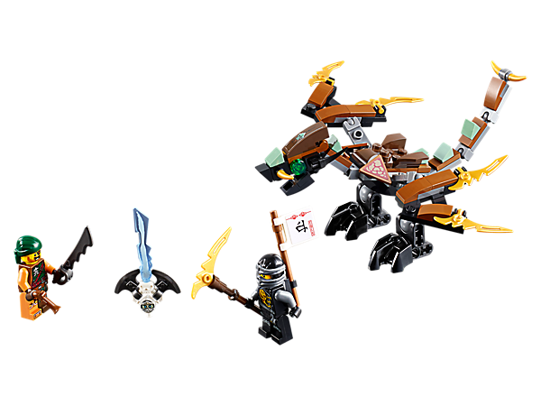

* * *

L’avant de la boîte présente le logo LEGO en haut à gauche, Ninjago au centre, et un visage de ninja en haut à droite, le drapeau des méchants en bas à gauche, et au centre une présentation du contenu de la boîte.

[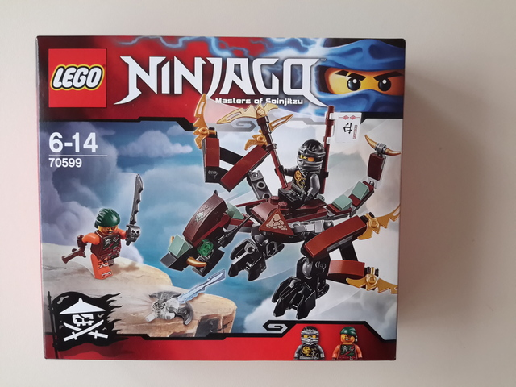](https://www.freelug.org/IMG/jpg/20160522_121635.jpg)

Le dos quant à lui montre quelques scènes d’action, signale l’existence de vidéos, et nous indique que la boîte contient l’épée numéro 1 sur 7 — j’imagine que les autres sont, ou seront, dans d’autres sets.

[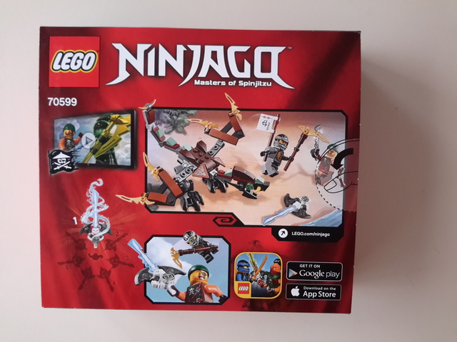](https://www.freelug.org/IMG/jpg/20160522_121708.jpg)

La boîte contient deux sachets, une notice, et une plaque d’autocollants.

[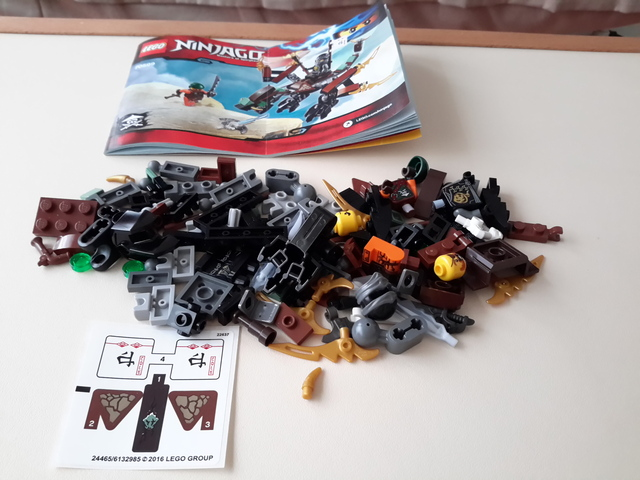](https://www.freelug.org/IMG/jpg/20160522_123044.jpg)

Un gros plan sur lesdits autocollants, que j’ai décidé de ne pas coller même si cela rend le modèle moins joli.

[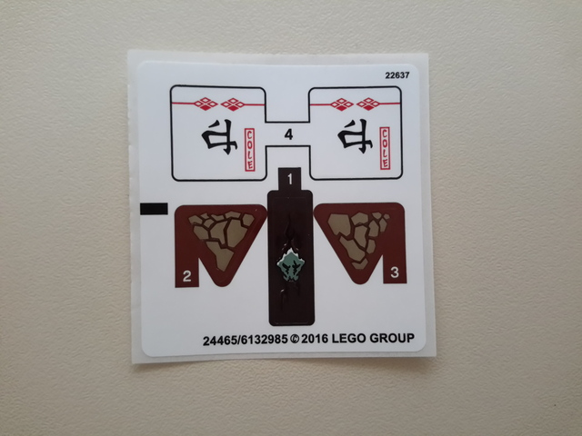](https://www.freelug.org/IMG/jpg/20160522_123101.jpg)

La première figurine est Cole, que voici déjà dans son masque. Le visage est énervé, il n’aime manifestement pas devoir se battre pour récupérer l’épée magique. La sérigraphie est jolie, avec une tornade et des lacets fermant la tenue, la ceinture tombant sur les jambes.

[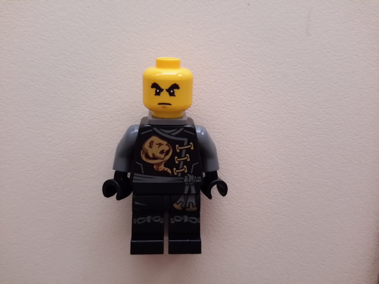](https://www.freelug.org/IMG/jpg/20160522_123216.jpg)

Le dos (sans la tête) continue la ceinture, et au centre trône le symbole de Cole, une espèce de kanji imaginaire. Les jambes en revanche sont uniformes.

[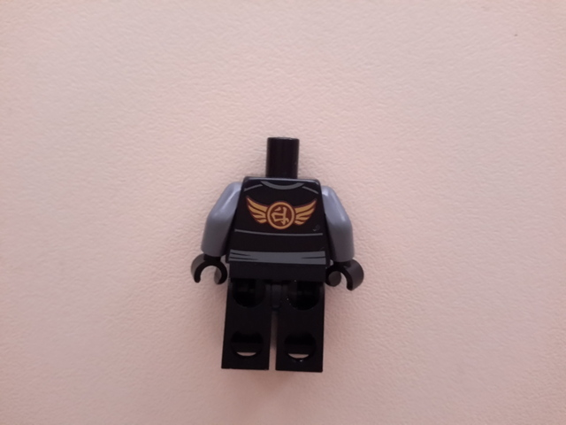](https://www.freelug.org/IMG/jpg/20160522_123151.jpg)

Cole porte un harnais avec un tenon, permettant d’accrocher le drapeau.

[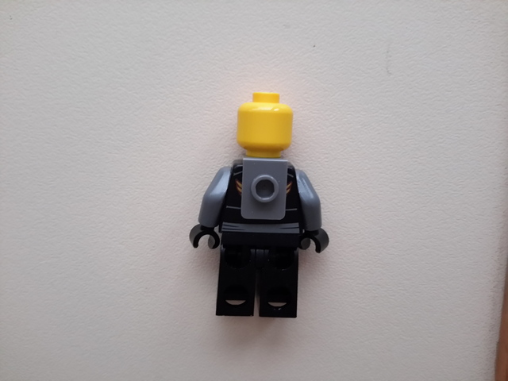](https://www.freelug.org/IMG/jpg/20160522_123232.jpg)

Le voici avec son masque, qui ne laisse que les yeux visibles. Contrairement à d’autres sets, le masque est comme un casque, et non attaché autour du cou.

[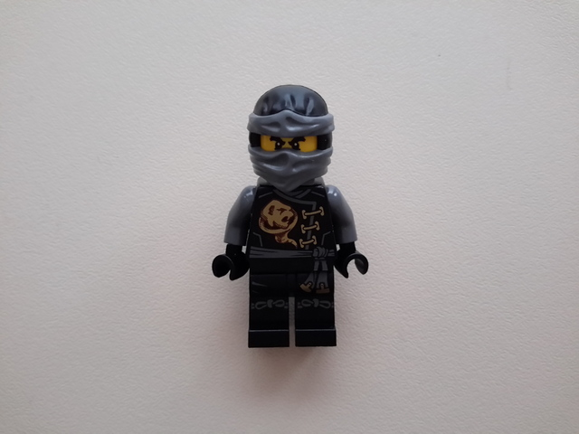](https://www.freelug.org/IMG/jpg/20160522_123300.jpg)

Cole tout équipé, avec le drapeau (sur lequel devrait être collé un autocollant) et son arme.

[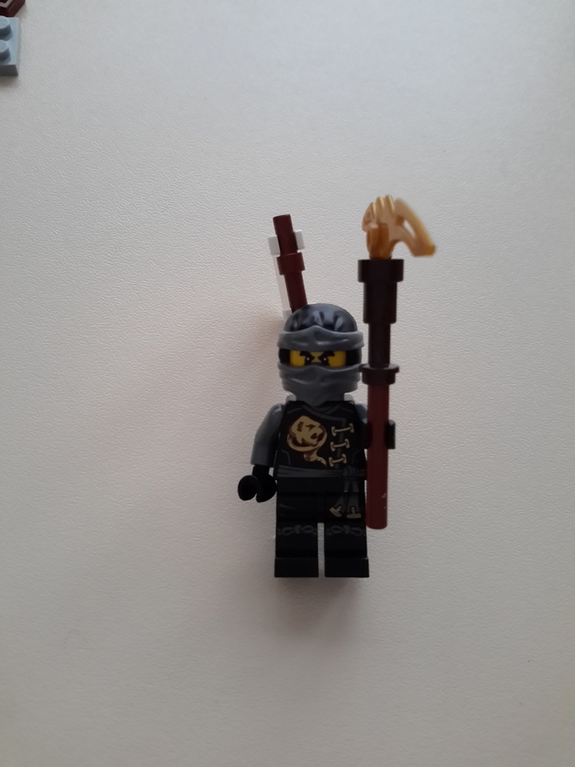](https://www.freelug.org/IMG/jpg/20160522_123429.jpg)

La seconde figurine est Bucko, méchant de service immédiatement reconnaissable. La sérigraphie du torso est bien détaillée, avec un harnais à boucles, un cordon tombant sur les jambes, une armure, et le symbole des méchants. Le sabre est également bien joli, avec une tête de mort sur la garde. Bonus, les jambes sont bicolores.

[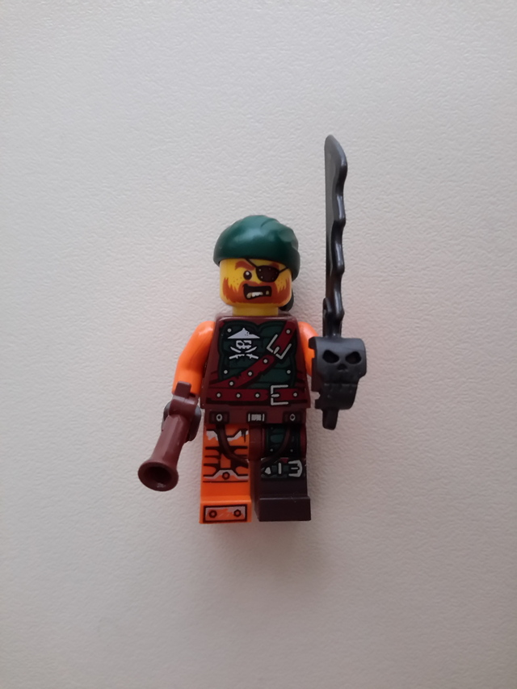](https://www.freelug.org/IMG/jpg/20160522_123706.jpg)

De dos le torso présente la suite du harnais, sur lequel est accroché quelque objet que je ne puis identifier. Les jambes sont uniformes, comme celles de Cole.

[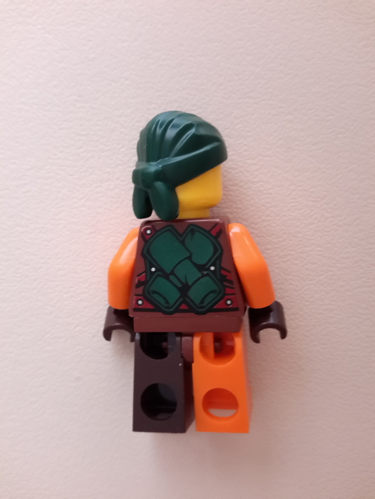](https://www.freelug.org/IMG/jpg/20160522_123733.jpg)

Enfin l’épée, numéro 1 donc, avec un logo représentant un visage de ninja pas content (pour aller avec Cole ?), et deux petites lames certainement redoutables en combat.

[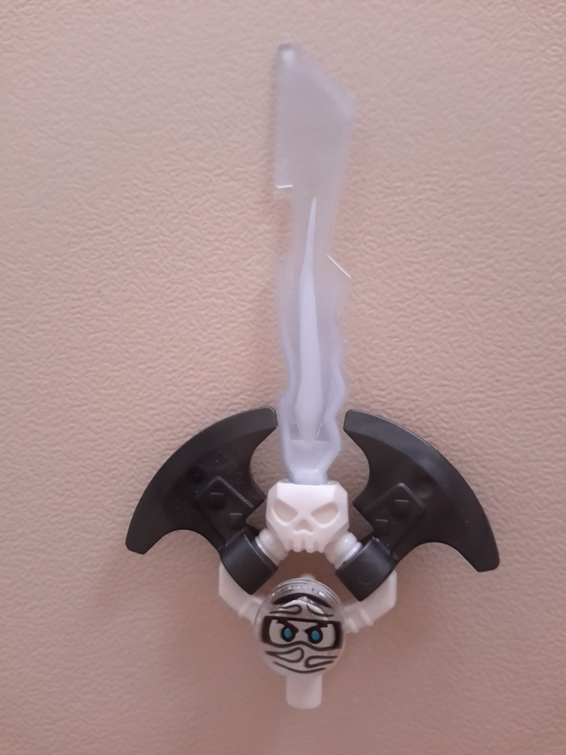](https://www.freelug.org/IMG/jpg/20160522_123601.jpg)

La construction du dragon lui-même commence par le corps, sur lequel il n’y a pas moins de six jonctions articulées, promettant de nombreuses possibilités de rotation.

[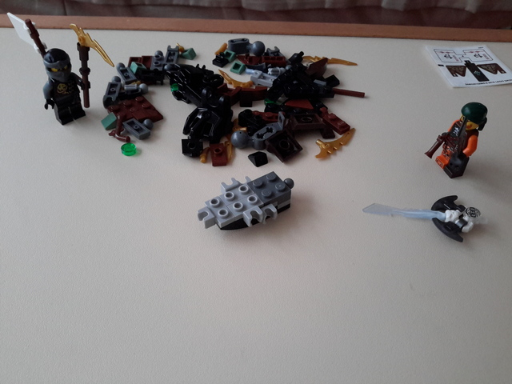](https://www.freelug.org/IMG/jpg/20160522_124059.jpg)

Cole y a évidemment son siège, pour commander le dragon.

[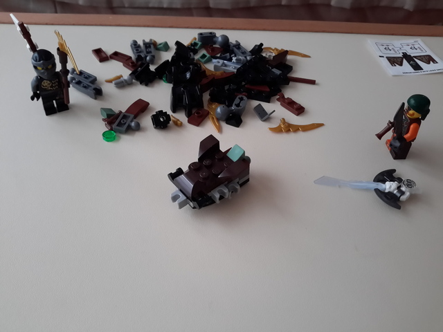](https://www.freelug.org/IMG/jpg/20160522_124312.jpg)

La queue comporte également deux articulations...

[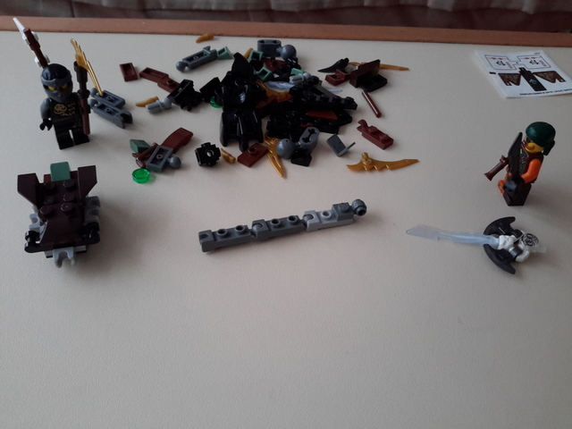](https://www.freelug.org/IMG/jpg/20160522_124400.jpg)

... et évidemment des écailles, représentées par des pièces vert pâle du plus bel effet.

[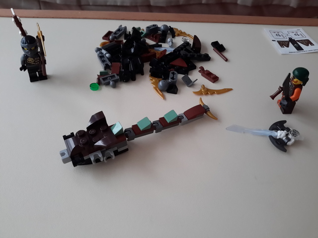](https://www.freelug.org/IMG/jpg/20160522_124536.jpg)

Après avoir mis le cou, on construit la tête, qui comporte une pièce avec une tige en diagonale vers le bas, sur laquelle s’accrochera la mâchoire.

[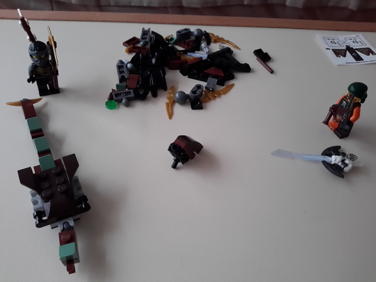](https://www.freelug.org/IMG/jpg/20160522_124746.jpg)

La tête comporte deux yeux verts, des moustaches, deux oreilles pointées vers l’arrière, un museau.

[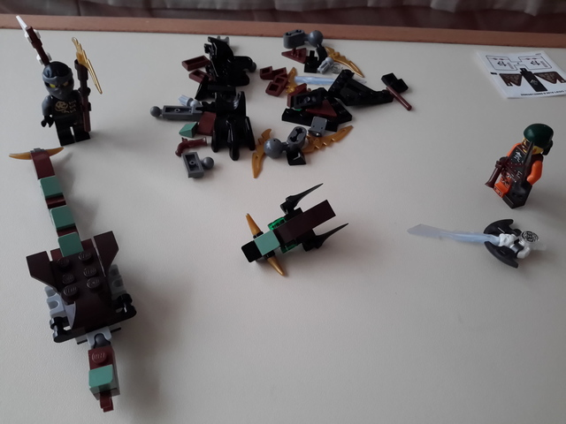](https://www.freelug.org/IMG/jpg/20160522_124955.jpg)

Tandis que la mâchoire inférieure est faite avec deux pièces, et se raccroche à la tige diagonale mentionnée précédemment. Conséquence, la mâchoire peut tourner (le dragon peut se la déboîter), mais pas s’ouvrir ou se fermer...

[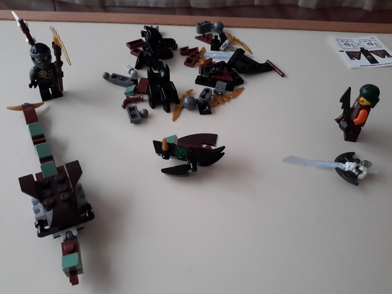](https://www.freelug.org/IMG/jpg/20160522_125019.jpg)

Le corps proprement dit du dragon, qui fait une belle longueur tout déployé. Il comporte cinq articulations au total, toutes à deux degrés de liberté. Sur les deux pièces marron clair se posent normalement des autocollants.

[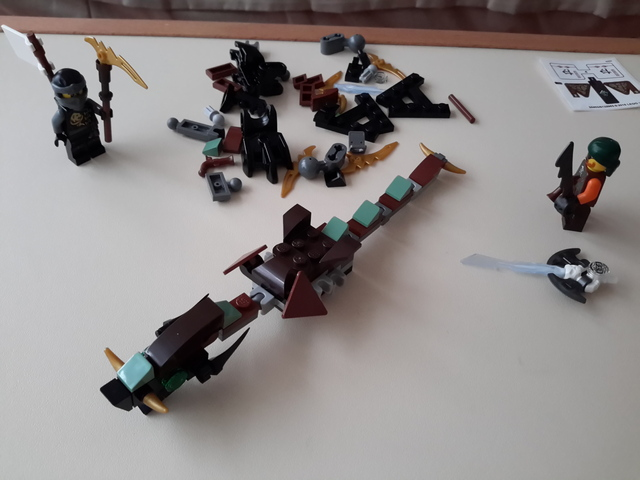](https://www.freelug.org/IMG/jpg/20160522_125117.jpg)

Les deux pattes griffues ont également une articulation...

[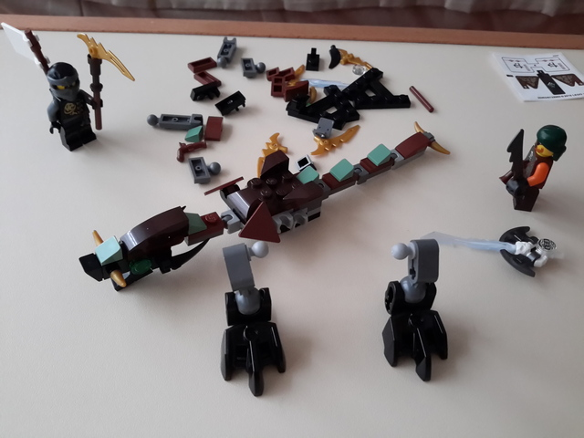](https://www.freelug.org/IMG/jpg/20160522_125201.jpg)

... et permettent de soutenir le dragon.

[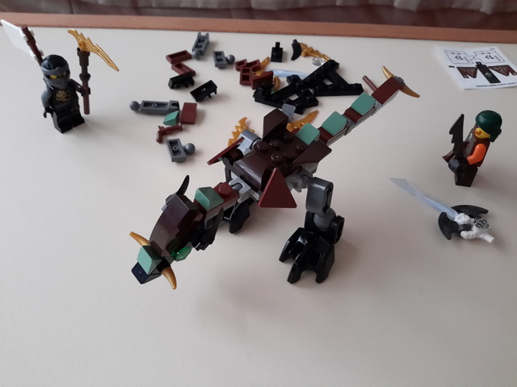](https://www.freelug.org/IMG/jpg/20160522_125241.jpg)

Les ailes se construisent en symétrique (théoriquement l’une après l’autre, je vais le faire en parallèle), avec comme base une pièce en forme de « A ».

[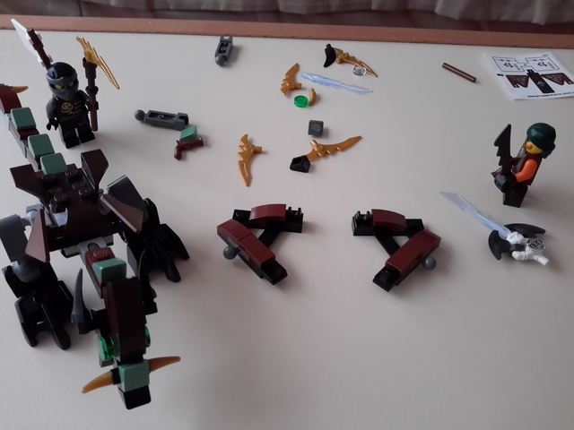](https://www.freelug.org/IMG/jpg/20160522_125504.jpg)

Chaque aile se voit dotée de deux lames dorées et d’une articulation supplémentaire, qui permettra le rattachement au corps avec possibilité de rotation.

[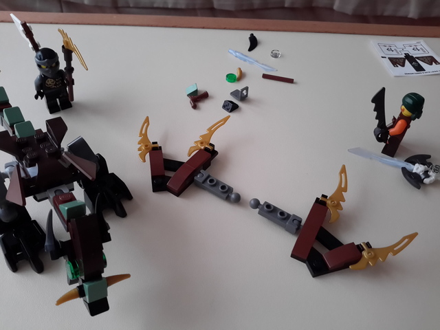](https://www.freelug.org/IMG/jpg/20160522_125628.jpg)

Et voici le dragon terminé, en position « neutre »...

[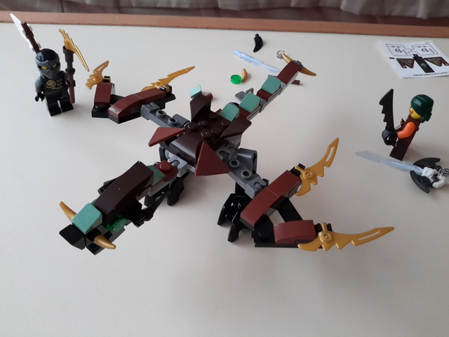](https://www.freelug.org/IMG/jpg/20160522_125707.jpg)

... dressé sur ses pattes...

[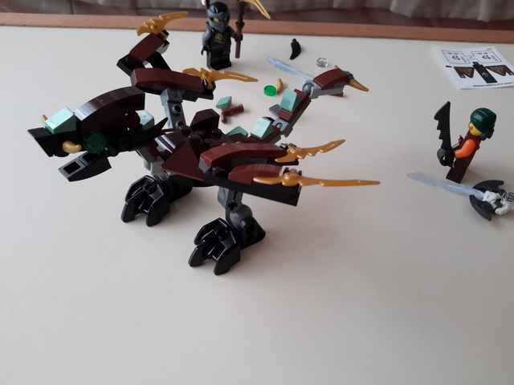](https://www.freelug.org/IMG/jpg/20160522_125749.jpg)

... et enfin lové en rond (l’idée était de le montrer en position endormie, mais ce n’est pas forcément réussi...).

[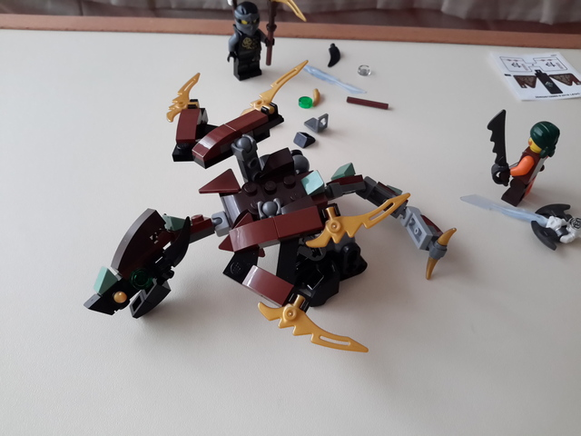](https://www.freelug.org/IMG/jpg/20160522_125834.jpg)

Cole fièrement monté sur le dragon, surveillant les pièces bonus. Parmi elles une corne dorée, le visage de ninja et la lame de l’épée numéro 1, un harnais dorsal, et quelques autres pièces.

[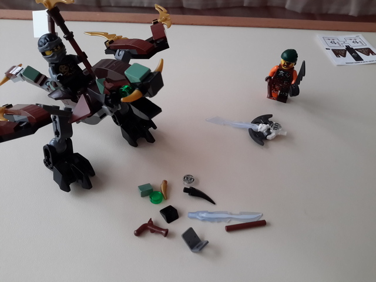](https://www.freelug.org/IMG/jpg/20160522_130006.jpg)

* * *

**AVIS :** un très bon petit set, qui comporte peu de pièces mais compense par leur intérêt à mon sens. La construction est simple, sans être trop barbante ou répétitive. C’est mon second set Ninjago, et je ne regrette pas du tout cet achat (peut-être même que je finirai par coller les autocollants !).

**BONUS :** un GIF présentant toutes les étapes de la construction (cliquez pour lancer, 10 Mo).

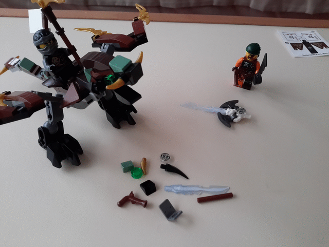
