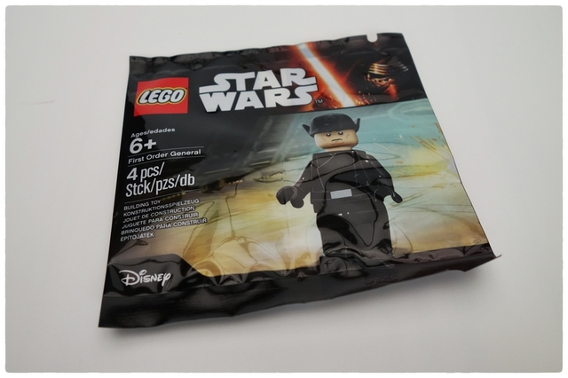
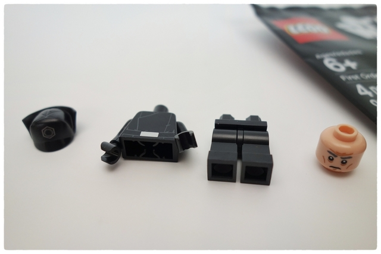
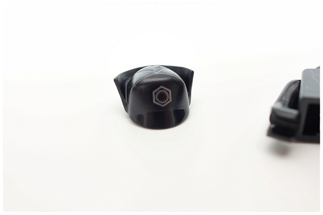
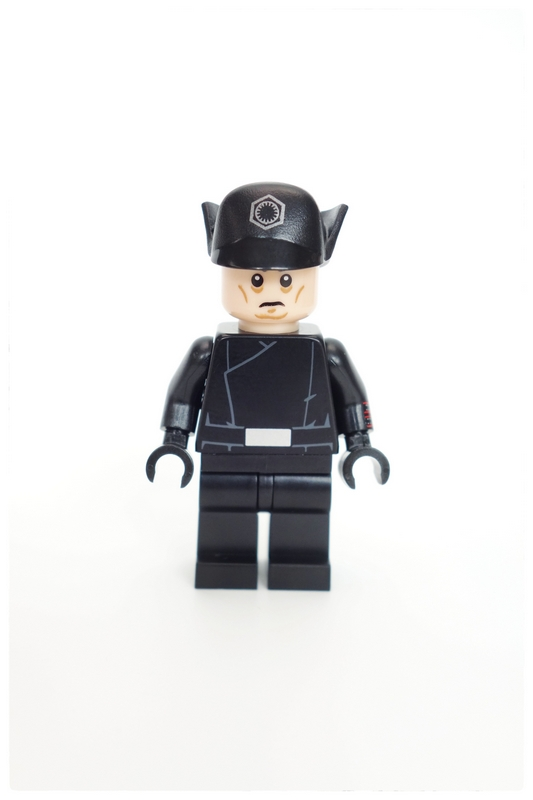
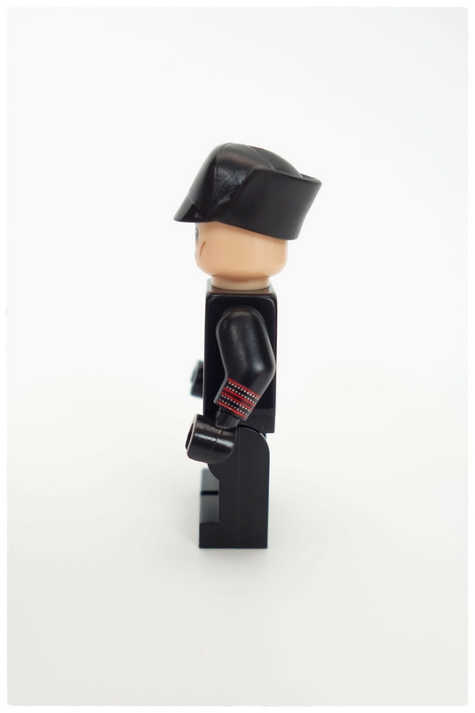
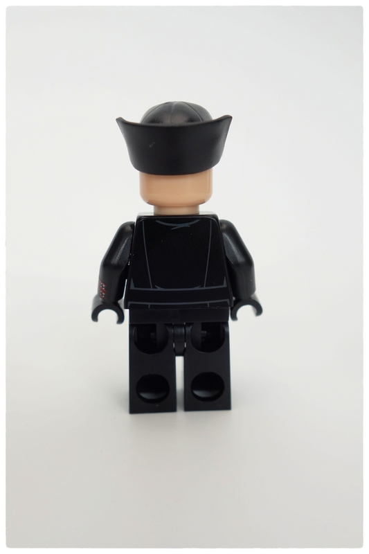

Complétons la [revue du Polybag 30602](/articles/revue-polybag-30602-first-order-stormtrooper-star-wars/), en nous attaquant maintenant à celui qui était proposé de manière alternative dans certains stores lors de l’évènement "May the 4th 2016", le First Order General.

Toujours dans l’univers de l’épisode 7, ce polybag, offert à partir de 55€ d’achat, ne dispose pas de numéro de set. Le plastique utilisé est d’ailleurs différent de celui utilisé pour le polybag du First Order Stormtrooper.  
Ce polybag a également été disponible à la vente dans certains stores allemands au prix de 3,99€.

Habillage identique, avec le bandeau Kylo Ren, le logo LEGO® et le logo Star Wars. Petite mise en scène visuelle. Rien de nouveau sous le soleil...

A l’intérieur, 4 pièces. Pas un accessoire, pas un blaster, c’est un peu mesquin je trouve. Une paire de jumelles aurait complété le personnage.

Déjà présente dans le set 75104 - Kylo Ren’s Command Shuttle, où elle habille la figurine du général Hux, la casquette présente une jolie sérigraphie de l’emblème du First Order.

La sérigraphie du torse est sobre, mais elle est fidèle à l’uniforme porté dans le film. Simple et efficace. La tête est bien détaillée, le visage inquiet du général est bien retranscrit avec ses rides sur le front au-dessus de ses gros sourcils gris (une tête idéale pour une fig custom de François Fillon ;-) ) Les cernes sous les yeux accentuent cet aspect inquiet et fatigué.

Que ce soit le torse ou la tête, nous avons droit ici à deux pièces inédites qui ne se trouvent que dans ce polybag.

Jolie petite sérigraphie sur le bras gauche, les galons du général. Là encore il s’agit d’une pièce inédite, puisque la minifig du général Hux est habillé d’un manteau, et qu’on ne voit pas la manche de sa vareuse. C’est fin, c’est propre.

Minimum syndical sur le dos, quelques plis et la continuité de la ceinture.

**Conclusion.** Avec sa tête, son torse et son bras, inédits, nous avons affaire ici à une véritable figurine exclusive, qui aurait mérité également le logo "LEGO Star Wars - Exclusive for 2016". Au vu des prix pratiqués sur le marché secondaire, on peut légitimement penser qu’il a été produit plus d’exemplaires de ce polybag que du 30602, vous n’aurez aucune peine à le trouver à un prix correct, si vous ne l’avez pas encore.
