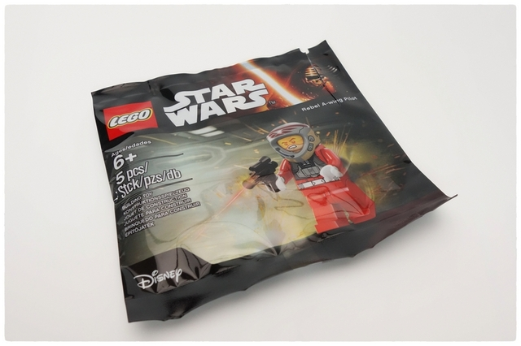
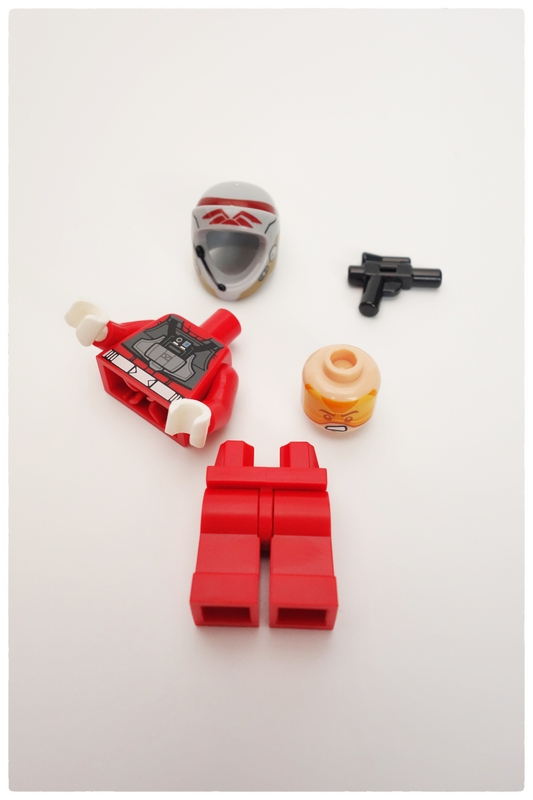
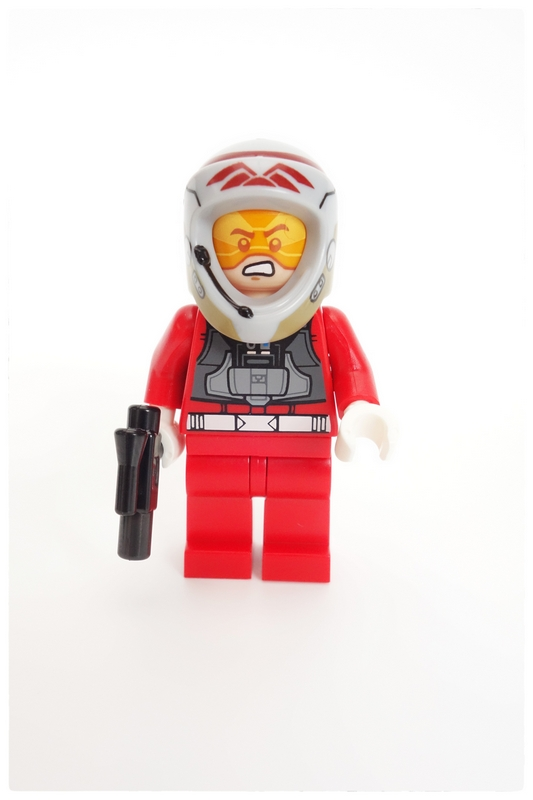
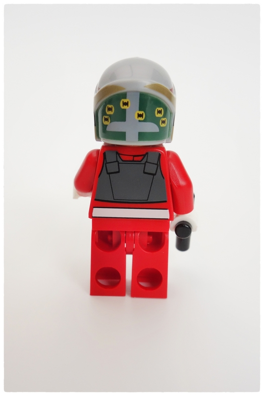
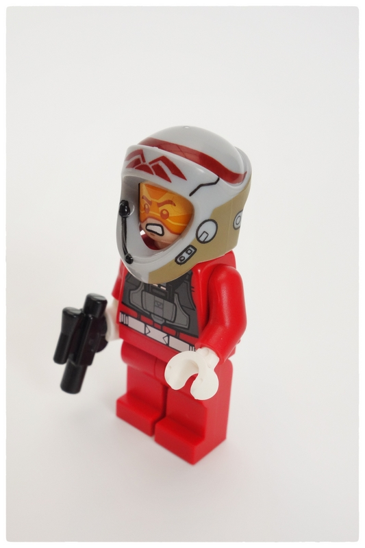
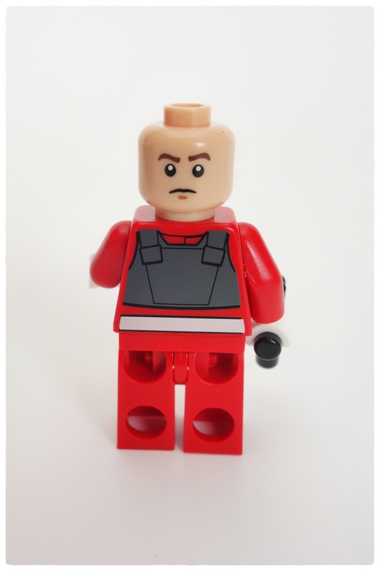

Autre polybag 2016 de la gamme Star Wars, ce Rebel A-Wing Pilot tiré de la série animée "Star Wars Rebels".

Le classique habillage Star Wars avec le bandeau Kylo Ren.  
Le visuel nous présente le pilote en action, faisant feu de son blaster, dans ce que l’arrière-plan laisse suggérer comme étant un hangar.

Cinq pièces, pas une de plus. C’est la norme dans ce type de sachets.

La tampographie est splendide, j’aime tout particulièrement le soin apporté aux reflets sur la visière, imprimés directement sur la tête en flesh. L’expression du visage est très bien rendue, avec des sourcils asymétriques, et la petite ride au niveau du menton, qui donne un peu plus de relief à ce visage.  
La combinaison de pilote est elle aussi très réussie, avec de beaux détails sur la ceinture et sur le plastron.  
Le casque n’est pas en reste avec un très beau visuel également.

Le dos du torse est imprimé également. Le visuel est plus simple, mais l’impression est fine et ne bave pas.  
Par contre, le casque continue de m’impressionner, avec des petits visuels de Tie Fighter, un pour chaque abattu par ce pilote.  
Par contre, petit décalage d’impression sur la bande ocre de droite, qui n’est pas au même niveau que celle de gauche. Dommage...

Une vue de biais, pour se rendre compte du travail effectué sur le casque, avec entre autre l’impression du micro sur l’épaisseur du casque.

Et nous avons droit à un visage alternatif, sans la visière.

**Conclusion.** Très beau travail sur cette minifig exclusive, puisque aucun des éléments qui la composent (mis à part les jambes en rouge) ne se retrouve utilisé pour un autre personnage.  
Un seul petit regret, un petit visuel sur les jambes (poche, sangle...) aurait donné à cette fig un caractère encore plus exclusif.
