Profitant d’une offre réservée aux exposants de Fana’briques dans le magasin KingJouet de l’exposition, j’ai fait l’acquisition du nouveau train passager, et uniquement lui. Il faut dire qu’avec une disponibilité avant l’heure, ils sont vite partis...

**–** Référence : 60197  
**–** Nom : Le train de passagers télécommandé  
**–** Année : 2018  
**–** Nombre de pièces : 677  
**–** Prix : 139,99€  
**–** Fonctionne à piles (10 piles AAA 1,5V)

## La boite

[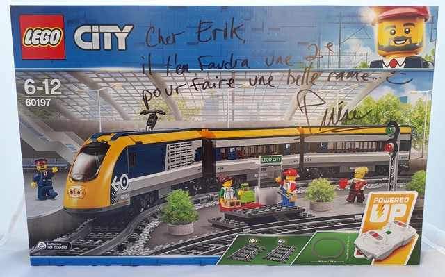](https://www.freelug.org/IMG/jpg/60197_01.jpg)

Comme pour toute boite LEGO, la face présente le contenu. La présentation avec deux voies pourrait laisser croire au premier coup d’oeil à la présence d’un grand circuit, mais l’inventaire en bas à droite rappelle le contenu exact et la taille de la boucle, un cercle étendu de 4 rails droits.

Nouveau logo pour nouveau système électrique, _Powered Up_ remplace le _Power Function_. A l’arrière de la boite, il est bien précisé que ce nouveau système n’est pas compatible avec le précédent.

[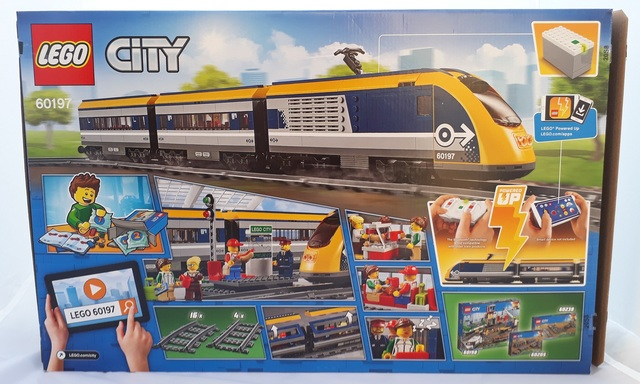](https://www.freelug.org/IMG/jpg/60197_02.jpg)

L’arrière illustre les fonctionnalités du jouet.

Ce set est a été réalisé par le designer Pierre Normandin, et j’ai profité de sa présence amicale sur l’exposition Fana’briques 2018 pour faire signer la boite. Son petit message rappellera bien qu’il faut deux boites pour obtenir une rame complète.

## Le contenu

[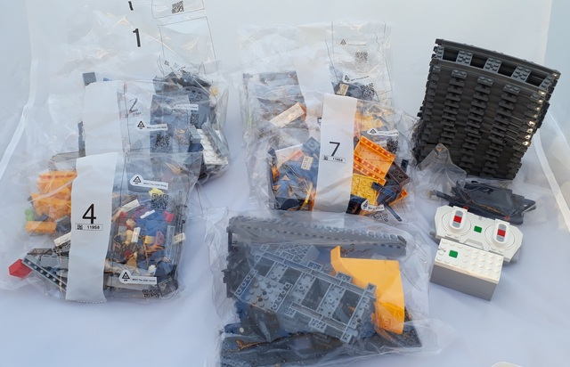](https://www.freelug.org/IMG/jpg/60197_03.jpg)

Le contenu arrive en 7 sachets numérotés et un non numéroté, un ensemble de 5 notices, une planche d’autocollants et les rails courbes.

[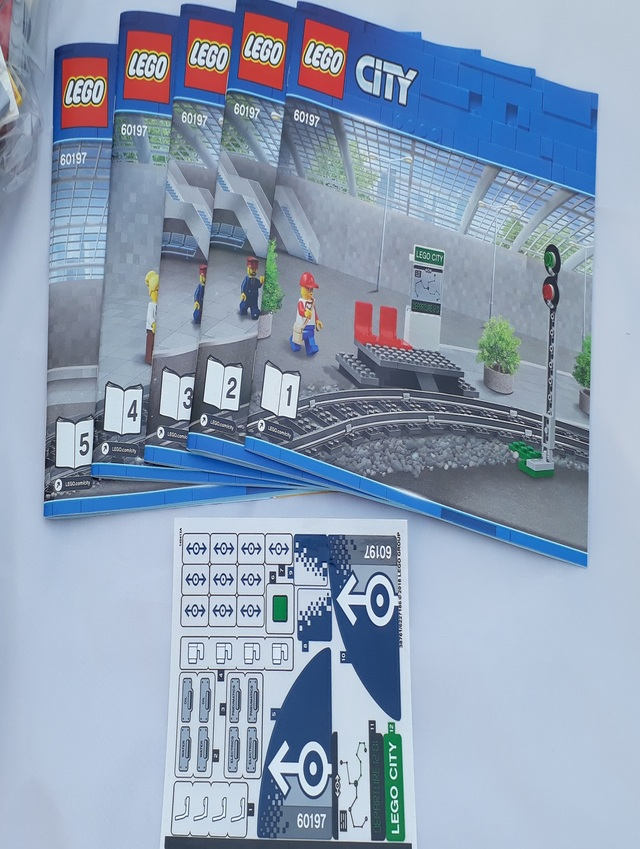](https://www.freelug.org/IMG/jpg/60197_05.jpg)

Les nouveaux éléments Powered Up, à savoir le moteur, le boitier de piles/récepteur et la télécommande arrivent également en vrac dans la boite. Dans les trains PFS, ces composants étaient emballés dans un petit carton...

[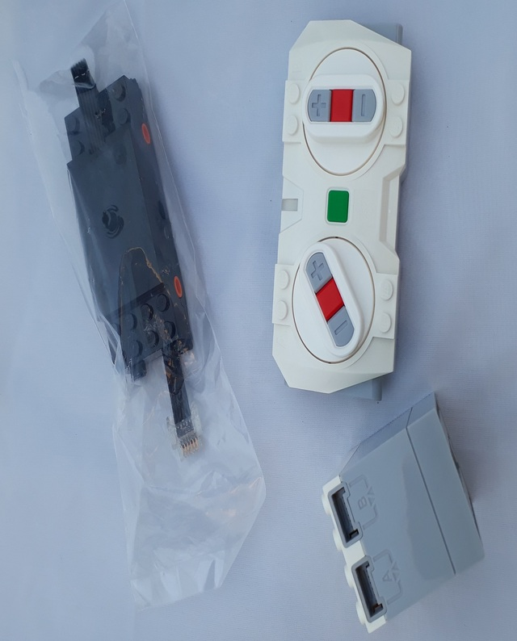](https://www.freelug.org/IMG/jpg/60197_04.jpg)

## Sachet 1 : les accessoires

Le premier sachet permet d’assembler le feu de signalisation et le quai. Il est accompagné d’une figurine passager.

[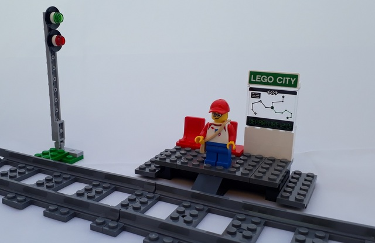](https://www.freelug.org/IMG/jpg/60197_06.jpg)

Clin d’oeil ou simple coïncidence, l’heure de départ est fixée à 12:01, soit la même heure indiquée sur la [tile 3069px5](https://www.bricklink.com/v2/catalog/catalogitem.page?id=3565#T=C) qui existe depuis 1988 !

## Sachets 2 et 3 : la motrice

Les 2 sachets suivants permettent d’assembler la motrice.

[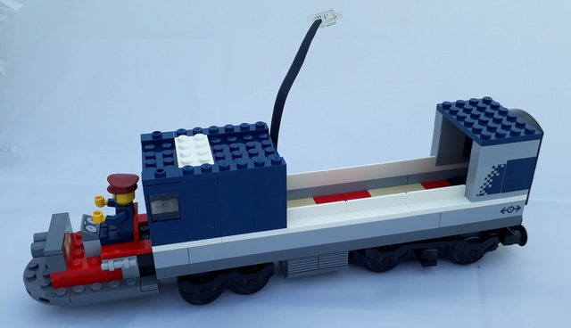](https://www.freelug.org/IMG/jpg/60197_08.jpg)

Nouvel élément, le nez en métapièce donne l’allure générale. Petit conseil au moment de poser les autocollants : ne suivez pas la notice. Attendez d’avoir posé le nez sur l’ensemble pour coller les 2 gros autocollants afin d’aligner correctement les bandes. J’ai fait l’erreur sur un des côtés...

[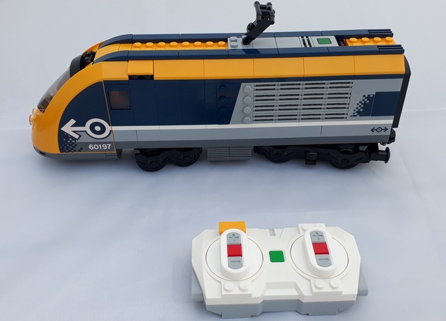](https://www.freelug.org/IMG/jpg/60197_09.jpg)

La motrice est accompagnée du conducteur. Notez le pantographe, nouvelle pièce, ainsi que la tile 1x2 qui vient se poser sur la télécommande, pour visualiser facilement à quel train est elle est associée.

Si la gamme Powered Up ne propose pas encore de lumières, le montage laisse supposer qu’il est prévu à terme d’être adapté à leur présence.

## Sachets 4 et 5 : la voiture-bar

[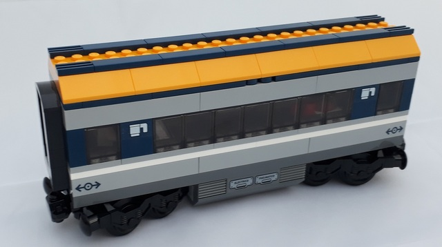](https://www.freelug.org/IMG/jpg/60197_11.jpg)

Les sachets 4 et 5 permettent d’assembler la voiture-bar. La serveuse proposera aux voyageurs café, muffins, croissant ou hot-dog. Des petites tablettes permettent aux voyageurs de consommer, debout, en regardant défiler le paysage.

[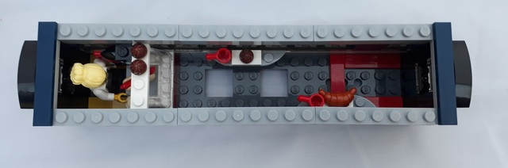](https://www.freelug.org/IMG/jpg/60197_10.jpg)

## Sachets 6 et 7 : la voiture passager

Enfin, les deux derniers sachets permettent d’assembler la voiture passager qui comprend 4 places assises pour une voyageuse.

[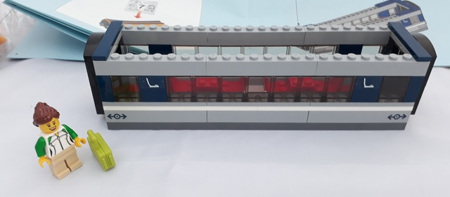](https://www.freelug.org/IMG/jpg/60197_12.jpg)

Le montage du toit est identique à celui de la voiture-bar. Avec un peu de logique, vous pourrez le construire sans vous préoccuper de la notice.

[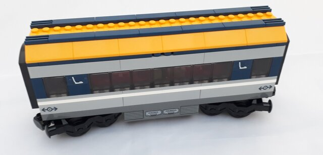](https://www.freelug.org/IMG/jpg/60197_13.jpg)

## La rame complète

L’ensemble nous apporte donc une demi-rame qu’il faudra compléter par une seconde boite. On regrettera que la planche d’autocollants ne propose pas quelques extras pour remplacer la seconde voiture-bar par une voiture passager par exemple.

[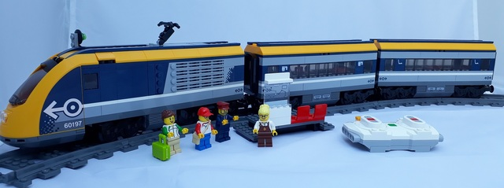](https://www.freelug.org/IMG/jpg/60197_14.jpg)

Le montage se fait sans difficulté particulière. Le train s’inscrit parfaitement dans la lignée des trains passagers dans son aménagement.

A la question, ce train s’inspire-t-il d’un vrai train, je pencherais volontiers, pour le choix des couleurs et du nez, vers les nouvelles rames Eurostar sur base de Siemens Velaro.

[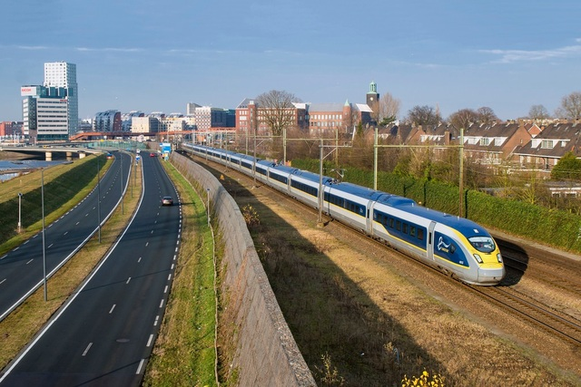](https://www.freelug.org/IMG/jpg/siemens_velaro.jpg)

Autre nouvelle pièce du contenu, la valise à roulette de la passagère. C’est en fait une pièce provenant de la gamme Friends ([voir la boite 41344](https://brickset.com/sets/41344-1/Andrea-s-Accessories-Store). Ce sont les designers Friends qui ont proposé à Pierre si cette valise pouvait l’intéresser.

Il reste quelques extra pièces à l’issue de la construction, mais plus aucune en double, il semblerait que ce soit la nouvelle politique de LEGO.

[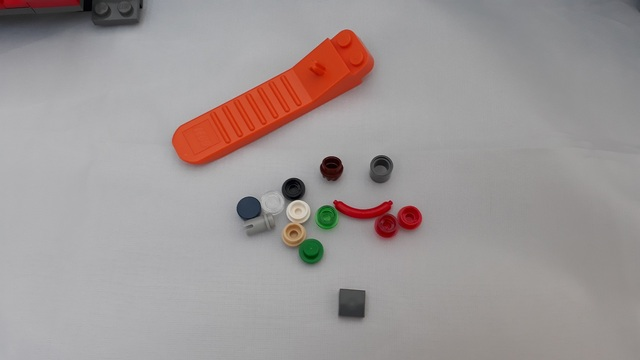](https://www.freelug.org/IMG/jpg/60197_15.jpg)

## Le système Powered Up

Ne nous le cachons pas, la grande nouveauté de cette boite, c’est le système Powered Up. Exit le système infra-rouge du Power Functions, bienvenue au bluetooth.

Pour l’instant, peu de composants sont disponibles et peu d’informations a été diffusé par LEGO concernant ce nouveau système, si ce n’est qu’il s’agit de la même connectique que LEGO Boost.

Le récepteur bluetooth est intégré directement au boitier de piles, ce qui permet d’avoir un système plutôt compact. Deux ports sont disponibles, A et B.

La télécommande permet de piloter les deux ports A et B. Chaque bloc de commande (+, - et bouton rouge) peut tourner, sans effet. Cela permet simplement d’avoir une disposition droite-gauche plutôt que haut-bas.

L’appairage entre la télécommande et le récepteur se fait par un appui long sur les 2 composants.

Le train possède 10 niveaux de vitesse, dans chaque sens de marche.

[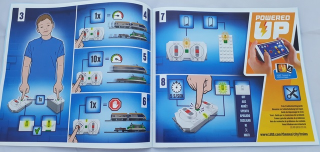](https://www.freelug.org/IMG/jpg/60197_07.jpg)

Qui dit bluetooth dit connectivité avec les périphériques actuels tels que smartphone ou tablette. LEGO met donc une application Powered Up à disposition, qui permet de piloter directement depuis son téléphone le train. Quelques sons, joués par le téléphone, ajoutent un peu de valeur.

Erreur d’exécution plugins/auto/sarkaspipr/v5.0.1/modeles/album.html

Pour plus d’observations et discussions, [rendez-vous sur le forum FreeLUG sur le topic dédié au Powered Up](https://forum.freelug.org/viewtopic.php?f=10&t=241).

## Et pour la fin...

Lors du rangement à la fin de l’exposition, en quête de quelques cartons LEGO pour ranger les achats, je trouve une boite vide dans une benne. Prenant au mot Pierre, je lui soumets cette seconde boite pour signature. Non sans humour, voici son petit mot ;-)

[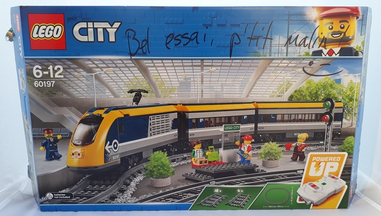](https://www.freelug.org/IMG/jpg/60197_16.jpg)
