Ce set exclusif, non disponible à la vente, est offert par LEGO lors des évènements "Grand Opening" de ses LEGO Stores pour un certain montant d’achat (variable selon les pays). Sorti en 2014, il remplace le set 3300003 qui date lui de 2012. J’avais réussi à obtenir ce dernier lors de l’ouverture du store de Lille, et j’ai eu la surprise de me faire offrir cette nouvelle version.

Le set contient 413 pièces (au lieu de 280 pour le précédent) et une minifig.

Les sets exclusifs offerts par la marque danoise à ses clients sont souvent décriés par les AFOLs, qui reprochent systématiquement d’être obligés de dépenser beaucoup d’argent en sets, pour se voir offrir ces exclusivités.  
Pour info, le set 3300003 était ajouté au sac du client qui avait dépensé 30€, alors qu’il faut maintenant dépenser 125€ dans le store pour obtenir le 40145. Soit une dépense "obligatoire" quatre fois plus importante.  
Alors, ces 480 pièces valent-elles que l’on arrive aux aurores pour faire la file avant l’ouverture du magasin, et espérer être dans les 300 chanceux qui pourront repartir avec ? Ouvrons cette boîte pour une autopsie de son contenu. C’est parti…

[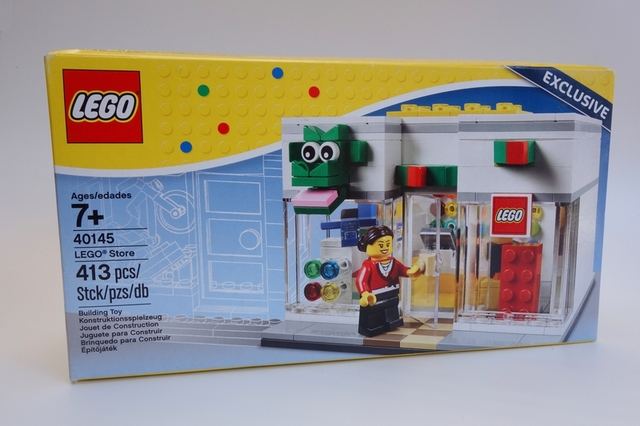](https://www.freelug.org/IMG/jpg/40145_Lego_Store_001.jpg)

La boîte, justement. Elle est de très belle dimension, et pèse son poids. Le visuel est sobre, un logo LEGO dans le coin supérieur gauche, un bandeau jaune avec des tenons en partie supérieure, et une accroche avec le mot "exclusive" qui barre le coin supérieur droit. Nous retrouverons cette accroche sur deux autres faces de l’emballage "exclusif" et "exclusivo".  
Le visuel du modèle construit est bien mis en valeur. La façade dessinée d’un magasin de style Creator continue la perspective. Une manière d’indiquer que ce magasin est compatible avec les bâtiments de cette gamme ?

[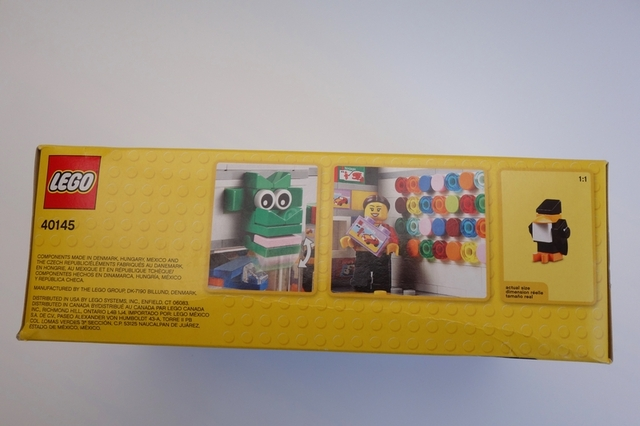](https://www.freelug.org/IMG/jpg/40145_Lego_Store_002.jpg)

[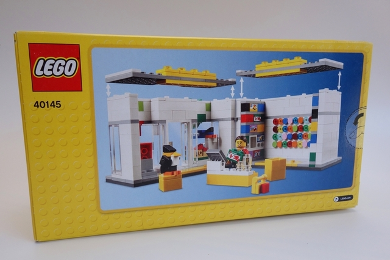](https://www.freelug.org/IMG/jpg/40145_Lego_Store_003.jpg)

La tranche nous propose deux détails de la construction et le classique objet à l’échelle 1:1. La face arrière nous propose, quant à elle, une vue éclatée du modèle, qui promet un peu de jouabilité.

[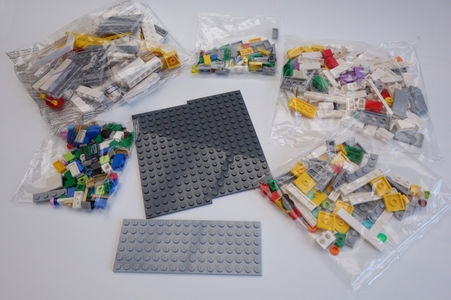](https://www.freelug.org/IMG/jpg/40145_Lego_Store_004.jpg)

[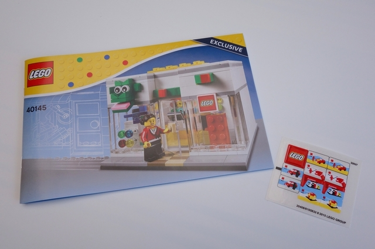](https://www.freelug.org/IMG/jpg/40145_Lego_Store_005.jpg)

Une fois ouverte, les entrailles de la bête contiennent 5 sachets non numérotés, 3 plaques, 1 notice de montage de 47 étapes, et une petite planche de stickers. Certaines des étapes sont divisées en sous-étapes, ce qui en fait au final un peu plus que 47.

[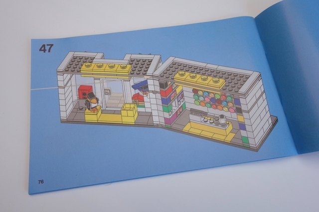](https://www.freelug.org/IMG/jpg/40145_Lego_Store_007.jpg)

Déballons nos sachets, faisons un joli tas de pièces et commençons à farfouiller là-dedans pour trouver les pièces qui vont être nécessaires à chaque étape. Il m’arrive très souvent d’ouvrir tous les sachets en même temps. Certes, la construction prend plus de temps, mais j’aime fouiller dans les tas de pièces, ça fait partie du plaisir LEGO pour moi. Je regrette un peu les anciennes notices qu’il fallait bien observer pour deviner quelles nouvelles pièces avaient été ajoutées à l’étape précédente.

[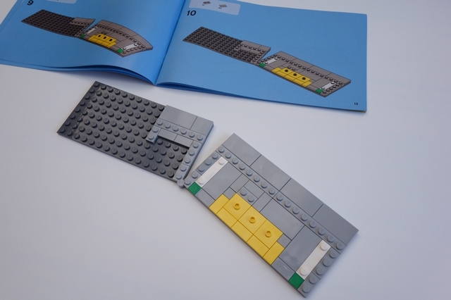](https://www.freelug.org/IMG/jpg/40145_Lego_Store_008.jpg)

Au bout de la 10ème étape, nous avons deviné que la construction finale aura une taille de 16x16 et qu’il sera possible de l’ouvrir en 2.

[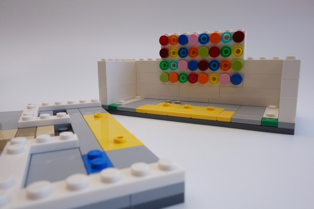](https://www.freelug.org/IMG/jpg/40145_Lego_Store_009.jpg)

Etape 20. Le mur du fond et le Pick a Brick wall sont en place.

[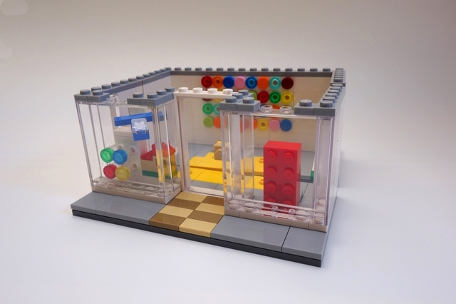](https://www.freelug.org/IMG/jpg/40145_Lego_Store_010.jpg)

[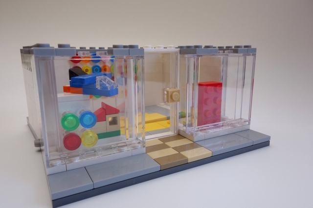](https://www.freelug.org/IMG/jpg/40145_Lego_Store_011.jpg)

Etape 30. Les vitrines sont montées, et l’aménagement intérieur est commencé. La brique rouge géante n’a pas été oubliée, et figure en bonne place. De l’autre côté, les nouveaux modèles Creator (une maison et un avion) sont bien mis en valeur.

[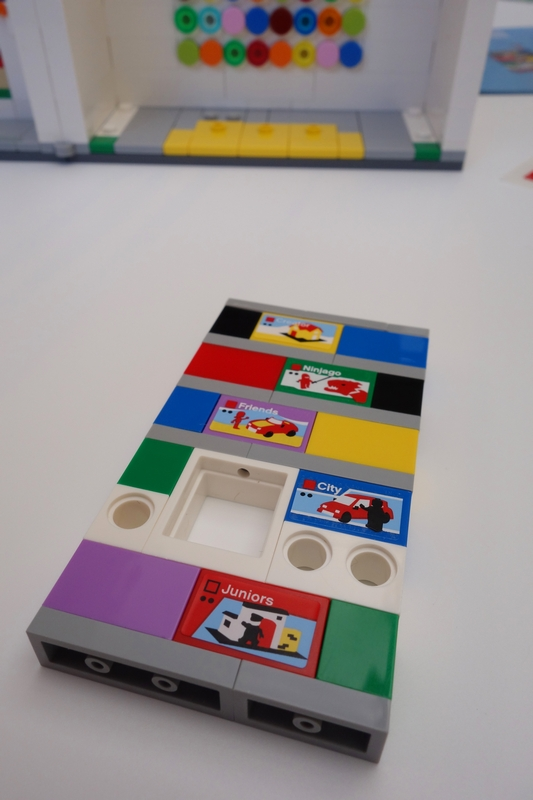](https://www.freelug.org/IMG/jpg/40145_Lego_Store_013.jpg)

[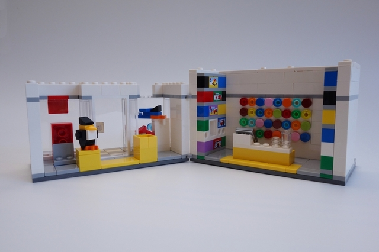](https://www.freelug.org/IMG/jpg/40145_Lego_Store_015.jpg)

Les rayonnages se remplissent de boîtes, c’est ici que les stickers sont principalement utilisés. Cinq gammes sont présentées ici : Creator (sur fond jaune), Ninjago (sur fond vert), City (sur fond bleu), Friends (sur fond pourpre), et Junior (sur fond rouge). Deux murs identiques se font face au fond de la boutique.

[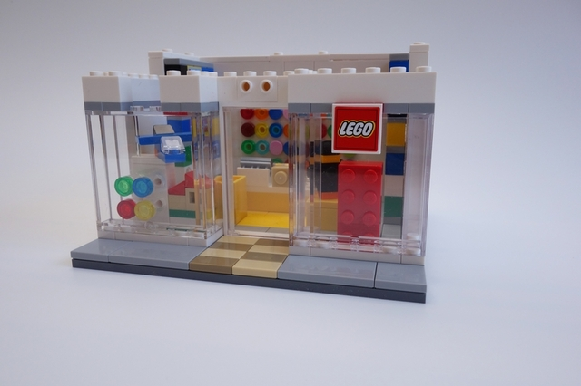](https://www.freelug.org/IMG/jpg/40145_Lego_Store_016.jpg)

A l’étape 40, l’aménagement intérieur est terminé, il ne reste que la décoration de la façade. Quel dommage que l’enseigne LEGO soit un sticker sur une tile 2x2 blanche.

[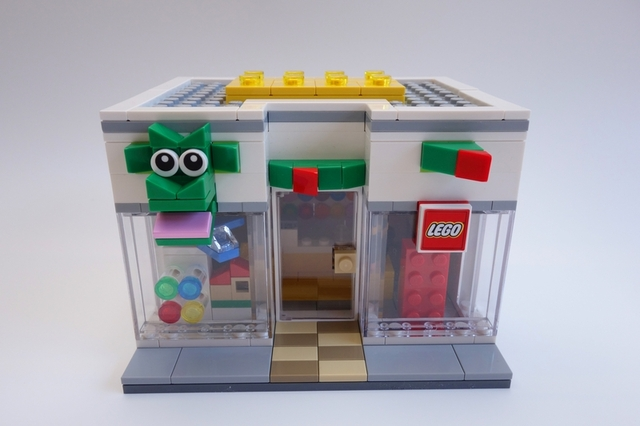](https://www.freelug.org/IMG/jpg/40145_Lego_Store_017.jpg)

[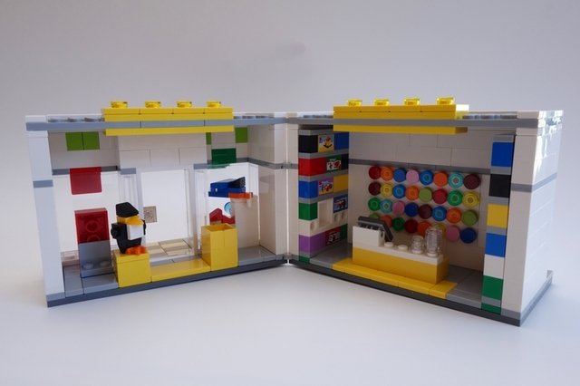](https://www.freelug.org/IMG/jpg/40145_Lego_Store_018.jpg)

Le dragon, dont la gueule est articulée, orne la façade, le magasin peut ouvrir et s’apprête à accueillir ses premiers clients.

La minifig représente une femme, qui porte un sac LEGO brickbuild. J’ai bien aimé la tile 1x1 rouge pour faire le logo. Dommage là encore que LEGO n’ait pas pourvu ce set de la minifig de vendeur du polybag 5001622, l’ensemble aurait été vraiment complet.

[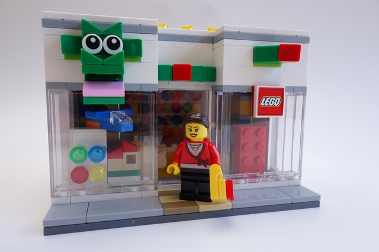](https://www.freelug.org/IMG/jpg/40145_Lego_Store_019.jpg)

**Conclusion :** si il ne présente aucune technique de construction particulière, on reste dans de l’empilage de briques, ce set constitue une agréable surprise au final, et le client qui aura eu cette boîte pensera, pour une fois, que les exécutifs de Billund se sont enfin décidés à faire un vrai cadeau.  
L’inventaire n’est pas compliqué et ne comporte aucune pièce difficile à trouver, au pire, il vous faudra faire vos propres stickers. Par contre, si vous êtes un collectionneur acharné et qu’il vous faut absolument la boîte, il ne vous reste plus qu’à attendre l’ouverture du prochain LEGO store près de chez vous, ou de jeter un œil sur les sites de petites annonces.

[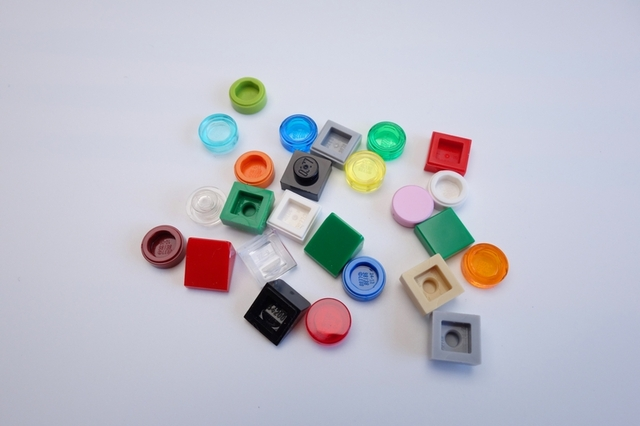](https://www.freelug.org/IMG/jpg/40145_Lego_Store_022.jpg)

Une série d’extra-parts qui viendront compléter un vrac.

**Bonus spécial :**

[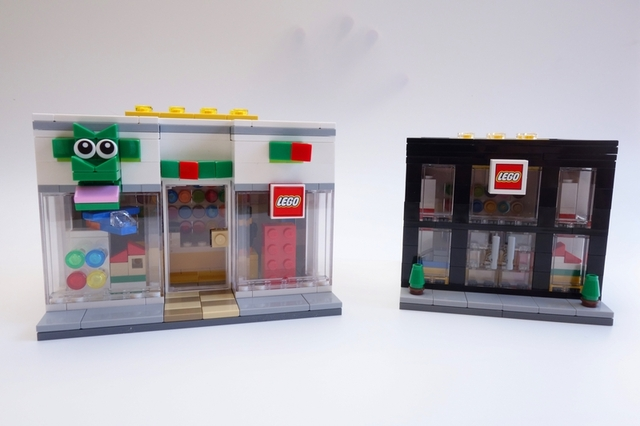](https://www.freelug.org/IMG/jpg/40145_Lego_Store_021.jpg)

Une comparaison visuelle des deux LEGO stores. Il n’y a pas photo (enfin si...), ce second store s’intégrera facilement au milieu d’une ville constituée de bâtiments Creator.
