A l’occasion de l’évènement May the Fourth, la société LEGO a offert la possibilité à quelques clients fidèles, choisis dans les LUGs ou directement par les personnels des stores, d’obtenir un set exclusif Star Wars, produit à 3500 exemplaires.

Ce set reproduit, à une échelle micro-micro-scale, l’échappée du Faucon Millenium des entrailles d’une bestiole de l’espace, tapie au fin fond d’un astéroïde.

Pour que cette boîte se retrouve au fond d’un sac en plastique jaune, orné du logo rouge de notre marque danoise préférée, il fallait donc faire partie des 28 chanceux par store à avoir reçu une invitation à une ouverture spéciale des magasins, le samedi 30 avril 2016, de 9h à 10h.

Autre détail, qui a son importance, il fallait également dépenser 125€ en sets de la licence Star Wars. Ben oui, cadeau, mais pas trop quand même…

Il n’a pas fallu longtemps samedi après-midi pour que les premières boîtes fassent leur apparition sur les marchés parallèles, avec des mises à prix pouvant dépasser les 250€. Certains spécul… heuu… grands fans de sets LEGO Star Wars ayant certainement vu là l’opportunité de rembourser l’achat d’une ou deux boîtes, voire de faire un bénéfice substantiel.

Alors ? Ce set exclusif de 161 pièces vaut-il cette somme ? Que vaut-il tout court ? Voici les questions auxquelles cette revue, une exclusivité FreeLUG, va tenter de répondre.

Commençons par l’emballage.

[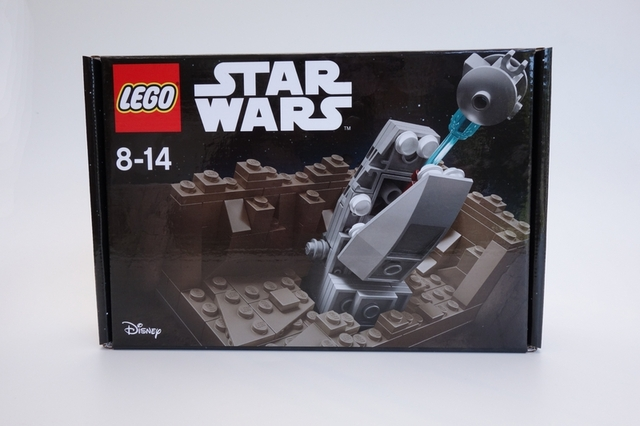](https://www.freelug.org/IMG/jpg/Space_Worm_Star_Wars_001.jpg)

Sur la face, un visuel du set monté sur un fond noir, le bandeau Kylo Ren présent sur les boites de la gamme actuellement est absent. Seuls les logos LEGO, Star Wars et Disney, ainsi que la tranche d’âge à laquelle s’adresse ce set accompagnent la photo, 8-14. Pas de nom inscrit sur la boîte.  
C’est sobre et efficace, comme les sets architectures dont s’inspire cet emballage.

[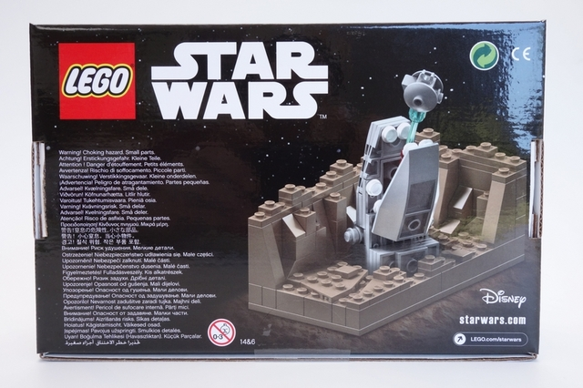](https://www.freelug.org/IMG/jpg/Space_Worm_Star_Wars_002.jpg)

Au dos, le set vu sous un angle légèrement différent, et la mention "Attention ! Risque d’étouffement, présence de petites pièces", inscrite en 33 langues.  
Aucun autre élément graphique ne vient compléter cette face arrière.

[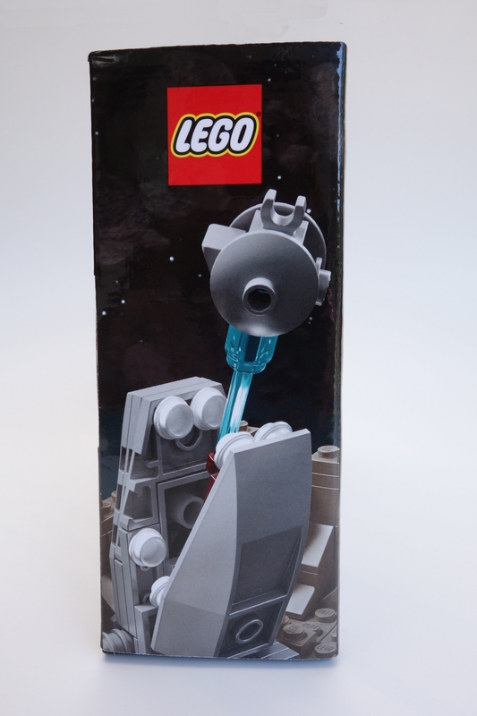](https://www.freelug.org/IMG/jpg/Space_Worm_Star_Wars_004.jpg)

[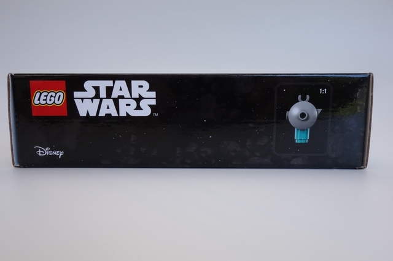](https://www.freelug.org/IMG/jpg/Space_Worm_Star_Wars_003.jpg)

Sur une tranche, un détail du set, avec un zoom sur le micro-riquiqui Millenium Falcon (MF) qui échappe de justesse aux crocs acérés du space bug ! Et sur une autre tranche, un MF à l’échelle 1:1. Le "machin" est si petit que les designers ont laissé pour la photo la brique ronde 1x1 trans-light-blue qui figure l’énergie dégagée par les réacteurs.

[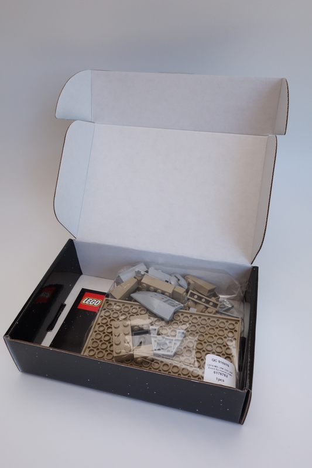](https://www.freelug.org/IMG/jpg/Space_Worm_Star_Wars_005.jpg)

L’ouverture de la boîte se fait, comme les sets Architectures, par le dessus. Le carton est plus épais que les sets traditionnels, l’impression est belle, bref, qualitativement, ça en jette un peu.

Comme aimait à le dire la mère de Napoléon, maître d’un autre Empire célèbre : "Pourvou qué ça doure !"

[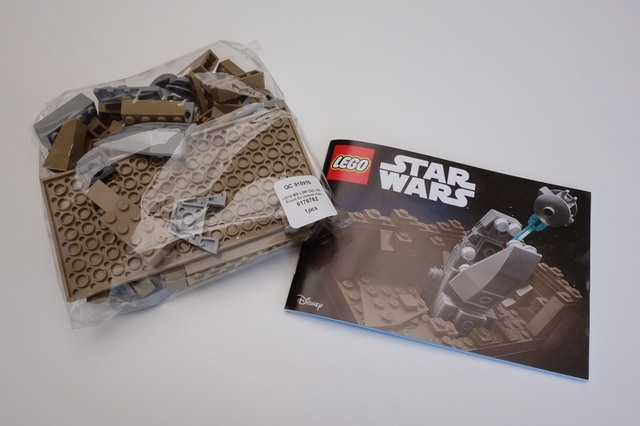](https://www.freelug.org/IMG/jpg/Space_Worm_Star_Wars_007.jpg)

À l’intérieur, un sachet bien rempli et une notice brochée. J’ai commencé à espérer que, dans la veine de la gamme Architecture, le livret contiendrait quelques pages sur la séquence représentée.  
Mes espoirs se sont arrêtés là…

Je me suis par contre demandé si le sachet, refermable grâce à une bande adhésive repositionnable, n’avait pas été rempli manuellement, au vu de la plate 8x16 dark tan qui supporte l’ensemble qui rentre pile-poil dans la largeur.

[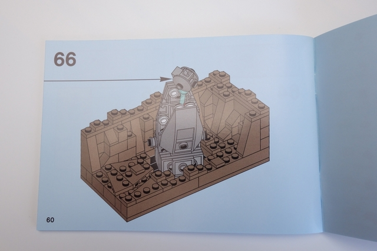](https://www.freelug.org/IMG/jpg/Space_Worm_Star_Wars_008.jpg)

[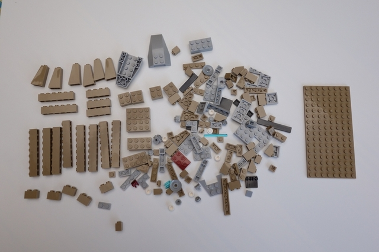](https://www.freelug.org/IMG/jpg/Space_Worm_Star_Wars_010.jpg)

Les designers de Billund ont quand même prévu 66 étapes, oui, oui, 66 étapes, pour assembler les 161 pièces de cette boîte.

Commençons…

[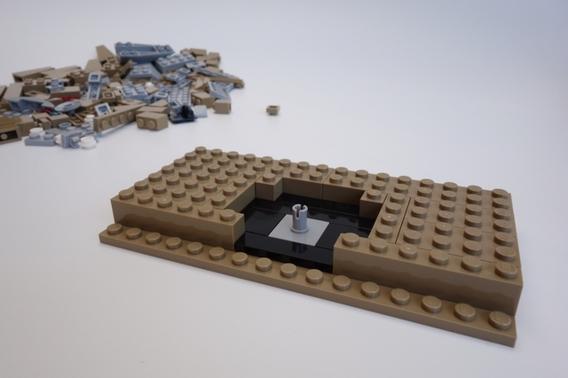](https://www.freelug.org/IMG/jpg/Space_Worm_Star_Wars_011.jpg)

À l’étape 10, la plate est presque recouverte d’une couche de dark tan, qui va représenter le sol de l’astéroïde et le gouffre duquel sort le monstre.

[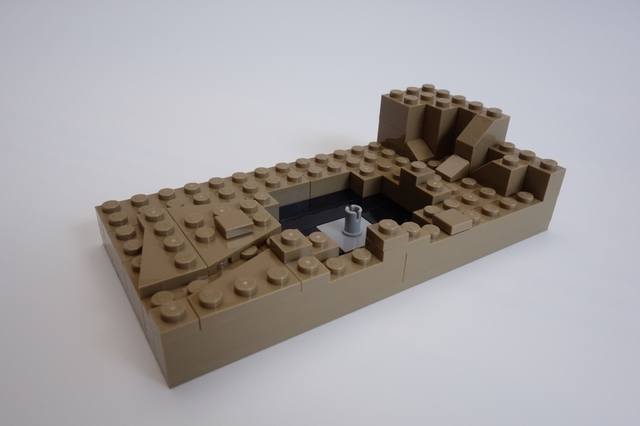](https://www.freelug.org/IMG/jpg/Space_Worm_Star_Wars_012.jpg)

Les 10 étapes suivantes permettent de donner un peu de relief au sol et de commencer à monter un peu de rocaille autour du gouffre.

[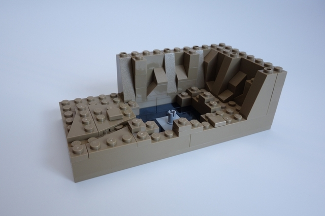](https://www.freelug.org/IMG/jpg/Space_Worm_Star_Wars_013.jpg)

Rocaille qui n’est toujours pas terminée à l’issue de l’étape 30. À ce rythme-là, on n’est pas prêt de prendre le goûter, surtout quand il faut une étape pour placer une brique 1x4.

[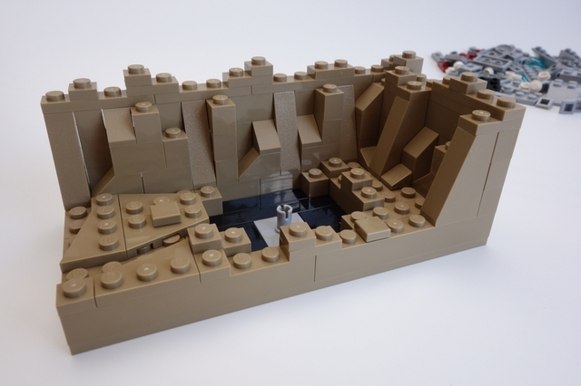](https://www.freelug.org/IMG/jpg/Space_Worm_Star_Wars_014.jpg)

Ouf ! Le sol de l’astéroïde est terminé, il aura fallu 40 étapes pour monter ça…  
N’oubliez pas que ce set s’adresse à des jeunes de 8 à 14 ans ;-)

[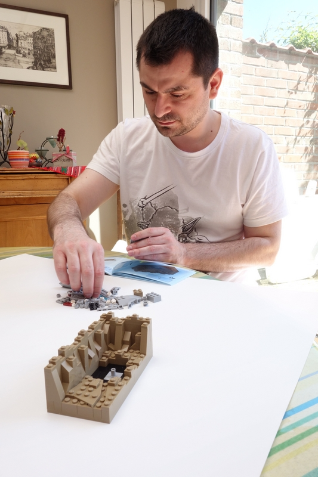](https://www.freelug.org/IMG/jpg/Space_Worm_Star_Wars_015.jpg)

Je passe la main à l’ami Mika, qui prend le relais pour la suite, la construction du bug de l’espace.

Comment ? On me souffle dans l’oreillette que Mika ne rentre pas dans la tranche d’âge. N’ayez crainte, je pense qu’il s’en sortira quand même.

[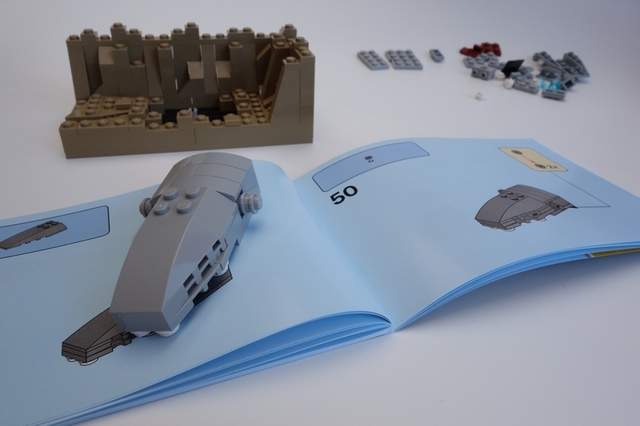](https://www.freelug.org/IMG/jpg/Space_Worm_Star_Wars_016.jpg)

La preuve en image, il est arrivé jusqu’à l’étape 50 sans se tromper. Jusqu’ici, tout va bien.

[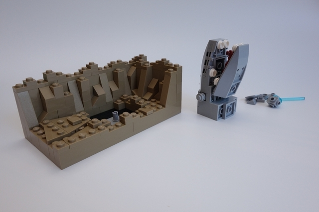](https://www.freelug.org/IMG/jpg/Space_Worm_Star_Wars_017.jpg)

À la fin de l’étape 60, le space bug est monté, il sera mis en place à l’étape 61.  
Le petit tas de pièces restant sur le côté servira à construire le tas de ferraille le plus rapide de la galaxie. Désolé pour ceux qui pensaient que c’étaient les extra parts.

[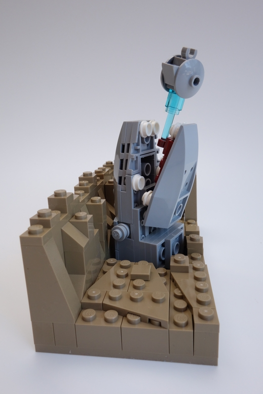](https://www.freelug.org/IMG/jpg/Space_Worm_Star_Wars_018.jpg)

Et voilà au final à quoi ressemble ce set terminé.  
Il y en a dans le fond qui parlent… Qui a dit "Pas grand-chose" ?

[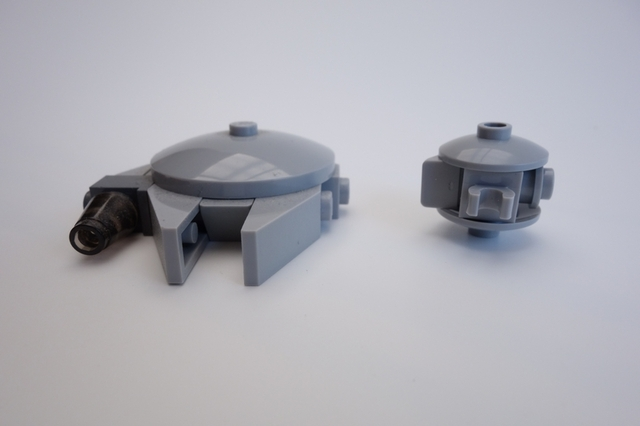](https://www.freelug.org/IMG/jpg/Space_Worm_Star_Wars_019.jpg)

[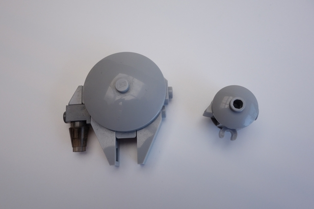](https://www.freelug.org/IMG/jpg/Space_Worm_Star_Wars_020.jpg)

En bonus, un petit comparatif entre le Millenium Falcon de ce set exclusif, et celui qui vient de perdre sa place de "plus petit MF" LEGO, qui était apparu dans un calendrier de l’avent.

Une image vaut mieux que mille mots… En tout cas ça permet de relativiser, et on arrêtera de se plaindre des micros sets inclus dans ces calendriers de fin d’année.

[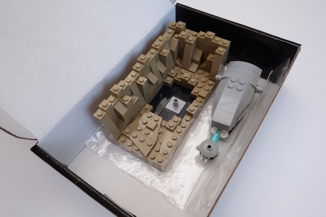](https://www.freelug.org/IMG/jpg/Space_Worm_Star_Wars_021.jpg)

Une fois démontée, la construction rentre parfaitement dans la boîte.

Pour conclure :  
Avant tout, je tiens à remercier Mika qui m’a proposé de venir chez moi pour qu’on monte ce set ensemble afin d’en faire la revue.

Au sujet du set en lui-même, il n’y a pas grand-chose à en dire, il ne propose aucune technique de construction particulière. La scène représentée est parfaitement reconnaissable.

À mon avis, la société LEGO aurait pu insister un peu plus sur le côté collector du set, en entourant la base de noir, à l’instar des sets architectures dont s’inspire son emballage.  
Une tile noire tout autour (avec une 1x8 sérigraphiée "The Empire Strikes Back" ?) aurait donné un aspect fini et un peu plus luxueux à cette construction.

L’inventaire des pièces ne présente aucune exclusivité, il ne sera donc vraiment pas difficile de le reconstituer pour ceux qui tiennent absolument à posséder ce set dans leur collection.

Par contre, si vous voulez aussi la boîte, il va falloir casser votre tirelire.

À noter, par ailleurs, que ce set ne propose aucune extra parts.
