La saison 5 de la gamme Microfighter Star Wars innove en proposant des doubles sets, comprenant chacun un vaisseau de la Résistance et un du 1er Ordre.  
Jetons un œil sur le premier des deux, la référence 75195.

-   Set N° : 75195 - Ski Speeder vs Walker du 1er Ordre
-   Nombre de pièces : 208
-   Prix : 19,99€
-   Rapport prix/pièce : 9,6 cents/pièce
-   Nombre de figs : 2

Dans la gamme Star Wars, les sets Microfighters sont les seuls à ne pas arborer de bandeau en haut de la boîte, avec d’un côté le logo LEGO® et celui de STAR WARS et de l’autre le portrait d’un personnage de la saga - en fait 3 pour cette vague 2018 avec Rey, Finn et Poe. Malgré le relooking de certaines gammes, l’emballage ne change pas, même si le volume de la boîte a largement doublé en passant de 1 à 2 vaisseaux à l’intérieur. En même temps, toute en longueur, le visuel aurait certainement été écrasé si un bandeau supplémentaire était venu s’ajouter.

[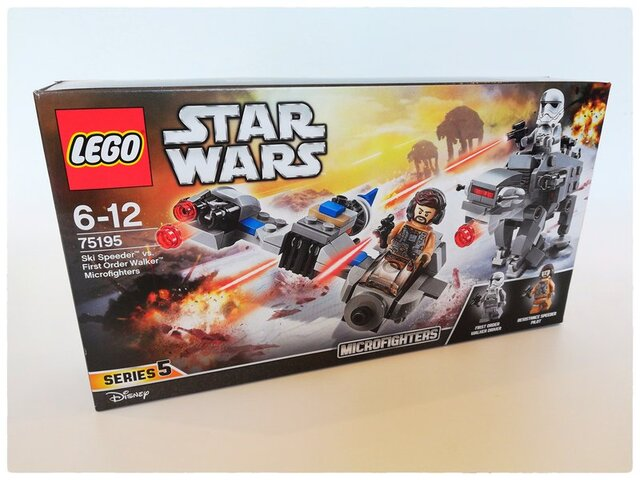](https://www.freelug.org/IMG/jpg/75195_Ski_Speeder_vs_First_Order_Walker_Microfighters_001.jpg)

La place gagnée permet ainsi de présenter les deux vaisseaux dans une mise en scène dynamique, avec un visuel de fond rappelant forcément la scène finale de l’épisode VIII, la bataille sur la planète de sel, Crait. Les vaisseaux semblent vraiment de belle taille.  
Les deux minifigs présentes dans le set sont également présentées sur la face avant.

[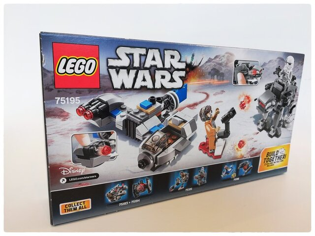](https://www.freelug.org/IMG/jpg/75195_Ski_Speeder_vs_First_Order_Walker_Microfighters_002.jpg)

La face arrière nous présente la jouabilité du set, avec les stud shooters intégrés sur chaque vaisseau, mais également un petit (qui a dit ridicule ?) élément de décor censé représenter la ligne de défense de la Résistance.  
En partie basse, les 4 sets de cette série 5 sont présentés.

A l’intérieur, deux notices et deux sachets.

[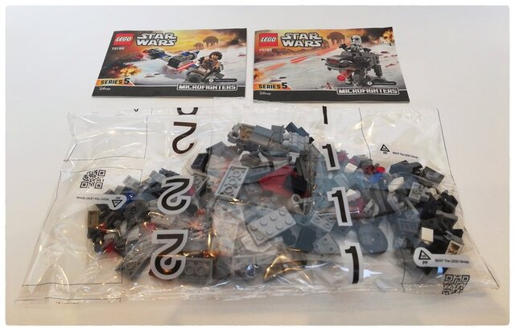](https://www.freelug.org/IMG/jpg/75195_Ski_Speeder_vs_First_Order_Walker_Microfighters_003.jpg)

Pour le coup, c’est plutôt bien pensé, ça permet à deux enfants de monter chacun son vaisseau.

[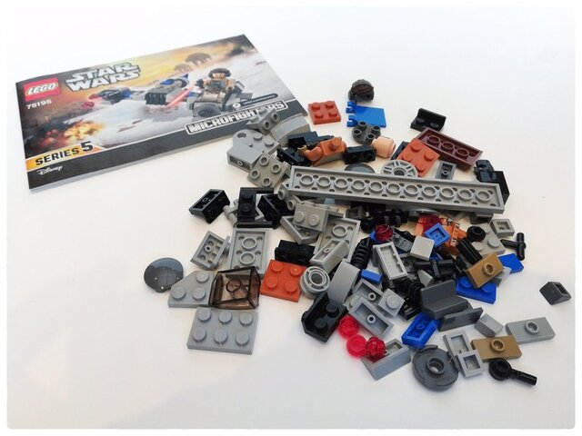](https://www.freelug.org/IMG/jpg/75195_Ski_Speeder_vs_First_Order_Walker_Microfighters_004.jpg)

Le contenu du sachet qui va permettre de monter le Ski Speeder

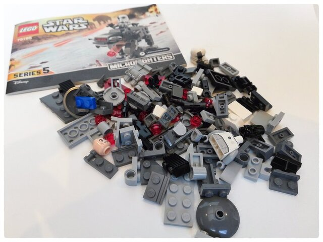

Et celui qui va permettre de construire le Walker du 1er Ordre

[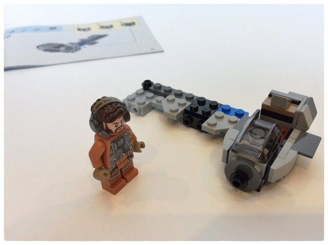](https://www.freelug.org/IMG/jpg/75195_Ski_Speeder_vs_First_Order_Walker_Microfighters_006.jpg)

[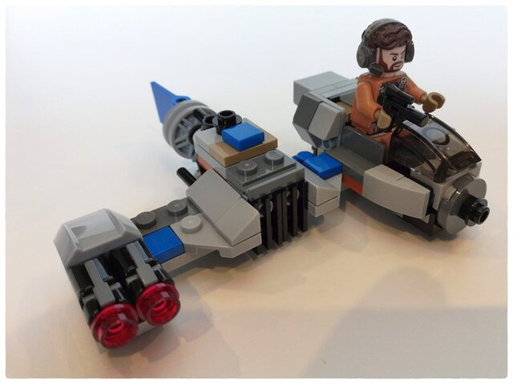](https://www.freelug.org/IMG/jpg/75195_Ski_Speeder_vs_First_Order_Walker_Microfighters_009.jpg)

[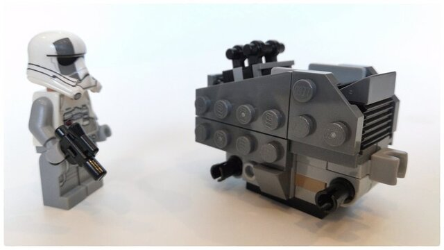](https://www.freelug.org/IMG/jpg/75195_Ski_Speeder_vs_First_Order_Walker_Microfighters_007.jpg)

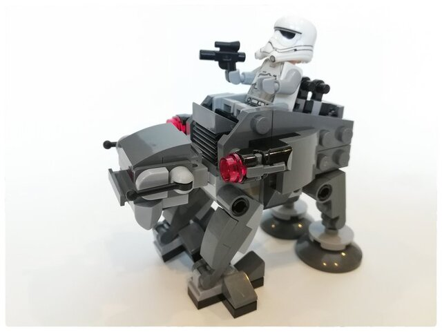

Les deux vaisseaux sont montés assez vite et ne présentent aucune difficulté.  
Par contre, les designers auraient pu faire un effort pour le représentation du ski qui permet l’équilibrage du speeder en vol, ici figuré par un simple bras de squelette noir. Ça fait cheap.

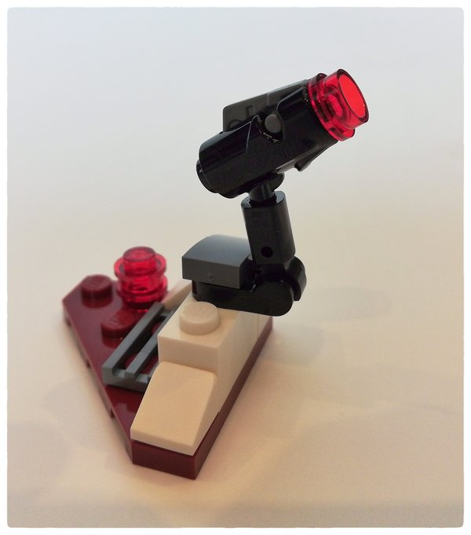

Le set est vendu 19,99€ soit un centime de plus que deux microfighters simples. Pour cette somme, et pour éviter les cris d’AFOLs hurlant que TLC en profite pour augmenter les prix sur leur dos, le directeur financier de la firme de Billund vous offre ce magnifique modèle de la ligne de défense de la Résistance sur Crait.

Passons aux minifigs, bien souvent le point fort des sets Star Wars.

_Le pilote de Speeder de la Résistance_

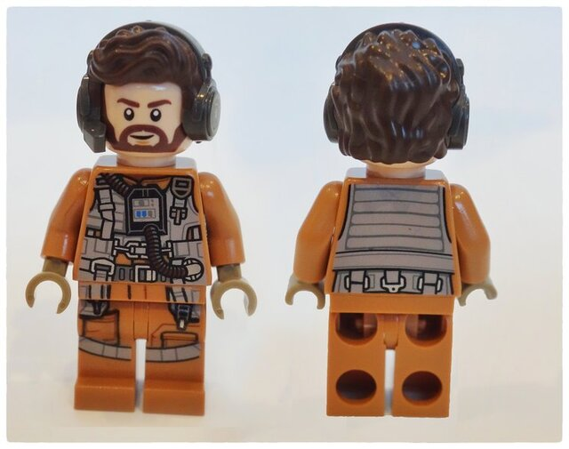

**Le pilote de Speeder de la Résistance**

Splendide sérigraphie très détaillée sur le torse, avec raccord sur la taille et les jambes pour la combinaison. Le torse est imprimé au verso également.  
Les cheveux du personnage, avec le casque par-dessus, bénéficient d’une très belle sculpture. Je trouve d’ailleurs que les moulages des casques sont de plus en plus détaillés sur de nombreuses minifigs, et je trouve ça vraiment chouette.  
Belle sérigraphie sur les écouteurs du casque et sur le dessus.

_Le pilote du walker Texas Rang.... du 1er Ordre_

[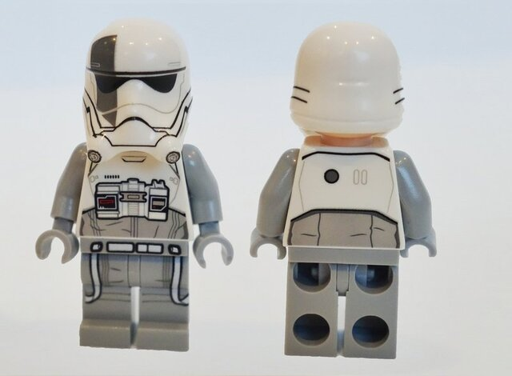](https://www.freelug.org/IMG/jpg/75195_Ski_Speeder_vs_First_Order_Walker_Microfighters_013.jpg)

**Le pilote du walker Texas Rang.... du 1er Ordre**

Là encore, très beau travail de sérigraphie sur le torse (face et dos) et sur la taille et les jambes. Le casque ne déroge pas à la règle. Ça n’a beau être qu’un simple pilote, la fig est très belle.

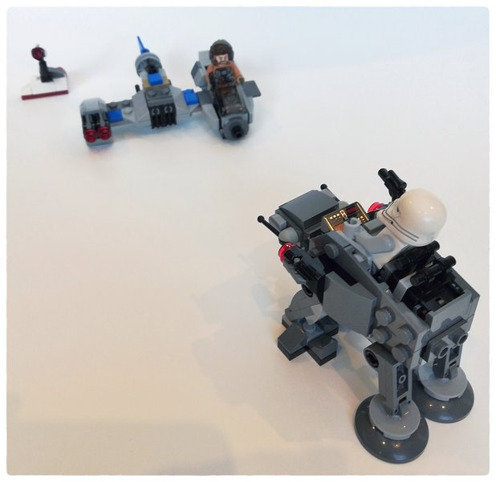

Allez hop, on rejoue la bataille de Crait !

**Conclusion**

J’ai toujours apprécié cette série des microfighters Star Wars, et pourtant, avec ce set la mayonnaise ne prend pas. Il faut dire que le Ski Speeder est vraiment un appareil avec un design particulier, pas évident à reproduire, et à cette échelle, il passe difficilement.

Le Walker semble un peu balourd, grossier, comme l’original du film. Comparé à lui, l’AT-AT de l’épisode IV semble un modèle d’élégance et de légèreté.  
Alors oui, deux belles figs, mais au final, pour moi, peut-être un concept qui s’essouffle.
