LEGO poursuit sa politique d’acquisition de licences porteuses. Après Star Wars ou bien encore Harry Potter, voici que la firme danoise nous propose le cartonnesque Bob l’éponge. La gamme, jusqu’alors exclusivement disponible outre-atlantique, débarque sur le Shop@Home, pour le plus grand bonheur des petits... et des AFOLs !

_Le Crabe Croustillant - The Krusty Krab_

_

Année : 2006

Nombre de pièces : 295

Nombre de minifigs : 3

_

_Prix Shop @ Home : 24,99 Euros_

**La boîte**

Elle est magnifique ! Un packaging mega peps encore jamais vu chez LEGO ! L’univers coloré et sous-marin du dessin animé est parfaitement restitué.

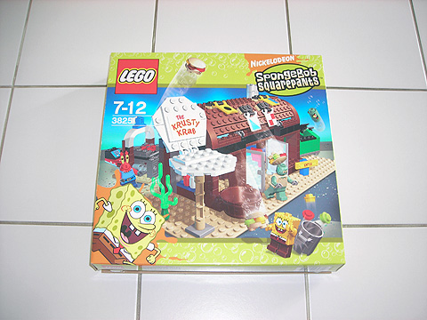

**Le recto...**

Une franche réussite, à mille lieues de certaines boîtes particulièrement austères (la gamme Vikings notamment).

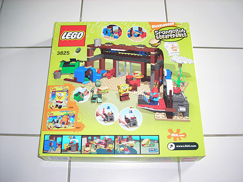

**... et le verso**

**Le contenu**

Une (très recherchée) plaque de couleur tan saute tout d’abord aux yeux, à celle-ci s’ajoutent 5 sachets non numérotés, une planchette d’autocollants et la notice.

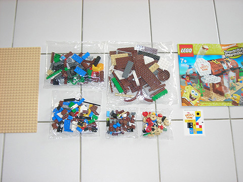

**Des sachets peu nombreux mais denses**

L’une des premières choses que j’ai faite fut de saisir la notice et de relever le numéro Item de certaines références dont la fameuse plaque tan. Allô ? Le Depan’Order ? Alors, je voudrais...

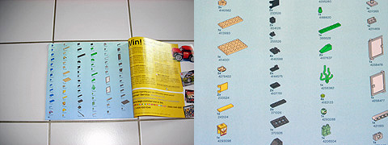

**La notice et les précieux numéros !**

**Le montage**

Il sera bref, mais particulièrement plaisant.

Il débute comme de coutume par l’assemblage des minifigs.  
Je remarque que la minifig Bob dispose d’une pièce spécifique tout comme son acolyte dont j’ignore le nom !

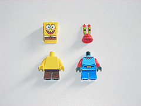

**Des pièces spécifiques très... spécifiques !**

Il faut également noter l’utilisation de jambes courtes non articulées.

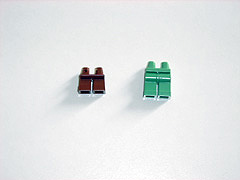

**Le premier taille un poil juste :-)**

Une sacrée bande de loustics ces quatre là...

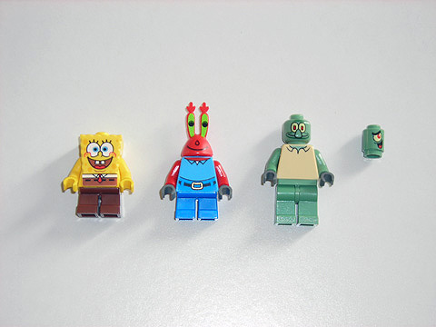

**Chaud devant !**

Le montage est du type semi-modulaire, à savoir que si les sachets ne sont pas numérotés, on assemble une série de modules ou d’accessoires fondamentaux indépendants ou liés entre eux.

Un conteneur à ordures.

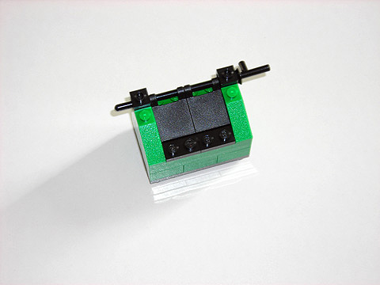

**Ah ! Cette obsession contemporaine du recyclage...**

Une caisse-comptoir-livreuse sous-marine qui dispose d’un mécanisme d’éjection de burgers !

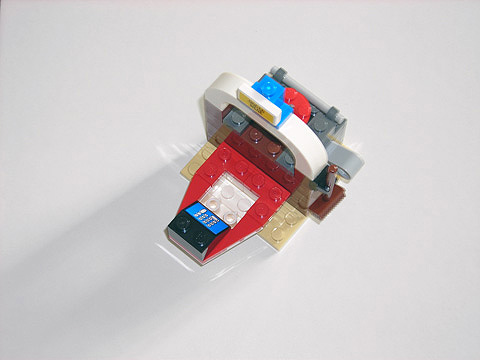

**La caisse de comment qu’il s’appelle ? Patrick ? Non...**

Dont voici quelques détails :

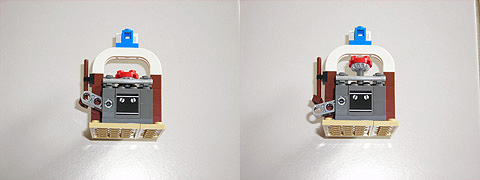

**Ca fonctionne plus que bien !**

Je suis surpris de constater que des pièces qu’on a l’habitude de voir imprimées (tiles, slopes) sont remplacées par des autocollants. Un artifice (économique) qui n’est pas un bon point pour la durabilité...

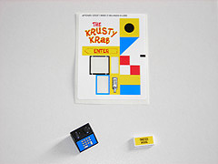

**Une économie pô très judicieuse...**

Bob est un vrai américain ! Y s’en fou’ le gars du cholestérol ! Allez ! Un plein baquet de burgers !

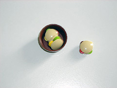

**Beurk !**

On attaque enfin le morceau de choix du set : le fast food sous-marin de la fine équipe.

Rien que des fondamentaux. La notice est progressive ; un peu trop à mon goût, certaines étapes s’enchaînant pièce par pièce ! Des pièces d’ailleurs fort sympas, le Depan Order va chauffer en ce qui me concerne :) Le point le plus complexe réside dans la toiture faite de charnières crantées pour une fois sans jeu excessif.

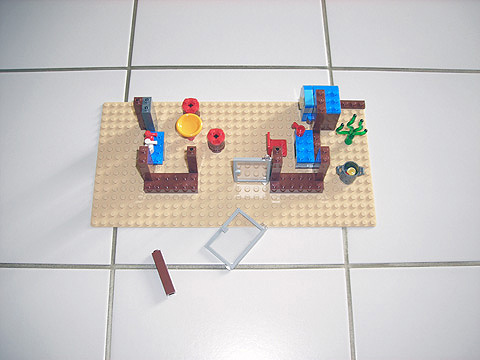

**En cours de montage**

Quelques vues de la gargotte :

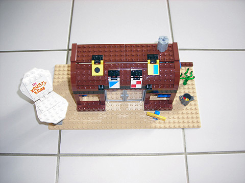

**Vue 1**

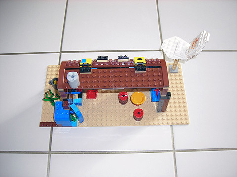

**Vue 2**

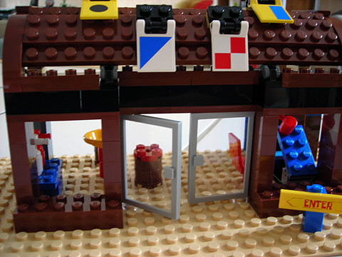

**Un p’tit coup d’zoom**

Et de son intérieur :

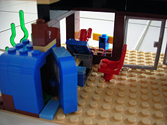

**Détails de l’intérieur 1**

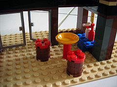

**Détails de l’intérieur 2**

Il reste comme toujours quelques petits trucs dans l’assiette.

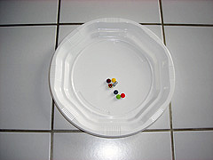

**Les traditionnelles pièces de rechanges sont les bienvenues**

**En conclusion**

Ce set est un vrai plaisir ! A monter, à regarder, à jouer (pardon, à gérer !),... à se faire offrir !

**_Le mot de Louise :_**

_En regardant le site LEGO, une jolie boîte colorée, sympathique comme les aiment les enfants... les grands enfants me tape à l’oeil ! Eh hop ! Une idée cadeau ! Abracadabra... Dring... Dring... Le livreur... Un colis... Une boîte de plus à construire pour mon Doudou ! Et vous ? Ne vous tente t-elle pas pour vos enfants ou pour vous-même ?!_

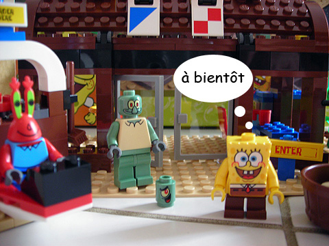
