La collection Bob l’Eponge s’étoffe avec l’arrivée de deux nouvelles références : l’autobus de Bikini Bottom ([3830](http://shop.lego.com/product/?p=3830&LangId=2057&ShipTo=US)) et le voyage en fusée (3831), hélas seulement disponibles outre-atlantique (merci Chatpin !).

Passionné d’astronautique, je ne pouvais manquer le rendez-vous orbital de notre ami Bob. Gros plan sur son périlleux voyage en fusée. La chasse aux méduses extra-terrestres est ouverte !

## Fiche signalétique

-   Référence : 3831 - Voyage en fusée (Rocket Ride)
-   Collection : [Bob l’Eponge](http://shop.lego.com/ByTheme/Leaf.aspx?cn=355&d=70)
-   Année : 2008
-   Nombre de pièces : 279 dont 3 minifigs
-   Prix moyen constaté : 30 $ ([disponible aux USA](http://shop.lego.com/product/?p=3831&LangId=2057&ShipTo=US))

## Présentation

**La boîte**

Colorée, originale, fun à souhait... Elle est absolument magnifique ! Un travail artistique de haute volée, dans la continuité de la première collection dont était issu le [set 3825](/articles/set-3825-le-crabe-croustillant-the-krusty-krab/). Je vais finir par désespérer de retrouver ce zeste de folie au sein d’autres collections...

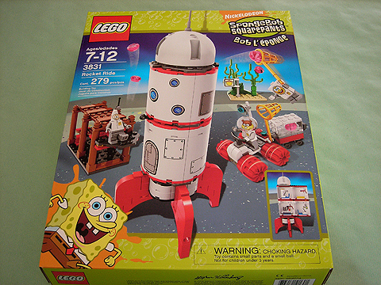

**Le recto de la boîte**

Le verso, tout aussi inspiré, détaille le contenu du set et ses diverses fonctionnalités. Parfait !

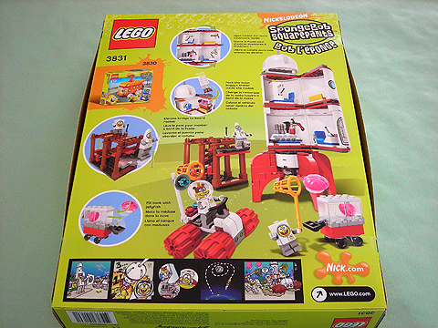

**... et son verso**

**Le contenu de la boîte**

Je ne suis pas un collectionneur orthodoxe, et j’attache en général peu d’intérêt à la conservation des boîtes. Une fois n’est pas coutume, j’ai délicatement ouvert celle-ci avant de la ranger à l’abri. Une fusée, pensez donc !

L’ouverture révèle trois sachets numérotés, une pièce en vrac, une planchette d’autocollants et la notice.

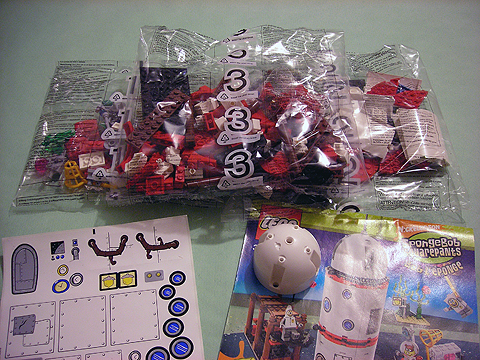

**Le contenu de la boîte**

La palette de briques ne recèle aucune pièce exotique si ce n’est le très intéressant casque bulle de Sandy.

## Le montage

Il s’articule autour de grandes étapes : minifigs, décor, engins et accessoires. La notice est claire et exempte de mauvaises surprises. Elle reprend à sa fin l’inventaire des pièces. Tout est rapide, un peu trop, comme toujours...

**Les minifigs**

Elles sont au nombre de trois : Bob et deux de ses compères Patrick et Sandy. Scaphandre coordonné de rigueur pour tout le monde ! J’adore !

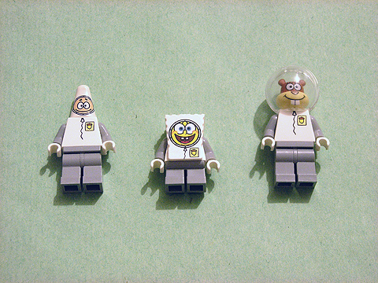

**Bob et ses acolytes**

**Le mini décor sous-marin**

En quelques briques, il symbolise le fond marin extra-terrestre. Le drapeau de nos conquérants de l’absurde planté entre les algues m’a bien fait rire ! Les toques de cuisinier translucides en guise de méduses également.

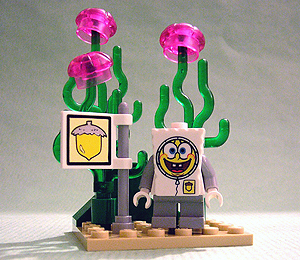

**Un petit pas pour Bob, un bond de géant pour les glands !**

**La tour de lancement**

Exit le rouge flamboyant des rampes d’acier de Cap Canaveral... Nous avons droit ici à une subtile combinaison de planches et de clous, dans le plus pur style ponton maritime ! Avec une fonction ascenseur aïe ouille bing plok loin de décourager nos trois loustics.

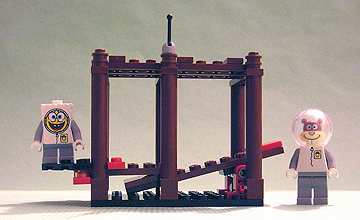

**La rampe de lancement avec ascenseur éjecteur !**

**Le rover lunaire sous-marin**

C’est un gros quad reprenant les trains roulants bien connus de véhicules espace du passé. Une remorque aquarium permettant de stoker les méduses collectées lors de la sortie extra-véhiculaire complète le tout.

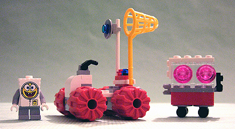

**Un rover sous-marin d’inspiration lunaire**

**La fusée**

Ah ! La fusée... Hummm !

Le design de notre lanceur interplanétaire est typique de l’univers cartoon, avec de grands empennages arrondis. Il comprend deux étages constitués de panneaux courbes 4x4x6.

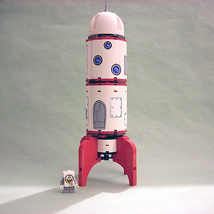

**La fusée achevée...**

Le volume intérieur ainsi crée est parfaitement adapté à l’échelle de nos minifigs. LEGO n’a pas manqué de l’exploiter, en permettant l’accès grâce à des charnières plates. Une astuce hautement ludique !

Les entrailles de la bête sont garnies de postes de commande et de racks d’outillage. Il y a de la place pour tous mais pas pour tout... Où vais-je donc garer le rover ?! A moins que ce ne soit un modèle lyophilisé à réhydrater sur place ;-)

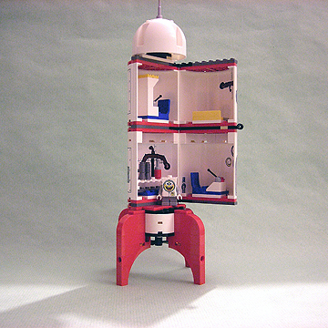

**... recèle bien des trésors**

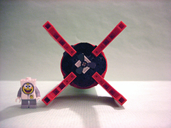

**Propulsion par hélice !**

Je ne déplore pas cette fois l’abondance d’autocollants qui étaient, au vu des galbes et de la surface de la fusée, la solution la plus adaptée.

**Un set réjouissant !**

Je vous laisse admirer quelques vues de ce bel ensemble.

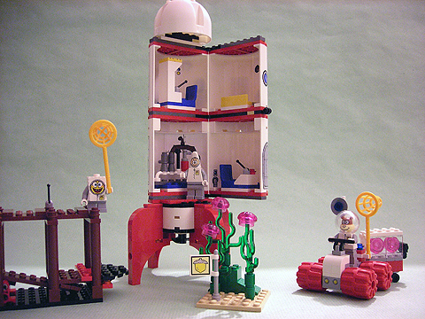

**Vue d’ensemble du set**

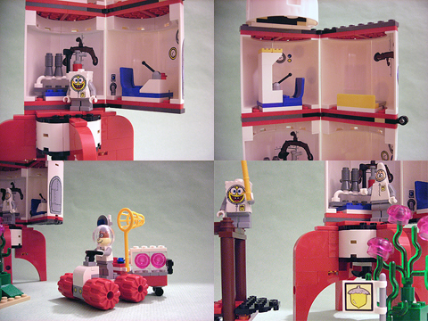

**Quelques vues rapprochées**

## En conclusion

Ce voyage en fusée est, comme la quasi totalité de la délirante collection Bob l’Eponge, une superbe réussite ! Il trouvera aisément sa place sur une étagère comme moi, ou mieux encore... [ici](http://www.brickshelf.com/cgi-bin/gallery.cgi?i=2384226) [^1] !!!

[^1]: Une belle idée de notre camarade Samrotule
