Peu avant Noël, j’eus l’opportunité d’acquérir à bas prix un certain nombre de sets dans le but de me constituer une solide banque de pièces. Ainsi, achetai-je ce set 4896, sans plus d’enthousiasme... Je ne soupçonnais pas un instant qu’il recelait une petite merveille, une vision de l’automobile de collection en LEGO plus proche de celle d’un AFOL que de celles des habituelles productions de la firme danoise...

Sachez que, si ce set propose le montage de trois véhicules différents, je ne vous présenterai en ces lignes que le modèle principal, un roadster... qui m’a littéralement bluffé ! Le petit bolide relègue le dragster et le 4x4 alternatifs au rang de faire-valoir anecdotiques.

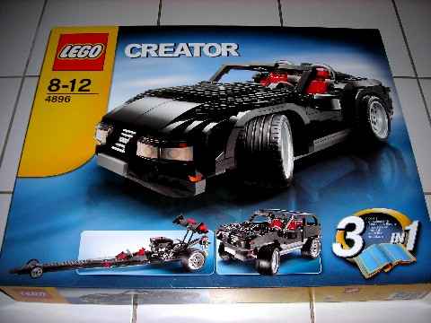

**La boîte**

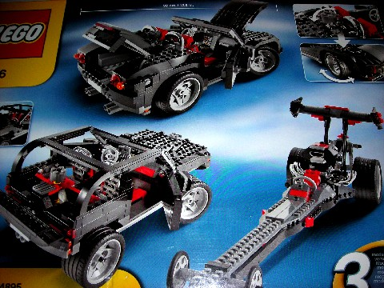

**Les modèles alternatifs**

Set 4896

931 pièces

Année 2006

60 € (prix moyen constaté)

**La boîte, le montage...**

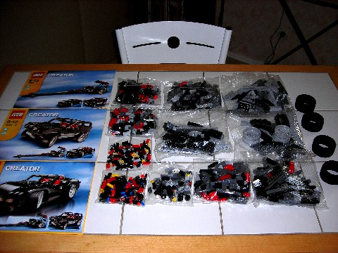

**Le contenu de la boîte**

La boîte recèle 11 sachets non numérotés, 4 pneus taille basse en vrac et 3 livrets de montage correspondants aux 3 modèles que vous propose LEGO.

Le montage du roadster vous prendra deux bonnes heures...

Il débute par l’assemblage du chassis constitué de poutres Technic où viendra se greffer "un arbre de renvoi" (le seul point de complexité de ce modèle) reliant la direction, parfaitement fonctionnelle, à une molette relativement discrète située derrière les sièges. Vous l’aurez compris, la rotation du volant de l’habitacle est fictive. C’est un artifice courant chez LEGO, afin d’accroitre la jouabilité du modèle.

Progressivement, le modèle s’étoffe avec l’apparition des métapièces de carrosserie. On y découvre des techniques de construction peu courantes pour un modèle commercial destinées à obtenir un effet de lissage. Les AFOLs férus de SNOT et autres techniques de montages savantes se régaleront de peaufiner l’esquisse de LEGO à l’infini.

Je vous laisse regarder ces quelques clichés de diverses étapes du montage, ils parlent d’eux-mêmes...

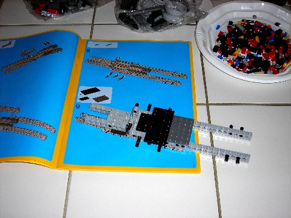

**En cours de montage 1**

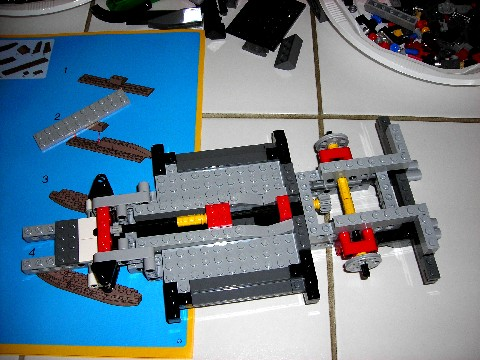

**En cours de montage 2**

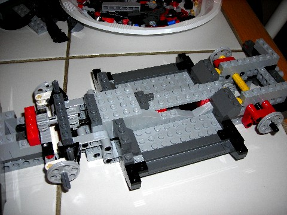

**En cours de montage 3**

Notez l’utilisation de poulies en guise de disques de frein, joli détail !

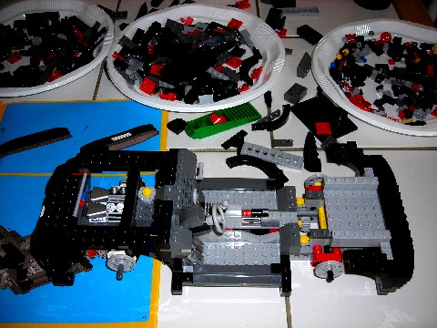

**En cours de montage 4**

La carrosserie commence à restituer ses galbes agressifs.

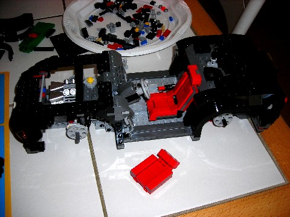

**En cours de montage 5**

Les deux sièges sont réglables, du beau travail !

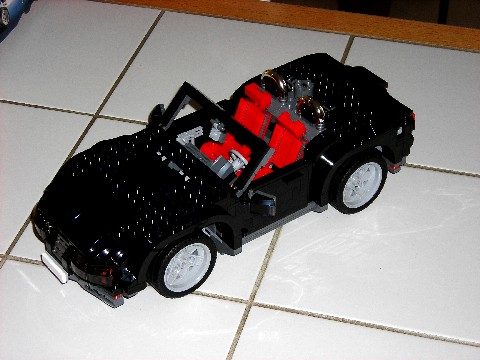

**Le modèle achevé**

**Il a de faux air de BMW Z4, ne trouvez-vous pas ?**

Je ne serais pas surpris d’apprendre que LEGO se soit inspiré des productions de la firme bavaroise pour réaliser ce modèle trapu et agressif. Force est de constater que ma banque de pièces devra se passer des briques issues du set 4896 que je ne suis pas prêt de désosser...

Le modèle achevé regorge de fonctionnalités et de détails : capot (avec béquille !) et coffre ouvrables, portières munies de rangements latéraux, sièges réglables, levier de vitesse, frein à main, pédalier aluminium... On se croirait presque au Salon de l’Auto ! Magnifique !

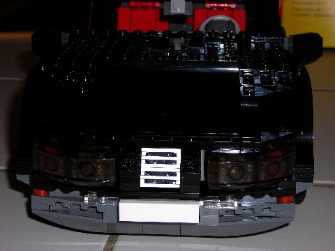

**Vue avant...**

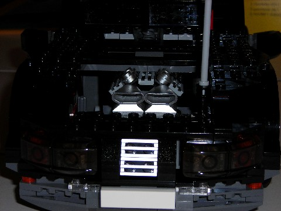

**... Capot ouvert**

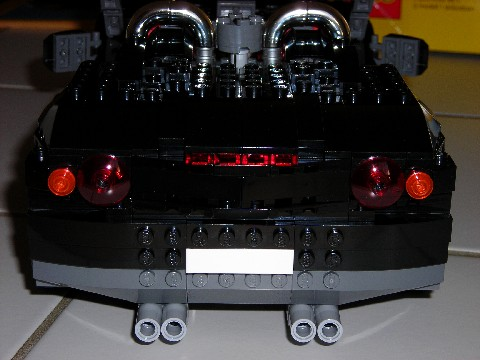

**Vue arrière...**

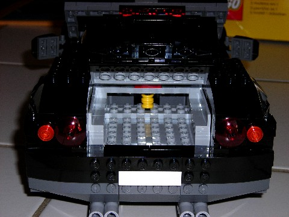

**... Coffre ouvert**

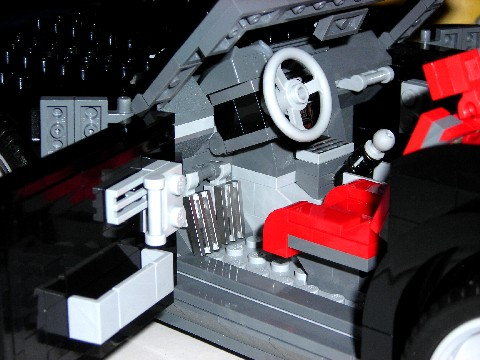

**Détails de l’habitacle**

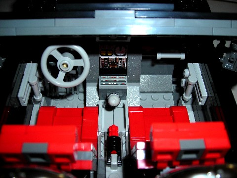

**Passe la seconde !**

**Une belle surprise...**

_Initialement destiné à alimenter des compartiments et des sacs de congélations, ce set s’avère en définitive un superbe modèle dont le montage fut un très agréable moment !_
