La gamme Creator reprend à son compte le concept du « plusieurs en 1 » initié par de nombreuses collections dans le passé (Designer, etc.). Une formidable initiative pour les novices qui permet la réalisation de modèles alternatifs qu’autrefois la société LEGO se contentait de suggérer au verso de ses boîtes. Néanmoins, cette dénomination multi modèles s’avère parfois abusive, tant certaines constructions proposées, « bricolées à l’arrach’ » à partir de la palette de briques du modèle principal, ne sont que de pâles faire-valoir. Qu’en est-il de ce set 4955 ?...

Le second semestre 2007 a vu le référencement de notre marque favorite s’étoffer en prévision des fêtes de fin d’année. [La gamme Creator](http://shop.lego.com/ByTheme/Leaf.aspx?cn=348&d=70), forte de sa popularité, a ainsi fait l’objet d’une attention toute particulière. Bâtiments, engins roulants ou volants... Une déferlante de sets plus alléchants les uns que les autres, dont certains bénéficient de l’intégration du tout récent et prometteur [Power Functions System](http://www.freelug.org/article.php3?id_article=645).

## Le concept du « plusieurs en 1 »

Cet argument (commercial) massue est une arme à double tranchant. Travaillant dans l’univers du jouet, combien de fois ai-je observé des parents - et pire encore des enfants - délaisser un multi modèles Creator au profit d’un baril de vrac jugé plus créatif « qu’une boîte avec laquelle on ne peut monter que 3 choses » ! La thématisation (3 engins volants, 3 maisons, etc.) majore vraissemblablement ce préjugé.

Que dire, si ce n’est que la société LEGO a encore du pain sur la planche en terme de communication sur l’aspect infini de la construction en briques...

## Création, création...

Les lecteurs les plus assidus du site auront remarqué l’affection que je porte aux sets de cette gamme qui privilégie la création en briques fondamentales, quasi exempte de méta pièces. Du « LEGO originel » en quelque sorte. Ainsi, c’est avec impatience que je guette la commercialisation de chaque nouvelle référence.  
Laissez-moi donc vous présenter ce nouveau set 4955.

**–** Référence : 4955 - Le camion (Big Rig)  
**–** Nombre de pièces : 550 ([inventaire Peeron](http://www.peeron.com/inv/sets/4955-1))  
**–** Tranche d’âge théorique : 7 à 12 ans  
**–** Année de commercialisation : 2007 (2ème semestre)  
**–** Prix moyen constaté : 29,99 Euro ; ([disponible sur le Shop@Home](http://shop.lego.com/ByTheme/Product.aspx?p=4955&cn=348&d=70))

## La boîte

Compacte, la boîte se pare d’un graphisme contrasté et harmonieux. La dominante jaune propre à la gamme Creator associée au fond bleu et aux briques rouges composant les modèles insuffle une dynamique saisissante. Beau travail ! Un packaging qui ne peut qu’inciter à l’achat d’impulsion.

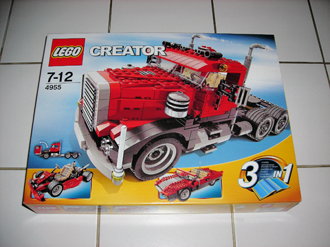

**Le recto**

Si le modèle phare - le camion américain - se taille la part belle, les engins alternatifs sont néanmoins convenablement exposés, plus encore sur le verso de la boîte.

Les maigres fonctionnalités disponibles (capot et portières mobiles) sont clairement visibles.

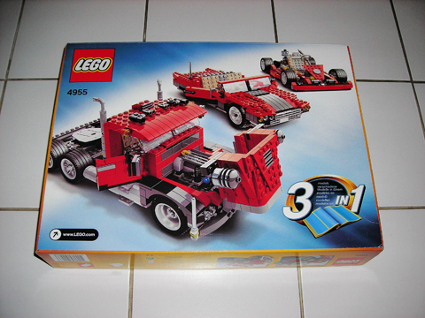

**Le verso**

_Remarquez que les clichés sont issus de l’imagerie de synthèse, un choix récurrent au sein de la gamme Creator._

L’inventaire des pièces est comme de coutume visible sur une tranche de la boîte. Une judicieuse initiative dont se réjouissent les AFOLs, tant il leur est aisé de jauger d’un simple coup d’oeil le potentiel de créativité du set.

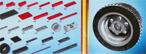

**L’inventaire est visible sur la boîte**

_Notez qu’une roue à l’échelle 1 permet aux novices d’estimer la taille des modèles proposés._

Cette inventaire est bien entendu doublé dans les dernières pages du 2ème livret de montage, assorti des références individuelles qui vous permettront de commander des pièces supplémentaires auprès du Depan’ Order, le service de pièces détachées de la société LEGO (0800 5346 1111 ou 0800 5346 5555, appel gratuit depuis un poste fixe).

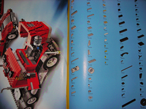

**Allô, Depan’ Order...**

## Le contenu

L’ouverture de la boîte dévoile 8 sachets non numérotés (un montage modulaire serait une injure au regard de la vocation créative du set), 6 pneus en vrac et 2 livrets de montage dont un exclusivement consacré au camion.

La densité du contenu n’est pas aussi importante que le laissaient suggérer la compacité de la boîte et les 550 pièces annoncées. 550 pièces certes, mais beaucoup de petites pièces...

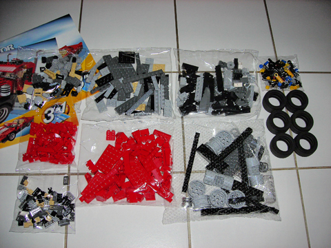

**Un contenu sans fioritures**

_Remarquez la répartition par couleur, absolue ou relative, des pièces. De quoi relancer le débat sur le meilleur compromis en matière de tri !_

Un bref examen révèle la présence d’un nombre important de petites briques à fort potentiel combinatoire. Un régal pour les MOCeurs férus de détails toujours avides de ces petites pièces providentielles.

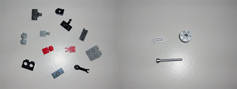

**Des pièces à fort potentiel combinatoire et quelques pièces chromées**

Le très suggestif ratio briques/intérêt/prix apparaît très satisfaisant, même si certains regretteront la sempiternelle abondance de briques rouges...

## 1er modèle : Le camion

Le premier modèle - le modèle phare - est une réplique de truck, un camion américain. C’est avec un brin de nostalgie que j’entame son montage. Peut-être, comme moi, avez-vous été victime (vos proches surtout !) d’une période « truck », chambre tapissée de posters de ces engins customisés à outrance...

Le châssis, de type poutre, se dévoile immédiatement.

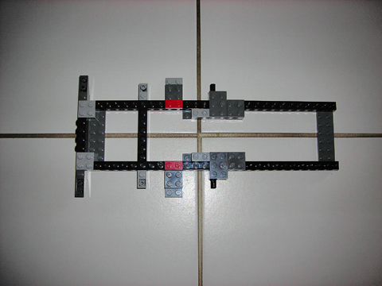

**Le camion à l’étape 10**

Les premiers détails apparaissent rapidement. On devine que le tracteur ne sera pas directionnel, ce qui est compréhensible au regard du prix.

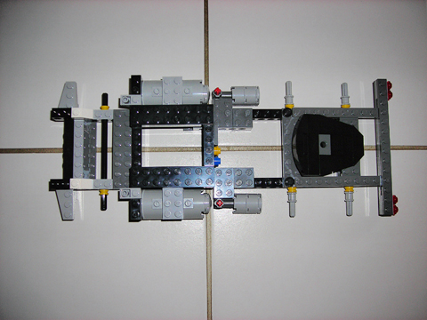

**Le camion à l’étape 20**

Hormis la calandre, les briques composant la carrosserie ne font l’objet d’aucune combinaison savante d’assemblage, SNOT ou autres. Elles sont simplement empilées.

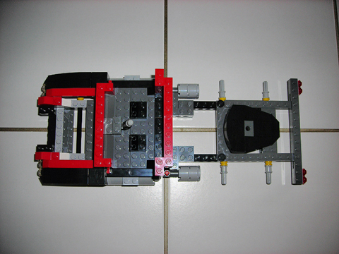

**Le camion à l’étape 30**

L’aménagement de la cabine est soigné, et le bloc moteur d’un design assez réaliste.

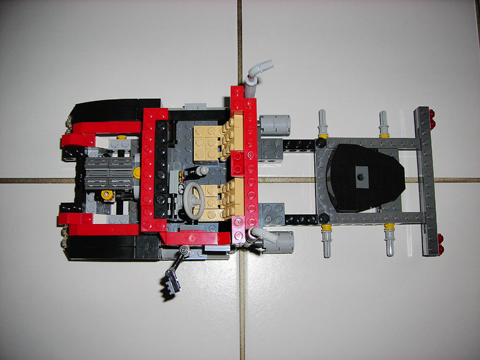

**Le camion à l’étape 40**

Le montage touche à sa fin, il ne manque que les roues et quelques briques.

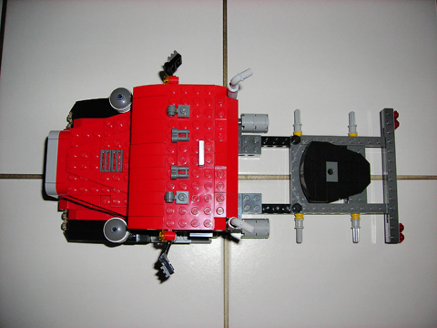

**Le camion à l’étape 50**

Sur un thème maintes fois décliné, les Masterbuilders nous livrent une composition magnifique sans être magistrale. Ampleur, richesse, rigueur... Il mérite à coup sûr son statut de modèle principal !

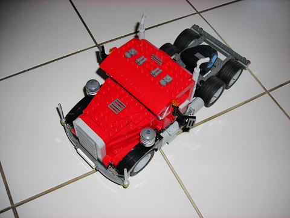

**Le camion - Vue 1**

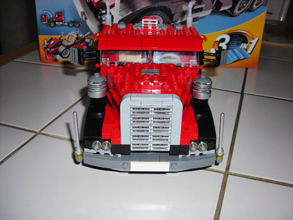

**Le camion - Vue 2**

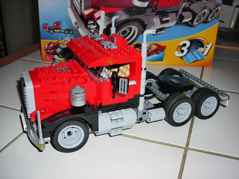

**Le camion - Vue 3**

Je vous laisse examiner quelques vues rapprochées de ce truck. Le capot et les portières sont mobiles.

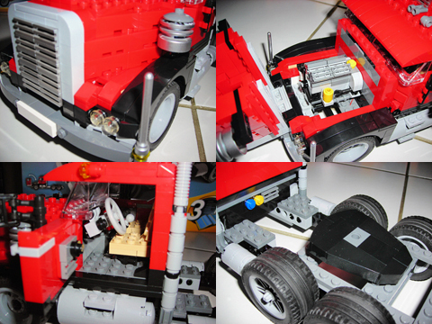

**Zoom sur quelques détails et fonctionnalités du camion**

Le camion absorbe l’intégralité des pièces disponibles. Ainsi, il définit bien, par cette palette, le potentiel (et donc la limite) des autres modèles...

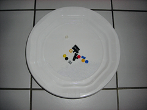

**Les pièces restantes après l’assemblage du camion**

## 2ème modèle : Le kart

Je me souviens avec délice de mon premier kart LEGO, le [set 854](http://www.peeron.com/inv/sets/854-1) (un modèle à part entière, et non une construction alternative comme ici), découvert par hasard dans un placard quelques semaines avant le jour J. Le mythe du Papa Noël ne s’en remit jamais...

Tout comme le truck, le kart se base sur un châssis poutre.

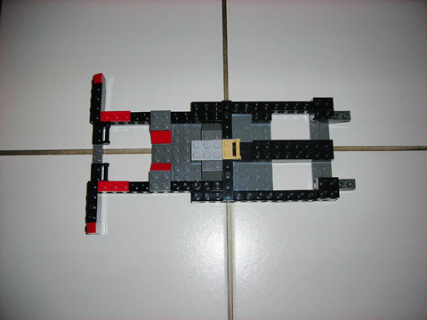

**Le kart à l’étape 10**

Les pontons faisant office de carrosserie sont bien restitués.

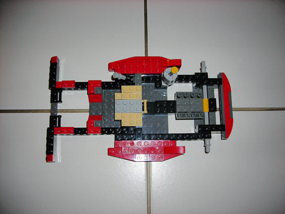

**Le kart à l’étape 20**

Une direction fonctionnelle aurait magnifié un modèle déjà particulièrement fidèle et séduisant.

La palette de briques disponibles imposera inévitablement certains « compromis », notamment des recompositions de pièces (2 plates jointes qui en appairent une autre en symétrie, etc.). Le revers de la médaille des multi modèles...

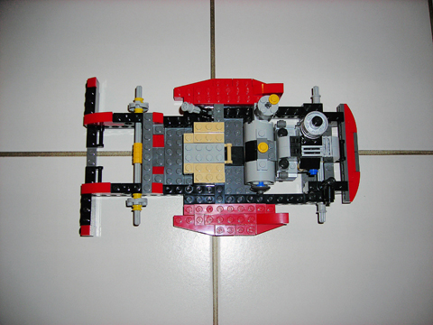

**Le kart à l’étape 30**

Si ce kart n’est pas le modèle le plus original du set, c’est à mon goût le plus réussi. Il est stupéfiant de réalisme, même si certaines proportions ne sont pas tout à fait respectées. Le minimalisme de sa structure allié à la pertinence des choix de montage, des designs et des couleurs des pièces le composant en font un régal pour les yeux. Le bloc moteur monocylindre avec sa ligne d’échappement - hélas statique ! - est une pièce d’orfèvrerie à lui seul !

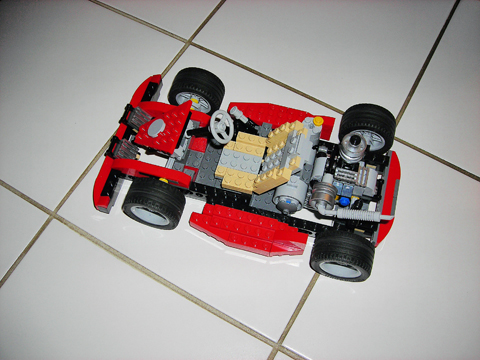

**Le kart - Vue 1**

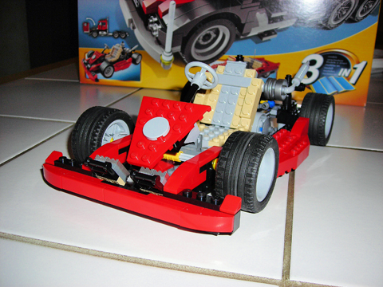

**Le kart - Vue 2**

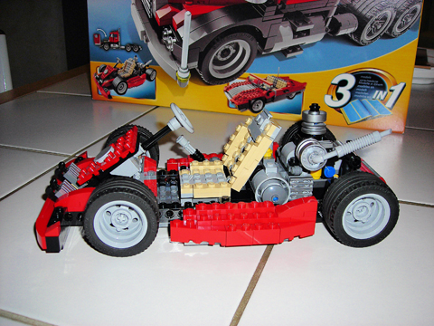

**Le kart - Vue 3**

Je vous laisse examiner quelques vues rapprochées de ce kart.

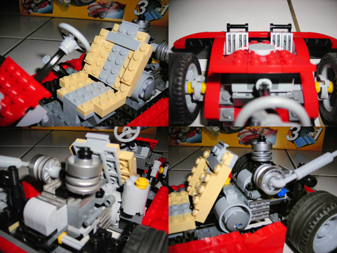

**Zoom sur quelques détails et fonctionnalités du kart**

Le modèle ne requiert que peu de briques, au point que l’on pourrait presque entamer la construction d’un deuxième engin (à 2 roues !) avec les pièces inutilisées.

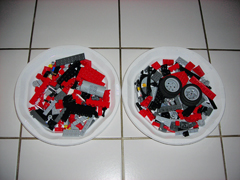

**Les pièces restantes après l’assemblage du kart**

## 3ème modèle : Le cabriolet

Le dernier modèle est une réplique de cabriolet des années fastes de l’automobile américaine. La filiation aux Cadillac, Buick et autres Chevrolet est patente.

Le châssis, toujours de type poutre, est cette fois moins marqué que les précédents.

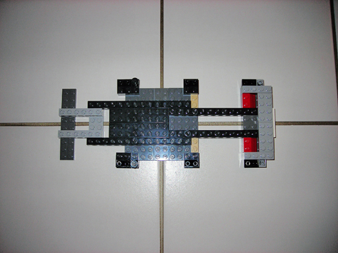

**Le cabriolet à l’étape 10**

La voie arrière est plus étroite que son homologue avant ! Un artifice qui permet aux briques de la carrosserie d’occulter une grande partie des roues arrières, afin de préserver la fluidité de la ligne.

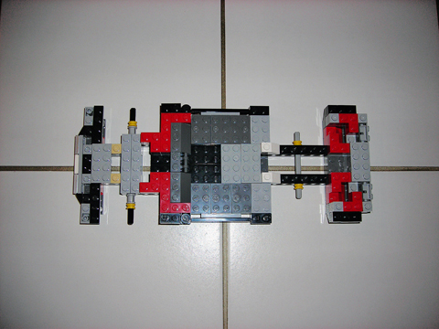

**Le cabriolet à l’étape 20**

Une fois de plus, la direction sonne aux abonnées absentes. Et la palette de briques atteint encore une fois ses limites : la structure s’affranchit ici ou là du respect des symétries de pièces et des couleurs.

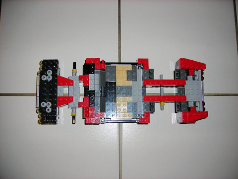

**Le cabriolet à l’étape 30**

Tout comme celle du camion, la carrosserie de notre belle américaine se révèle être un simple empilement.

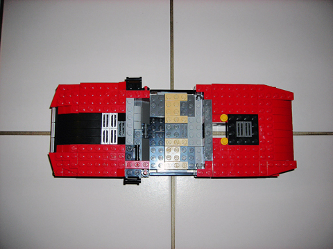

**Le cabriolet à l’étape 40**

Quelle originalité ! Les galbes alambiqués et tapageurs de ces grosses américaines à boîte automatique et V8 glouton sont somptueusement restituées. Je ne me lasse pas d’admirer cette calandre et ces optiques typiques. Superbe ! Même si cette guimbarde aurait mérité encore plus d’audace, notamment avec des ailerons plus prononcés.

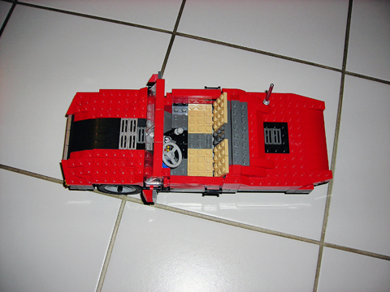

**Le cabriolet - Vue 1**

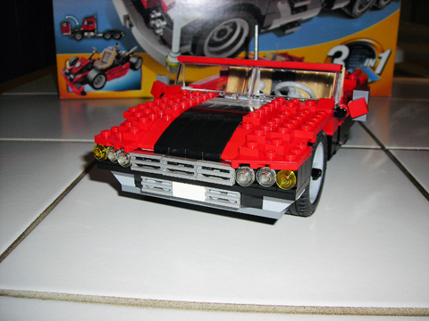

**Le cabriolet - Vue 2**

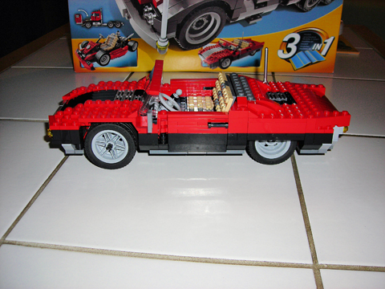

**Le cabriolet - Vue 3**

Je vous laisse examiner quelques vues rapprochées de ce cabriolet. Seules les portières sont mobiles.

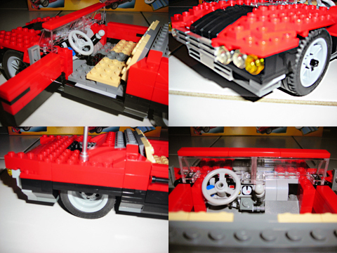

**Zoom sur quelques détails et fonctionnalités du cabriolet**

Moins de pièces utilisées que le truck, mais la carrosserie de notre bolide Made In USA absorbe toutefois la majorité des briques biseautées initiales.

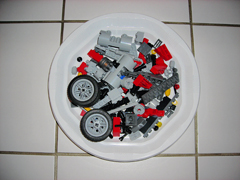

**Les pièces restantes après l’assemblage du cabriolet**

## En conclusion

Vous aurez compris à la lecture de cette revue l’enthousiasme qu’a suscité chez moi cette référence 4955. La force de ce set multi modèles ne réside pas comme bien souvent dans son modèle phare mais dans l’homogénéité de son offre de modèles et la pertinence de la palette de briques choisie. Voilà bien la première fois que les modèles alternatifs me séduisent plus que le modèle principal ! Un grand set Creator !

Avec l’accroissement sensible du référencement de la gamme Creator, la firme danoise mise gros. Un pari finalement loin d’être risqué tant les sets proposés rivalisent d’esthétique et d’originalité. Gageons que la société LEGO récoltera les fruits de ses investissements et persistera pour notre plus grand bonheur dans cette voie du « LEGO originel ».
