La fournée 2008 de la gamme Creator est particulièrement bien inspirée : maison, bateau, voiture... Une flopée de modèles qui rivalisent d’originalité et de qualité. Notons que l’intégration d’éléments électriques (moteur, brique sonore...), y compris dans des sets à prix modiques, ne fait que magnifier cette gamme pilier.

Gros plan sur le set 4994, une boîte « 3 en 1 » sur une thématique d’affreuses et féroces créatures. Brrr !

## Fiche signalétique

-   **Gamme :** [Creator](http://shop.lego.com/ByTheme/Leaf.aspx?cn=348&d=70)
-   **Set :** 4994 - Les créatures féroces (Fierce Creatures)
-   **Année :** 2008
-   **Tranche d’âge :** 6-12 ans
-   **Nombre de pièces :** 193 ([inventaire Peeron](http://www.peeron.com/inv/sets/4994-1))
-   **Prix moyen constaté (au 01/06/2008) :** 10,99 € (disponible sur le [Shop@Home](http://shop.lego.com/ByTheme/Product.aspx?p=4994&cn=348&d=70))

La gamme Creator fait la part belle à l’utilisation de briques fondamentales, avec pour objectif l’incitation à développer l’imagination et son expression matérielle. Ainsi, les boîtes « plusieurs en 1 » sont caractéristiques de cette ambition.

Exit le montage modulaire d’autres gammes qui vous mâche le travail et vous prive d’une partie du plaisir. Ici, LEGO vous « guide » au travers de différents modèles vous proposant des idées de structures, des astuces de montage, pour mieux vous inciter à concevoir les vôtres ! Grâce à la firme danoise, que vous soyez petit ou grand, vous allez devenir balèze en MOCs ;-)

## La boîte

Nous retrouvons le traditionnel graphisme de la gamme, de jaune et de bleu mêlés, avec toujours autant de peps. D’emblée, on comprend que l’attention des Masterbuilders s’est focalisée sur le design de l’araignée, qui monopolise l’essentiel du recto de la boîte.

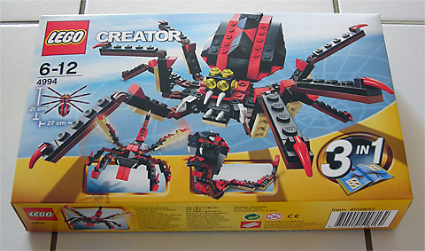

**Le recto de la boîte**

Les choses ne s’équilibrent que sur le verso, comme toujours ;-)

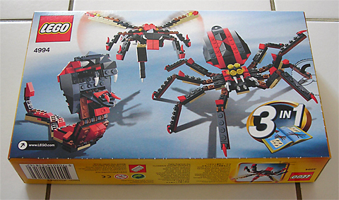

**Le verso de la boîte**

## Le Contenu

Il se répartit en trois sachets non numérotés et la notice, instituant l’ordre de montage suivant : araignée, cobra et insecte.

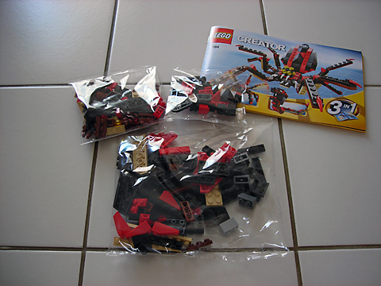

**Le contenu de la boîte**

Un coup d’œil rapide sur la palette de briques confirme la dominance des teintes rouges et noires, tout comme l’abondance de charnières crantées et de petites pièces à fort potentiel combinatoire : jumpers, briques à tenons déportés...

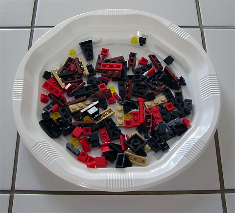

**Une des deux assiettes de pièces**

## Modèle 1 - L’araignée

L’araignée peut se décomposer en trois étapes fondamentales : le corps principal où viendront se greffer huit longues pattes puis un volumineux abdomen.

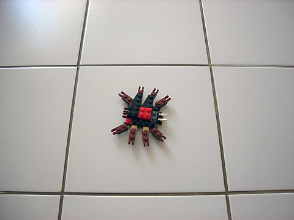

**L’araignée en cours de montage**

Le montage tient tout aussi compte de la finesse induite par certaines parties de l’animal que du peu de briques disponibles.

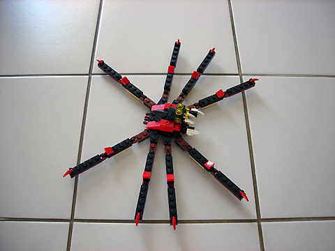

**L’araignée en cours de montage 2**

L’abdomen fait largement appel aux nouvelles générations de briques biseautées.

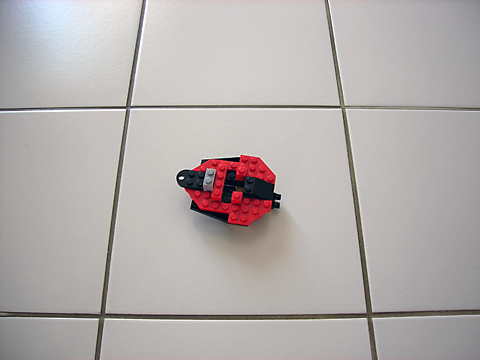

**L’araignée en cours de montage 3**

Remarquons qu’il ne reste plus aucune brique dans les assiettes, exception faites des pièces de rechange et de deux petites plaques, dont on se doute qu’elles auront leur utilité dans la construction des autres modèles.

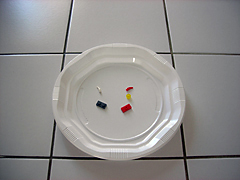

**Il ne reste plus de pièces...**

Comme je le faisais remarquer lors de la revue du [set 4955](/articles/set-4955-le-camion-big-rig/), c’est la palette de briques du modèle principal qui définit les limites de conception des autres.

L’araignée achevée, d’une réalisme stupéfiant, est très impressionnante. Elle est énorme, formidablement monstrueuse !

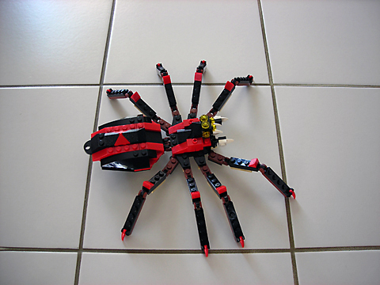

**L’araignée - Vue 1**

Le volume de son corps, l’ampleur de ses pattes et les teintes judicieuses sont pour beaucoup dans cette réussite.

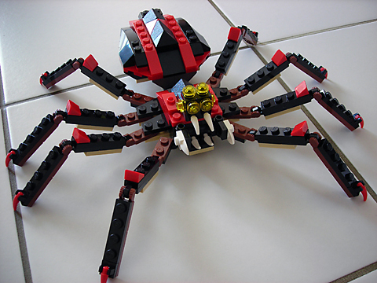

**L’araignée - Vue 2**

Vue de face ou de dos, elle vous donne la chair de poule !

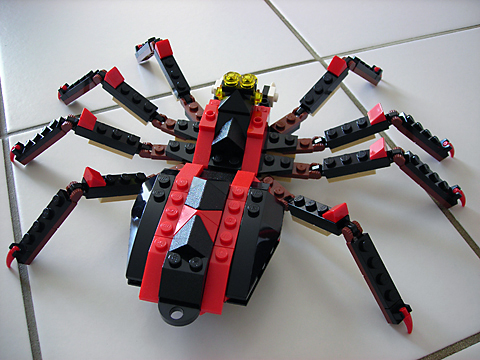

**L’araignée - Vue 3**

## Modèle 2 - Le cobra

Tout comme l’araignée, le cobra n’échappe pas à la sous-structuration, toujours très pédagogique. Dans le cas de notre reptile, nous pourrons réduire celle-ci à deux étapes : la tête et le corps-queue.

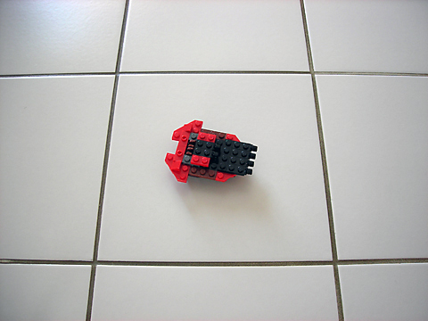

**Le cobra en cours de montage**

La tête du cobra fait l’objet d’un design assez élaboré pour un set de cette envergure. Hélas, les coloris, si pertinents pour l’araignée, rendent difficilement lisibles ce travail savant...

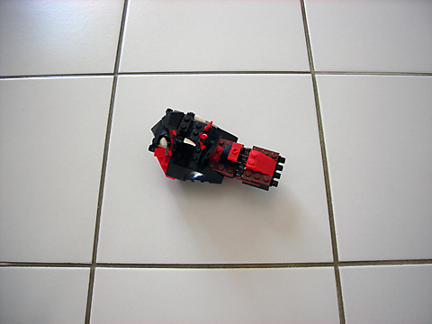

**Le cobra en cours de montage 2**

Le corps-queue du venimeux reptile, assez basique, tranche avec les efforts déployés précédemment.

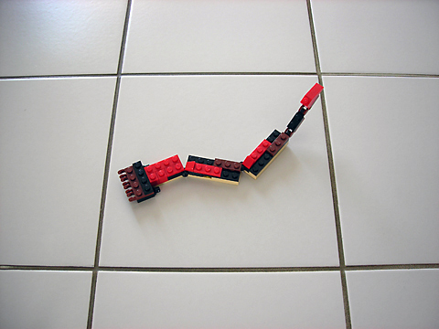

**Le cobra en cours de montage 3**

Ah ! Il en reste.

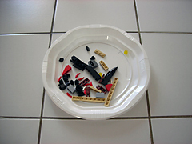

**Il y a plus de restes cette fois-ci**

Quel dommâge ! Comme quoi la couleur a une incidence considérable sur l’impact d’une création. Ce modèle ne dégage pas la dynamique et l’agressivité que devait lui conférer la conception léchée de sa tête.

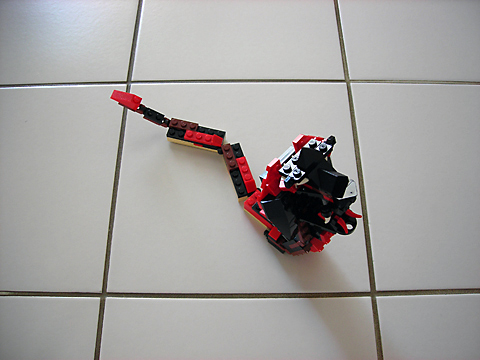

**Le cobra - Vue 1**

Je suis un piètre photographe (ah ! la capture de la lumière...), mais quel que soit l’angle de prise de vue, le faciès du cobra semble obscurci, éteint...

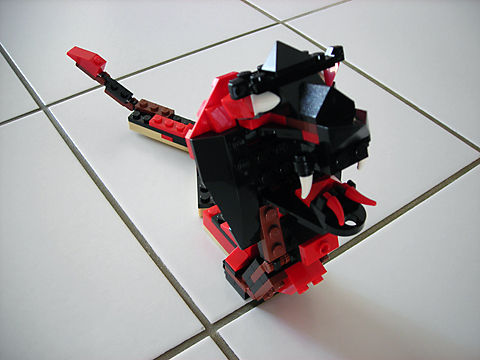

**Le cobra - Vue 2**

Ce modèle est une vraie déception. Tout les ingrédients pour en faire une belle création étaient réunis. Mais c’est râté, parce qu’illisible. Le mieux est l’ennemi du bien...

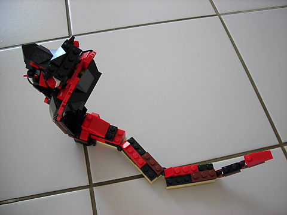

**Le cobra - Vue 3**

## Modèle 3 - L’insecte

On ne change pas une équipe qui gagne ; le dernier modèle se décompose également en sous-ensembles fondamentaux.

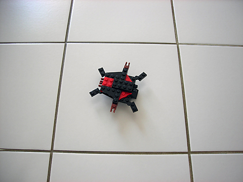

**L’insecte en cours de montage**

L’insecte prend, tout comme l’araignée, rapidement de l’ampleur. Mais l’impact n’est pas aussi intense que pour l’araignée.

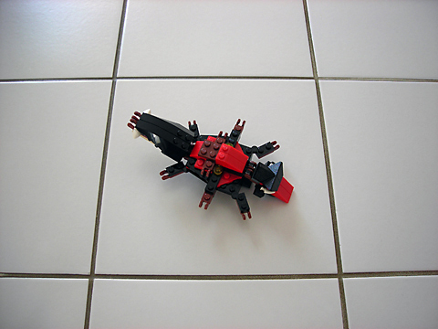

**L’insecte en cours de montage 2**

Attardons-nous sur cette technique de montage (que j’utilisais très souvent enfant) permettant de réaliser des charnières à l’aide d’un sandwich de plaques fines. Il est rare de voir ce type d’astuce dans un set officiel, LEGO préférant céder à la facilité en optant pour des pièces spécifiques. C’est un détournement de pièces simple et très efficace pour pallier un manque de pièces dédiées. Un très bon point.

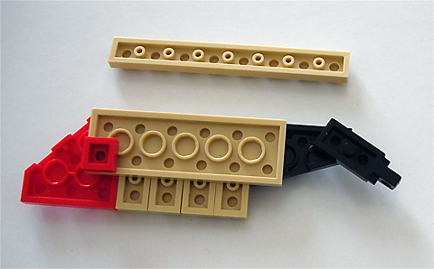

**Une astuce de montage très utilisée dans ce set**

On se rend compte à quel point l’araignée était gourmande en briques ;-)

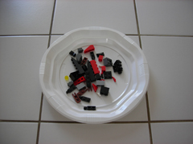

**Il reste à peine plus de pièces qu’après le montage du cobra**

Cet insecte monstrueux me fait penser à ceux qui évoluent dans les films de série B de la TOHO, notamment les innombrables Godzilla et consorts. Bzzz !

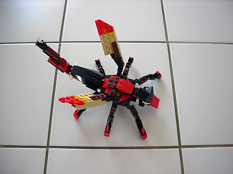

**L’insecte - Vue 1**

Le modèle - quoique un cran en-dessous de l’araignée - est digne de figurer aux palmarès des créatures monstrueuses. Revers de l’astuce des charnières en plaque, les ailes sont un poil épaisses.

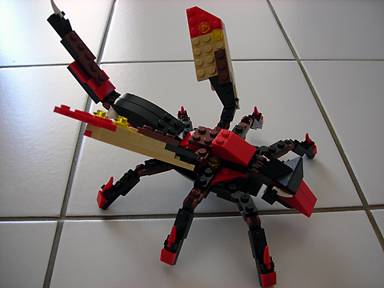

**L’insecte - Vue 2**

L’insecte, d’une conception moins complexe et originale que celle du cobra, est cependant bien mieux rendu que lui.

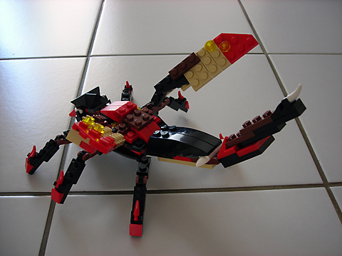

**L’insecte - Vue 3**

## Ma notation

-   **L’araignée : 9,5/10**
-   **Le cobra : 6/10**
-   **L’insecte : 7,5/10**

Avec une moyenne de 7,67/10 que j’arrondis à 8/10 (pour récompenser cette jolie boîte à vocation pédagogique), ce set 4994 tire bien son épingle du jeu. Essentiellement grâce à l’araignée qui le booste, et qui est à mon avis le seul modèle mémorable. Mais tout ne réside pas là...

## Je crée, tu crées, il creator !

Si les cahiers de vacances seront bientôt de sortie, rassurez-vous, il n’est pas question ici de réviser vos conjugaisons ! Seulement de jouer le jeu de la création et d’aller jusqu’au bout de la logique...

Les sets Creator dont je fais l’acquisition me servent essentiellement de banque de pièces, une fois les différents modèles assemblés. Je ne conserve en l’état que les modèles les plus significatifs, et joue assez rarement avec le contenu même de la boîte.

Ce qui est regrettable, c’est la distance qui s’instaure - l’âge et l’augmentation de ses ressources aidant - avec la modestie de l’enfance. Quand, disposant de peu de briques, vous vous appliquez à faire beaucoup avec pas grand chose. Quand vous recombinez inlassablement la petite boîte qu’on vous a offerte en attendant la tournée annuelle du Papa Noël. Quand vous créez, tout simplement :-)

Voyons donc ce qu’en seulement quelques minutes je suis capable de faire avec ce petit tas de briques !

**MOC de scorpion**

La thématique du set a déteint sur les premières idées de constructions qui me vinrent à l’esprit. Avouons également que la palette de briques, très spécifique (les charnières crantées notamment), incite instinctivement à la création de trucs patteux ou tentaculaires...

Je n’y ai consacré qu’un quart d’heure montre en main. C’est un petit jeu assez sympa qui gagnerait à se généraliser lors des réunions d’AFOLs :-)

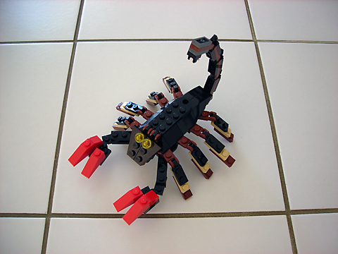

**MOC Scorpion - Vue 1**

Affamé, il vient de capturer une proie.

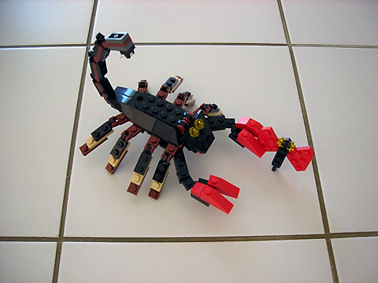

**MOC Scorpion - Vue 2**

Les dessous de la bête.

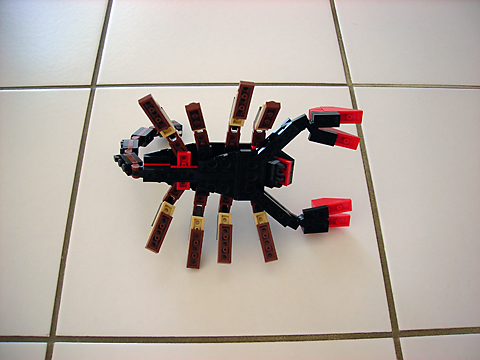

**MOC Scorpion - Vue 3**

Avec quelques modifications, on pourrait aisément le convertir en homard (en récupérant les plaques triangulaires du papillon pour en réaliser la queue). Un calamar m’a également titillé avant que je n’opte pour ce scorpion.

**Bon, ben... à vous maintenant ! ;-)**
