A l’heure des polémiques qu’engendre [la sortie de l’exceptionnel et fort onéreux Faucon Millenium UCS](https://www.freelug.org/spip.php?breve254), j’ai choisi de vous faire partager le montage d’un set Star Wars original, riche de fonctionnalités... et relativement abordable !

60 euros. C’est la somme qu’il vous faudra débourser pour acquérir le vaisseau de Boba Fett version 2006 (une première version fut produite par LEGO en 2000, [la référence 7144](http://guide.lugnet.com/set/7144), un autre en 2002 [la référence 7153](http://guide.lugnet.com/set/7153) en livrée Jango Fett, le père de l’autre ! Star Wars... c’est Dallas en apesanteur...), vu dans l’Episode V - "L’empire contre-attaque". On est loin des montants à trois chiffres qui deviennent monnaie courante - c’est le cas de dire :) - chez LEGO dès qu’on évoque la thématique Star Wars.

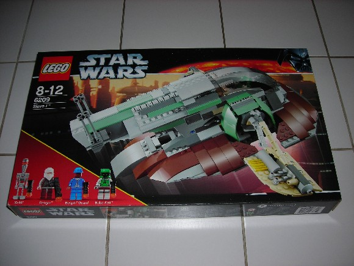

**La boîte**

**Le montage**

Set 6209 - 537 pièces - Année 2006

La boîte ouverte révèle 9 sachets, des poutres et des plates en vrac (curieux pour ces dernières...), une immense verrière fumée de cockpit et la notice (pfff... on peine toujours autant à distinguer le noir du gris foncé !).

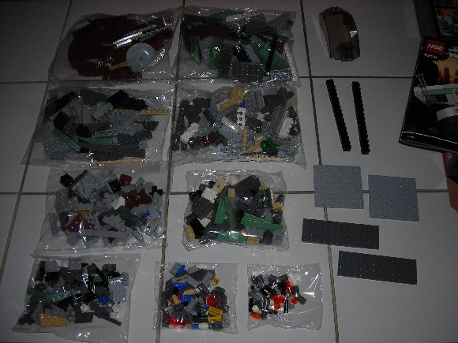

**Le contenu de la boîte**

Comme de coutume, la notice débute avec l’assemblage des minifigs, 3 en l’occurrence : Boba Fett, Fendar (pourquoi lui ?!) et un garde anonyme de la cité aérienne Bespin. A noter la présence d’IG-88 (doit-on le considérer comme une minifig...) un droïde métallisé du plus bel effet, et d’une brique représentant Han Solo prisonnier de son caisson de carbonite. C’est beaucoup. C’est bien !

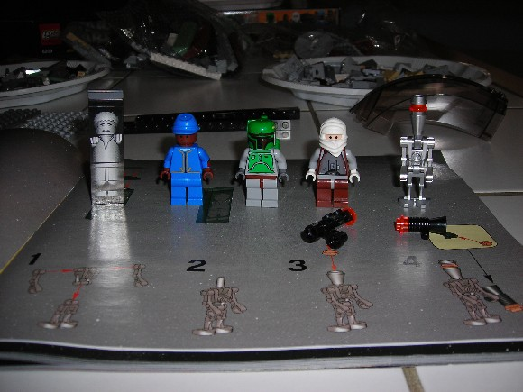

**Les minifigs**

Je ne m’éterniserai par sur le montage. Il est rapide, trop rapide, comme toujours :). L’essentiel de la structure du vaisseau est composé de méta pièces. Notez que les coloris employés sont peu courants dans la représentation traditionnelle des vaisseaux spatiaux ! J’apprécie toutefois cette touche d’exotisme assez harmonieuse.

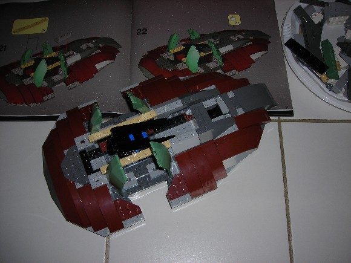

**En cours de montage n°1**

Le dessous de l’engin a été particulièrement soigné. La raison en est simple : le Slave est un vaisseau à inclinaison variable ; ce dessous deviendra en vol un arrière...

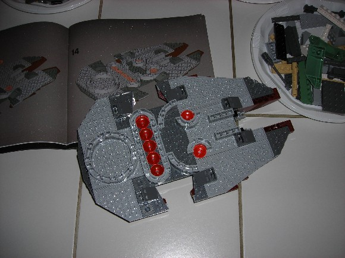

**En cours de montage n°2**

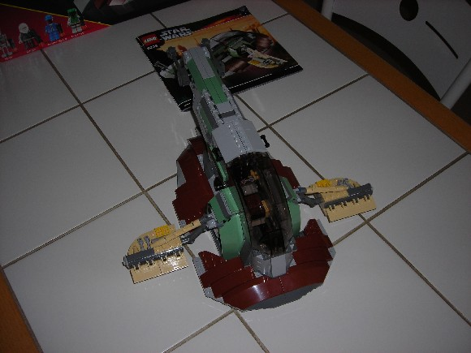

**Le modèle achevé**

**Alors, il vole ce fer à repasser ?!**

Oui ! Et bougrement bien.

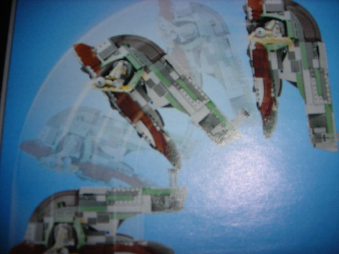

**Le slave, ça vole comme ça !**

C’est là toute son originalité : un vol à inclinaison variable. Posé sur sa semelle de fer à repasser, il bascule progressivement à la verticale. Subtil raffinement, le siège du pilote suit l’inclinaison qui est imprimée aux ailettes stabilisatrices en fonction des différentes phases de vol, pour une visibilité totale depuis le poste de pilotage !

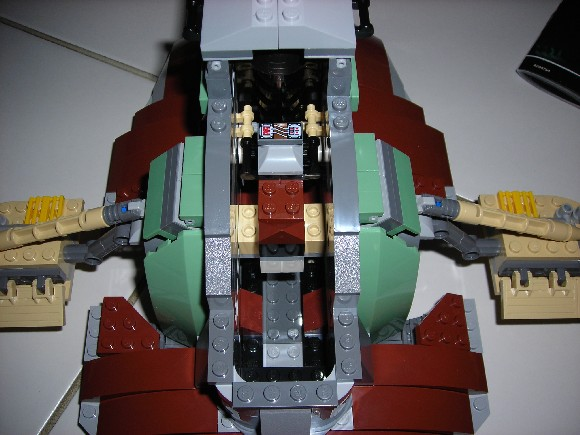

**Avant basculement...**

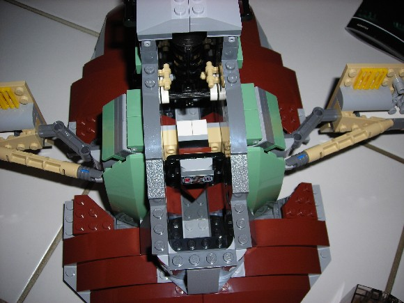

**... Après !**

Si le modèle ne paie pas de mine à première vue, ses entrailles regorgent de fonctionnalités. Un festival ! LEGO a clairement choisi de privilégier l’aspect ludique qui plait tant aux enfants sans pour autant nuire au réalisme du vaisseau qui est bluffant.

Des mécanismes simples mais bien pensés :

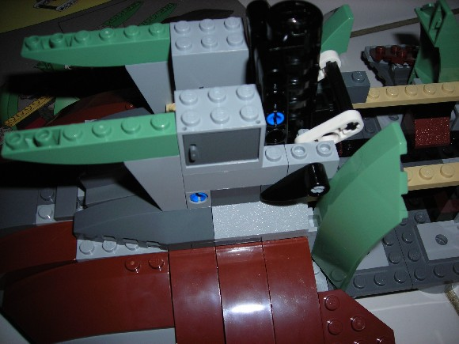

**Détail d’un mécanisme**

Au programme : des compartiments et des trappes à gogo, garnis d’armes en tout genre pour pasteuriser tout ceux qui oseront barrer votre route de féroce chasseur de primes !  
Entre autres : le lanceur de missile à ressort que l’on retrouve de plus en plus fréquemment dans les sets et la trappe de bombardement.  
Vous pourrez rejouer toutes les scènes de l’Episode V, notamment grâce à la soute qui peut contenir le sarcophage de Han Solo.

Laissons parler les photos...

Des canons rotatifs, des leviers de manoeuvres et de déclenchements : du beau travail !

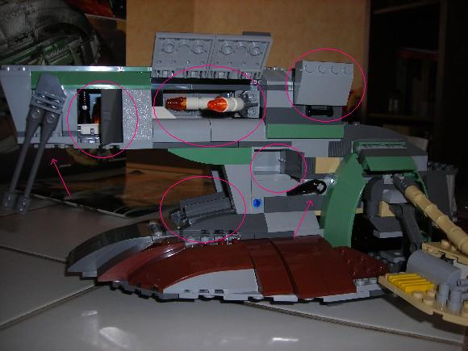

**Un vaisseau bourré de fonctionnalités !**

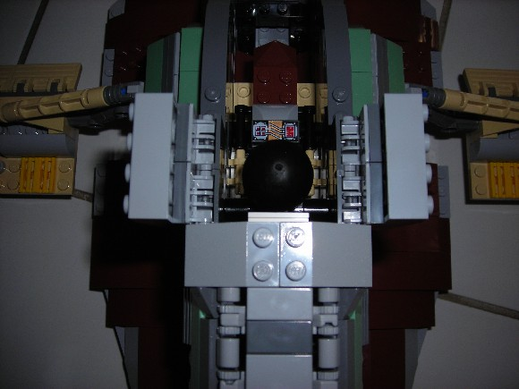

**Oeil au beurre noir en perspective !**

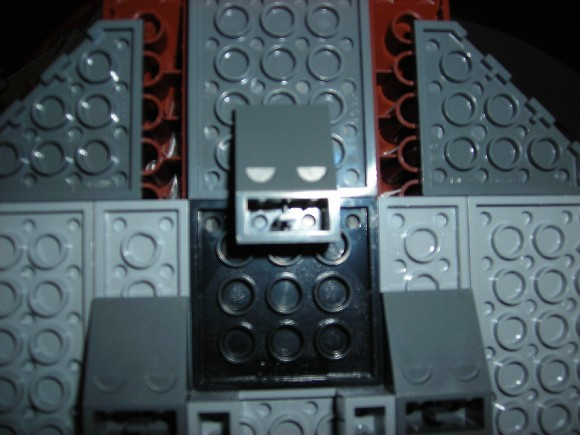

**La trappe de bombardement...**

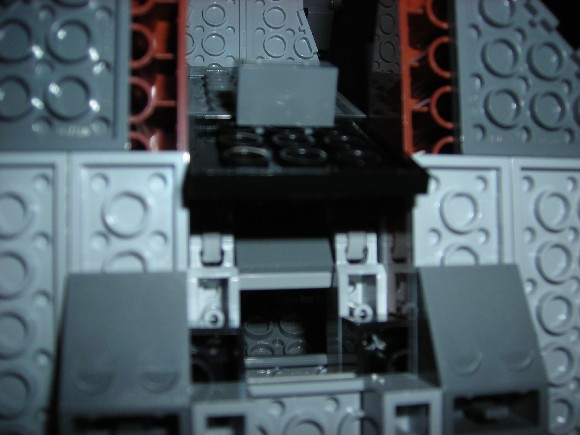

**... Boom !**

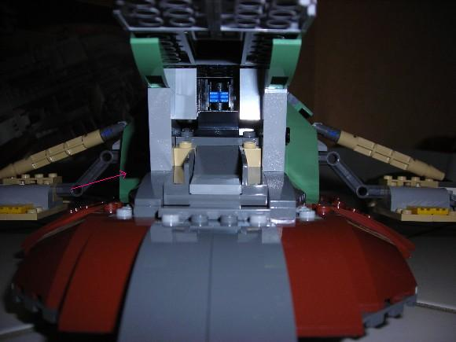

**La soute qui abrite Han Solo carbonité !**

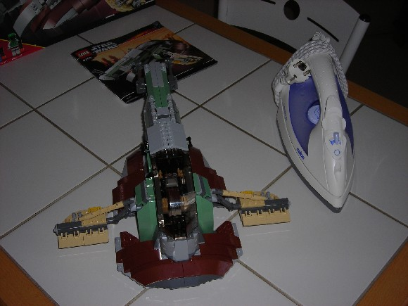

**Episode VII : Slave 1 contre Supergliss 40 !**

**En conclusion...**

Un joli set Star Wars, d’un rapport qualité prix plus que convenable, d’une grande originalité et débordant de gadgets ludiques qui laissent augurer de longues heures de batailles spatiales ! Il est simplement dommage que cet engin particulièrement réussi - mais trop peu "médiatisé" - ne soit pas plus prisé des enfants. Ils y trouveraient amplement leur compte... comme moi !
