Allez ! Au placard les Knight Machin-bidule et autres joyeusetés peu inspirées de ces dernières années ! La fournée médiévale 2007/2008 de la firme danoise est d’une richesse et d’une originalité stupéfiante ! Un virage qualitatif providentiel dans la foulée de celui prit par la gamme City.

Gros plan sur un set d’entrée de gamme : L’attaque à l’arbalète.

## Présentation

**Fiche signalétique**

-   Set : 7090 - L’attaque à l’arbalète (Crossbow Attack)
-   Gamme : [Castle](http://shop.lego.com/ByTheme/Leaf.aspx?cn=473&d=70)
-   Année : 2007
-   Nombre de pièces : 54 dont 3 minifigs ([inventaire Peeron](http://www.peeron.com/inv/sets/7090-1))
-   Prix moyen constaté : 5,99 €

**La boîte**

Ah ! Voilà une boîte comme je les aime ! Elle est superbe ! Le graphisme thématisé est une véritable pièce d’orfèvrerie. J’ai passé un long moment à contempler ce travail de pro... J’ai encore du pain sur la planche pour réaliser un montage de cette envergure ;-)

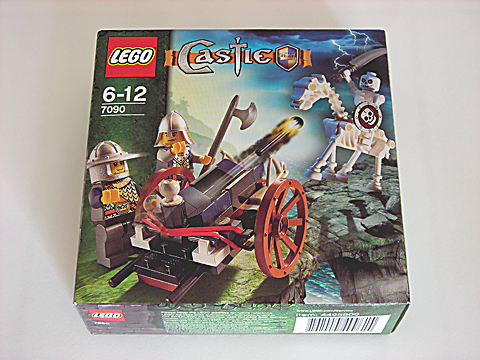

**Recto**

Le verso, dans la même veine, met l’accent sur l’aspect ludique du set qu’incarnent l’arbalète fonctionnelle sur affût et les minifigs armées jusqu’aux dents.

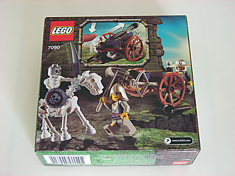

**Verso**

**Le contenu de la boîte**

L’ouverture révèle deux petits sachets transparents non numérotés et la notice.

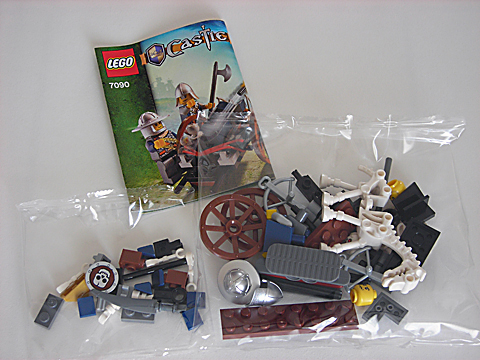

**Contenu**

La notice est claire et ne recèle aucun piège. Une fois n’est pas coutume, on y distingue facilement le gris foncé du noir. Elle ne manque pas de reprendre à sa fin l’inventaire des pièces utilisées.

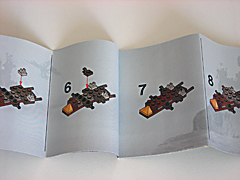

**Notice**

Le montage s’articulera autour de deux grands axes : les minifigs et l’arbalète sur affût.

**Les minifigs**

C’est une tradition chez LEGO, tout commence par l’assemblage des minifigs. Elles sont au nombre de trois : deux fantassins et un squelette.

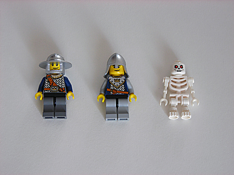

**Minifigs**

Le look général est plutôt flatteur. La diversité des casques et des motifs décoratifs est une bonne chose et tend à rendre ce petit set encore plus riche. Les torses sont finement tampographiés. Je ne me fais hélas aucune illusion sur la tenue dans le temps des teintes métallisées...

Le squelette est un modèle de nouvelle génération, avec des bras (enfin !) stables permettant le maniement d’ustensiles. L’expression faciale est glaçante, un point qui ravira les enfants.

**Les armes**

De nombreuses armes sont à la disposition des protagonistes : deux arbalètes et une hallebarde pour les fantassins, un sabre et un bouclier rond (bien dans le ton !) pour le squelette.

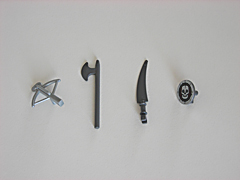

**Armes**

**Le cheval**

Un cheval squelette fait son apparition ! Il reprend le gabarit et la posture du traditionnel destrier LEGO né avec la gamme médiévale de 1984.

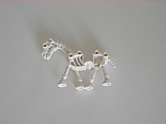

**Cheval**

Je regrette beaucoup qu’avec le passage de vie à trépas il ait perdu la seule articulation (jugulaire) qu’il possédait. Des membres mobiles auraient magnifiés la bête... Mais je ne doute pas qu’il plaira beaucoup aux enfants, le duo cheval/cavalier étant "destroy" à souhait !

**L’arbalète sur affût**

Dans ce type de set à petit prix, on retrouve souvent un petit décor symbolique. Quelques briques de murailles ou de fond sous-marin...

Ici, il n’en est rien. LEGO laisse le soin d’imaginer le champ de bataille. Tout se concentre sur l’aspect guerrier, en offrant aux fantassins une arme lourde permettant de repousser les hordes de belliqueux squelettes.

Il s’agit d’une arbalète sur affût, fonctionnelle grâce à un très simple mais très efficace mécanisme élastique. Seul le système de guidage du projectile m’est apparu un peu léger.

Son montage se fait en 14 étapes, certaines ne requérant que l’ajout d’une seule brique !

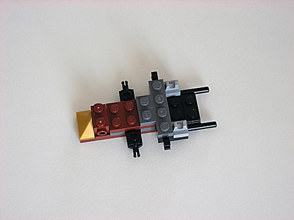

**Etape 8**

On arrive bien vite à l’étape 14 !

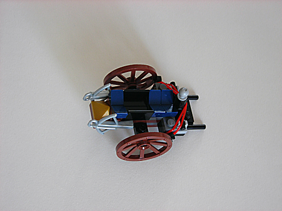

**Etape 14**

_Un bémol : les roues affleurent au point de toucher les pièces crochets qui servent à tendre l’élastique._

Je vous ferais grâce des recommandations d’usage sur le "netirsurtoupadanloeildetoncopain" que la notice reprend à juste titre. Le mécanisme de tir fonctionne parfaitement, malgré la précision médiocre induite par le guidage sommaire. La portée est d’environ 100 coudées-tenons de l’époque ;-)

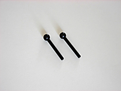

**Projectiles**

## En conclusion

Le rapport prix/qualité/plaisir est ENORME ! Son acquisition est bien plus avantageuse que celle de la petite [boîte impulse 5615](http://shop.lego.com/ByTheme/Product.aspx?p=5615&cn=473&d=70) disponible depuis peu pour 2,99€. Trois minifigs dont un squelette et sa monture pour 5,99 €, il n’y a vraiment pas photo !

Ce set modique ne manquera pas de subjuguer les enfants qui souhaitent mettre un pied dans l’univers médiéval de LEGO. Les AFOLs quant à eux s’en constitueront de faramineuses armées !

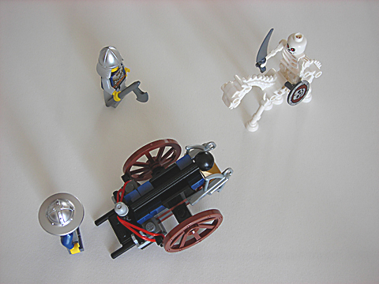

**Vue d’ensemble**

Je vous laisse admirer quelques vues rapprochées.

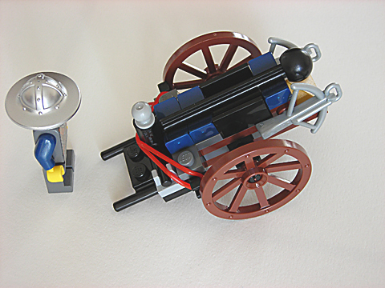

**Détail 1**

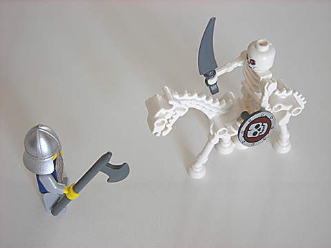

**Détail 2**

**Un petit set réjouissant, que j’avais à l’origine acheté en plusieurs exemplaires pour pièces et qui, finalement, m’a donné l’envie de replonger dans le Castle :-) La dernière collection que j’avais acquis en 1984 avant de sombrer dans un darkage prolongé :-(**
