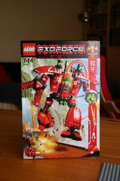
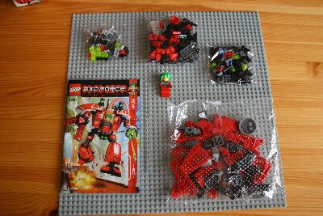
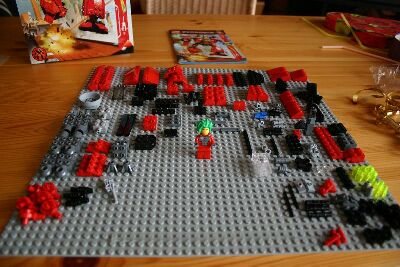
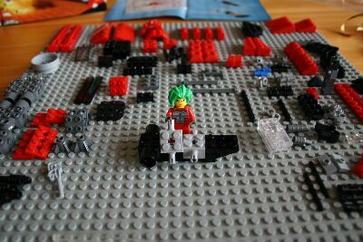
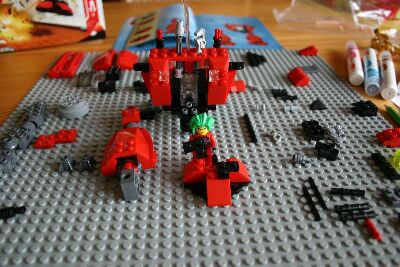
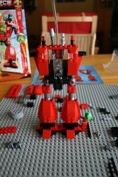
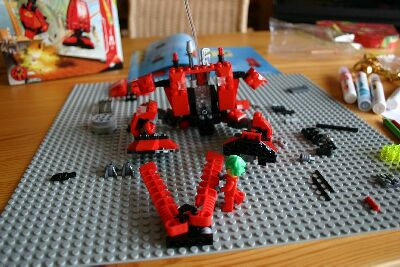
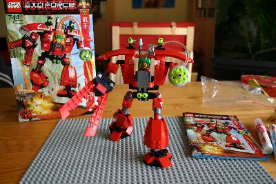

Vous l’aurez tous remarqué, les nouveaux sets EXO-FORCE ont envahi les rayons de nos magasins habituels. Impossible d’y échapper. Alors découvrons ensemble ce que cachent ces nouvelles boites en relief.

Pour ce faire, j’ai choisi le set 7701 « Traqueur Titan ». Après ouverture de la boite, nous sommes face à 4 sachets de pièces et la minifig de Takeshi, le jeune pilote de ce robot EXO-FORCE et bien sûr de la notice.

Après avoir assemblé la minifig, ouvrons les sachets afin d’aider notre jeune pilote à construire son robot de combat.

La construction débute par le corps du robot et la mise en place de la fameuse brique lumineuse source d’énergie de ces valeureux robots.

Une fois le corps fini, notre petit héros s’attaque aux jambes de la bête et là que de travail :

Voilà, les jambes et le torse du robot sont assemblés. On remarque déjà la taille conséquente du robot par rapport à la minifig.

Une fois le robot assis (oui je sais j’aurai pu fournir une nacelle pour l’aider dans sa tâche), Takeshi assemble les bras, la pince à impulsions électromagnétiques (les plus observateurs auront repéré les pièces Bionicle) et surtout son canon laser rotatif !

Plus que le cockpit à mettre en place et voilà le Traqueur Titan prêt pour le combat.

Voilà un set qui se monte facilement et qui ravira les amateurs de mangas, seul petit bémol enfin pour moi, la matière dont est faite la coiffe est un peu trop souple, idéal pour son style de coiffure mais attention de ne pas la perdre lors des combats acharnés.

C’est tout, à vous de jouer maintenant.

Le [reste des photos](http://photos.freelug.org/v/Gyclore/Sets/7701) sur la galerie.

## Fiche technique

**–** Année de sortie : 2006  
**–** Nombre de pieces : 196  
**–** Prix : 14,99 Euros  
**–** liens utiles

-   Lugnet : [http://guide.lugnet.com/set/7701](http://guide.lugnet.com/set/7701)
-   Peeron : [http://www.peeron.com/inv/sets/7701-1](http://www.peeron.com/inv/sets/7701-1)
-   Shop@Home : [http://shop.lego.com/product.asp?p=7701](http://shop.lego.com/product.asp?p=7701)
-   Site officiel : [http://exoforce.lego.com/default.aspx](http://exoforce.lego.com/default.aspx)
