Exploitant le juteux filon du Tuning, LEGO étoffe son parc de bolides rugissants... pour notre plus grand bonheur ! Nouveau-né dans la généalogie des « Nitro » de la gamme Racers, ce Nitro Muscle ne déroge pas à une recette qui a fait ses preuves : aggressivité et outrance ! En avant-première (le set sera disponible sous peu dans le commerce), voyons ce que la bête a dans le ventre, euh pardon ! sous le capot...

Référence : 8146 - Nitro Muscle / Racers

Année : 2007 (disponible à partir de Juillet/Août)

Nombre de pièces : 598

Prix moyen (sous réserve) : 59,99 €

**La boîte**

Ambiance de Run nocturne prohibé.

Elle arbore le traditionnel graphisme de la gamme Racers, habillage de carbone à fibres tressées et logo à damiers que contraste ici un flammé typiquement Tuning reprenant les coloris rouge et jaune du modèle. L’immersion dans l’univers du délire mécanique, de la vitesse hors-la-loi et de la frime est bluffante. L’odeur de la gomme brûlante nous chatouille déjà les narines !

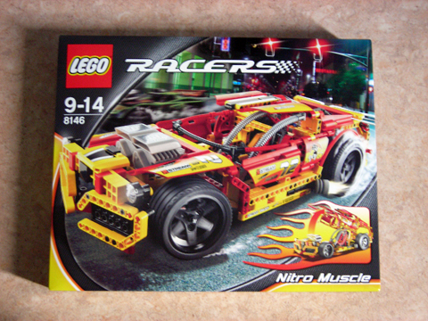

**Le recto...**

Le verso dévoile quant à lui les fonctionnalités principales du modèle : train avant directionnel et carrosserie basculante. Remarquons qu’aucuns modèles alternatifs ne sont suggérés...

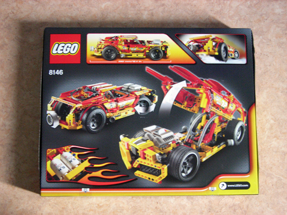

**... et le verso**

Les sensations induites par le packaging accentuent l’excitation qui précède l’ouverture de la boîte ! Mission réussie !

**Le contenu**

La boîte recèle 11 sachets non numérotés, 4 jantes et 2 paires de pneus de diamètres différents en vrac, une planche d’autocollants métallisés et une épaisse notice.

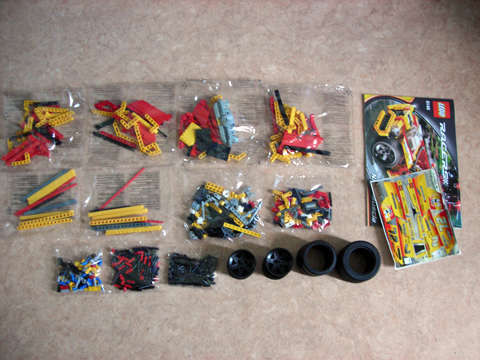

**Le contenu de la boîte**

Ce set n’étant pas encore inventorié par des sites dédiés tel [Peeron](http://www.peeron.com/), je me lance dans le comptage des pièces qui le composent, sur la foi de l’inventaire imprimé en toute fin de notice. Une initiative toujours aussi utile pour les AFOLs qui souhaitent acquérir des pièces supplémentaires auprès du Depan’ Order, le service de pièces détachées de la société LEGO.

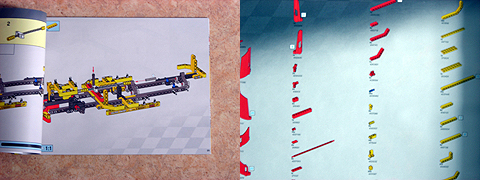

**Le traditionnel inventaire des pièces**

Comme le laissait deviner la boîte, les pièces sont essentiellement issues de l’univers Technic, complémentées ici ou là de méta pièces spécifiques.

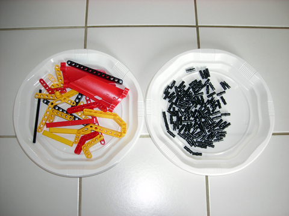

**Des pièces essentiellement Technic**

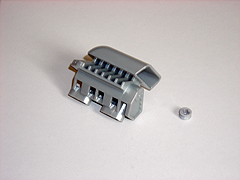

**L’une des deux méta pièces V8**

C’est là une des particularités de la gamme Racers, vaste et hétéroclite (elle compte notamment des véhicules à rétro friction !), alliant des modèles aux structures conventionnelles tels les Tiny ou les Roadsters Ferrari à des engins dont on se demande parfois pourquoi la firme danoise ne les a pas estampillés Technic ?!

La transversalité des banques de pièces est devenue courante ces dernières années, ainsi l’utilisation d’engrenages Technic au sein d’un set Harry Potter par exemple ! Convenons qu’une brique judicieuse est une brique judicieuse, quelle que soit son origine. Néanmoins, la frontière entre certains sets Racers et Technic est des plus floues, même si les premiers ont de toute évidence des fonctionnalités et un potentiel de reconversion moindre.

**Le montage**

Constitué de 44 étapes principales et d’une kyrielle d’étapes intermédiaires, il est de type semi modulaire ; à savoir que l’on assemble des séries de modules fondamentaux indépendants ou liés entre eux, très souvent appairés. Pas moins de deux grosses heures de travail.

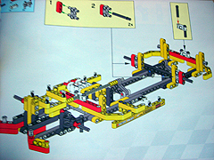

**Gros plan sur la notice de montage**

Peu de difficultés en perspective. L’assemblage du Nitro Muscle ne fait appel à aucunes techniques qui ne soient déjà parfaitement connues et maîtrisées par un AFOL.

Je vous laisse découvrir divers clichés du modèle en cours d’assemblage.

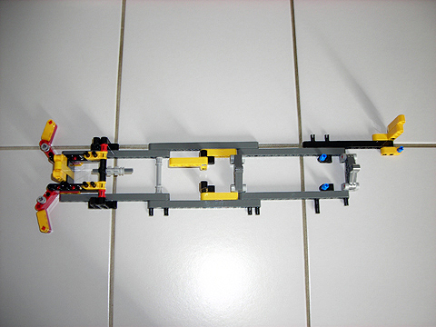

**Etape 15**

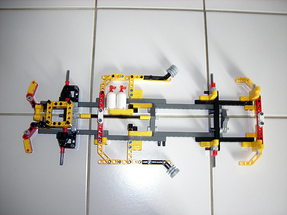

**Etape 30**

Si le modèle possède un train avant directionnel, le volant de l’habitacle est cependant fictif. Le contrôle, renvoyé à l’arrière de la voiture, s’opérant grâce à une molette (une jante, disproportionnée hélas) solidaire d’un arbre traversant le châssis de part en part jusqu’à un classique ensemble crémaillère/fusées. Convenons que l’ensemble de renvoi aurait mérité une intégration plus discrète...

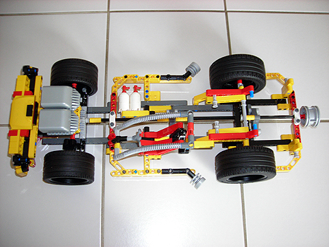

**Etape 43**

La carrosserie est à l’image de la plupart des créations d’influence Technic contemporaine : « suggestive ». Elle ne recouvre pas entièrement le châssis comme d’autres véhicules Racers ou Creator en utilisant des briques, mais se contente de suggérer des formes par l’emploi de poutres, de tubes flexibles et de méta pièces typées désormais bien connues. Ainsi ajourée, la carrosserie permet d’apprécier plus aisément les divers détails et fonctionnalités internes, ici fort peu nombreux au demeurant.

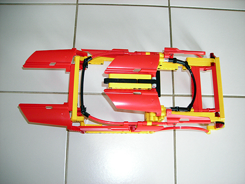

**La carrosserie**

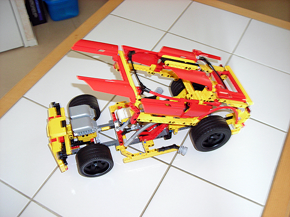

**Ca bascule !**

Le basculement de la carrosserie pourra sembler déroutant aux novices. C’est néanmoins un artifice courant dans l’univers du sport automobile Made In USA (qui a plausiblement influencé les Masterbuilders de Billund). Comme en Nascar (l’équivalent de nos courses de « Production »), point de capot ! Pour accéder à la mécanique, on soulève tout !

_Attention :_

_La pose des autocollants (que je rechigne habituellement à appliquer hors rédaction d’articles) de grandes surfaces requiert toujours autant de soins et de dextérité pour éviter déchirures et bulles malséantes. Sueurs froides garanties !_

Arf ! Les autocollants, l’éternel dilemme de l’AFOL... Appliqués, ils ont le désavantage d’hypothéquer le versement de la pièce dans une autre construction ; de même l’impossibilité de recouvrir la décoration originale en cas de décollement. Néanmoins, j’admets que ce type de set, compte tenu de son esprit, ne saurait en faire l’impasse pour un rendu optimal.

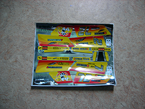

**Une planche d’autocollants métallisés**

N’hésitez pas à commander une deuxième planche au Depan’ Order !

**Planquez votre permis à points !**

Notre Nitro Muscle achevé a fière allure. Une vraie bête de « Run » !

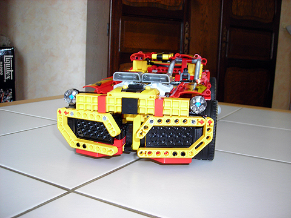

**Vue 1**

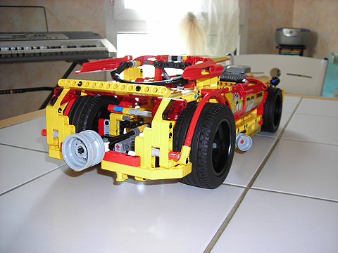

**Vue 2**

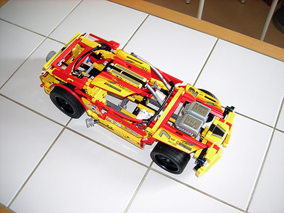

**Vue générale**

Certains des accessoires qui équipent notre bolide des rues (les bonbonnes de N2O par exemple !) feraient dresser les cheveux du personnel des Mines !

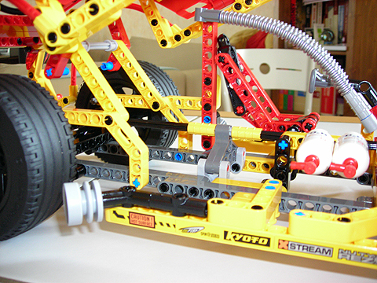

**Détail 1**

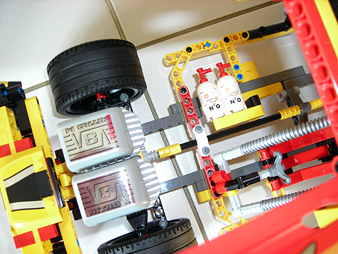

**Détail 2**

_Deux bémols :_

_Dommage que la calandre soit aussi brouillonne et massive, et que les fonctionnalités nous laissent sur notre faim (pas de moteur à pistons, etc.)._

**En conclusion**

Si la conception et les galbes de ce Nitro Muscle ne sont pas d’une originalité renversante, c’est toutefois un modèle magnifique (au look certes très particulier, on aime ou on n’aime pas) et qui honore la vrombissante gamme Racers. L’engin est bien né ! Et il trouvera sans difficulté sa place sur une étagère de votre bureau ou dans une vitrine, à moins que vous ne décidiez de le cannibaliser pour étoffer votre banque de pièces Technic. A vous de choisir !
