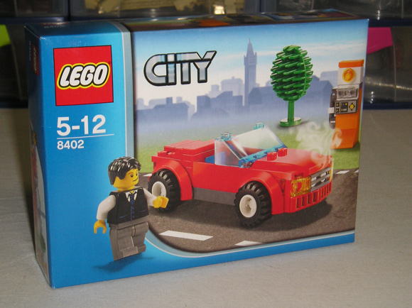
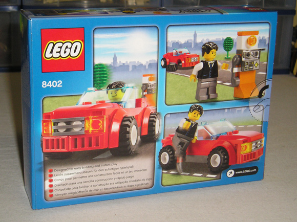
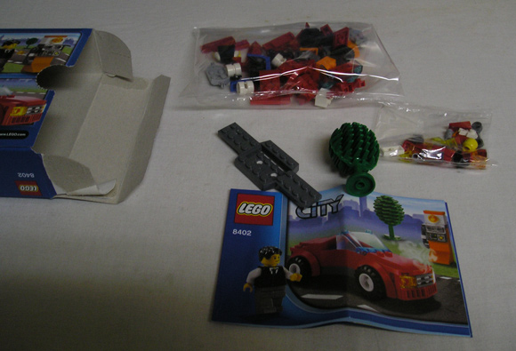
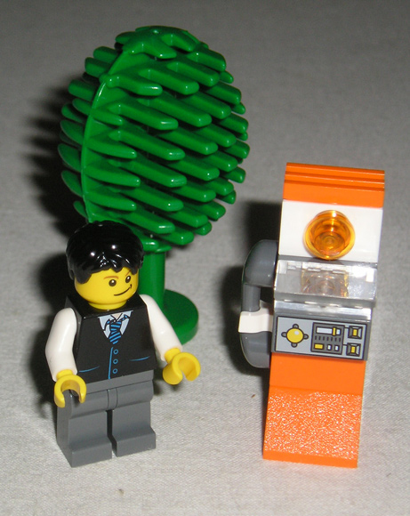
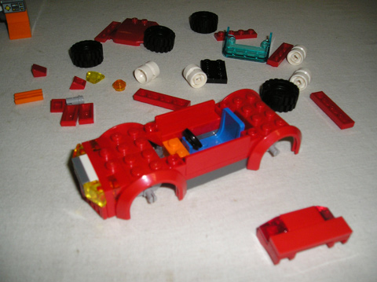
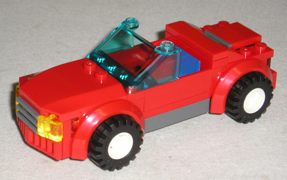
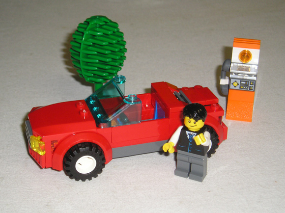
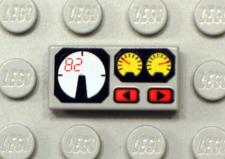
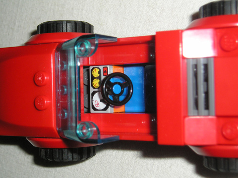
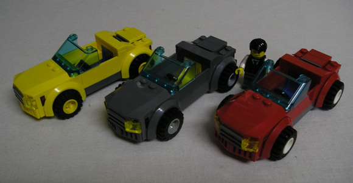

Une petite boîte, attrayante par la voiture rouge... mais qu’en est-il vraiment ?

## La boîte

**–** numéro du set : 8402  
**–** nom de la boîte : la décapotable  
**–** Gamme : CITY  
**–** Année : 2009  
**–** Nombre de pièces : 68  
**–** Nombre de Minifig : 1  
**–** Prix moyen constaté : 9€, [disponible sur le shop](http://shop.lego.com/ByTheme/Product.aspx?p=8402&cn=356&d=9#reviews)

**la boîte**

Une petite boîte, classique, on remarquera tout de suite la présence de l’arbre.

**l’arrière**

A l’arrière, classique aussi. Il est bien précisé que pour monter dans la voiture, notre Minifig devra faire un saut.

**le contenu...**

Dans la boîte, une notice avec deux sachets, le châssis et l’arbre ont été mis en vrac dans la boîte.

A noter tout de suite qu’il n’y a pas d’autocollant dans ce set !

## Le montage

Comme d’habitude, on commence par la Minifig, puis la borne d’appel d’urgence.

**Minifig + arbre + borne d’appel**

Ensuite on construit la voiture...

**en cours de montage...**

Rien de bien méchant. Donc on arrive vite à la fin du montage.

**la voiture finie**

Voici donc l’ensemble fini.

**manque plus que la dépanneuse....!**

Manque plus qu’à mettre le tout dans sa ville. Et puis à attendre la dépanneuse !

## Petit +

J’ai rajouté un tableau de bord dans la voiture, pour faire un peu plus réel.

**tableau de bord**

Elle est posée sur la brique 1x2 orange juste devant le volant.

**détail tableau de bord**

Et puis, en cherchant un petit peu parmi mes pièces, j’ai vu que j’avais la possibilité de faire des variantes en couleurs. Voici donc en plus de la rouge, une version en jaune et en Dark Bluish Grey.

**la famille...**

## Conclusion

Un petit set bien sympa à monter.

Une Minifig, un arbre, une borne d’appel et une voiture, un set bien complet.

Une belle Minifig, un homme avec une coiffure sympa. Mais on aurait surement préféré avoir une dame avec cette voiture en panne... ;-)

Pas d’autocollant, une bonne chose, mais on n’a pas de plaque d’immatriculation pour la voiture. On peut pas tout avoir ! ;-)

Bref, je vous conseille ce petit set, idéal pour compléter les rues de nos villes.
