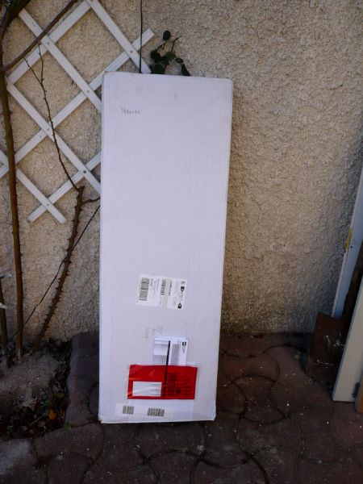
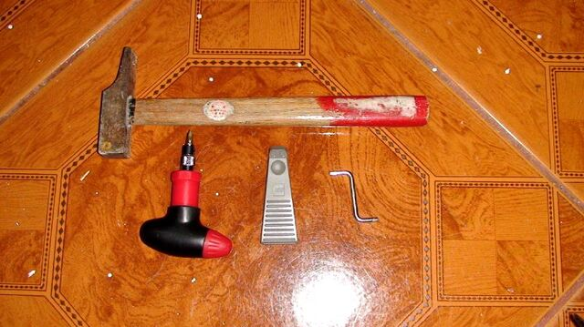
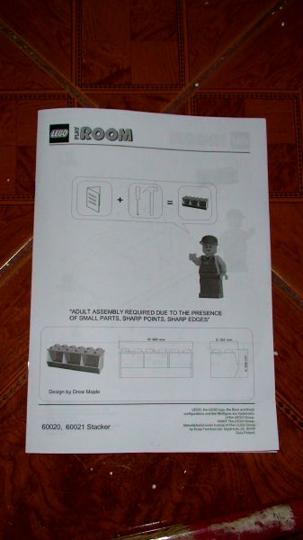
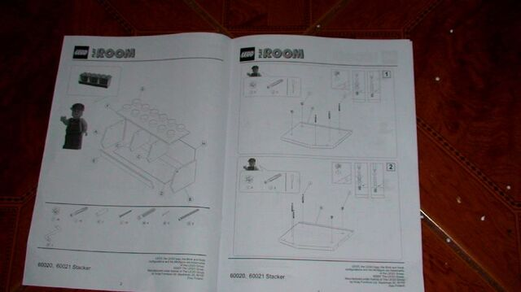
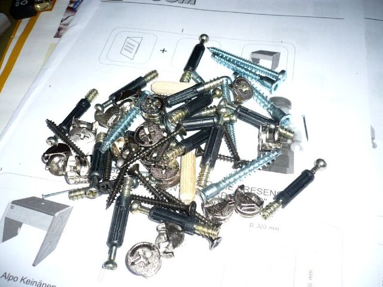
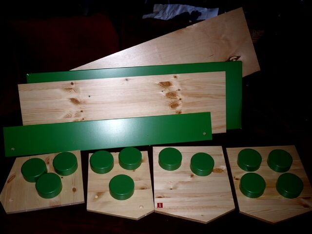
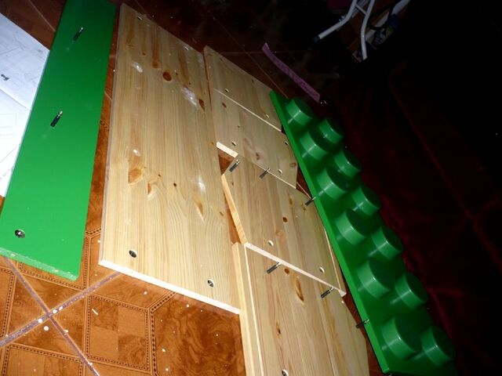
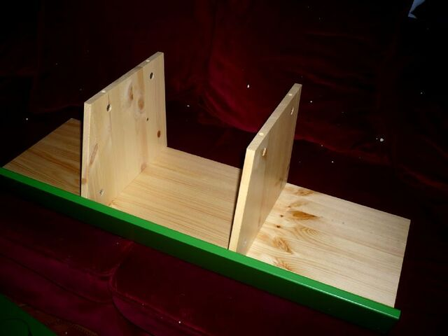
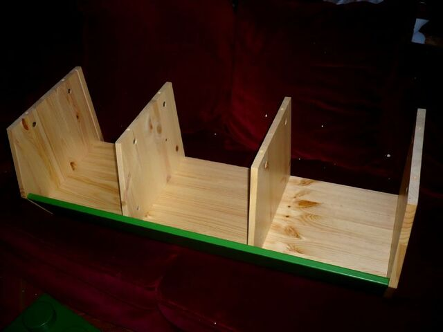
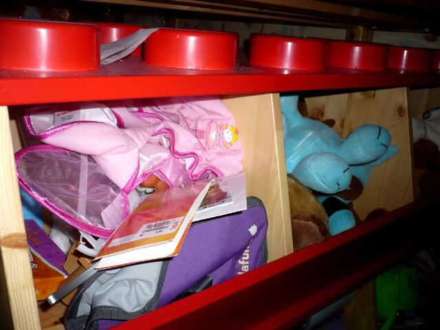

Ce set 60020 est contenu dans une des plus grande boite de chez LEGO.

Le rapport nombre de pièces par rapport à la taille de la boîte doit être l’un des plus petit.

Le matériel nécessaire à son montage est inhabituel :

Remarque : Il y a un intrus (Lequel ?)

La notice n’a pas la qualité habituelle :  
**–** Papier standard  
**–** Impression en noir et blanc

Bon un avantage, pas de risque de confondre les couleurs...

Comme souvent chez LEGO un sachet de petites pièces :

Le détail des pièces :

On assemble les petites pièces sur les grandes

La barre 2X6 demande beaucoup de tours de vis pour fixer les picots.

Montage des pièces étape par étape

Montage final en situation :

Un montage agréable et rapide. Nécessite beaucoup de place...

Les modèles peuvent être empilés et aussi décalés, dommage qu’ils n’existent pas en 2X3 pour monter des murs solides (Certains n’hésiteront peut-être pas à les modifier).

Un set surtout agréable pour le résultat fini, le montage lui n’est pas des plus agréable pour un AFOL.

Bois de bonne qualité, pas de l’aggloméré mais des lattes collées. Cela se ressent sur le poids.

Le prix normal était à mon avis trop important. Celui soldé plus qu’intéressant mais en quantité insuffisante...  
Comme souvent on regrette de ne pas en avoir acheté plus ;-)

J’espère que cette parodie d’article vous aura plu.

Question supplémentaire :  
Pour un concours de MOC ça compte pour combien de pièces ?
